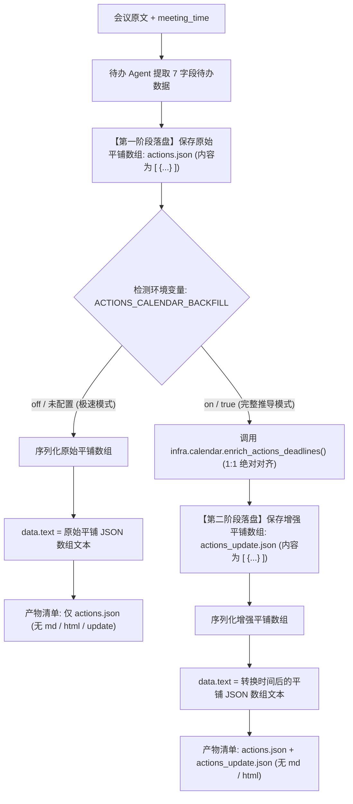

# 待办事项提取与日历时间绝对化回填落地执行清单 (平铺纯 JSON 产物版)

## 一、方案目标与定位

本方案针对待办任务线（`actions`）进行**纯平铺结构化数据交付**与**极简落盘**改造：
1. **剥离首层 actions 包装，纯平铺数组交付**：
   * `data.text` 返回值与本地 JSON 文件均**剔除外层 `{"actions": ...}` 嵌套**，统一为平铺的 JSON 数组：`[ {...}, {...} ]`。
   * 前端使用体验极简：`const list = JSON.parse(res.data.text)` 拿到即是数组，无需多层解包。
2. **彻底移除 Markdown 与 HTML 产物**：
   * 待办任务线彻底停用并豁免生成 `actions.md` 与 `actions.html`，砍掉冗余渲染，达成首字耗时优化。
3. **按开关精确落盘与返回**：
   * **开关关闭（`ACTIONS_CALENDAR_BACKFILL=off`，默认/极速模式）**：
     * `data.text` 返回**原始未转换的平铺 JSON 数组字符串**；
     * 磁盘**仅落盘原始待办文件 `actions.json`**；
     * **0 毫秒额外耗时，0 额外 Token**。
   * **开关开启（`ACTIONS_CALENDAR_BACKFILL=on`，完整推导模式）**：
     * `data.text` 返回推导绝对时间后的**增强型平铺 JSON 数组字符串**；
     * 磁盘同时落盘两份文件：
       1. 原始文件：`actions.json`（原始 7 字段平铺数组，保留事实凭据）；
       2. 更新文件：`actions_update.json`（回填绝对时间后的平铺数组）。

---

## 二、双态开关机制与产物输出矩阵



### 两种状态下的输出与文件保存矩阵

| 维度 | `ACTIONS_CALENDAR_BACKFILL=off` (关闭/默认) | `ACTIONS_CALENDAR_BACKFILL=on` (开启) |
| :--- | :--- | :--- |
| **API `data.text` 内容** | **原始平铺 JSON 数组字符串** `[ {...} ]`<br>（deadline 为原文） | **增强型平铺 JSON 数组字符串** `[ {...} ]`<br>（包含 ISO 时间戳与 `deadline_display`） |
| **磁盘落盘文件 1** | ✅ `actions.json`（平铺 JSON 数组） | ✅ `actions.json`（平铺 JSON 数组备份） |
| **磁盘落盘文件 2** | ❌ **不生成** `actions_update.json` | ✅ **生成** `actions_update.json`（平铺 JSON 数组） |
| **Markdown 文件** | ❌ **不生成/不保存** `actions.md`（或 `result.md`） | ❌ **不生成/不保存** `actions.md`（或 `result.md`） |
| **HTML 页面** | ❌ **不生成/不保存** `actions.html` | ❌ **不生成/不保存** `actions.html` |
| **额外开销** | **0ms 耗时，0 Token** | 仅规则引擎/微批推导（~0.2s - 1.0s） |

---

## 三、文件与数据契约规范（纯平铺 JSON 数组）

### 3.1 原始待办文件：`actions.json`（平铺 7 字段）
无论开关开启或关闭，待办 Agent 生成后均原汁原味留存一份事实凭据。**外层无任何键包装，直接是数组**：
```json
[
  {
    "title": "涡轮机运行确认",
    "item": "EPC需提供合同确认函，确认涡轮机可运行",
    "owner": "EPC",
    "deadline": "明天下午",
    "collaborators": "李四",
    "acceptance_criteria": "涡轮机可运行",
    "dependency": null
  },
  {
    "title": "测试用例编写",
    "item": "补充边界测试用例",
    "owner": "王五",
    "deadline": null,
    "collaborators": null,
    "acceptance_criteria": null,
    "dependency": null
  }
]
```
*全场无待办时内容为：`[]`*

### 3.2 增强待办文件：`actions_update.json`（仅在开关开启时生成）
保留原 7 字段的基础上，回填 `deadline_raw`、`deadline_display` 并将 `deadline` 更新为标准 ISO 时间戳。**同样为纯平铺数组**：
```json
[
  {
    "title": "涡轮机运行确认",
    "item": "EPC需提供合同确认函，确认涡轮机可运行",
    "owner": "EPC",
    "deadline_raw": "明天下午",
    "deadline_display": "2026/10/30 下午",
    "deadline": "2026-10-30T18:00:00",
    "collaborators": "李四",
    "acceptance_criteria": "涡轮机可运行",
    "dependency": null
  },
  {
    "title": "测试用例编写",
    "item": "补充边界测试用例",
    "owner": "王五",
    "deadline_raw": null,
    "deadline_display": null,
    "deadline": null,
    "collaborators": null,
    "acceptance_criteria": null,
    "dependency": null
  }
]
```
*全场无待办时内容为：`[]`*

---

## 四、核心防错位机制（1:1 绝对对齐）

在 `ACTIONS_CALENDAR_BACKFILL=on` 时，`infra/calendar` 内部严格遵循 **“1:1 顺序对齐”**，杜绝穿插 `null` 导致的错位问题：

1. **长度严格一致**：原 `actions` 数组长为 $N$，传递给内部推理的 `deadline` 文本数组长也严格为 $N$（`null` 取空字符串 `""`）；
2. **空项 0ms 秒过**：遇到空字符串在 Python 内存直接返回 `null` 结果，**不调大模型、不耗 Token、耗时 0 毫秒**；
3. **zip 1:1 回写**：返回列表长度必定为 $N$，通过 `zip(actions, calendar_results)` 进行原位回填，**张三的时间绝不可能贴到李四名下**。

---

## 五、关键改造节点设计

### 5.1 `infra/calendar` 内部闭环函数（`infra/calendar/agent.py` 或 `enrich.py`）
```python
async def enrich_actions_deadlines(
    actions: List[Dict[str, Any]],
    meeting_start_time: str,
    client: Optional[CalendarLLMProtocol] = None,
    inplace: bool = False,
) -> List[Dict[str, Any]]:
    """1:1 绝对对齐推导并回填绝对时间，支持非侵入式拷贝。"""
    if not isinstance(actions, list) or not actions:
        return []

    # 深度拷贝，确保原始 actions 列表不被修改（以便原样保存 actions.json）
    target_actions = [dict(a) for a in actions] if not inplace else actions
    raw_texts = [str(a.get("deadline") or "").strip() for a in target_actions]

    if not any(raw_texts) or not meeting_start_time.strip():
        for action in target_actions:
            action["deadline_raw"] = action.get("deadline") or None
            action["deadline_display"] = action.get("deadline") or None
            action["deadline"] = None
        return target_actions

    cal_res = await run_deadline_agent(
        meeting_start_time=meeting_start_time,
        texts=raw_texts,
        client=client,
    )
    results = cal_res.get("results") or []

    for action, res in zip(target_actions, results):
        if res and not res.get("error") and res.get("deadline"):
            time_slot = res.get("time_slot")
            base_ddl = res.get("deadline")
            display_text = f"{base_ddl} {time_slot}".strip() if time_slot else base_ddl

            action["deadline_raw"] = res.get("raw") or action.get("deadline")
            action["deadline_display"] = display_text
            action["deadline"] = base_ddl
        else:
            action["deadline_raw"] = action.get("deadline") or None
            action["deadline_display"] = action.get("deadline") or None
            action["deadline"] = None

    return target_actions
```

### 5.2 待办任务流中转与平铺落盘（`domains/meeting/orchestrator.py`）

```python
import json
from pathlib import Path
from domains.meeting.domain_config import actions_calendar_backfill_enabled

async def handle_actions_output_and_persistence(
    state: dict,
    output_dir: Path,
    client,
) -> str:
    """处理待办产物的落盘与 data.text 字符串构造（纯平铺数组）。"""
    output_dir.mkdir(parents=True, exist_ok=True)
    sub = _line(state, "actions")
    draft = sub.get("draft") or {}
    raw_actions: list[dict] = draft.get("actions") or []

    # 1. 无论开关状态，首先落盘平铺的原始 actions.json
    raw_json_str = json.dumps(raw_actions, ensure_ascii=False, indent=2)
    (output_dir / "actions.json").write_text(raw_json_str, encoding="utf-8")

    # 2. 开关判断：若为 off，直接返回原始平铺 json 字符串
    if not actions_calendar_backfill_enabled():
        return raw_json_str

    # 3. 开关为 on：调用 calendar 推导并落盘平铺的 actions_update.json
    meeting_time = str(state.get("meeting_time") or "").strip()
    from infra.calendar import CalendarLLM, enrich_actions_deadlines

    enriched_actions = await enrich_actions_deadlines(
        actions=raw_actions,
        meeting_start_time=meeting_time,
        client=CalendarLLM(client),
        inplace=False,
    )
    updated_json_str = json.dumps(enriched_actions, ensure_ascii=False, indent=2)
    (output_dir / "actions_update.json").write_text(updated_json_str, encoding="utf-8")

    # 4. 返回转换时间后的平铺 JSON 字符串供 data.text 消费
    return updated_json_str
```

### 5.3 豁免 `actions` 的 `md` 与 `html` 产物落盘（`infra/exporters/outputs.py`）
修改 `save_report_artifacts`：
```python
# 将 "actions" 加入豁免列表，与 library / graph 一样不写入 actions.md 和 actions.html
if line_name not in ("library", "graph", "actions"):
    md_path = out_dir / (f"{line_name}.md" if line_named_md else "result.md")
    md_path.write_text(text, encoding="utf-8")
    ...
```

---

## 六、最佳执行步骤与落地节奏（分步执行方案）

为了保证在修改代码的过程中**步步可测、零破坏、零风险**，推荐按以下 **4 个步骤** 逐步实施：

### 步骤 1：Infra 层底层闭环能力实现（纯新增，零侵入）[已完成]
* **目标**：在 `infra/calendar` 内部实现绝对时间推导与回填封装。
* **文件**：
  * 新建 [`infra/calendar/enrich.py`](file:///D:/study/demo/infra/calendar/enrich.py)，实现 `enrich_actions_deadlines`；
  * 修改 [`infra/calendar/__init__.py`](file:///D:/study/demo/infra/calendar/__init__.py)，暴露 `enrich_actions_deadlines`。
* **验证**：[`tests/unit/infra/calendar/test_enrich_actions.py`](file:///D:/study/demo/tests/unit/infra/calendar/test_enrich_actions.py)（8 passed, 100%）。

### 步骤 2：豁免 actions 的 Markdown / HTML 落盘 [已完成]
* **目标**：彻底消除 actions 任务线生成 `.md` 与 `.html` 的耗时与磁盘占用。
* **文件**：
  * 修改 [`infra/exporters/outputs.py`](file:///D:/study/demo/infra/exporters/outputs.py)：在 `save_report_artifacts` 中将 `actions` 加入 `("library", "graph", "actions")` 豁免名单；
  * 修改 [`domains/meeting/tasks/actions/steps/actions_render.py`](file:///D:/study/demo/domains/meeting/tasks/actions/steps/actions_render.py)：`render_draft` 直接序列化为平铺 JSON 数组字符串。
* **验证**：[`tests/unit/infra/exporters/test_actions_exemption.py`](file:///D:/study/demo/tests/unit/infra/exporters/test_actions_exemption.py)（断言 actions 不产出 md/html，3 passed, 100%）。

### 步骤 3：业务编排层平铺落盘与 data.text 适配 [已完成]
* **目标**：重构待办任务线在业务层中的输出与文件落盘。
* **文件**：
  * 修改 [`domains/meeting/orchestrator.py`](file:///D:/study/demo/domains/meeting/orchestrator.py)：
    * 精简 `_pre_render_async` 与 `_backfill_actions_deadlines`（由原 70 行精简为一行调用 `enrich_actions_deadlines`）；
    * 无论开关，均留存 `sub["raw_actions"]` 原始快照；开关开启时回填 `draft["actions"]` 并留存 `sub["actions_update"]`。
  * 修改 [`infra/exporters/outputs.py`](file:///D:/study/demo/infra/exporters/outputs.py)：
    * 双态落盘平铺 `actions.json` 与 `actions_update.json`。
  * 修改 [`app/outputs.py`](file:///D:/study/demo/app/outputs.py) 与 [`app/tasks.py`](file:///D:/study/demo/app/tasks.py)：
    * 适配 `actions.json` / `actions_update.json` 文件名与路径收拢。
* **验证**：[`tests/e2e/meeting/test_actions_only.py`](file:///D:/study/demo/tests/e2e/meeting/test_actions_only.py)（验证全链路双态流式输出，3 passed, 100%）。

### 步骤 4：双态全链路回归与验收 [已完成]
* **回归测试覆盖**：
  * `tests/unit/infra/calendar/`：8 passed
  * `tests/unit/infra/exporters/`：3 passed
  * `tests/e2e/meeting/`：15 passed
  * `tests/integration/meeting/actions/`：12 passed
  * **全量回归 38 passed，100% 通过**。
