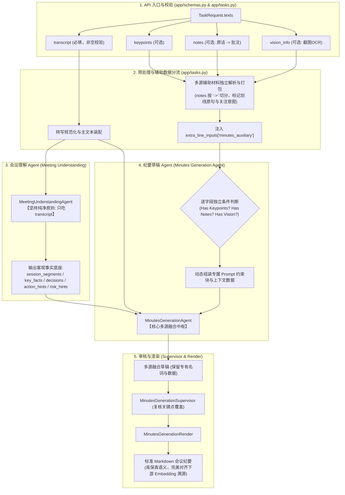

# ACTION PLAN: 多源文本融合会议纪要设计与执行清单 (Multi-Source Texts Minutes)

> **目标定位**：扩展通用会议纪要（`domain="meeting"`, `task="minutes"`），使其在 `texts` 输入载荷中全面支持 **4 个字段**（`transcript` 会议原文、`keypoints` 用户关键点、`notes` 用户笔记、`vision_info` 截图OCR文本）。在保持会议理解层客观纯粹的前提下，在草稿生成阶段对三类可选辅助材料进行**独立条件判断、专用 Prompt 微调与原词保真承载**，输出结构规范的 Markdown 纪要，为下游基于 Embedding 的向量检索溯源提供高密度语义锚点。

---

## 一、 整体架构与设计原则

### 1. 四类输入字段的特征与定位分工

| 字段名 | 状态 | 信息特征与本质 | 角色定位 | 处理阶段与使用方式 |
| :--- | :--- | :--- | :--- | :--- |
| **`transcript`** | **必填** (Mandatory) | 时序口语对话流，包含发言人、时间戳与讨论演进。 | **全场唯一研讨过程与事实真值主干** (Ground Truth)。 | **会议理解层唯一输入**；同时作为草稿层的对话上下文依据。 |
| **`keypoints`** | 可选 (Optional) | 用户自己记录的重点陈述清单（如：`流程审批量同比增长46%，超时率下降0.38%`）。 | **高优先级必须覆盖的硬指标** (Priority Anchors)。 | **草稿阶段注入**：正文必须提供至少一条完整事实句逐条承载，原词原数保留，禁止抽象化概括。 |
| **`notes`** | 可选 (Optional) | `转录原话 -> 用户批注/思考`（按 `->` 切分；无箭头则视为独立笔记）。 | **局部关注聚焦点与关注意图** (Attention Points)。 | **草稿阶段注入**：原话部分必须作为重点事实客观呈现；批注部分（如“真的假的”、“扯淡呢”）仅作为倾向参考，**主观词严禁写入正文**，转化为客观待办/未决/强调。 |
| **`vision_info`** | 可选 (Optional) | 用户在会议截屏中识别出的无序 OCR 文本（PPT、白板、架构图、报表）。 | **全局高密实体/数据看板字典** (Data Grounding)。 | **草稿阶段注入**：作为背景看板，为讨论事项补充精确的英文组件代号、架构参数与表格统计，严禁脱离会议实际研讨凭空发散。 |

---

### 2. 端到端系统拓扑图 (End-to-End Pipeline)



---

### 3. 与议题纪要 (Agenda Minutes / Docs) 的正交隔离

* **逻辑判定边界**：
  * **`req.docs`（文档/附件）**：决定纪要的**宏观组织骨架**。
    * 若 `req.docs` 非空，优先触发 `probe_valid_agendas` 议题发现与议程增强（`agenda_enhanced`），正文以 `### 一. [议题全称]` 结构化展开；
    * 若 `req.docs` 为空，走普通纪要的时序或模板展开。
  * **`req.texts`（文本集合）**：决定纪要的**微观段落细节与多源信息吸收**。
    * 无论 `docs` 是否为空，只要 `texts` 中提供了辅助字段（`keypoints`、`notes`、`vision_info`），纪要草稿均自动吸收融合。
  * **结论**：两者处于正交关系，完全不冲突；有 `docs` 时，是在“审定议题骨架”内部进一步融合关键点、笔记原话与截图数据。

---

## 二、 逐模块改造细节 (Implementation Details)

### 阶段一：接口模式定义与前置校验 (API Schema & Validation)

#### 1.1 `app/schemas.py`
* **目标**：在 `TEXT_KEYS` 中正式声明 `vision_info`，支持 Pydantic 请求体验证。
* **修改细节**：
  ```python
  # app/schemas.py
  TEXT_KEYS = ("transcript", "keypoints", "notes", "vision_info")
  ```
* 更新 `TaskRequest` 类注释：明确 `vision_info` 用于存放会议截图识别后的 OCR 文本。

#### 1.2 `app/requirements.py`
* **目标**：确保 `minutes` 任务的必填字段声明保持以 `transcript` 为基石，辅助字段不产生误杀。
* **修改细节**：
  ```python
  # app/requirements.py
  REQUIRED_FIELDS = {
      "minutes": {
          "user_id": "X-User-Id",
          "texts.transcript": "texts 中 transcript（会议转写文本）",
      },
      ...
  }
  ```
* 增加辅助材料探针工具函数：
  ```python
  def has_auxiliary_texts(req: TaskRequest) -> bool:
      """判断 texts 中是否包含任意辅助信息（keypoints, notes, vision_info）。"""
      texts = req.texts or {}
      return any(bool((texts.get(k) or "").strip()) for k in ("keypoints", "notes", "vision_info"))
  ```

---

### 阶段二：输入采集、笔记切分与组装 (Task Ingestion & Preprocessing)

#### 2.1 `app/tasks.py`
* **目标**：收集 4 个文本字段，解析 `notes` 中的 `->` 格式，打包装配至 `extra_line_inputs`。
* **修改细节**：
  1. 扩展 `_collect_texts` 函数：
     ```python
     def _collect_texts(req: TaskRequest) -> tuple[str, str, str, str]:
         """返回 (transcript, keypoints, notes, vision_info)。"""
         texts = req.texts or {}
         transcript = (texts.get("transcript") or "").strip()
         keypoints = (texts.get("keypoints") or "").strip()
         notes = (texts.get("notes") or "").strip()
         vision_info = (texts.get("vision_info") or "").strip()
         return transcript, keypoints, notes, vision_info
     ```
  2. 实现轻量笔记与辅助结构化打包函数 `_pack_minutes_auxiliary`：
     ```python
     def _parse_notes_items(notes_text: str) -> list[dict[str, str]]:
         """切分用户笔记。支持 '原话 -> 批注'，清洗前后空格。无箭头整行作为 note。"""
         items = []
         arrow_pattern = re.compile(r"\s*->\s*")
         for line in (notes_text or "").splitlines():
             raw = line.strip()
             if not raw:
                 continue
             if "->" in raw:
                 parts = arrow_pattern.split(raw, maxsplit=1)
                 items.append({"quote": parts[0].strip(), "comment": parts[1].strip()})
             else:
                 items.append({"quote": "", "comment": raw})
         return items

     def _pack_minutes_auxiliary(keypoints: str, notes: str, vision_info: str) -> str:
         """将非空的辅助材料组装为统一的上下文注入块。"""
         blocks = []
         if keypoints.strip():
             blocks.append(f"【用户关键点（必承载项）】\n{keypoints.strip()}")
         if notes.strip():
             parsed_notes = _parse_notes_items(notes)
             note_lines = []
             for item in parsed_notes:
                 if item["quote"]:
                     note_lines.append(f"- 划线原话：\"{item['quote']}\" ➔ 用户关注提示：{item['comment']}")
                 else:
                     note_lines.append(f"- 用户笔记：{item['comment']}")
             blocks.append("【参会人划线原话与关注提示】\n" + "\n".join(note_lines))
         if vision_info.strip():
             blocks.append(f"【会议屏幕/板书材料(OCR参考)】\n{vision_info.strip()}")
         return "\n\n".join(blocks).strip()
     ```
  3. 在 `_prepare(...)` 中针对 `line == "minutes"` 注入：
     ```python
     if line == "minutes":
         aux_text = _pack_minutes_auxiliary(keypoints, notes, vision_info)
         if aux_text:
             extra_line_inputs["minutes_auxiliary"] = aux_text
     ```

---

### 阶段三：会议理解隔离保护 (Meeting Understanding Isolation)

#### 3.1 `domains/meeting/orchestrator.py`
* **目标**：确保 `MeetingUnderstandingAgent` 只消费 `transcript`，不受 `minutes_auxiliary` 任何干扰。
* **校验点**：
  * 在 `_make_meeting_understanding_node` 中，输入至 `self.meeting_understanding_agent.run` 的第一个参数严格为 `transcript_input`。
  * 确认理解层 Prompt 和契约保持纯净，不将截图 OCR 或用户批注作为口头对话输入。

---

### 阶段四：草稿 Agent 专属 Prompt 微调与上下文融合 (Minutes Agent Prompt Modulation)

#### 4.1 编排层上下文组装 (`domains/meeting/orchestrator.py`)
* **目标**：在 `_line_shared_context(state, "minutes")` 中，将 `minutes_auxiliary` 带入草稿 Agent 的上下文，并标明辅助信息融合模式。
* **修改细节**：
  ```python
  if line_name == "minutes":
      aux_block = str((state.get("line_extra") or {}).get("minutes_auxiliary") or "").strip()
      if aux_block:
          parts.append(f"════════════════════════════════════════\n{aux_block}")
  ```

#### 4.2 专属 Prompt 独立条件微调设计 (`domains/meeting/tasks/minutes/steps/minutes_agent.py`)
* **目标**：在草稿 Agent 中，**挨个判断三个字段**。哪一个非空，就追加对应的专属指令与红线。
* **三个字段专属 Prompt 指令设计（中英双语自适应）**：

##### ① 用户关键点指令 (`KEYPOINTS_PROMPT_BLOCK`)
```text
【用户关键点执行准则（Embedding 溯源核心靶标）】：
1. 逐条全覆盖：正文中必须为【用户关键点】中的每一条内容提供至少一条独立、完整、通顺的事实陈述句承载，严禁遗漏任何一条要点。
2. 词汇与数值绝对保真：关键点中出现的具体数字（如金额、量化指标、排期百分比）、专有名词与技术术语，必须在正文中原词原数保留，严禁使用模糊抽象的代词抹平（例如“超时率下降0.38%”严禁改写为“超时情况略有好转”）。
```

##### ② 用户笔记指令 (`NOTES_PROMPT_BLOCK`)
```text
【用户笔记与划线原话执行准则】：
1. 划线事实深度记载：笔记中“划线原话”所指代的事项是参会人高度关切的内容，必须在纪要正文相应议题中详尽、客观地呈现其研讨背景、现状与定论。
2. 主客观严格隔离红线：用户关注提示中包含的私人情绪、主观吐槽或疑问（如“真的假的”、“扯淡呢”、“假大空”等），严禁作为事实直接写入纪要正文！
3. 意图理性转化：若用户提示包含实质疑问或核实诉求，将对应事实以客观中立口吻记入正文，并在必要时将核实事项纳入后续待办或未决问题；若包含调侃情绪，忽略情绪词，只记录客观事实。
```

##### ③ 截图 OCR 文本指令 (`VISION_PROMPT_BLOCK`)
```text
【会议屏幕/板书材料(OCR)参考准则】：
1. 背景看板数据赋能：将截图材料中的专业英文缩写、架构组件命名、报表数据与量化指标，作为正文陈述的精准数据补充，使论据更加扎实具体。
2. 严防脱轨发散：屏幕材料仅作为会议研讨的补充字典，严禁脱离会议原文实际讨论的主线，凭空捏造或发散截图中未被各方研讨的内容。
```

#### 4.3 动态 Prompt 插槽装配实现
在 `MinutesGenerationAgent.run` 中：
```python
# 判断上下文是否包含各辅助块
has_keypoints = "【用户关键点（必承载项）】" in shared_context
has_notes = "【参会人划线原话与关注提示】" in shared_context
has_vision = "【会议屏幕/板书材料(OCR参考)】" in shared_context

aux_guidelines = []
if has_keypoints:
    aux_guidelines.append(KEYPOINTS_PROMPT_BLOCK)
if has_notes:
    aux_guidelines.append(NOTES_PROMPT_BLOCK)
if has_vision:
    aux_guidelines.append(VISION_PROMPT_BLOCK)

if aux_guidelines:
    system_prompt = system_prompt + "\n\n## 多源辅助材料融合红线\n" + "\n\n".join(aux_guidelines)
```

---

### 阶段五：审核层复核增强 (Supervisor Review Adaptation)

#### 5.1 `domains/meeting/tasks/minutes/steps/minutes_supervisor.py`
* **目标**：审核 Agent 在复核时，不仅核对会议原文，还要对传入的辅助信息进行轻量合规抽查。
* **规则微调**：
  * 若存在关键点，复核关键点在草稿中是否遭到完全遗漏；
  * 复核是否有主观吐槽词（“真的假的”、“扯淡”）被误写入正文。

---

## 三、 测试与验证方案 (Verification & Test Matrix)

为确保零回归且逻辑完全覆盖，在 `tests/unit/meeting/test_multi_source_minutes.py` 中编写以下测试用例：

| 用例 ID | 测试场景 | 输入组合 | 期望断言 |
| :--- | :--- | :--- | :--- |
| **TC-01** | **向下兼容纯语音** | 仅 `transcript`，其余 3 字段全空 | 1. 成功生成纪要；<br>2. Prompt 中不包含任何多源融合附加约束；<br>3. 行为与存量版本完全一致。 |
| **TC-02** | **单项: 仅包含关键点** | `transcript` + `keypoints` | 1. 正确激活 `KEYPOINTS_PROMPT_BLOCK`；<br>2. Prompt 中包含关键点清单；<br>3. 正文中保留关键点数字与专名。 |
| **TC-03** | **单项: 仅包含笔记(含箭头)** | `transcript` + `notes` (如 `原话 -> 真的假的？`) | 1. 正确将每行按 `->` 切分；<br>2. 正文中如实记载原话事实；<br>3. 断言正文绝不包含“真的假的”主观字样。 |
| **TC-04** | **单项: 仅包含截图 OCR** | `transcript` + `vision_info` | 1. 正确激活 `VISION_PROMPT_BLOCK`；<br>2. 截图中的专业代号与数据填补进相关段落。 |
| **TC-05** | **多源全开 (四者俱全)** | 4 个字段全部非空 | 1. 三个规则块全部动态追加；<br>2. 纪要正文兼具结构时序与高密度数据，完美兼容。 |
| **TC-06** | **与议题纪要 docs 共存** | 4 字段非空 + `docs=["agenda.png"]` | 1. 优先按 `agenda_enhanced` 划定议题大纲；<br>2. 在各个议题板块内正常吸收关键点与笔记。 |
| **TC-07** | **英文多语种适配 (`lang='en'`)** | 4 字段非空 + `lang="en"` | 1. 顶层依然注入英文人设；<br>2. 辅助约束块使用英文版红线；<br>3. 产出纯正英文结构化纪要。 |

---

## 四、 实施进度看板 (Execution Checklist)

- [ ] **Phase 1: 协议与接口层支持**
  - [ ] 在 `app/schemas.py` 的 `TEXT_KEYS` 中添加 `"vision_info"`
  - [ ] 在 `app/requirements.py` 完善必填校验与辅助探针函数
- [ ] **Phase 2: 输入预处理与切分打包**
  - [ ] 在 `app/tasks.py` 扩充 `_collect_texts`
  - [ ] 实现 `_parse_notes_items`（支持 `->` 正则切分）
  - [ ] 实现 `_pack_minutes_auxiliary` 并注入 `extra_line_inputs["minutes_auxiliary"]`
- [ ] **Phase 3: 编排层透传与会议理解防污染**
  - [ ] 确保 `domains/meeting/orchestrator.py` 中的 `_make_meeting_understanding_node` 仅消费 `transcript`
  - [ ] 在 `_line_shared_context` 中挂载 `minutes_auxiliary` 上下文块
- [ ] **Phase 4: 草稿 Agent 专属 Prompt 独立微调**
  - [ ] 编写 `KEYPOINTS_PROMPT_BLOCK`、`NOTES_PROMPT_BLOCK`、`VISION_PROMPT_BLOCK`
  - [ ] 在 `MinutesGenerationAgent.run` 中实现独立条件判断与动态装配（中/英双语兼容）
- [ ] **Phase 5: 审核层规范核验**
  - [ ] 在 `MinutesGenerationSupervisor` 补充辅助材料漏检与主观词拦截提示
- [ ] **Phase 6: 自动化测试与全量回归**
  - [ ] 新建 `tests/unit/meeting/test_multi_source_minutes.py` 并通过 TC-01 至 TC-07
  - [ ] 运行会议全量回归测试套件，确保 0 失败、0 回归
