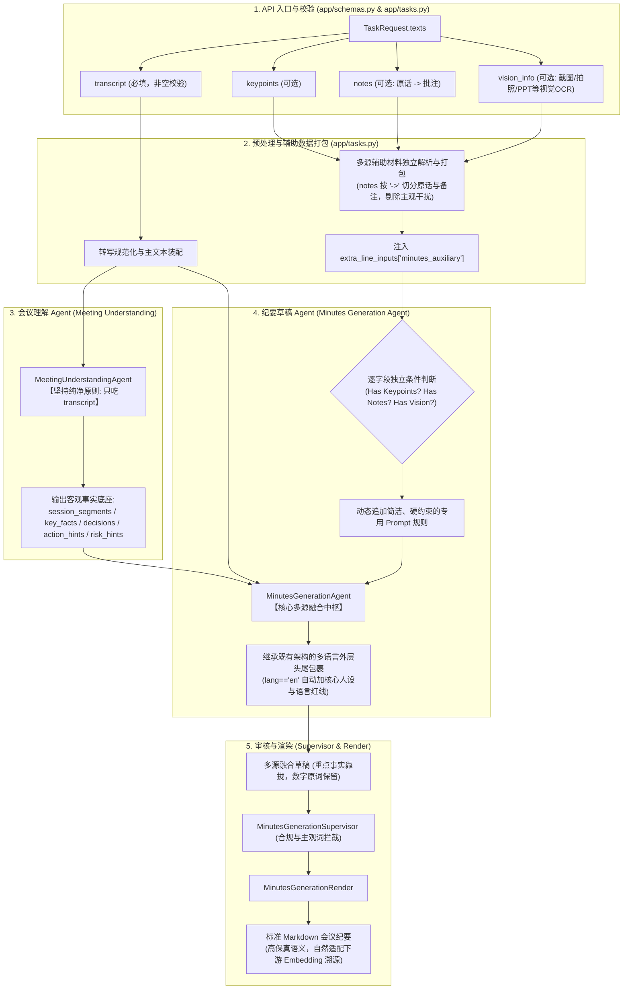

# ACTION PLAN: 多源文本融合会议纪要设计与执行清单 (Multi-Source Texts Minutes)

> **目标定位**：扩展通用会议纪要（`domain="meeting"`, `task="minutes"`），使其在 `texts` 输入载荷中全面支持 **4 个字段**（`transcript` 会议原文、`keypoints` 用户关键点、`notes` 用户笔记、`vision_info` 视觉信息OCR文本）。在保持会议理解层客观纯粹的前提下，在草稿生成阶段对三类可选辅助材料进行**独立条件判断、实用型 Prompt 微调与数据保真**，输出结构规范的 Markdown 纪要，为下游基于 Embedding 的向量检索溯源提供高密度语义锚点。

---

## 一、 整体架构与设计原则

### 1. 四类输入字段的特征与定位分工

| 字段名 | 状态 | 信息特征与本质 | 角色定位 | 处理阶段与使用方式 |
| :--- | :--- | :--- | :--- | :--- |
| **`transcript`** | **必填** (Mandatory) | 时序口语对话流，包含发言人、时间戳与讨论演进。 | **全场唯一研讨过程与事实真值主干** (Ground Truth)。 | **会议理解层唯一输入**；同时作为草稿层的对话上下文依据。 |
| **`keypoints`** | 可选 (Optional) | 用户自己记录的重点关注清单（如：`流程审批量同比增长46%，超时率下降0.38%`）。 | **重点关注与内容靠拢依据**。 | **草稿阶段注入**：正文叙述尽量向关键点靠拢，优先体现其中的核心事实与数据，保留具体数值与专名，无需生硬逐条单句强行挂载。 |
| **`notes`** | 可选 (Optional) | `转录原话 -> 用户批注/思考`（按 `->` 切分；无箭头则整行视为独立笔记）。 | **划线重点与关注意图参考**。 | **草稿阶段注入**：原话部分作为重要事实如实记录；批注部分仅作意图参考，**批注中的个人吐槽与主观词严禁入文**，存疑事项客观列入待办或未决。 |
| **`vision_info`** | 可选 (Optional) | 会议视觉材料（包括屏幕截图、投屏PPT、现场拍照、白板记录、数据看板等）识别出的 OCR 文本。 | **视觉看板与背景数据补充**。 | **草稿阶段注入**：作为参考看板，为讨论事项补充精确的术语拼写、架构代号与指标表格，严禁脱离会议实际研讨凭空发散无关内容。 |

---

### 2. 端到端系统拓扑图 (End-to-End Pipeline)



---

### 3. 与议题纪要 (Agenda Minutes / Docs) 的正交隔离

* **逻辑判定边界**：
  * **`req.docs`（文档/附件）**：决定纪要的**宏观组织骨架**。
    * 若 `req.docs` 非空，优先触发 `probe_valid_agendas` 议题发现与议程增强（`agenda_enhanced`），正文以 `### 一. [议题全称]` 结构化展开；
    * 若 `req.docs` 为空，走普通纪要的时序或模板展开。
  * **`req.texts`（文本集合）**：决定纪要的**微观段落细节与多源信息吸收**。
    * 无论 `docs` 是否为空，只要 `texts` 中提供了辅助字段（`keypoints`、`notes`、`vision_info`），纪要草稿均自动吸收融合。
  * **结论**：两者处于正交关系，完全不冲突；有 `docs` 时，是在“审定议题骨架”内部进一步融合关键点、笔记原话与视觉数据。

---

## 二、 逐模块改造细节 (Implementation Details)

### 阶段一：接口模式定义与前置校验 (API Schema & Validation)

#### 1.1 `app/schemas.py`
* **目标**：在 `TEXT_KEYS` 中声明 `vision_info`，支持 Pydantic 请求体验证。
* **修改细节**：
  ```python
  # app/schemas.py
  TEXT_KEYS = ("transcript", "keypoints", "notes", "vision_info")
  ```
* 更新 `TaskRequest` 说明：`vision_info` 存放会议视觉材料（屏幕截图、投屏演示、现场拍照、白板等）识别出的 OCR 文本。

#### 1.2 `app/requirements.py`
* **目标**：确保 `minutes` 任务的必填字段声明保持以 `transcript` 为基石，辅助字段保持可选。
* **修改细节**：
  ```python
  # app/requirements.py
  REQUIRED_FIELDS = {
      "minutes": {
          "user_id": "X-User-Id",
          "texts.transcript": "texts 中 transcript（会议转写文本）",
      },
      ...
  }
  ```

---

### 阶段二：输入采集、笔记切分与组装 (Task Ingestion & Preprocessing)

#### 2.1 `app/tasks.py`
* **目标**：收集 4 个文本字段，解析 `notes` 中的 `->` 格式，打包装配至 `extra_line_inputs`。
* **修改细节**：
  1. 扩展 `_collect_texts` 函数：
     ```python
     def _collect_texts(req: TaskRequest) -> tuple[str, str, str, str]:
         """返回 (transcript, keypoints, notes, vision_info)。"""
         texts = req.texts or {}
         transcript = (texts.get("transcript") or "").strip()
         keypoints = (texts.get("keypoints") or "").strip()
         notes = (texts.get("notes") or "").strip()
         vision_info = (texts.get("vision_info") or "").strip()
         return transcript, keypoints, notes, vision_info
     ```
  2. 实现结构化打包函数 `_pack_minutes_auxiliary`：
     ```python
     def _parse_notes_items(notes_text: str) -> list[dict[str, str]]:
         """切分用户笔记。支持 '原话 -> 批注'，清洗前后空格；无箭头整行作为备注。"""
         items = []
         arrow_pattern = re.compile(r"\s*->\s*")
         for line in (notes_text or "").splitlines():
             raw = line.strip()
             if not raw:
                 continue
             if "->" in raw:
                 parts = arrow_pattern.split(raw, maxsplit=1)
                 items.append({"quote": parts[0].strip(), "comment": parts[1].strip()})
             else:
                 items.append({"quote": "", "comment": raw})
         return items

     def _pack_minutes_auxiliary(keypoints: str, notes: str, vision_info: str) -> str:
         """将非空的辅助材料组装为统一的上下文注入块。"""
         blocks = []
         if keypoints.strip():
             blocks.append(f"【用户核心关键点】\n{keypoints.strip()}")
         if notes.strip():
             parsed_notes = _parse_notes_items(notes)
             note_lines = []
             for item in parsed_notes:
                 if item["quote"]:
                     note_lines.append(f"- 原话：\"{item['quote']}\" | 备注：{item['comment']}")
                 else:
                     note_lines.append(f"- 笔记：{item['comment']}")
             blocks.append("【用户划线原话与笔记】\n" + "\n".join(note_lines))
         if vision_info.strip():
             blocks.append(f"【视觉信息参考(OCR)】\n{vision_info.strip()}")
         return "\n\n".join(blocks).strip()
     ```
  3. 在 `_prepare(...)` 中针对 `line == "minutes"` 注入：
     ```python
     if line == "minutes":
         aux_text = _pack_minutes_auxiliary(keypoints, notes, vision_info)
         if aux_text:
             extra_line_inputs["minutes_auxiliary"] = aux_text
     ```

---

### 阶段三：会议理解隔离保护 (Meeting Understanding Isolation)

#### 3.1 `domains/meeting/orchestrator.py`
* **目标**：确保 `MeetingUnderstandingAgent` 只消费 `transcript`，不受无序视觉信息 OCR 与主观笔记任何干扰。
* **规则**：
  * 在 `_make_meeting_understanding_node` 中，输入至 `self.meeting_understanding_agent.run` 的参数严格保持为 `transcript_input`。
  * 理解层不引入无序 OCR 和主观笔记，避免破坏时序研讨脉络、产生发言人归属混乱或事实幻觉。

---

### 阶段四：草稿 Agent 专属 Prompt 实用化微调 (Pragmatic Minutes Agent Prompt Modulation)

#### 4.1 编排层上下文组装 (`domains/meeting/orchestrator.py`)
* 在 `_line_shared_context(state, "minutes")` 中，将 `minutes_auxiliary` 带入草稿 Agent 上下文：
  ```python
  if line_name == "minutes":
      aux_block = str((state.get("line_extra") or {}).get("minutes_auxiliary") or "").strip()
      if aux_block:
          parts.append(f"════════════════════════════════════════\n{aux_block}")
  ```

#### 4.2 专属 Prompt 实用化微调 (`domains/meeting/tasks/minutes/steps/minutes_agent.py`)

> **设计准则**：
> 1. **单一本源，无需维护双语 Prompt**：遵循系统既有架构，指令主体统一为中文规则。当 `lang == "en"` 时，外层已有的【核心人设】与【语言红线】会自动对整篇 Prompt 进行英文输出强约束；
> 2. **事实尽量靠拢**：不设死板的“逐条全覆盖”硬卡死，改为在正文叙述中尽量向关键点事实靠拢；
> 3. **核心红线守住**：数字专名如实保留、主观吐槽严禁入文、视觉材料不脱离会议凭空发散。

##### 规则定义（单一本源）

###### ① 用户关键点指令 (`KEYPOINTS_PROMPT_BLOCK`)
```text
## 用户关键点参考
以下是用户记录的核心关注点。撰写纪要正文时：
1. 事实尽量靠拢：纪要正文的论述尽量向用户关键点靠拢，在对应议题中优先体现关键点涉及的事实与结论；
2. 保持数据一致：关键点中的具体数字（指标、金额、排期）、专有名词，正文如实保留，不要随意改写。
```

###### ② 用户笔记指令 (`NOTES_PROMPT_BLOCK`)
```text
## 用户笔记参考
以下是参会人的划线原话与笔记备注。撰写纪要正文时：
1. 结合原话事实：划线原话是参会人关注的要点，正文撰写对应议题时应如实体现相关事实；
2. 个人批注不入文：笔记中的个人批注（如吐槽、疑问、随手标记）严禁直接写进纪要正文；
3. 存疑事项客观记录：若笔记反映出对某事项存在疑问或需后续核实，可客观体现于对应事项或待办中。
```

###### ③ 视觉信息指令 (`VISION_PROMPT_BLOCK`)
```text
## 视觉信息参考 (OCR)
以下是会议视觉材料（如PPT、屏幕截图、现场拍照、白板记录、数据报表等）的识别文本。撰写纪要正文时：
1. 补充具体数据：当会议讨论到相关内容时，可参考视觉信息补充具体的术语拼写、技术参数、指标数值与报表数据；
2. 不脱离研讨发散：仅提取与会议实际讨论明确相关的视觉信息，严禁脱离研讨主线自行引入无关文字。
```

---

#### 4.3 动态插槽组装逻辑实现

在 `MinutesGenerationAgent.run` 中：
```python
# 1. 独立条件判断：有哪个辅助材料，才挂载对应的规则指令
aux_blocks = []
if "【用户核心关键点】" in shared_context:
    aux_blocks.append(KEYPOINTS_PROMPT_BLOCK)
if "【用户划线原话与笔记】" in shared_context:
    aux_blocks.append(NOTES_PROMPT_BLOCK)
if "【视觉信息参考(OCR)】" in shared_context:
    aux_blocks.append(VISION_PROMPT_BLOCK)

if aux_blocks:
    raw_system_prompt = raw_system_prompt + "\n\n" + "\n\n".join(aux_blocks)

# 2. 紧接着走原有的多语言处理（无需任何改动，天然生效）
lang_val = lang or parse_lang_mode(shared_context)
if (lang_val or "").strip().lower() == "en":
    role_prefix = "英文（English）"
    body_prompt = raw_system_prompt
    first_period = body_prompt.find("。\n")
    if first_period > 0:
        body_prompt = body_prompt[first_period + 2 :].strip()
    system_prompt = (
        f"【核心人设与交付目标】\n"
        f"你是专职的【{role_prefix}】会议纪要草稿 Agent，本次任务必须全程直接提炼并输出标准、专业、精炼的商务{role_prefix}结构化草稿。\n\n"
        f"{body_prompt}\n\n"
        f"## 语言红线\n"
        f"1. 所有字段必须严格使用【{role_prefix}】输出，严禁夹杂中文字符与全角标点；\n"
        f"2. 待定/未决统一使用 [TBD] 或 [Pending Confirmation]，严禁输出 [待确认]；\n"
        f"3. 专业术语、专有名词与人名保留英文原文写法；\n"
        f"4. 执行要点统一采用 `[Owner] Action + Deliverable + Deadline` 结构清晰陈述。"
    )
else:
    system_prompt = raw_system_prompt
```

---

### 阶段五：审核层复核增强 (Supervisor Review)

#### 5.1 编排层审核上下文注入 (`domains/meeting/orchestrator.py`)
* 在 `_supervisor_context(state, "minutes")` 中，向审核上下文 `blocks` 注入辅助参考，使 Supervisor 能对照原件核验：
  ```python
  if line_name == "minutes":
      aux_block = str((state.get("line_extra") or {}).get("minutes_auxiliary") or "").strip()
      if aux_block:
          blocks.append(aux_block)
  ```

#### 5.2 审核规则与质量底线 Prompt 微调 (`domains/meeting/tasks/minutes/prompts.py`)
在 `_SUPERVISOR_COMMON_BASE`（全模式共享的审核公共基底）中落地硬约束：

1. **核心审查原则区域追加**：
   ```text
   - 多源辅助参考审查（输入含对应标签时生效）：
     1. 拦截主观批注：【用户划线原话与笔记】中的个人批注与主观吐槽严禁进入正文（包括直接引用或改写转述）；
     2. 数据专名一致：正文引用的【用户核心关键点】与【视觉信息参考(OCR)】中的数字指标、专有名词不得篡改、捏造或方向写反。
   ```

2. **核心质量底线（判罚 Reject 准绳）区域追加第 4 项**：
   ```text
   - 核心质量底线（未发现严重缺陷时予以 approve）：
     1. 关键事实/结论与原文相悖（数字、归属或方向性判断写反）；
     2. 凭空捏造原文没有的人名、数字或虚假拍板；
     3. 将探讨/建议性意见升格为已拍板决议；
     4. 泄露【用户划线原话与笔记】中的批注或主观吐槽。
   ```

#### 5.3 审核执行端自适应多语言 (`domains/meeting/tasks/minutes/steps/minutes_supervisor.py`)
* 无需新增语言分支，自动继承现有的 `if (lang_val or '').strip().lower() == 'en':` 头尾语言红线包裹，零冗余。

---

## 三、 测试与验证方案 (Verification & Test Matrix)

在 `tests/unit/meeting/test_multi_source_minutes.py` 中编写以下测试用例：

| 用例 ID | 测试场景 | 输入组合 | 期望断言 |
| :--- | :--- | :--- | :--- |
| **TC-01** | **向下兼容纯语音** | 仅 `transcript`，其余 3 字段全空 | 1. 成功生成纪要；<br>2. Prompt 中不包含任何辅助规则块；<br>3. 行为与存量版本完全一致。 |
| **TC-02** | **单项: 仅包含关键点** | `transcript` + `keypoints` | 1. 正确激活 `KEYPOINTS_PROMPT_BLOCK`；<br>2. 正文中重点事实尽量向关键点靠拢；<br>3. 关键点中的数字与专名得到保留。 |
| **TC-03** | **单项: 仅包含笔记(含箭头)** | `transcript` + `notes` (如 `原话 -> 真的假的？`) | 1. 正确将每行按 `->` 切分；<br>2. 正文中如实记载原话事实；<br>3. 断言正文绝不包含“真的假的”主观字样。 |
| **TC-04** | **单项: 仅包含视觉信息** | `transcript` + `vision_info` (包含截图/照片数据) | 1. 正确激活 `VISION_PROMPT_BLOCK`；<br>2. 视觉材料中的技术代号与数据填补进相关段落。 |
| **TC-05** | **多源全开 (四者俱全)** | 4 个字段全部非空 | 1. 三个规则块按需追加；<br>2. 纪要正文兼具结构时序与数据补充，自然融合。 |
| **TC-06** | **与议题纪要 docs 共存** | 4 字段非空 + `docs=["agenda.png"]` | 1. 优先按 `agenda_enhanced` 划定议题大纲；<br>2. 在各个议题板块内正常吸收关键点、笔记与视觉数据。 |
| **TC-07** | **英文多语种适配 (`lang='en'`)** | 4 字段非空 + `lang="en"` | 1. 辅助规则自然纳入 `body_prompt`；<br>2. 外层语言红线强制约束输出纯正英文结构化纪要。 |

---

## 四、 实施进度看板 (Execution Checklist)

- [x] **Phase 1: 协议与接口层支持**
  - [x] 在 `app/schemas.py` 的 `TEXT_KEYS` 中添加 `"vision_info"`
  - [x] 在 `app/requirements.py` 确保校验保持以 `transcript` 必填，辅助项可选
- [x] **Phase 2: 输入预处理与切分打包**
  - [x] 在 `app/tasks.py` 扩充 `_collect_texts` 支持 4 元组
  - [x] 实现 `_parse_notes_items`（支持 `->` 正则切分与单行容错）
  - [x] 实现 `_pack_minutes_auxiliary` 并注入 `extra_line_inputs["minutes_auxiliary"]`（视觉标签使用 `【视觉信息参考(OCR)】`）
- [x] **Phase 3: 编排层透传与会议理解防污染**
  - [x] 确保 `domains/meeting/orchestrator.py` 中的 `_make_meeting_understanding_node` 仅消费 `transcript`
  - [x] 在 `_line_shared_context` 中挂载 `minutes_auxiliary` 上下文块
- [x] **Phase 4: 草稿 Agent 专属 Prompt 实用化微调**
  - [x] 实现实用化、单一本源的 Prompt 规则块（`KEYPOINTS_PROMPT_BLOCK`、`NOTES_PROMPT_BLOCK`、`VISION_PROMPT_BLOCK`）
  - [x] 在 `MinutesGenerationAgent.run` 中实现独立条件判断与动态装配，无缝继承既有 `lang == "en"` 头尾包裹
- [x] **Phase 5: 审核层规范核验**
  - [x] 在 `domains/meeting/orchestrator.py` 的 `_supervisor_context` 挂载 `minutes_auxiliary`
  - [x] 在 `domains/meeting/tasks/minutes/prompts.py` 的 `_SUPERVISOR_COMMON_BASE` 落地多源审查准则与底线判罚项（精确保留三大标签）
- [x] **Phase 6: 自动化测试与全量回归**
  - [x] 新建 `tests/unit/meeting/test_multi_source_minutes.py` 并通过 TC-01 至 TC-09 (12 项用例全过)
  - [x] 运行会议全量回归测试套件，确保 0 失败、0 回归 (99 项全绿)
