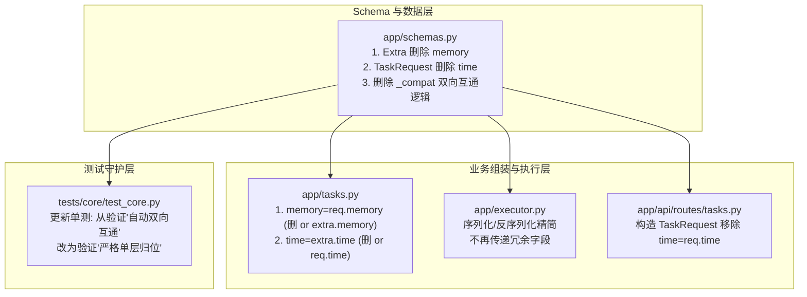

# ACTION PLAN: memory 与 time 字段严格层级归位及双重保险清理清单

> **需求背景与核心原则**：
> 彻底移除历史兼容期的“双重保险（双向互通、自动拷贝提升、短路兜底）”逻辑，建立单一、清晰、零歧义的数据契约：
> 1. **`memory` 严格且仅位于最外层顶层**（`TaskRequest.memory: bool = False`），代表系统级核心长记忆能力；
> 2. **`time` 严格且仅位于 `extra` 内部**（`Extra.time: str = ""`），代表会议任务特有的业务召开时间元数据；
> 3. 彻底删除顶层与 `extra` 之间的字段冗余、自动提升/同步逻辑以及下游业务层的 `or` 兼容短路，传错层级直接报错或忽略。

---

## 一、 涉及修改的文件清单与代码改动点

经过全库代码与测试用例的深入审计，共涉及 **4 个生产代码文件** 与 **1 个核心测试文件**。



---

## 二、 逐文件修改细节规范 (Before vs After)

### 1. [app/schemas.py](file:///D:/study/demo/app/schemas.py)

#### 改动 1.1：`Extra` 数据类删除 `memory`
```python
# ── 修改前 ──
class Extra(BaseModel):
    template: str = ""
    profile: str = ""
    project: str = ""
    subject: str = ""
    style: str = ""
    memory: bool = False  # ❌ 冗余字段，删除
    agenda_txt: str = ""
    time: str = ""
    catalog: str = ""

# ── 修改后 ──
class Extra(BaseModel):
    template: str = ""
    profile: str = ""
    project: str = ""
    subject: str = ""
    style: str = ""
    agenda_txt: str = ""
    time: str = ""  # ✅ 严格归位于此
    catalog: str = ""
```

#### 改动 1.2：`TaskRequest` 数据类删除 `time`
```python
# ── 修改前 ──
class TaskRequest(BaseModel):
    texts: dict[str, str] = Field(default_factory=dict)
    docs: list[str] = Field(default_factory=list)
    memory: bool = False
    extra: Extra = Field(default_factory=Extra)
    time: str = ""  # ❌ 冗余字段，删除
    lang: str = "zh"

# ── 修改后 ──
class TaskRequest(BaseModel):
    texts: dict[str, str] = Field(default_factory=dict)
    docs: list[str] = Field(default_factory=list)
    memory: bool = False  # ✅ 严格归位于此（系统级顶层开关）
    extra: Extra = Field(default_factory=Extra)
    lang: str = "zh"
```

#### 改动 1.3：`_compat_task_request` 彻底删除双向同步代码
彻底剔除字典分支与 BaseModel 分支中对 `memory` 和 `time` 的同步逻辑，仅保留针对 `docs` 中 `catalog.json` 的清洗兼容。

```python
# ── 修改前 ──
@model_validator(mode="before")
@classmethod
def _compat_task_request(cls, data: Any) -> Any:
    if isinstance(data, dict):
        extra = data.get("extra")
        if extra is None:
            extra = {}
            data["extra"] = extra
        if isinstance(extra, dict):
            # 1. 兼容老客户端把 memory 放在 extra 内部的情况：自动提升到顶层 ❌ 删除
            if extra.get("memory") and not data.get("memory"):
                data["memory"] = extra["memory"]
            elif data.get("memory") and not extra.get("memory"):
                extra["memory"] = data["memory"]
            # 2. 兼容老客户端把 time 传在顶层的情况：自动同步到 extra.time ❌ 删除
            if data.get("time") and not extra.get("time"):
                extra["time"] = data.get("time", "")
            elif extra.get("time") and not data.get("time"):
                data["time"] = extra.get("time", "")
            # 3. 兼容老客户端把 catalog.json 放在 docs 里的情况
            if not extra.get("catalog") and data.get("docs"):
                jsons = [f for f in data["docs"] if str(f).lower().endswith(".json")]
                if jsons:
                    extra["catalog"] = jsons[0]
                    data["docs"] = [f for f in data["docs"] if not str(f).lower().endswith(".json")]
        elif isinstance(extra, BaseModel):
            # BaseModel 下的互通兼容 ❌ 全部删除
            if getattr(extra, "memory", False) and not data.get("memory"):
                data["memory"] = extra.memory
            ...
    return data

# ── 修改后 ──
@model_validator(mode="before")
@classmethod
def _compat_task_request(cls, data: Any) -> Any:
    if isinstance(data, dict):
        extra = data.get("extra")
        if extra is None:
            extra = {}
            data["extra"] = extra
        if isinstance(extra, dict):
            # 仅保留 docs 附件中 json 目录文件的清洗兼容
            if not extra.get("catalog") and data.get("docs"):
                jsons = [f for f in data["docs"] if str(f).lower().endswith(".json")]
                if jsons:
                    extra["catalog"] = jsons[0]
                    data["docs"] = [f for f in data["docs"] if not str(f).lower().endswith(".json")]
        elif isinstance(extra, BaseModel):
            if not getattr(extra, "catalog", "") and data.get("docs"):
                jsons = [f for f in data["docs"] if str(f).lower().endswith(".json")]
                if jsons:
                    extra.catalog = jsons[0]
                    data["docs"] = [f for f in data["docs"] if not str(f).lower().endswith(".json")]
    return data
```

---

### 2. [app/tasks.py](file:///D:/study/demo/app/tasks.py)

#### 改动 2.1：输入组装 `_prepare` 移除双向短路兜底
* **位置**：`app/tasks.py` 行 721–723
```python
# ── 修改前 ──
return _Prepared(
    line=line,
    ctx=ctx,
    profile_file=profile_file,
    templates=templates,
    modes=modes,
    extra_line_inputs=extra_line_inputs,
    input_files=input_files,
    user_id=(user_id or "").strip(),
    project=(extra.project or "").strip(),
    subject=_subject_pinyin(extra.subject),
    memory=bool(req.memory or extra.memory),            # ❌ 删掉 or extra.memory
    time=(extra.time or req.time or "").strip(),        # ❌ 删掉 or req.time
    lang=req.lang,
)

# ── 修改后 ──
return _Prepared(
    line=line,
    ctx=ctx,
    profile_file=profile_file,
    templates=templates,
    modes=modes,
    extra_line_inputs=extra_line_inputs,
    input_files=input_files,
    user_id=(user_id or "").strip(),
    project=(extra.project or "").strip(),
    subject=_subject_pinyin(extra.subject),
    memory=bool(req.memory),                            # ✅ 仅取顶层
    time=(extra.time or "").strip(),                    # ✅ 仅取 extra
    lang=req.lang,
)
```

#### 改动 2.2：日志埋点移除冗余判断
* **位置**：`app/tasks.py` 行 761–762
```python
# ── 修改前 ──
logger.info(
    "[task:start] domain=%s task=%s request_id=%s user_id=%s memory=%s",
    domain,
    task,
    request_id,
    user_id,
    bool(req.memory or (req.extra and getattr(req.extra, "memory", False))),
)

# ── 修改后 ──
logger.info(
    "[task:start] domain=%s task=%s request_id=%s user_id=%s memory=%s",
    domain,
    task,
    request_id,
    user_id,
    bool(req.memory),
)
```

---

### 3. [app/executor.py](file:///D:/study/demo/app/executor.py)

* **位置**：行 44–75
* **改动点**：
  * `payload_from_request`：无需在顶层重复序列化 `"time": req.time or ""`，因为 `req.extra.model_dump()` 已经完整包含了 `extra.time`；
  * `request_from_payload`：实例化 `TaskRequest` 时直接传入 `memory=bool(data.get("memory", False))`，删除顶层 `time` 构造入参。

```python
# ── 修改前 ──
def payload_from_request(...) -> dict[str, Any]:
    return {
        "domain": domain,
        "task": task,
        "user_id": user_id,
        "request_id": request_id,
        "texts": dict(req.texts or {}),
        "docs": list(req.docs or []),
        "extra": req.extra.model_dump(),
        "time": req.time or "",              # ❌ 删除
        "memory": req.memory,
    }

def request_from_payload(...) -> tuple[...]:
    ...
    req = TaskRequest(
        texts={k: v for k, v in dict(data.get("texts") or {}).items() if isinstance(v, str)},
        docs=[str(name) for name in list(data.get("docs") or [])],
        memory=bool(data.get("memory", False) or getattr(extra, "memory", False)),  # ❌ 删兼容
        extra=extra,
        time=str(data.get("time") or getattr(extra, "time", "")),                   # ❌ 删顶层
    )

# ── 修改后 ──
def payload_from_request(...) -> dict[str, Any]:
    return {
        "domain": domain,
        "task": task,
        "user_id": user_id,
        "request_id": request_id,
        "texts": dict(req.texts or {}),
        "docs": list(req.docs or []),
        "extra": req.extra.model_dump(),     # ✅ time 已包含在 extra 中
        "memory": bool(req.memory),          # ✅ memory 处于顶层
    }

def request_from_payload(...) -> tuple[...]:
    ...
    req = TaskRequest(
        texts={k: v for k, v in dict(data.get("texts") or {}).items() if isinstance(v, str)},
        docs=[str(name) for name in list(data.get("docs") or [])],
        memory=bool(data.get("memory", False)),
        extra=extra,
    )
```

---

### 4. [app/api/routes/tasks.py](file:///D:/study/demo/app/api/routes/tasks.py)

* **位置**：行 190–196
```python
# ── 修改前 ──
task_req = TaskRequest(
    texts=req.texts,
    docs=req.docs,
    memory=req.memory,
    extra=req.extra if isinstance(req.extra, Extra) else Extra.model_validate(req.extra),
    time=req.time,  # ❌ 删除
)

# ── 修改后 ──
task_req = TaskRequest(
    texts=req.texts,
    docs=req.docs,
    memory=req.memory,
    extra=req.extra if isinstance(req.extra, Extra) else Extra.model_validate(req.extra),
)
```

---

### 5. [tests/core/test_core.py](file:///D:/study/demo/tests/core/test_core.py) (测试用例调整)

原单测中编写了专门用于“验证双向互通”的陈旧测试，改造后必须同步更新断言，**改为严格验证“层级互不渗透”**：

* **位置**：`tests/core/test_core.py` 行 243–258
```python
# ── 修改前 ──
# 1.1 memory 顶层字段与 extra.memory 自动互通
r1 = TaskRequest(memory=True)
check("TaskRequest 顶层支持 memory=True", r1.memory is True, "")
check("TaskRequest memory 自动同步到 extra.memory", r1.extra.memory is True, "")  # ❌ 废弃

r2 = TaskRequest.model_validate({"extra": {"memory": True}})
check("老格式 extra.memory 自动提升到顶层 memory", r2.memory is True, "")           # ❌ 废弃

# 1.2 time 下沉至 extra.time 与双向同步
r3 = TaskRequest(time="2026-06-15 10:00")
check("顶层 time 自动同步到 extra.time", r3.extra.time == "2026-06-15 10:00", "") # ❌ 废弃

r4 = TaskRequest.model_validate({"extra": {"time": "2026-06-15 10:00"}})
check("extra.time 自动同步到顶层 time", r4.time == "2026-06-15 10:00", "")        # ❌ 废弃

# ── 修改后 ──
# 1. 验证字段严格单层归位 (memory 仅在顶层，time 仅在 extra)
# 1.1 memory 字段归位
r1 = TaskRequest(memory=True)
check("TaskRequest 顶层支持 memory=True", r1.memory is True, "")
check("Extra 模型中不再包含 memory 字段", "memory" not in Extra.model_fields, "")

# 1.2 time 字段归位
r2 = TaskRequest(extra=Extra(time="2026-06-15 10:00"))
check("Extra 正确保存 time 字段", r2.extra.time == "2026-06-15 10:00", "")
check("TaskRequest 模型中不再包含 time 字段", "time" not in TaskRequest.model_fields, "")

# 1.3 验证传错层级不会产生自动拷贝
r3 = TaskRequest.model_validate({"extra": {"memory": True}})
check("传在 extra 的 memory 不再自动提升", r3.memory is False, "")

r4 = TaskRequest.model_validate({"time": "2026-06-15 10:00"})
check("传在顶层的 time 不再自动同步到 extra", r4.extra.time == "", "")
```

---

## 三、 测试与验证步骤

1. **核心模型与基础流程验证**：
   ```bash
   pytest tests/core/test_core.py
   ```
   * 确保更新后的 `test_core.py` 全部通过，断言严格单层归位有效。
2. **会议任务全套件回归验证**：
   ```bash
   pytest tests/unit/meeting/ tests/meeting/test_meeting_memory.py tests/core/test_engine_smoke.py
   ```
   * 验证长记忆（`memory=True`）在顶层传入时能够被 `_prepare` 和 `runner` 正确捕获并调用记忆钩子；
   * 验证 `extra.time` 在会议纪要溯源、历史对照及记忆写入时正常落盘。
3. **接口脚本契约抽样核验**：
   * 检查 [api_test/sync/meeting/minutes/minutes.py](file:///D:/study/demo/api_test/sync/meeting/minutes/minutes.py)：
     ```python
     json={
         "domain": "meeting",
         "task": "minutes",
         "memory": False,               # 顶层唯一
         "extra": {
             "time": "2026-09-08",       # extra 唯一
             "template": "general_minutes"
         }
     }
     ```
   * 运行测试脚本，确认 HTTP 200 成功响应。

---

## 四、 实施看板 (Task Checklist)

- [x] **Step 1: Schema 瘦身与契约重定义**
  - [x] `app/schemas.py`: 从 `Extra` 中移除 `memory`
  - [x] `app/schemas.py`: 从 `TaskRequest` 中移除 `time`
  - [x] `app/schemas.py`: 从 `_compat_task_request` 中彻底删除互通逻辑
- [x] **Step 2: 业务层消除兜底**
  - [x] `app/tasks.py`: `_prepare` 直接取 `req.memory` 与 `extra.time`
  - [x] `app/tasks.py`: 简化日志中的长记忆读取
- [x] **Step 3: 序列化与异步路由适配**
  - [x] `app/executor.py`: 精简序列化/反序列化字段
  - [x] `app/api/routes/tasks.py`: 构造 `TaskRequest` 移除顶层 `time`
- [x] **Step 4: 测试更新与全量回归**
  - [x] `tests/core/test_core.py`: 更新为严格单层校验
  - [x] 运行 `pytest` 全量测试套件并确保 100% 通过
