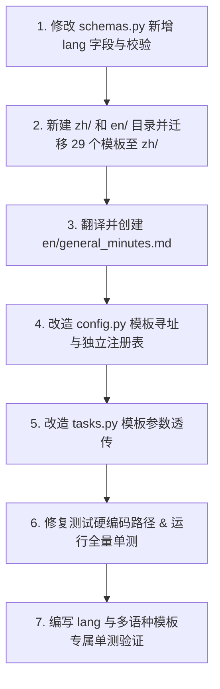

# 模板多语种目录改造、请求体 lang 扩展与通用纪要英文试点行动清单 (ACTION PLAN)

> **目标**：
> 1. 在请求体第一层引入 `lang: "zh" | "en"` 控制参数及严格校验；
> 2. 实现中文与英文基底模板的物理目录隔离（`resources/templates/zh/` 与 `resources/templates/en/`）；
> 3. 底层模板寻址与注册表支持按请求语种 `lang` 严格、独立加载对应语言目录下的模板文件；
> 4. 首期将通用纪要（`general_minutes.md`）翻译为专业地道英文模板进行试点，并完成端到端请求与模板加载验证。
>
> **核心原则**：
> - **请求体第一层一等公民**：`lang` 直接作为顶层字段，不触碰 `_compat_task_request`。
> - **严格语种隔离，无跨语种混用**：当请求 `lang="en"` 时，严格在 `en/` 目录下查找模板；若请求的模板不存在，严格按契约抛出 400，**绝不跨语种混用或静默回退到中文模板**。
> - **基底模板基数为 29 个**：已剔除历史多余的 `admission_briefing`，中文基底模板基数固定为 29 个。

---

## 一、 请求体验证与参数解析扩展 ([app/schemas.py](file:///D:/study/demo/app/schemas.py))

### 1.1 请求体第一层增加 `lang` 字段
- **改动文件**：[app/schemas.py](file:///D:/study/demo/app/schemas.py)
- **改动位置**：`TaskRequest` 模型顶层字段（约第 63 行）。
- **具体设计**：
  ```python
  class TaskRequest(BaseModel):
      texts: dict[str, str] = Field(default_factory=dict)
      docs: list[str] = Field(default_factory=list)
      memory: bool = False
      extra: Extra = Field(default_factory=Extra)
      time: str = ""
      lang: str = "zh"  # 🌟 请求顶层一等公民，默认中文 "zh"
  ```
- **字段独立校验器**：
  ```python
  @field_validator("lang")
  @classmethod
  def _validate_lang(cls, value: str) -> str:
      v = (value or "zh").strip().lower()
      if v in {"en", "english"}:
          return "en"
      if v in {"zh", "ch", "cn", "chinese"}:
          return "zh"
      raise ValueError(f"lang 仅支持 'zh' 或 'en'，收到未知取值：{value}")
  ```
- **契约边界**：不触碰 `_compat_task_request`，不与 `extra` 产生任何双向同步或历史兼容包袱。

---

## 二、 模板目录结构物理隔离

现有的 `resources/templates/` 调整为清晰的二级语种目录：

```
resources/templates/
├── zh/                            # 🌟 现有 29 个中文基底模板全量移入
│   ├── general_minutes.md
│   ├── project_progress.md
│   ├── team_meeting.md
│   └── ... (共 29 个模板，与 cm_template_v2 严格 1:1 对齐)
└── en/                            # 🌟 英文基底模板库
    └── general_minutes.md         # 🌟 首期试点：通用纪要英文模板（后续补全其余 28 个）
```

---

## 三、 底层模板读取与注册表逻辑改造 ([app/config.py](file:///D:/study/demo/app/config.py))

### 3.1 `template_dir` 语种动态寻址
- **函数签名**：`def template_dir(lang: str = "zh") -> Path`
- **寻址逻辑**：
  - `lang == "en"`：定位到 `resources/templates/en/`；
  - `lang == "zh"`（或缺省）：定位到 `resources/templates/zh/`；
  - 仅做目录环境安全检查（若子目录不存在安全回退到父级目录 `resources/templates`），**不混杂跨语种读取**。

### 3.2 `template_registry` 独立注册表（按语种严格隔离）
- **函数签名**：`def template_registry(lang: str = "zh") -> dict[str, dict[str, object]]`
- **逻辑设计**：
  - 维护独立的 `{lang}` 维度注册表缓存；
  - 严格只扫描 `resources/templates/{lang}/*.md` 构建条目；
  - **严格契约执行（无跨语种混用）**：
    - 在 `lang == "en"` 模式下，注册表仅包含 `en/` 下已有的模板；
    - 请求任何尚未英化的模板，直接命中非法模板检查并抛出 400，保证交付的契约纯净性与可预期性。

### 3.3 `template_key` 与 `resolve_template_format` 语种透传
- **函数签名**：
  - `def template_key(template_value: str, lang: str = "zh") -> str`
  - `def resolve_template_format(template_value: str, lang: str = "zh") -> str`
- **逻辑设计**：
  - 接收 `lang` 参数，并在对应的 `template_registry(lang=lang)` 中按模板文件名与标题进行精准定位；
  - 英文模式下不仅支持文件名英文键（如 `general_minutes`），也支持英文一级标题名称（如 `General Minutes`）。

---

## 四、 任务准备层模板加载透传 ([app/tasks.py](file:///D:/study/demo/app/tasks.py))

### 4.1 `_template_file` 函数改造
- **函数签名**：
  ```python
  def _template_file(
      domain: str,
      line: str,
      template_value: str,
      profile_value: str = "",
      style_value: str = "",
      is_agenda_enhanced: bool = False,
      lang: str = "zh",  # 🌟 新增语种入参
  ) -> Path | None:
  ```
- **逻辑调用更新**：
  - 调用 `resolve_template_format(value, lang=lang)`，严格提取对应语种的模板正文与要求。

### 4.2 `_prepare` 任务解析入口透传
- 在 `_prepare(domain, task, req, user_id)` 中：
  - 调用 `_template_file(..., lang=req.lang)`，将最外层传入的 `req.lang` 准确下发。
  - 在 `_Prepared` 数据结构中保存 `lang: str = req.lang`，为后续完整运行管线打好基础。

---

## 五、 试点英文模板：`general_minutes.md` 规范翻译对照

### 5.1 英文模板正文 (`resources/templates/en/general_minutes.md`)

```markdown
# General Minutes

<!-- requirement
Objectively and comprehensively present the core content and decisions of the meeting in a rigorous, formal business tone; organize facts by topic clusters and structured sub-sections, highlighting key metrics, participant stances, and final rulings with high information density.
-->

## [Executive Summary]
[Single paragraph, approx. 150–250 words: Provide an overview of the meeting background, primary participants, key discussion tracks, and final crucial decisions; detailed technical points should not be expanded here.]

## [Key Discussion Points]
[Detailed facts and progress structured around business topics: Group by topic with subheadings "### Topic Name"; under each topic, use bullet points "- " to detail specific proposals, rationale, metrics, and explicit requirements, scaling naturally with the discussion.]

## [Decisions & Rulings]
[Focus on final approved resolutions, decisions, and consensus guidelines: List item by item using "- **Item Name**: Specific resolution, target metrics, decision owner, and rollout timeline"; adaptively omit this section if no explicit decisions or consensus were reached.]
```

### 5.2 结构对照表

| 栏位 | 中文版 (`zh/general_minutes.md`) | 英文版 (`en/general_minutes.md`) | 说明 |
| :--- | :--- | :--- | :--- |
| **文件标题** | `# 通用纪要` | `# General Minutes` | 一级标题，渲染终稿直接呈现 |
| **要求注释** | `<!-- requirement ... 客观全面呈现... -->` | `<!-- requirement ... Objectively and comprehensively... -->` | 供下游渲染 Prompt 注入使用 |
| **栏目一** | `## [全文摘要]` | `## [Executive Summary]` | 宏观开场总述 |
| **栏目二** | `## [要点梳理]` | `## [Key Discussion Points]` | 业务板块展开（下挂 `### Topic Name`） |
| **栏目三** | `## [结论定调]` | `## [Decisions & Rulings]` | 最终裁决与落地标准（`- **Item**: ...`） |

---

## 六、 测试用例与硬编码路径适配清单

迁移后，部分单元测试中硬编码了旧路径 `Path("resources/templates/xxx.md")`，需要同步对齐：

1. [tests/meeting/test_consensus_decision.py](file:///D:/study/demo/tests/meeting/test_consensus_decision.py#L33)：更新为 `resources/templates/zh/consensus_decision.md`。
2. [tests/unit/core/templates/test_column_projection.py](file:///D:/study/demo/tests/unit/core/templates/test_column_projection.py#L2068)：更新为 `resources/templates/zh/court_transcript.md`。
3. [tests/unit/core/templates/test_section_pruner.py](file:///D:/study/demo/tests/unit/core/templates/test_section_pruner.py#L235)：更新为 `resources/templates/zh/` 相应文件。
4. [tests/unit/meeting/test_minutes_agenda_integration.py](file:///D:/study/demo/tests/unit/meeting/test_minutes_agenda_integration.py#L225)：更新为 `resources/templates/zh/general_minutes.md`。
5. [tests/unit/core/templates/_common.py](file:///D:/study/demo/tests/unit/core/templates/_common.py#L36)：`template_dir()` 默认返回 `zh` 目录，全量继承。

---

## 七、 具体执行步骤顺序 (Execution Roadmap)



1. **Step 1 - Schema 扩展**：
   - 在 [app/schemas.py](file:///D:/study/demo/app/schemas.py) 的 `TaskRequest` 顶层增加 `lang: str = "zh"` 与字段校验器。
2. **Step 2 - 目录创建与物理迁移**：
   - 创建 `resources/templates/zh/` 和 `resources/templates/en/`；
   - 将现有 29 个 `.md` 文件移入 `resources/templates/zh/`。
3. **Step 3 - 创建英文试点模板**：
   - 编写创建 `resources/templates/en/general_minutes.md`。
4. **Step 4 - 改造配置与注册表**：
   - 在 [app/config.py](file:///D:/study/demo/app/config.py) 中更新 `template_dir`, `template_registry`, `template_key`, `resolve_template_format`。
5. **Step 5 - 任务准备层透传**：
   - 在 [app/tasks.py](file:///D:/study/demo/app/tasks.py) 中向 `_template_file` 与 `_Prepared` 透传 `lang`。
6. **Step 6 - 修复测试硬编码路径与回归**：
   - 对齐测试用例中的硬编码路径，全量跑测试。
7. **Step 7 - 编写专项测试验证**：
   - 验证 `lang="en"` 加载英文通用纪要；
   - 验证 `lang="zh"` 加载中文通用纪要；
   - 验证 `lang="en"` 请求未翻译模板严格 400。
