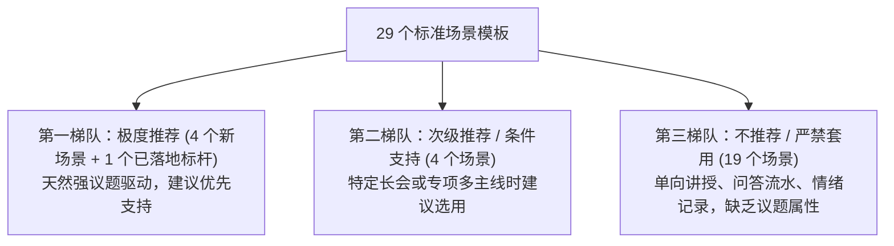
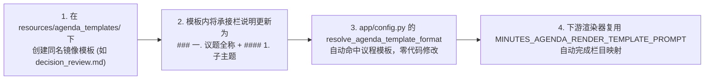

# 29 个标准模板场景按议题输出可行性分析与栏目推荐方案

> **核心目标**：评估系统现有 8 大业务领域共 29 个标准模板对“审定议题模式（Agenda-Enhanced Mode）”的适配性，明确指出哪些场景天然具备议程驱动属性、适宜按议题输出，并精准锚定具体承接议题展开的模板栏目与落地方案。

---

## 一、议题驱动模式的判别准则与边界

### 1. 什么是“按议题输出”？
按议题输出（Agenda-Driven Output）是指在正文核心研讨栏目中，以**现场审定的有效议程/议题清单**为主线展开呈现，形成原生 Markdown 树状层级：
* **三级议题大项**（`### 一. [议题全称]`）
* **四级子主题聚类**（`#### 1. [子业务方向]`，严控在 2–6 个以内）
* **无序列表项要点**（`- `，交代方案细节、数据论据与定调结论，单条约 40–80 字）

### 2. 适用的判定标准（四要素）
1. **多主线并列性**：会议并非单线推进，而是包含 2 个及以上相对独立、互不嵌套的研讨事项或业务战线；
2. **多方质询/观点交锋**：各议题内部通常有方案汇报、各方论证、参数比选与讨论博弈；
3. **独立决策定调**：每个议题往往有专属的验收标准、拍板决议或后续分工，而非全场笼统总结；
4. **与议程单 1:1 对齐**：参会人员事先明确或现场口头确认了既定议程清单。

> [!CAUTION]
> **反模式警示（严禁一刀切）**：
> 凡属于“单向传授（课堂/讲座）”、“线性问答（面试/访谈）”、“情绪与生活记录（备忘/咨询/游览）”的场景，天然缺乏多方审定议题的属性，强行按议题切片会割裂叙事逻辑、产生大量空泛无依据的伪标题，破坏公文规范。

---

## 二、29 个场景模板全景评估与分级矩阵

系统现存 29 个标准模板根据议题属性被划分为三个梯队：



### 全景分级总览表

| 推荐等级 | 场景模板名称 (中文 / 英文) | 所属领域 | 业务适配度 | 核心承接栏目 (关键锚点) |
| :--- | :--- | :--- | :---: | :--- |
| **已落地标杆** | **通用纪要** (`general_minutes.md`) | 日常记录 | 100% | **`## [要点梳理]`** |
| **第一梯队 (强推荐)** | **决策评审会** (`decision_review.md`) | 会议 | 100% | **`## [方案陈述]`** |
| **第一梯队 (强推荐)** | **工作研讨会** (`workshop_session.md`) | 会议 | 95% | **`## [研讨方案]`** |
| **第一梯队 (强推荐)** | **合同审核** (`contract_vetting.md`) | 法律沟通 | 90% | **`## [核心条款梳理]`** |
| **第一梯队 (强推荐)** | **小组讨论** (`group_seminar.md`) | 学习 | 90% | **`## [发言要点]`** |
| **第二梯队 (次级推荐)**| **项目进度会** (`project_progress.md`) | 会议 | 80% | **`## [进度追踪]`** |
| **第二梯队 (次级推荐)**| **沟通交流会** (`exchange_forum.md`) | 会议 | 75% | **`## [核心信息]`** |
| **第二梯队 (次级推荐)**| **庭审记录** (`court_transcript.md`) | 法律沟通 | 75% | **`## [举证质证]`** |
| **第二梯队 (次级推荐)**| **辩论会** (`debate_forum.md`) | 学习 | 70% | **`## [核心争议]`** |
| **第三梯队 (不推荐)** | **团队例会、总结复盘会等其余 20 个模板** | 综合 | < 40% | *不建议改动（保持原专属结构）* |

---

## 三、第一梯队（极度推荐）重点场景深度剖析

这 4 个场景天然具备闭门会议、多议题独立评审、现场拍板的核心特征，是继“通用纪要”之后最具落地价值的议题化场景。

### 1. 决策评审会 (`decision_review.md`)
* **适用场景**：架构方案评审、产品立项评审、投决会、技术改造评审等。
* **原模板结构**：
  * `## [评审议题概况]`（首栏总述，宏观交代背景）
  * `## [方案陈述]`（核心论述栏）
  * `## [最终决议]`（拍板结论栏）
  * `## [遗留问题]`（风险与卡点）
* **承接议题的精准栏目**：**`## [方案陈述]`**
* **原理解析**：
  评审会天然由“N 个待审方案议题”构成（如“议题一：支付中台高可用升级方案”、“议题二：风控规则引擎自研方案”）。
  在 `## [方案陈述]` 栏目下，每个待审方案作为独立的三级议题小节展开，下方以四级子主题列出方案考量、实测参数与评审质询，最契合公文评审规范；而 `## [最终决议]` 则作为全局决议栏目，同步列出各项通过/驳回定调。
* **排版输出形态示例**：
  ```markdown
  ## 方案陈述
  ### 一. 支付中台高可用单元化方案评审
  #### 1. 容灾指标与多活架构考量
  - 核心结算链路推进同城双活改造，目标 RTO 压缩至 30 秒以内，RPO 为 0；
  - 针对分库分表路由机制完成压力测试，单机 QPS 上限达到 1.2 万次/秒。
  #### 2. 数据一致性保障举措
  - 引入分布式事务最终一致性补偿机制，异常工单自动重试时限设定为 15 分钟；
  - 明确会后由基础架构组牵头完成全链路压测，作为上线验收前置条件。
  ### 二. 风控规则引擎自研替代评审
  - 原商业引擎年化授权成本高昂，新自研引擎规则匹配延迟实测降低至 12ms……
  ```

---

### 2. 工作研讨会 (`workshop_session.md`)
* **适用场景**：业务战略研讨、专题攻坚 Workshop、产品设计研讨会等。
* **原模板结构**：
  * `## [研讨概述]`（总述背景与目标）
  * `## [核心观点]`（研讨原则与关键洞察）
  * `## [研讨方案]`（具体技术方案与行动路径）
  * `## [未决后续]`（待定事项）
* **承接议题的精准栏目**：**`## [研讨方案]`**
* **原理解析**：
  Workshop 会议通常设定 2~4 个攻坚议题进行分组头脑风暴或分头汇报。
  将 `## [研讨方案]` 栏目作为议题承载底座，按 `### 一. [攻坚议题全称]` 展开方案细节、架构选型与实施步骤，条理分明，能完全消除原本按发言零散罗列的流水账感。

---

### 3. 合同审核 (`contract_vetting.md`)
* **适用场景**：重大采购合同会审、法务商务风险谈判、技术协议对齐会。
* **原模板结构**：
  * `## [合同概况]`（合同基本信息与主体）
  * `## [核心条款梳理]`（商务、交付、违约等关键条款）
  * `## [风险识别]`（潜在法律或履约风险）
  * `## [审核结论]`（法务定调意见）
* **承接议题的精准栏目**：**`## [核心条款梳理]`**
* **原理解析**：
  合同审核会议是典型的**“以条款为议题”**（如“议题一：知识产权与代码归属条款”、“议题二：违约金上限与赔偿责任界定”、“议题三：验收节点与质保金支付周期”）。
  在 `## [核心条款梳理]` 下，每个审定条款作为一个三级小节（`### 一. 知识产权与成果归属条款`），子级对比双方诉求、修改考量与最终达成合规条款，非常严谨规范。

---

### 4. 小组讨论 (`group_seminar.md`)
* **适用场景**：专业培训研讨、高校研究生研讨班、学术课题讨论会。
* **原模板结构**：
  * `## [讨论议题]`（讨论主题交代）
  * `## [发言要点]`（各方观点陈述）
  * `## [共识与分歧]`（共识沉淀）
  * `## [未决问题]`（遗留悬念）
* **承接议题的精准栏目**：**`## [发言要点]`**
* **原理解析**：
  研讨会通常由主持人抛出 2~3 个核心命题供全员探讨。
  将 `## [发言要点]` 升级为议题树状结构：`### 一. [研讨命题全称]`，下方以子主题归纳主流学术流派、实证数据与反方辩驳，杜绝将发言零碎地挂在人名之下。

---

## 四、第二梯队（次级推荐 / 条件支持）场景剖析

这 4 个场景在具备“明确长议程单”时可无缝应用，但在日常常规会议中可能仅讨论单一事项，建议设为**按需开启**：

| 场景模板 | 承接栏目 | 业务场景适用机制 |
| :--- | :--- | :--- |
| **项目进度会** (`project_progress.md`) | **`## [进度追踪]`** | 当跨多个业务子系统联合周会时，按 `### 一. [子系统/模块名称]` 设立议题汇报进度与卡点；单一小项目周会则不建议强拆过多议题。 |
| **沟通交流会** (`exchange_forum.md`) | **`## [核心信息]`** | 跨部门/甲乙方协调会，就多个争议接口/权责议题逐项对齐时，按议题排版呈现双方交换意见。 |
| **庭审记录** (`court_transcript.md`) | **`## [举证质证]`** | 复杂庭审中，法官会明确归纳“核心争议焦点一、二、三”，此时按争议焦点设立议题归集双方举证质证。 |
| **辩论会** (`debate_forum.md`) | **`## [核心争议]`** | 涵盖多个分论点交锋的综合辩论赛事，按各分辩题拆解双方论据。 |

---

## 五、第三梯队（不建议套用议题）清单与原因

以下 19 个模板**强烈建议保持原有独立结构**，严禁强套议题模式：

1. **单向宣讲与知识沉淀类（3 个）**：
   * `class_transcript.md`（课堂记录）、`special_lecture.md`（专题讲座）、`knowledge_memo.md`（知识笔记）
   * *原因*：讲师单向讲授，以知识树逻辑展开，无现场审定议题和多方博弈决议。
2. **一对一问答与考核类（4 个）**：
   * `hiring_report.md`（面试报告）、`interview_debrief.md`（面试复盘）、`interview_transcript.md`（采访记录）、`research_dialogue.md`（调研访谈）
   * *原因*：线性问答流，围绕单个候选人或受访者展开，强套议题会导致结构破碎。
3. **专家问诊与咨询类（3 个）**：
   * `clinical_advisory.md`（就医咨询）、`psychological_session.md`（心理咨询）、`legal_advisory.md`（法律咨询）
   * *原因*：严格遵循“问诊-病史-诊断-处方”专业闭环，非议事决议会议。
4. **单向发布与日常纪实类（9 个）**：
   * `product_launch.md`（产品发布）、`media_briefing.md`（新闻发布）、`media_qa_session.md`（媒体问答）、`government_bulletin.md`（政府报告）、`team_meeting.md`（团队例会）、`retrospective_session.md`（总结复盘会）、`personal_memo.md`（个人备忘）、`conversation_transcript.md`（对话记录）、`site_visit_tour.md`（参观游览）、`home_school_liaison.md`（家校沟通）
   * *原因*：日常随记或单向宣传，缺乏多议程闭门拍板的业务基因。

---

## 六、工程落地实施路径建议

系统目前已经在“通用纪要”上跑通了完整的议题增强流水线，若要将**第一梯队的 4 个场景**升级支持议题输出，工程扩展极其平滑自然：



### 极简落地三步法：
1. **新建镜像模板**：在 `resources/agenda_templates/` 目录下新增对应模板文件（例如 `decision_review.md`）；
2. **对齐占位说明**：将对应栏目（如 `## [方案陈述]`）的占位说明对齐通用纪要的规约（“以现场审定的有效议题清单为主线展开呈现：每个审定议题设立三级小节标题……”）；
3. **零代码改动生效**：现有 `app/config.py` 中的 `resolve_agenda_template_format()` 具备自动探测能力，只要检测到议程模式且 `resources/agenda_templates/{template_id}.md` 存在，即可自动优先加载该模板完成议题直出渲染！
