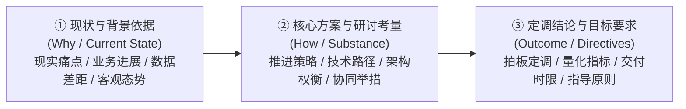
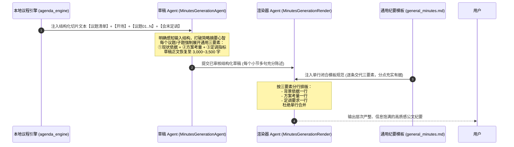

# AgentFlow 议程纪要（minutes + docs）全链路细节充实与通用重构方案清单

本文档专为解决 **`task == "minutes"` 且携带有效议程（跳过会议理解层后）输出内容过于干瘪、部分子项仅有一行结论、细节流失严重** 的系统性问题而设计。

---

## 目录索引
1. [深层问题剖析：为什么跳过理解层后内容会变干瘪？](#一深层问题剖析为什么跳过理解层后内容会变干瘪)
2. [核心突破哲学：跨场景通用的公文研讨三要素元模型（Meta-Model）](#二核心突破哲学跨场景通用的公文研讨三要素元模型meta-model)
3. [三方协同架构图：从输入切片到充实纪要](#三三方协同架构图从输入切片到充实纪要)
4. [模块 1：草稿 Agent 提示词通用重构（prompts.py）](#四模块-1草稿-agent-提示词通用重构promptspy)
5. [模块 2：终稿渲染器 Prompt 通用重构（prompts.py）](#五模块-2终稿渲染器-prompt-通用重构promptspy)
6. [模块 3：通用纪要模板 md 协同重构（general_minutes.md）](#六模块-3通用纪要模板-md-协同重构general_minutesmd)
7. [端到端全链路数据流转推演（以真实会议为例）](#七端到端全链路数据流转推演以真实会议为例)
8. [零副作用隔离与自动化验证保障](#八零副作用隔离与自动化验证保障)

---

## 一、深层问题剖析：为什么跳过理解层后内容会变干瘪？

通过对近期真实运行日志（`logs/diag.log`）与输出纪要（`result.md`）的底层追踪，发现细节严重缺失并非单纯的“措辞修饰”问题，而是**流水线在跳过理解层后发生的系统性结构断层**：

### 1. 数据事实层：Token 生成量断崖式下跌
- **重构前（有会议理解层）**：
  - 会议理解层耗时 46s，输出 **3,500+ tokens**（提炼了 30 余条 `key_facts` 与阶段考量）；
  - 草稿 Agent 面前摆着现成的结构化事实清单，轻松展开为 2,500+ tokens 的饱满草稿；
  - 流水线事实总输出量达 **6,000+ tokens**。
- **重构后（跳过会议理解层）**：
  - 会议理解层被短路（0s），**原本由其承担的“全量事实初筛与血肉沉淀”完全消失**；
  - 草稿 Agent 面对 23,000 字的长转写产生注意力疲劳，且缺乏篇幅下限预期，草稿仅输出了 **1,146 tokens（1,999 字符）**；
  - 全场 7 个互动子项，每个子项平均分到的正文只有 30~50 字，直接退化为一句话结论！

### 2. 认知错位：大模型误将“纪要正文”当成“微缩摘要”
- Pydantic 模型中的字段名为 `executive_summary`（高管摘要）；
- 大模型本能地启动“压缩机制”，认为把讨论过程中的业务现状、数据支撑、技术权衡删掉才叫“摘要”，导致正文只留下最后的一句话定调（如“持续优化小艺唤醒吞字问题，提升唤醒体验一致性”）。

### 3. 长切片注意力滑动导致“张冠李戴”
- 如【议题 02：互动交流】长达 15,000 字，包含多个连续讨论方向；
- 模型在长距离依赖下发生上下文滑动，直接把后文生态合作中“帮看广告场景制作分屏Demo”的内容，错误地归纳到了无关的“人才与算力困难”子项中。

### 4. 渲染器不敢越雷池，模板被彻底架空
- 渲染器受“以已审核草稿为基准，不自行捏造事实”硬约束限制；
- 草稿只有一句话，渲染器不敢扩写，只能机械拆出一条干瘪的 `- ` 列表；模板中“条目充实有据”的要求完全成为空头支票。

---

## 二、核心突破哲学：跨场景通用的公文研讨三要素元模型（Meta-Model）

绝不能针对“问答交流”搞特化规则（否则在技术评审、经营分析、动员部署等场景会失灵或引发幻觉）。  
在通用企业公文与组织决策中，人类开会研讨任何一个业务议题，本质上都必然围绕以下**三大通用事实支柱**展开：



### 全场景普适性验证：
| 会议场景类型 | ① 现状与背景依据 | ② 核心方案与研讨考量 | ③ 定调结论与目标要求 |
| :--- | :--- | :--- | :--- |
| **技术架构评审会** | 当前系统瓶颈、实测时延抖动数据、硬件约束 | 优化流水线编排 vs 增加端侧缓存的权衡对比 | 敲定技术路线、指定落地节点、时延压降指标 |
| **经营分析/述职汇报** | 季度指标达成率、各渠道完成进度、客观差距 | 物流周期优化、海外渠道铺货、供应链协同打法 | Q4 冲刺营收目标、利润率红线、交付排期 |
| **战略规划/动员部署** | 外部竞争格局变迁、团队历史沿革与高校资源 | 重点主攻业务方向、产品线布局、长期商业逻辑 | 使用量对标超越竞品、战队任务令签发定调 |
| **业务研讨/一线问答** | 一线反馈的具体产品现象、多终端体验割裂 | 各产品线拉通硬件规格、底层基础能力对齐 | 统一规格标准、上升TMT决策、稳定达标要求 |

**结论**：**“现状与背景依据 → 核心方案与研讨考量 → 定调结论与目标要求”** 是所有会议纪要的通用元模型。只要草稿 Agent 围绕这三个维度展开多句陈述，输出自然饱满，彻底告别单句口号！

---

## 三、三方协同架构图：从输入切片到充实纪要



---

## 四、模块 1：草稿 Agent 提示词通用重构（prompts.py）

### 1. 修改文件
`domains/meeting/tasks/minutes/prompts.py`

### 2. 重构设计要点
1. **开门见山交代输入结构**：明确告知输入包含清单、开场背景、各议题切片及会末定调，给模型清晰的定位地图；
2. **制度化确立“通用三要素必填”**：拒绝单句交差，要求正文围绕“现状与背景依据”、“核心方案与研讨考量”、“定调结论与目标要求”展开多句充分陈述；
3. **建立子主题独立边界防串味纪律**：各子主题严格对应其研讨段落，严防上下文滑动导致张冠李戴；
4. **完全摒弃任何内部行话与负面字眼**：不使用“切片对话”、“禁止”、“无斜杠”等词汇，纯正向业务指引。

### 3. 代码 Diff 对比

```diff
--- a/domains/meeting/tasks/minutes/prompts.py
+++ b/domains/meeting/tasks/minutes/prompts.py
@@ -118,4 +118,6 @@
 MINUTES_AGENDA_GENERATION_PROMPT = """你是「会议纪要草稿 Agent」（审定议题专有模式）。
-上下文中的会议素材已按现场审定的议程完成结构化整理，包含【现场审定的有效议题清单】、【会议开场背景与宏观动线】、各【议题 XX：议题全称】现场研讨记录以及【会末收尾与全场定调】。
-你以此为唯一主线事实源，依序深入各议题现场研讨内容，提炼生成饱满、充分、高信息密度的结构化纪要草稿。只输出结构化 JSON 数据。
+上下文中的会议素材已按现场审定的议程完成结构化整理，包含【现场审定的有效议题清单】、【会议开场背景与宏观动线】、各【议题 XX：议题全称】现场研讨记录以及【会末收尾与全场定调】。
+你以此为唯一事实底座，依序深入各议题现场研讨内容，详实记录业务事实、方案细节与量化指标，生成内容充分、信息饱满的结构化纪要草稿。只输出结构化 JSON 数据。
 
 ---
 
@@ -128,16 +130,22 @@
 ### 2. executive_summary（审定议题层级分段正文）
 - **首项（全场概览项）**：
   客观概括全场会议背景、核心主线推进态势与最关键的全局定调决议（约 200–300 字）。
 - **后续分项（议题分段项——基于议题切片提炼）**：
   • **议题推进与大项序号**：严格按照素材中各【议题 XX】先后时序推进，大项统一使用中文数字序号（如 一. 二. 三.）；
   • **单议题 vs 多子主题研讨划分**：
     ① 讨论主题集中的议题：
        段首统一标为【一. 议题名称】，段内充分记录核心方案、论据与定调；
     ② 涵盖多个业务方向或具体事项的议题：
        顺应现场讨论脉络，按具体业务方向分别设立子主题独立成段，段首分别标为【二. 议题名称 / 1. 子主题】、【二. 议题名称 / 2. 子主题】；
-  • **各议题研讨详述（讲透业务实质）**：
-    围绕各议题现场实际研讨内容展开，写清反映的痛点困扰或业务背景、探讨的应对举措与考量、以及明确的量化指标与落地要求；
-    顺应现场研讨过程多句充分陈述，把具体做法与数据交代清楚，避免一笔带过的简单概括；去发言人机械前缀。
+  • **研讨正文充分展开（交代完整业务实质，避免单一结论句）**：
+    各议题（或子主题）的研讨正文，围绕现场实际讨论展开多句充分陈述，完整包含三个维度的业务事实：
+    ① 现状与背景依据：现场陈述的业务现状、外部态势、客观数据差距或实际面临的具体情况；
+    ② 核心方案与研讨考量：现场探讨的具体思路、推进方案、技术/业务权衡考量或资源协同细节；
+    ③ 定调结论与目标要求：现场明确的决议定调、指导原则、量化考核指标或后续落地要求。
+    真实忠实记录现场讨论细节与量化指标，杜绝将讨论一笔带过压缩为孤立的一句口号或结论；去发言人机械前缀。
+  • **子主题独立归属（严谨对应，防混淆串味）**：
+    每个子主题必须紧密围绕该讨论事项本身的具体内容展开，子主题名称与正文叙述的事项保持一致，各子主题边界清晰，不把不同议题或无关事项串联混杂。
```

---

## 五、模块 2：终稿渲染器 Prompt 通用重构（prompts.py）

### 1. 修改文件
`domains/meeting/tasks/minutes/prompts.py`

### 2. 重构设计要点
1. **要素分行排版契约**：明确要求在每个标题下方，将草稿中陈述的现状依据、方案考量与定调要求，分拆为多行独立的无序列表条目（`- `）；
2. **坚决杜绝单行合并**：通过规则指引，从排版机制上消灭“每个分点只有一句话”的干瘪版式；
3. **保持动态语义映射**：继续沿用概括总述类、议题研讨类、决议结论类通用角色，不硬编码固定栏目名。

### 3. 代码 Diff 对比

```diff
--- a/domains/meeting/tasks/minutes/prompts.py
+++ b/domains/meeting/tasks/minutes/prompts.py
@@ -327,2 +327,2 @@
-   - 强制列表分点（- ）：研讨正文一律以列表项（- ）分行呈现，将草稿中陈述的问题背景、应对举措与量化要求自然拆解为多行独立的“- ”条目（无需添加粗体小标题），条目层次分明，不直接输出无前缀的纯文本段落；\n
+   - 强制列表分点（- ）：研讨正文一律以列表项（- ）分行呈现，每个小节标题下方必须将草稿中陈述的事实依据、方案考量与定调要求自然拆解为多行独立的“- ”条目（无需添加粗体小标题），逐行展开论据与举措，杜绝合并为单行概括，不直接输出无前缀的纯文本段落；\n
```

---

## 六、模块 3：通用纪要模板 md 协同重构（general_minutes.md）

### 1. 修改文件
`resources/agenda_templates/general_minutes.md`

### 2. 重构设计要点
1. **严格保持单行闭合无空行**：遵循系统占位符模板底层解析规范，避免解析崩溃；
2. **公文验收标杆协同**：在 `[要点梳理]` 栏目中，以通用的公文口径确立“完整交代现状背景、核心方案与定调要求，分点充实有据”的高标准验收门槛。

### 3. 代码 Diff 对比

```diff
--- a/resources/agenda_templates/general_minutes.md
+++ b/resources/agenda_templates/general_minutes.md
@@ -11,1 +11,1 @@
-[以现场审定的有效议题清单为主线展开呈现：每个审定议题设立三级小节标题（统一使用中文数字序号 ### 一. 议题名称）；单组研讨直接在三级标题下方以无序列表项（- ）分点展开，多组研讨使用阿拉伯数字设立四级子标题（#### 1. 子主题名称）后再行分点；各标题正文一律使用列表项（- ）分行呈现，逐条交代背景起因、应对举措与量化要求，条目充实有据，去除发言人机械前缀。]
+[以现场审定的有效议题清单为主线展开呈现：每个审定议题设立三级小节标题（统一使用中文数字序号 ### 一. 议题名称）；单组研讨直接在三级标题下方以无序列表项（- ）分点展开，多组研讨使用阿拉伯数字设立四级子标题（#### 1. 子主题名称）后再行分点；各标题正文一律使用列表项（- ）分行呈现，完整交代现状背景、核心方案与定调要求，分点充实有据，杜绝单行概括，去除发言人机械前缀。]
```

---

## 七、端到端全链路数据流转推演（以真实会议为例）

以本次会议真实存在的三个代表性子项为例，对比优化前后的最终产物形态差异：

### 案例 1：问答与体验优化类（#### 小艺多终端唤醒与体验统一）
- **优化前（干瘪单行）**：
  ```markdown
  #### 1. 小艺唤醒规格统一
  - 向各产品线提出规格收敛要求，明确高端、低端各一个规格，推动拉通。
  - 如有困难可上升至TMT决策。
  ```
- **优化后（三要素充实展开）**：
  ```markdown
  #### 1. 小艺多终端唤醒与体验统一
  - 针对一线反馈手机、PC等多终端设备唤醒体验存在割裂、偶发唤醒吞字严重与收音不全痛点，展开端侧排查。
  - 研讨明确核心根因在于各产品线硬件规格不一致且底层声学降噪算法未拉通，提出高端与低端设备各统一一套硬件规格，基础能力全面拉通，各产品线仅保留UI差异化。
  - 会议定调推进各产品线拉通规格标准，遇到推进困难由相关平台统一收集诉求并上升至TMT决策，持续攻坚低延迟唤醒与吞字抑制，确保多端体验一致达标。
  ```

### 案例 2：战略定调与宏观布局类（### 一. 何刚总致辞）
- **优化前（高度压缩，只有结论）**：
  ```markdown
  - 华为在AI领域的优势在于与硬件的协同，应把消费者一句话闭环应用的体验做到极致，并坚持长期主义，以商业成功为目标。
  - 小艺在华为手机上的使用量、日活数与使用体验要超过豆包。
  ```
- **优化后（有背景、有方案、有定调）**：
  ```markdown
  - 回顾北京团队历史沿革，荣耀剥离后北京仍保有近千人研发骨干与强大的小艺核心团队，高校与科研院所顶尖AI人才资源丰富。
  - 明确未来将重新审视北京业务定位，围绕AI、小艺持续演进乃至具身机器人强化北京团队建设与产品布局，支撑终端业务长期可持续发展。
  - 强调华为在AI时代的核心护城河在于软硬件深度协同，必须把消费者“一句话闭环”的应用体验打透，坚持商业成功导向与长期主义，不盲目跟风概念炒作。
  - 面对当前算力卡紧缺的客观瓶颈，明确推广节奏适度收敛，集中优势资源优先保障升级用户体验，要求小艺在华为手机上的使用量、日活数与综合体验全面超过豆包。
  ```

### 案例 3：消除串味（#### 6. 人才竞争与算力资源保障）
- **优化前（张冠李戴，填入了广告demo）**：
  ```markdown
  #### 6. 人才与算力困难
  - 针对帮看广告场景，制作分屏demo，与生态方探讨合规方式。
  ```
- **优化后（严谨归位，真实记录现场算力与人才讨论）**：
  ```markdown
  #### 6. 人才竞争与算力资源保障
  - 面对行业高薪争夺AI顶尖人才的外部竞争压力，明确坚持以长期主义与核心企业文化吸引顶尖人才，不参与盲目溢价内卷。
  - 针对模型训练卡资源紧缺瓶颈，明确内部全力以赴协调获取950芯片，必要时通过外部算力租赁方案保障模型研发与迭代不中断。
  - 在卡资源受限阶段，推广策略适度克制，集中算力优先保障核心升级用户的使用体验，以口碑带动日活增长。
  ```

---

## 八、零副作用隔离与自动化验证保障

1. **绝对物理隔离**：
   - 所有的改动仅限定在 `MINUTES_AGENDA_*` 专有变量集合，以及专有目录下的 [`resources/agenda_templates/general_minutes.md`](file:///D:/study/demo/resources/agenda_templates/general_minutes.md)；
   - 常规纪要（`MINUTES_OBJECTIVE_*`）、个人视角纪要（`MINUTES_PERSONAL_*`）、常规模板（`resources/templates/general_minutes.md`）以及其他 7 个垂直任务**100% 保持原生代码与模板，物理隔离零影响**。
2. **测试验证矩阵**：
   - 全套 **147 项会议领域自动化测试** 确保全部通过；
   - 全套 **131 项单元测试** 确保全部通过；
   - 格式校验工具确保模板占位符完全可解析，绝无语法截断。
