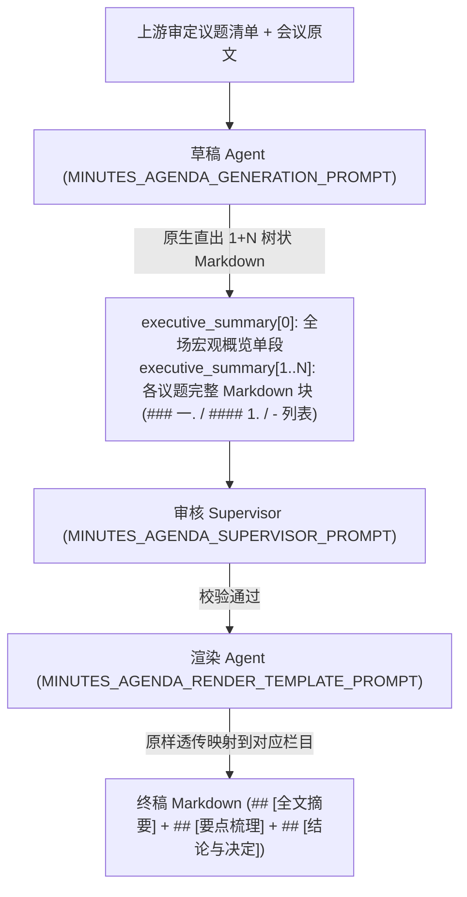

# 议题模板纪要 Prompt 重构与执行方案

## 一、 问题背景与根因复盘

### 1. 现象与痛点
在模板纪要+审定议题场景中，大模型经常在渲染栏目（如【要点梳理】）中出现排版异常：
- 错误地将议题下各分组全部打平成同级标题（如从“### 一.”机械顺延至“### 十二.”）；
- 或将议题名称与子主题混杂输出为“一、议题1：xxx 二、议题1：xxx”等生硬格式；
- 在普通非议题模板纪要中，偶现“### 议题：xxx”字样泄露。

### 2. 根因剖析
1. **中介伪标记脆弱易碎**：
   原设计中，草稿 Agent 提炼出事实后，强行在段首贴上私有中括号标签 `【一. 议题名称 / 1. 子主题】`。大模型不是确定性编译器，该中介标签极易发生格式漂移（如斜杠写成冒号、数字漏写等）。
2. **下游渲染模型负担过重**：
   下游渲染 Agent 在拿到十几个带中括号的扁平段落后，既要解析标签、又要跨段落做树状聚类分组（Tree Aggregation）、还要拆解长句为列表项。注意力机制在长文本自回归时极易走捷径，机械地“见一个标记加一个三级标题”，导致树状层级坍塌为单层平铺。
3. **普通通用模板 Prompt 污染**：
   非议题通用模板（`resources/templates/general_minutes.md`）占位符中硬编码了“按议题设立小节标题 ### 议题名称”，诱导了常规纪要的格式漂移。

---

## 二、 核心重构设计：草稿原生树状直出 + 渲染原样透传

从根本上解决问题的核心思想是：**“草稿端原生树状直出，渲染端极简原样透传”**。
全流程彻底废除 `【一. 议题 / 1. 子主题】` 伪标记。



### 1. 草稿契约重构：executive_summary 的「1 + N」原生结构
草稿契约中 `executive_summary: list[str]` 的各项具备完全确定、自洽的语义：

- **`executive_summary[0]`（全场概览项）**：
  单段连贯公文（约 250–350 字），立足全场宏观视角，概述全场业务背景、核心主线推进态势与最关键的全局定调决议，不铺开各议题微观细节。
- **`executive_summary[1..N]`（审定议题块，与审定清单 1:1 映射）**：
  全场有 $N$ 个审定有效议题，数组后续就恰好包含 $N$ 项。每一项即为一个完整、自包含的 Markdown 树状分块：
  - **一级大项**：以三级标题 `### 一. [审定议题全称]` 开头（序号按中文数字“一. 二. 三.”顺延）；
  - **单主题集中研讨**：标题下方直接使用无序列表项 `- ` 陈述业务方案、事实论据与量化指标；
  - **多方向/子事项研讨**：下方使用四级标题 `#### 1. [子主题名称]`、`#### 2. [子主题名称]` 顺次分组，每组下方使用无序列表项 `- ` 充分展开。

#### 示例：草稿生成出的 executive_summary 内容
```json
{
  "headline": "AI终端与端侧芯片协同技术研讨会",
  "executive_summary": [
    "本次会议全面研讨了AI端侧协同与车载芯片量产推进情况。北京团队自剥离调整后聚焦服务各产品线，当前算力供给偏紧，全场明确以软硬深度协同为核心护城河，收敛非核心推广，集中保障主力机型体验超越竞品。",
    "### 一. 何刚总致辞\n- 回顾北京团队发展历程，自业务调整后规模稳定在八九百人，业务重心转向赋能各产品线。\n- 强调在AI领域的优势在于软硬件深度融合，而非单纯比拼解题能力，优先把一句话闭环体验做到极致。\n- 明确当前算力卡紧缺是客观瓶颈，要求适度收敛营销推广，优先确保核心用户体验稳定优于竞品。",
    "### 二. 互动交流与专项研讨\n#### 1. 小艺唤醒体验一致性与产品线拉通\n- 针对各产品线诉求不一导致唤醒体验分化的问题，统一拉通技术规格，高中低端机型设立分档标准。\n- 要求小艺团队主动对接产品线提报规格约束，关键卡点及时升级至跨部门决策会议定夺。\n#### 2. AI撬动消费的关键场景体验打磨\n- 指出当前体验距离消费者完全满意仍有约20%的细节差距，必须聚焦高频刚需场景纵深做透。\n- 优先攻坚通话摘要、日程流转等日常核心场景，以确定性体验拉动换机口碑。"
  ],
  "key_decisions": [
    "- **算力调配与营销收敛**：各战线暂缓泛化推广，算力资源优先向核心旗舰机型倾斜保障。",
    "- **小艺体验规格拉通**：由小艺团队牵头制定高中低端统一规范，两周内完成各产品线签约互锁。"
  ],
  "personally_relevant_points": []
}
```

### 2. 渲染端极简降维：原样透传
下游渲染 Agent 不再承担任何复杂的私有标记解析与跨段落聚类合并任务：
- **`## [全文摘要]` 栏目**：直接填入 `executive_summary[0]`；
- **`## [要点梳理]` 栏目**：直接将 `executive_summary[1:]` 原样透传呈现，保留已成型的 `### 一.` / `#### 1.` / `- ` 树状排版；
- **`## [结论与决定]` 栏目**：直接填入 `key_decisions` 列表项；
- **若存在执行要点/待办栏目**：直接填入 `personally_relevant_points`。

---

## 三、 通用性保障：多栏目、多场景映射机制

### 1. 字段与模板栏目的语义解耦
模型是如何知道将哪个字段填入模板的哪一栏的？
通过**语义自适应匹配（Semantic Intent Mapping）**：
- 模板栏目标题包含“摘要/背景/概览/总述” $\rightarrow$ 映射 `executive_summary[0]`；
- 模板栏目标题包含“要点/过程/研讨/讨论/事项” $\rightarrow$ 映射 `executive_summary[1:]`；
- 模板栏目标题包含“结论/决定/决议/决策” $\rightarrow$ 映射 `key_decisions`；
- 模板栏目标题包含“行动/分工/待办/计划” $\rightarrow$ 映射 `personally_relevant_points`。

### 2. 多栏目同时需按议题输出的通用解法
在某些复杂模板中，如果存在两栏都需要按议题输出（例如：【各议题研讨过程】与【各议题决议与落地】），设计具备天然扩展性：
1. **方案 A（模板栏目分工明确，业界标准做法）**：
   大部分公文模板遵循“研讨事实归要点，拍板结论归决定”的标准规范。`executive_summary[1:]` 承载研讨过程与论据，`key_decisions` 承载各议题决议。
2. **方案 B（双栏议题细化）**：
   在渲染 Prompt 中明确语义规则：若决议栏也要求按议题呈现，指示渲染器将 `key_decisions` 条目按其归属的议题大项名称设立三级小标题分类展示。草稿生成端与各任务线核心契约保持稳定，不需要修改底层字段结构。

---

## 四、 详细改动执行清单

### 1. `domains/meeting/tasks/minutes/prompts.py`

#### (1) 草稿生成提示词：`MINUTES_AGENDA_GENERATION_PROMPT`
- **修改目标**：
  - 彻底移除 `【一. 议题名称】`、`【二. 议题名称 / 1. 子主题】` 伪标记规则；
  - 明确规定 `executive_summary` 的「1 + N」原生树状 Markdown 输出规范；
  - 文风要求：语言精炼，正向引导叙述，减少否定性禁令。
- **正向规范表述**：
  - 首项为全场概括段（约 250–350 字）；
  - 后续每一项严格对应一个审定有效议题，项首直接以三级标题 `### 一. [审定议题全称]` 设立；
  - 单组研讨直接以列表项 `- ` 阐述方案与事实；
  - 多组研讨以四级标题 `#### 1. [子主题名称]` 分组后以列表项 `- ` 阐述。

#### (2) 审核提示词：`_AGENDA_SUPERVISOR_RULES` / `MINUTES_AGENDA_SUPERVISOR_PROMPT`
- **修改目标**：
  - 将审查放行条件中的“单组【一. 议题】、多组【二. 议题 / 1. 子主题】格式”替换为“三级议题标题（### 一. 议题全称）、四级子主题（#### 1. ）与列表项（- ）树状层级”；
  - 保留公文决议体与脱水表述认可规则，确保与全局审核标准一致。

#### (3) 独立渲染提示词：`MINUTES_AGENDA_RENDER_PROMPT`
- **修改目标**：
  - 与草稿直出格式完全拉平，确立三级标题为中文数字（`### 一. 议题全称`），四级子主题为阿拉伯数字（`#### 1. 子主题全称`），正文为列表项 `- `。

#### (4) 模板渲染提示词：`MINUTES_AGENDA_RENDER_TEMPLATE_PROMPT`
- **修改目标**：
  - 彻底删除“草稿段首标记转化为标题”规则；
  - 将议题研讨类栏目映射规则简化为：直接原样映射 `executive_summary[1:]`，保留草稿中已成型的三级议题标题、四级子主题与无序列表，不做破坏性重写与二次聚类。

### 2. `resources/templates/general_minutes.md`（普通非议题模板脱敏）
- **修改目标**：
  - 将第 11 行 `按议题设立小节标题 ### 议题名称` 改为 `按现场研讨设立三级小节标题（### 业务板块名称）`；
  - 彻底切断普通会议纪要中模型错误生成“### 议题：xxx”的提示词诱因。

### 3. `resources/agenda_templates/general_minutes.md`（审定议题专属模板）
- **修改目标**：
  - 与原生树状结构完全对齐，提示词保持正向简洁，明确三级标题为审定议题全称，四级标题为阿拉伯数字子主题，正文列表项分点呈现。

### 4. `tests/unit/meeting/test_minutes_agenda_integration.py`（自动化测试守卫）
- **修改目标**：
  - 校验断言字符串，确保对重构后的 Prompt 关键词做精准对齐，保障测试全量通过；
  - 新增关于原生树状格式的结构化契约用例。

---

## 五、 文风与引导原则对照表

| 原表述（生硬禁令 / 互联网大词） | 优化后正向规范（简练、公文体、正向引导） |
| :--- | :--- |
| 会议开场背景与宏观动线 | 会议开场背景与主线脉络 |
| 防混淆串味 | 严格对应，防止跨议题交叉混淆 |
| 严禁在每行添加粗体标签 | 正文直接以无序列表项（- ）陈述方案与事实 |
| 杜绝合并为单行概括，不直接输出无前缀的纯文本段落 | 充分展开方案细节与客观论据，每条要点独立成行 |
| 严禁因正文提及而输出空列表 [] | 正文中已包含的明确决议，此处同步独立全量归集 |
| 段首统一标为【一. 议题名称】 | 项首设立三级小节标题（### 一. 议题全称）原生直出 |

---

## 六、 验证与回归计划

1. **静态检查与语法测试**：
   运行 `tests/unit/meeting/test_minutes_agenda_integration.py`，确保议题全链路（路由、上下文、模板解析、审核放行）100% 通过。
2. **议题引擎测试**：
   运行 `tests/unit/meeting/test_agenda_engine.py`，确保议程切片与上下文装配稳定。
3. **非议题与通用测试回归**：
   运行通用纪要及其他任务线测试，确保普通客观纪要、个人纪要、行动项等完全不受影响。
