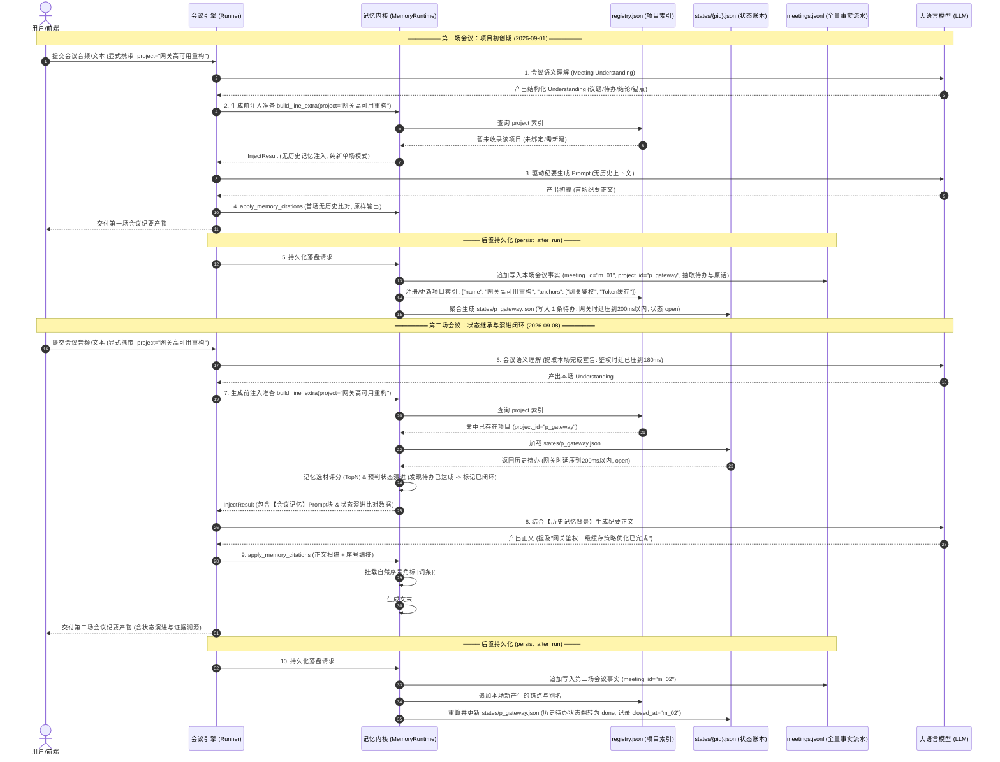
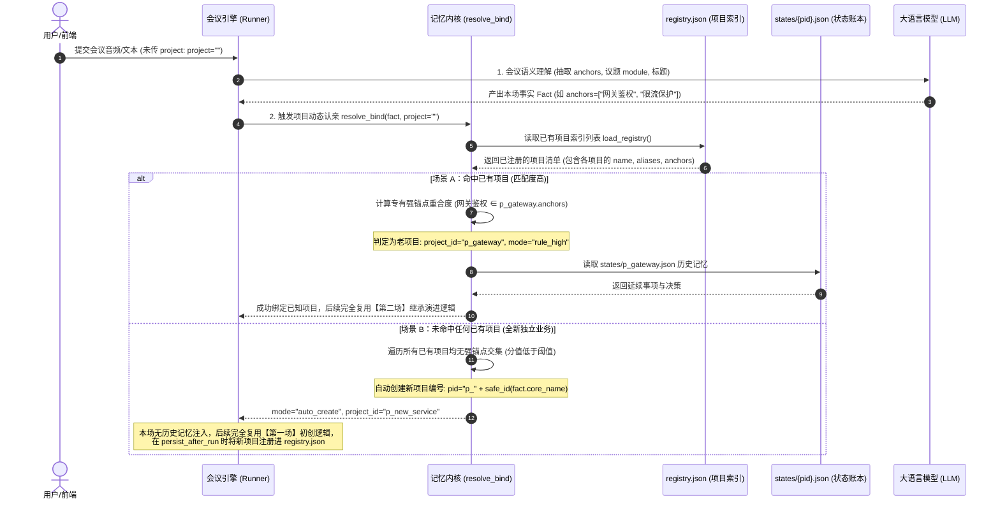

# 会议记忆系统完整执行时序与数据流转规范 (MEMORY_EXECUTION_FLOW_UML.md)

> **修订日期**：2026-11-06  
> **核心主题**：会议记忆系统（Memory v2）项目级生命周期、文件存储结构演变、显式/隐式绑定时序与贯穿示例。

---

## 一、 架构与执行逻辑确认（回答“这个没问题吧”）

**结论：您的理解完全正确，且非常精准地抓住了整套会议记忆系统的核心运转骨架！**

系统正是以 `project` 为主线，在用户隔离目录 `data/{user_id}/memory/minutes/` 下通过三大文件（**索引表**、**事实流水**、**状态账本**）实现多场会议的自闭环演进。

在底层工程实现上，有以下三个关键细节为您的理解提供有力支撑：

1. **读写时钟严格隔离（Before Gen 读历史，After Gen 写本场）**：
   - **纪要生成前**（`build_line_extra`）：仅从 `states/{project_id}.json` 读取**上一场及更早**的既有状态，筛选 TopN 注入本场 Prompt，并预先计算状态演进草稿。严禁在生成前落盘本场数据，彻底杜绝“本场自己引用自己”的悖论；
   - **纪要生成后**（`persist_after_run`）：当大模型生成正文且挂载完文末证据卡片后，系统才将本场事实追加到 `meetings.jsonl`，并刷新 `registry.json` 与 `states/{project_id}.json`。
2. **状态账本的幂等重算机制（Rebuild State）**：
   - `states/{project_id}.json` 不是简单的局部字段覆盖，而是通过 `rebuild_state` 从 `meetings.jsonl` 中过滤出属于该 project 的所有历史场次，按时间顺序重新模拟状态机流转（创建、认领、解决、沉寂）。这确保了即便某场会议被重新编辑或删除，状态账本依然能 100% 幂等恢复。
3. **无缝平滑自适应认亲（规则打分优先）**：
   - 未传 `project` 时，优先使用规则引擎比对 `fact.anchors`、`topics.module` 与 `registry.json` 中已有项目的强锚点（`strong_anchors`）与别名；只要 Jaccard/包含度超过阈值即可秒级精准绑定，零额外延迟。

---

## 二、 UML 时序图一：显式指定 Project（第一场 ➔ 第二场）

展示显式传入 `project="网关高可用重构"` 时，第 1 场新建与第 2 场继承演进的完整时序：



---

## 三、 UML 时序图二：未指定 Project（自动锚点认亲 ➔ 自动新建/关联）

展示未传入 `project`（留空）时，系统如何进行“自适应认亲”：



---

## 四、 极简实战贯穿示例：每一步文件中都存了什么

以核心项目 **“网关高可用重构”**（用户 ID：`user_001`）两场会议流转为例，直观展示三个关键物理文件的内容演变：

```
data/user_001/memory/minutes/
  ├─ registry.json        # 项目别名与强锚点索引
  ├─ meetings.jsonl       # 每场会议全量事实流水（只追加，不覆盖）
  └─ states/              # 宏观任务状态机账本
       └─ p_gateway.json  # 本项目的最新演进账本
```

---

### 阶段 1：第一场会议（2026-09-01 《网关鉴权方案评审会》）

#### 现场原话输入：
> **李工**：“网关鉴权接口压测发现抖动，需要在一周内将时延指标压到 200ms 以内。”  
> **张工**：“后续统一采用 Token 二级缓存保护方案。”

#### 执行前（磁盘为空）：
- `registry.json`：`{"projects": {}}`
- `meetings.jsonl`：空
- `states/p_gateway.json`：不存在

#### 执行中（纪要输出）：
由于无前序历史，生成的纪要为标准单场格式（无状态演进与历史溯源小节）。

#### 执行后（写入磁盘后的文件内容）：

##### 1. `registry.json`（自动收录新项目与首场锚点）
```json
{
  "projects": {
    "p_gateway": {
      "name": "网关高可用重构",
      "aliases": ["网关鉴权方案评审会"],
      "anchors": ["网关鉴权", "Token缓存", "时延指标"],
      "negative_anchors": [],
      "updated_at": "2026-09-01"
    }
  }
}
```

##### 2. `meetings.jsonl`（追加第 1 场事实流水）
```jsonl
{"meeting_id": "m_01", "time": "2026-09-01", "project_id": "p_gateway", "title": "网关鉴权方案评审会", "decisions": ["统一采用Token二级缓存保护方案"], "open_items": ["网关鉴权接口时延压到200ms以内"], "action_items": [{"text": "网关鉴权接口时延压到200ms以内", "owner": "李工", "timing": "一周内"}], "quotes": {"网关鉴权接口时延压到200ms以内": "网关鉴权接口压测发现抖动，需要在一周内将时延指标压到 200ms 以内。"}, "topics": [{"module": "网关核心架构", "title": "鉴权方案"}]}
```

##### 3. `states/p_gateway.json`（构建第 1 场初始状态账本）
```json
{
  "project_id": "p_gateway",
  "name": "网关高可用重构",
  "meeting_names": {
    "m_01": "网关鉴权方案评审会"
  },
  "recent_meetings": ["m_01"],
  "decisions": [
    {
      "item_id": "d_01",
      "text": "统一采用Token二级缓存保护方案",
      "status": "active",
      "meeting_id": "m_01",
      "quote": "统一采用Token二级缓存保护方案。"
    }
  ],
  "actions": [
    {
      "item_id": "a_01",
      "text": "网关鉴权接口时延压到200ms以内",
      "status": "open",
      "since": "m_01",
      "last_seen": "m_01",
      "owner": "李工",
      "timing": "一周内",
      "quote": "网关鉴权接口压测发现抖动，需要在一周内将时延指标压到 200ms 以内。"
    }
  ],
  "open_items": [],
  "risks": []
}
```

---

### 阶段 2：第二场会议（2026-09-08 《网关鉴权优化与推流推进会》）

#### 现场原话输入：
> **李工**：“大家同步一下，网关鉴权接口压测时延已成功压到 180ms，指标已顺利达成。接下来重点安排音视频推流丢帧补偿算法测试。”

#### 执行前（读取磁盘）：
1. 传入 `project="网关高可用重构"`（或未传 project，通过“网关鉴权”自动认亲到 `p_gateway`）；
2. 读取 `states/p_gateway.json`，调取待办 `a_01`（时延压到200ms以内，状态 open）；
3. 发现本场李工发言表示该指标已达成，程序自动比对生成【已闭环】演进条目。

#### 执行中（生成的纪要产物）：
大模型正文带上自然超链接，文末自动附带【状态演进】与【记忆溯源】两大板块：

```markdown
# 网关鉴权优化与推流推进会

## 会议决议
团队针对核心指标进行复盘，[网关鉴权接口压测时延优化](#source-1)已顺利收口，后续全面转入推流算法灰度。

...

## 状态演进

**新增决策**：
  - 音视频推流：音视频推流丢帧补偿算法测试

**已闭环**：
  - 网关核心架构：网关鉴权接口时延压到200ms以内

## 记忆溯源

#### [1] 网关鉴权接口时延压到200ms以内
> 网关鉴权接口压测发现抖动，需要在一周内将时延指标压到 200ms 以内。
- **来源会议**：网关鉴权方案评审会（2026-09-01）
```

#### 执行后（写入磁盘后的文件内容）：

##### 1. `registry.json`（增量更新别名与新发现的业务锚点）
```json
{
  "projects": {
    "p_gateway": {
      "name": "网关高可用重构",
      "aliases": ["网关鉴权方案评审会", "网关鉴权优化与推流推进会"],
      "anchors": ["网关鉴权", "Token缓存", "时延指标", "音视频推流", "丢帧补偿"],
      "negative_anchors": [],
      "updated_at": "2026-09-08"
    }
  }
}
```

##### 2. `meetings.jsonl`（追加第 2 场事实流水，只增不改）
```jsonl
{"meeting_id": "m_01", "time": "2026-09-01", "project_id": "p_gateway", "title": "网关鉴权方案评审会", ...}
{"meeting_id": "m_02", "time": "2026-09-08", "project_id": "p_gateway", "title": "网关鉴权优化与推流推进会", "decisions": ["音视频推流丢帧补偿算法测试"], "open_items": [], "action_items": [], "closed_items": ["网关鉴权接口时延压到200ms以内"], "quotes": {"音视频推流丢帧补偿算法测试": "接下来重点安排音视频推流丢帧补偿算法测试。"}, "topics": [{"module": "音视频推流", "title": "推流优化"}]}
```

##### 3. `states/p_gateway.json`（状态机驱动演进：老待办翻转为 done，记录 closed_at）
```json
{
  "project_id": "p_gateway",
  "name": "网关高可用重构",
  "meeting_names": {
    "m_01": "网关鉴权方案评审会",
    "m_02": "网关鉴权优化与推流推进会"
  },
  "recent_meetings": ["m_01", "m_02"],
  "decisions": [
    {
      "item_id": "d_01",
      "text": "统一采用Token二级缓存保护方案",
      "status": "active",
      "meeting_id": "m_01",
      "quote": "统一采用Token二级缓存保护方案。"
    },
    {
      "item_id": "d_02",
      "text": "音视频推流丢帧补偿算法测试",
      "status": "active",
      "meeting_id": "m_02",
      "quote": "接下来重点安排音视频推流丢帧补偿算法测试。"
    }
  ],
  "actions": [
    {
      "item_id": "a_01",
      "text": "网关鉴权接口时延压到200ms以内",
      "status": "done",
      "since": "m_01",
      "last_seen": "m_02",
      "closed_at": "m_02",
      "owner": "李工",
      "timing": "一周内",
      "quote": "网关鉴权接口压测发现抖动，需要在一周内将时延指标压到 200ms 以内。"
    }
  ],
  "open_items": [],
  "risks": []
}
```

---

## 五、 总结要点

1. **`registry.json` 是路由入口**：负责快速认亲，维护项目身份（ID、标准名、历史会议别名、业务强弱锚点）；
2. **`meetings.jsonl` 是唯一事实账目流水（Source of Truth）**：每场一条独立 JSON，真实保存该场会议的原始切片、提取的结论、完成宣告与发言原话；
3. **`states/{project_id}.json` 是记忆投影与状态机**：由流水表动态驱动聚合，负责跨场状态流转（open ➔ done）、沉寂降噪（dormant）、以及为本场纪要提供溯源原话与演进分类。
4. **两类调用的唯一区别在于认亲阶段**：
   - 传 `project`：直接按显式项目名锁定 `project_id`；
   - 不传 `project`：大模型理解提取锚点后，在 `registry.json` 中自适应扫描，能认亲则认亲，认不到则自动开辟新项目。认亲后两者后续的数据流转与沉淀过程 **100% 相同**。
