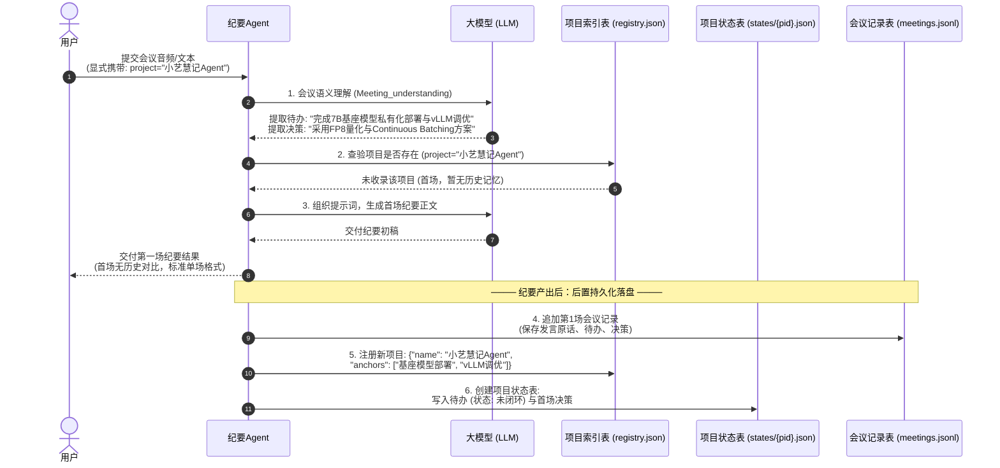
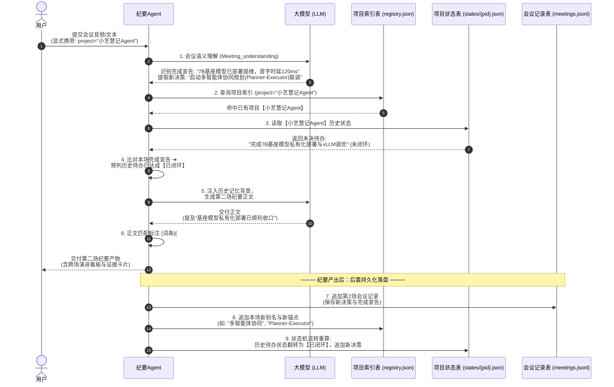
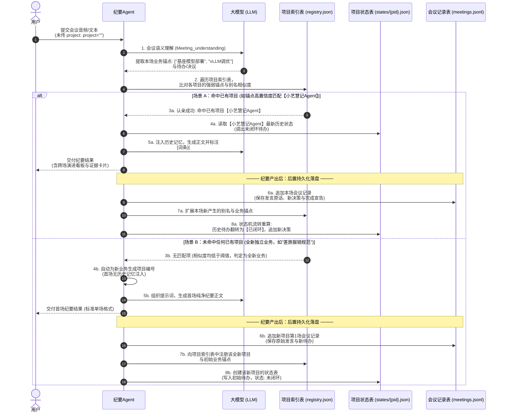

# 会议记忆系统完整执行时序与数据流转规范 (MEMORY_EXECUTION_FLOW_UML.md)

> **修订日期**：2026-11-06  
> **核心主题**：会议记忆系统项目级生命周期、清晰分层 UML 时序、小艺慧记Agent基座模型部署与多智能体研发实战贯穿示例。

---

## 一、 架构与执行逻辑确认（回答“这个没问题吧”）

**结论：您的理解完全正确，且非常精准地抓住了整套会议记忆系统的核心运转骨架！**

系统以 `project` 为统一主线，在用户隔离目录 `data/{user_id}/memory/minutes/` 下，通过三大物理文件实现多场会议的自闭环演进：

1. **项目索引表 (`registry.json`)**：全局项目目录，记录项目编号、标准名称、历史会议别名及业务强弱锚点，负责快速“认亲”；
2. **会议记录表 (`meetings.jsonl`)**：唯一的事实流水来源，每场会议追加一条独立记录（只增不改），保存发言原话摘录、提取出的待办与决议；
3. **项目状态表 (`states/{pid}.json`)**：项目的最新宏观状态账本，由事实流水动态聚合生成，维护跨场待办生命周期（未闭环 ➔ 已闭环）、决策演进与记忆溯源出处。

在底层执行上有两个关键设计支撑您的理解：

- **读写时钟严格隔离（生成前读历史，生成后写本场）**：
  - **纪要生成前**：只从项目状态表中读取**上一场及更早**的历史状态，筛选高相关记忆注入本场提示词，并预判本场状态演进草稿。此时绝不写入本场数据，彻底杜绝“自己引用自己”的悖论；
  - **纪要生成后**：大模型生成完正文并挂载好引用链接后，才将本场记录追加至会议记录表，并刷新项目索引表与项目状态表。
- **状态流转确定性重算**：
  - 项目状态表不是简单覆盖，而是基于会议记录表中该项目的全部历史记录，按时间顺序模拟状态机流转。无论中间某场是否重跑，状态演进永远 100% 幂等可靠。

---

## 二、 UML 时序图 1.1：第一场会议（显式指定 Project ➔ 初创落盘）

展示首场会议《小艺慧记Agent基座模型部署与架构评审会》中，如何由空项目起步，完成纪要交付与初创数据三表落盘：



---

## 三、 UML 时序图 1.2：第二场会议（显式指定 Project ➔ 状态继承与闭环演进）

展示第二场会议《小艺慧记Agent多智能体架构推进会》中，如何读取历史状态、比对本场完成宣告，生成带超链接演进的纪要，并驱动状态机闭环：



---

## 四、 UML 时序图 2：未指定 Project（自动锚点认亲 ➔ 流程分流 ➔ 三表落盘）

展示未传入 `project`（传空或未指定）时，系统如何进行智能认亲，并在命中或新建两种场景下，完整操作三张存储表：



---

## 五、 实战示例：小艺慧记Agent每一步各存了什么

以核心项目 **“小艺慧记Agent”**（用户：`user_001`，项目编号：`p_xiaoyi_agent`）围绕**大模型基座部署与多智能体协同研发**的两场会议为例，展示三张物理存储表的极简演变：

```
data/user_001/memory/minutes/
  ├─ 项目索引表 (registry.json)
  ├─ 会议记录表 (meetings.jsonl)
  └─ states/
       └─ p_xiaoyi_agent.json  # 项目状态表
```

---

### 阶段 1：第一场会议（2026-09-01 《小艺慧记Agent基座模型部署与架构评审会》）

#### 现场原话输入：
> **李工**：“为了保障数据安全与端到端响应，小艺慧记7B基座模型私有化部署与vLLM服务调优必须在本周五前完成。”  
> **张工**：“基座模型推理统一采用 FP8 权重量化与 Continuous Batching 加速方案。”

#### 执行前（文件为空）：
- `registry.json`：`{"projects": {}}`
- `meetings.jsonl`：空
- `states/p_xiaoyi_agent.json`：不存在

#### 执行中（生成的纪要）：
首场无历史比对，生成标准的常规纪要（无状态演进与记忆溯源栏目）。

#### 执行后（写入磁盘后的文件内容）：

##### 1. `项目索引表` (`registry.json`) —— 注册新项目
```json
{
  "projects": {
    "p_xiaoyi_agent": {
      "name": "小艺慧记Agent",
      "aliases": ["小艺慧记Agent基座模型部署与架构评审会"],
      "anchors": ["基座模型部署", "vLLM调优", "FP8量化", "Agent开发"],
      "updated_at": "2026-09-01"
    }
  }
}
```

##### 2. `会议记录表` (`meetings.jsonl`) —— 追加第 1 场流水
```jsonl
{"meeting_id": "m_01", "time": "2026-09-01", "project_id": "p_xiaoyi_agent", "title": "小艺慧记Agent基座模型部署与架构评审会", "decisions": ["基座模型推理统一采用FP8量化与Continuous Batching加速方案"], "open_items": ["完成小艺慧记7B基座模型私有化部署与vLLM服务调优"], "action_items": [{"text": "完成小艺慧记7B基座模型私有化部署与vLLM服务调优", "owner": "李工", "timing": "本周五前"}], "quotes": {"完成小艺慧记7B基座模型私有化部署与vLLM服务调优": "为了保障数据安全与端到端响应，小艺慧记7B基座模型私有化部署与vLLM服务调优必须在本周五前完成。"}, "topics": [{"module": "基座建设", "title": "模型部署"}]}
```

##### 3. `项目状态表` (`states/p_xiaoyi_agent.json`) —— 初始状态
```json
{
  "project_id": "p_xiaoyi_agent",
  "name": "小艺慧记Agent",
  "meeting_names": {
    "m_01": "小艺慧记Agent基座模型部署与架构评审会"
  },
  "recent_meetings": ["m_01"],
  "decisions": [
    {
      "item_id": "d_01",
      "text": "基座模型推理统一采用FP8量化与Continuous Batching加速方案",
      "status": "active",
      "meeting_id": "m_01",
      "quote": "基座模型推理统一采用 FP8 权重量化与 Continuous Batching 加速方案。"
    }
  ],
  "actions": [
    {
      "item_id": "a_01",
      "text": "完成小艺慧记7B基座模型私有化部署与vLLM服务调优",
      "status": "open",
      "since": "m_01",
      "last_seen": "m_01",
      "owner": "李工",
      "timing": "本周五前",
      "quote": "为了保障数据安全与端到端响应，小艺慧记7B基座模型私有化部署与vLLM服务调优必须在本周五前完成。"
    }
  ],
  "open_items": [],
  "risks": []
}
```

---

### 阶段 2：第二场会议（2026-09-08 《小艺慧记Agent多智能体架构推进会》）

#### 现场原话输入：
> **李工**：“先同步下基座进展，小艺慧记7B基座模型已完成私有化部署，vLLM推理首字时延降至120ms以内，运行稳定。接下来重点启动多智能体协同规划（Planner-Executor）核心链路联调。”

#### 执行前（读取磁盘与比对）：
1. 传入 `project="小艺慧记Agent"`（或未传 project，通过“基座模型部署”自动认亲到已有项目【小艺慧记Agent】）；
2. 读取该项目的状态表，调取待办 `a_01`（基座模型部署与vLLM调优，状态为 open）；
3. 结合本场李工发言判定该待办已达成，系统自动识别为【已闭环】。

#### 执行中（生成的纪要产物）：
正文自动带上自然连续的超链接，文末附带【状态演进】与【记忆溯源】板块：

```markdown
# 小艺慧记Agent多智能体架构推进会

## 核心决议
架构组针对基座环境进行复盘，[小艺慧记7B基座模型私有化部署与vLLM服务调优](#source-1)已顺利收口，后续重点启动协同规划链路联调。

...

## 状态演进

**新增决策**：
  - 智能体架构：启动多智能体协同规划（Planner-Executor）核心链路联调

**已闭环**：
  - 基座建设：完成小艺慧记7B基座模型私有化部署与vLLM服务调优

## 记忆溯源

#### [1] 完成小艺慧记7B基座模型私有化部署与vLLM服务调优
> 为了保障数据安全与端到端响应，小艺慧记7B基座模型私有化部署与vLLM服务调优必须在本周五前完成。
- **来源会议**：小艺慧记Agent基座模型部署与架构评审会（2026-09-01）
```

#### 执行后（写入磁盘后的文件内容）：

##### 1. `项目索引表` (`registry.json`) —— 增量扩展别名与新业务锚点
```json
{
  "projects": {
    "p_xiaoyi_agent": {
      "name": "小艺慧记Agent",
      "aliases": ["小艺慧记Agent基座模型部署与架构评审会", "小艺慧记Agent多智能体架构推进会"],
      "anchors": ["基座模型部署", "vLLM调优", "FP8量化", "Agent开发", "多智能体协同", "Planner-Executor"],
      "updated_at": "2026-09-08"
    }
  }
}
```

##### 2. `会议记录表` (`meetings.jsonl`) —— 追加第 2 场流水（只增不改）
```jsonl
{"meeting_id": "m_01", "time": "2026-09-01", "project_id": "p_xiaoyi_agent", "title": "小艺慧记Agent基座模型部署与架构评审会", ...}
{"meeting_id": "m_02", "time": "2026-09-08", "project_id": "p_xiaoyi_agent", "title": "小艺慧记Agent多智能体架构推进会", "decisions": ["启动多智能体协同规划（Planner-Executor）核心链路联调"], "open_items": [], "action_items": [], "closed_items": ["完成小艺慧记7B基座模型私有化部署与vLLM服务调优"], "quotes": {"启动多智能体协同规划（Planner-Executor）核心链路联调": "接下来重点启动多智能体协同规划（Planner-Executor）核心链路联调。"}, "topics": [{"module": "智能体架构", "title": "协同规划"}]}
```

##### 3. `项目状态表` (`states/p_xiaoyi_agent.json`) —— 状态机流转演进
待办状态由 `open` 翻转为 `done`，记录关闭会议 `closed_at: "m_02"`，并追加新决策：
```json
{
  "project_id": "p_xiaoyi_agent",
  "name": "小艺慧记Agent",
  "meeting_names": {
    "m_01": "小艺慧记Agent基座模型部署与架构评审会",
    "m_02": "小艺慧记Agent多智能体架构推进会"
  },
  "recent_meetings": ["m_01", "m_02"],
  "decisions": [
    {
      "item_id": "d_01",
      "text": "基座模型推理统一采用FP8量化与Continuous Batching加速方案",
      "status": "active",
      "meeting_id": "m_01",
      "quote": "基座模型推理统一采用 FP8 权重量化与 Continuous Batching 加速方案。"
    },
    {
      "item_id": "d_02",
      "text": "启动多智能体协同规划（Planner-Executor）核心链路联调",
      "status": "active",
      "meeting_id": "m_02",
      "quote": "接下来重点启动多智能体协同规划（Planner-Executor）核心链路联调。"
    }
  ],
  "actions": [
    {
      "item_id": "a_01",
      "text": "完成小艺慧记7B基座模型私有化部署与vLLM服务调优",
      "status": "done",
      "since": "m_01",
      "last_seen": "m_02",
      "closed_at": "m_02",
      "owner": "李工",
      "timing": "本周五前",
      "quote": "为了保障数据安全与端到端响应，小艺慧记7B基座模型私有化部署与vLLM服务调优必须在本周五前完成。"
    }
  ],
  "open_items": [],
  "risks": []
}
```

---

## 六、 核心架构总结

| 表名称 | 物理路径 | 核心定位与职责 |
| :--- | :--- | :--- |
| **项目索引表** | `registry.json` | **全局目录与路由认亲**：记录项目标准名、所有历史场次别名、业务强弱锚点，未传 project 时由此进行秒级相似度匹配。 |
| **会议记录表** | `meetings.jsonl` | **唯一事实流水（Source of Truth）**：每场一条独立记录，只追加不修改，记录该场会议抽取出的原始事实、发言摘录与完成宣告。 |
| **项目状态表** | `states/{pid}.json` | **宏观状态机演进账本**：由事实流水动态驱动聚合，维护待办生命周期（未闭环 ➔ 已闭环）、决策演进，并为当前纪要提供证据原话与来源出处。 |
