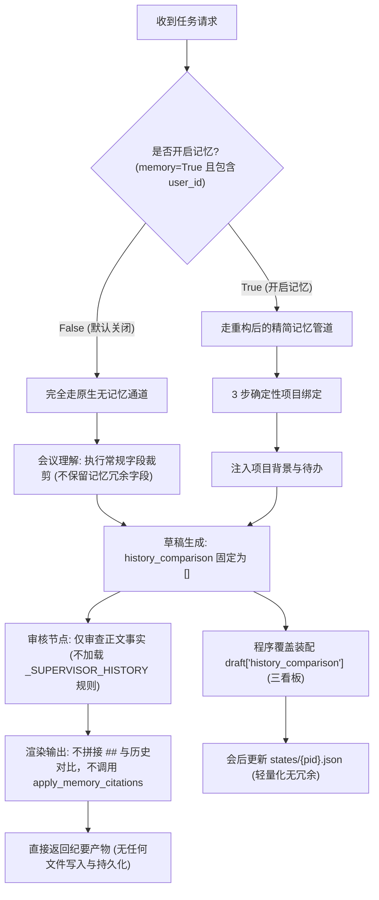

# 会议记忆系统（Memory v2）彻底重构与精简方案清单

> **设计宗旨**：
> 本方案旨在对现有会议记忆逻辑进行**根治性重构（Root-Cause Refactoring）**，坚决摒弃“打补丁”式的修修补补。彻底拔除所有**低效、不可靠、无实际消费的过度设计代码**，使记忆系统收敛为一套**高内聚、轻量化、100% 确定性**的项目状态机。
> 
> **零回归红线**：
> 严格恪守架构分层边界，**不开启记忆（`memory=False` 或未传 memory 参数）时代码路径 100% 零影响、零变更、零性能损耗**。

---

## 目录
- [一、 现状痛点与重构原则](#一-现状痛点与重构原则)
  - [1. 核心痛点诊断](#1-核心痛点诊断)
  - [2. 重构三大原则](#2-重构三大原则)
  - [3. 核心认知澄清：状态机与大模型（LLM）的边界分工](#3-核心认知澄清状态机与大模型llm的边界分工)
- [二、 彻底拔除的冗余模块与核心选型论据](#二-彻底拔除的冗余模块与核心选型论据)
  - [1. 全链路拔除「风险演变（Risks Lifecycle）」状态机](#1-全链路拔除风险演变risks-lifecycle状态机)
  - [2. 状态记账本（states/）死数据拔除与字段合并](#2-状态记账本states死数据拔除与字段合并)
  - [3. 拔除 600+ 行脆弱的正文 N-gram 字符级超链接扫描（彻底解决「文末历史记忆神隐」Bug）](#3-拔除-600-行脆弱的正文-n-gram-字符级超链接扫描彻底解决文末历史记忆神隐bug)
  - [4. 拔除模糊且低效的向量语义检索兜底与同步](#4-拔除模糊且低效的向量语义检索兜底与同步)
  - [5. 为什么短句比对（去重与闭环）依然保留纯 Python 5 字滑窗（similar）？](#5-为什么短句比对去重与闭环依然保留纯-python-5-字滑窗similar)
- [三、 精简后的目标架构与数据模型（Before vs After）](#三-精简后的目标架构与数据模型before-vs-after)
- [四、 涉及文件的详细改造清单](#四-涉及文件的详细改造清单)
- [五、 非开启记忆（memory=False）的绝对隔离性保障](#五-非开启记忆memoryfalse的绝对隔离性保障)
- [六、 重构落地实施步骤与验收用例](#六-重构落地实施步骤与验收用例)

---

## 一、 现状痛点与重构原则

### 1. 核心痛点诊断
当前记忆系统经过多轮演进，虽然具备了基本的项目绑定和跨场对比能力，但累积了严重的架构包袱：
1. **伪功能堆叠**：例如 `states` 文件中维护的 `events` 事件流（240 条）只写不读，纯属磁盘死数据；
2. **状态机主观脆弱**：“风险演变”试图用正则对大模型极其发散的风险文本进行“休眠/唤醒”，极易产生误判；
3. **大模型查重包袱**：强行划分 `open_items` 与 `actions`，导致代码内部必须写复杂的跨列表查重逻辑，而在注入端又强行拼回在一起；
4. **正文超链接碰运气**：写了 600+ 行复杂的字符滑动窗口、泛词黑名单去对碰正文，实测挂空率极高，维护成本极其沉重；
5. **外部依赖冗余**：不传 project 时的向量检索因为防误判门禁过高，基本处于摆设状态，却带来了对 Embedding 基础设施的硬依赖。

### 2. 重构三大原则
1. **彻底拔除，非修修补补**：凡是下游没有业务消费的字段、凡是命中率极低且维护成本极高的算法，整块代码连根拔起，不留僵尸逻辑。
2. **确定性优先于概率性**：记忆系统的核心是“跨场状态机对比”，必须 100% 保证事实确定性，杜绝依靠正则碰运气或大模型幻觉。
3. **接口契约向下兼容**：外部 API 参数不变，生成草稿协议 `draft["history_comparison"]` 字段保留（作为标准协议），保证前端渲染无缝兼容。

### 3. 核心认知澄清：状态机与大模型（LLM）的边界分工
- **会后落盘是 0 次大模型调用**：很多人误以为会后存盘是大模型又总结了一遍，其实会后落盘是 100% 纯 Python 代码的机械搬运（0 Token 消耗）。
- **分工本质**：
  - **大模型**：是“单场速记员”，只负责从本场嘈杂录音中提炼事实；
  - **Python 状态机**：是“跨场记账本”，负责待办去重合并、状态流转（`open` ➔ `done`）、发言原话反查与截取、主键与场次标定。
- **重构准绳**：**重构绝不是要弱化或去掉 Python 状态机，而是剔除状态机内部过度设计的自嗨死数据与幽灵逻辑，让其专注于核心决策与待办！**

---

## 二、 彻底拔除的四大冗余模块

### 1. 全链路拔除「风险演变（Risks Lifecycle）」状态机
- **为什么必须砍掉**：
  - **前端早已抛弃**：在 HTML 双栏审阅卡片中，看板固定只展示三类（`延续事项`、`已闭环`、`新增决策`），代码作者已主动将风险演变剔除出右栏；
  - **注入端几乎不执行**：在 `inject.py` 中，只有当项目的未决待办全部做完（`len(ranked_open) == 0`）时，才会轮到注入 1 条休眠风险。95% 以上的会议场景该分支根本不跑；
  - **输入极其不稳定**：自然语言会议中的“风险”措辞极度随意，上一场叫“并发瓶颈”，下一场叫“性能支撑不足”，相似度算法完全对不上，导致状态机里的风险疯狂重复建档、误判休眠。
- **拔除范围**：
  - `domains/meeting/memory/state.py`：删除 `_upsert_risks`、`_close_items(risks, ...)`、`_apply_dormant`、`_MITIGATED_RE`、`_DORMANT_AFTER`；从 `update_state` 中彻底移除 `risks` 维护。
  - `domains/meeting/memory/inject.py`：删除 `preview_comparison` 中的风险对比行，删除 `elif dormant:` 注入分支，删除 `_risk_meta`。
  - `domains/meeting/memory/render.py`：删除 `_LEDGER_LINE_RE` 中对 `风险演变` 的正则捕获。

---

### 2. 状态记账本（states/）死数据拔除与字段合并
- **为什么必须砍掉**：
  - **`events`（240 条事件流）**：全局没有任何下游消费代码去读取它，纯属只写不读的死数据；
  - **`summary` 字段**：用分号拼出的一串概况文字，下游提示词注入直接用结构化条目拼装，从未消费过 `summary`；
  - **`open_items` 与 `actions` 强行二元化**：两者业务本质都是“会后要做/要跟进的事”，由于分立导致了 `_upsert_open` 内部写了数十行 `other=opens` 跨列表防重逻辑。
- **拔除与精简范围**：
  - `states/{project_id}.json` 彻底删除 `events` 和 `summary` 顶层字段；
  - 合并 `open_items` 与 `actions` 为统一的 **`actions`（或 `todo_items`）** 列表，条目内部保留 `kind: "action" | "open"` 即可；
  - 删除单条 item 内无下游消费的 `time_source`；
  - 简化单条 item 内重复冗余的 `meeting_id`（仅保留 `since` 和 `last_seen`）。

---

### 3. 拔除 600+ 行脆弱的正文 N-gram 字符级超链接扫描（彻底解决「文末历史记忆神隐」Bug）
- **痛点机理诊断（为什么用户经常看到“只有状态演进，没有历史记忆”？）**：
  - 核心根源在于 `render.py:765` 的致命拦截：
    ```python
    if not used_items:
        return f"{body.strip()}{comparison_section}"  # ◄── 正文没搜到词，文末历史记忆引用整段被抛弃！
    ```
  - 旧代码存在严重的“执念设计”：**认为必须先在正文里用正则搜到词并插上超链接（如 `[时延](#memory-1)`），文末才有资格打印【来源 1】的发言原话卡片**。
  - 为此维护了 600 多行极其庞大的正则堆砌：数十个泛词黑名单（`_GENERIC_NEEDLES`）、英文单位过滤（`_LATIN_SKIP`）、汉字切词、章节标题与 module 重合度门禁；
  - **翻车现场**：大模型写正文只要换一个近义词（例如将“搜索时延”改写成“接口响应性能”），600 行正则直接落空，`used_items` 判定为空，文末的 `## 历史记忆引用` 彻底被丢弃！导致实测中返回的 Markdown 只有 `## 与历史对比`，历史记忆原话全面神隐！
  - 此外，这种“在生成好的 Markdown 正文里强行做字符串替换插入锚点”的黑魔法极易破坏 Markdown 原始语法（如破坏加粗、链接、代码块）。

- **技术选型深度剖析：为什么不换用 BGE 等 Embedding 模型在正文中做语义匹配？**
  很多同学直觉会想“既然正则太死板，为什么不用向量算相似度？”——在正文打标场景下，向量模型存在 **3 个不可逾越的工程死穴**：
  1. **实体边界无法对齐（Token-Level 定位困境）**：向量相似度是句子级/段落级的。当它判定整句话与历史待办相似度 0.88 时，它无法告诉你方括号 `[ ]` 到底该套在具体的哪两三个字上，把整句 50 个字全加链接会毁掉排版；
  2. **语义泛化引发严重的“张冠李戴（False Positive）”**：会议文本充满通用技术词（“缓存/优化/数据库/上线”），上一场的待办“优化 Redis 缓存”，极易在向量空间里被误挂到今天正文的“修复 MySQL 死锁”上，导致严肃纪要产生事实性张冠李戴事故；
  3. **实时渲染性能损耗**：原本几毫秒的 Markdown 渲染，若引入 $M \times N$ 的向量推理，会直接增加数百毫秒延迟，并让渲染层与外部深度学习推理服务产生硬依赖。

- **纪要正文中序号表现机制的澄清（破除认知误区）**：
  - **纯 Markdown（.md 源码）**：正文里根本没有独立的数字 `[1]`，而是 Markdown 超链接：`[网关时延指标](#memory-1)`；
  - **Markdown 阅读器预览**：肉眼看到的是蓝色可点击词汇 <ins>网关时延指标</ins>（点击跳转文末）；
  - **HTML 双栏网页审阅页**：前端 JS 提取末尾数字，在词汇后动态追加蓝色数字小方块角标 **`[1]`**。

- **彻底重构方案（解绑正文搜词，100% 确定性输出）**：
  - **彻底废除在纪要正文中强插 `(#memory-N)` 字符链接的脆弱逻辑**，大模型生成的正文字符串保持纯净，不再做粗暴替换；
  - **废除 `if not used_items:` 门禁**，打破“正文插链接才准在文末放证据”的错误执念；
  - **改由本场【状态演进事项】直接驱动文末证据输出**：
    本场既然已经确定了有哪些“延续待办”和“已闭环待办”，系统**直接提取这些事项自带的历史发言原话（`quote`）、来源会议名和时间**；
  - **纯 Markdown 与 HTML 表现**：
    - 在纯 Markdown 导出时，文末 100% 必出 `## 往期会议事实与发言出处` 附录，无论大模型正文用什么同义词，发言原话和 Deadline 永远稳定输出在文末，确凿防扯皮；
    - 在 HTML 双栏审阅页中，右栏由【状态演进看板】和【历史原话证据卡片】解耦呈现，左侧正文干净利落。
  - **收益**：瞬间拔除 `render.py` 中 500~600 行复杂黑魔法代码，彻底消灭“历史记忆原话神隐”的致命缺陷！

---

### 4. 拔除模糊且低效的向量语义检索兜底与同步
- **为什么必须砍掉**：
  - 会议通识词（例会、讨论、进度、推进、开发）在向量空间极其扁平，语义区分度极差；
  - 代码为了防误认，在 `_semantic_bind_fallback` 中设置了极度严苛的阈值（必须高出第二名 15% 且绝对分差大于 0.08），实测导致该逻辑 99% 的情况下都直接放弃绑定；
  - 引入了对 `infra.memory.embed` 向量模块的强耦合与会后向量同步开销（`_sync_meeting_vectors`）。
- **重构方案**：
  - 彻底拔除 `_semantic_bind_fallback` 与 `_sync_meeting_vectors`；
  - 绑定逻辑彻底收敛为清晰的 **3 步确定性阶梯**：
    1. **显式优先**：传了 `project` ➔ 强绑定并校验重叠；
    2. **规则打分**：未传 `project` ➔ 提取专有强锚点（中英混合、项目核心名、别名）打分，压倒性胜出则绑定；单项目先验单例匹配；
    3. **自动建新 / 独立单场**：提炼得出强专名 ➔ 自动新建项目；提炼不出（泛化标题闲聊）➔ 判定为独立单场，不强行归属。

---

### 5. 为什么短句比对（去重与闭环）依然保留纯 Python 5 字滑窗（`similar`）？
- **短句 vs 短句的天然优势**：待办短句（“网关时延指标压到50ms” vs “优化网关时延指标”）核心词高度聚集，纯 Python 5 字滑动窗口（`similar` 函数）计算耗时在微秒级，又快又准；
- **防止向量误判**：如果在待办短句比对上用向量，极容易把相似业务的两条不同任务（如“Redis鉴权优化” vs “Redis集群监控”）误判为同一个任务并错误合并；纯 Python 的 5 字公共子串能提供更可靠的硬匹配保障；
- **结论**：**短句与短句的对比（去重、闭环）坚决保留并复用 `similar` 算法；只废除长篇正文里的字符搜词打链接！**

---

## 三、 精简后的目标架构与数据模型（Before vs After）

### 1. `states/{project_id}.json` 结构精简对比

#### ❌ 重构前（臃肿复杂、冗余严重）：
```json
{
  "project_id": "alpha_gateway",
  "name": "网关改造项目",
  "anchors": ["网关", "Token"],
  "summary": "未决：时延指标... 风险：内存泄露...",     // 冗余：无下游消费
  "recent_meetings": ["m_01", "m_02"],
  "events": [                                      // 冗余：240条死数据，从未被读过
    {"type": "added", "item_id": "a1", "text": "..."}
  ],
  "decisions": [ ... ],
  "open_items": [ ... ],                           // 冗余：与 actions 概念混淆且导致跨列表查重
  "actions": [
    {
      "item_id": "a1",
      "text": "网关时延指标压到50ms",
      "status": "open",
      "since": "m_01",
      "last_seen": "m_01",
      "meeting_id": "m_01",                        // 冗余：与 since 重复
      "meeting_title": "第1场·启动会",
      "time": "2026-09-01",
      "time_source": "user",                       // 冗余：无下游消费
      "quote": "赵工：争取在9月15日前压到50ms",
      "kind": "action",
      "owner": "赵工",
      "timing": "9月15日前",
      "module": "网关架构",
      "topic_title": "时延优化"
    }
  ],
  "risks": [ ... ]                                 // 冗余：脆弱的休眠状态机，前端不展示
}
```

#### ✅ 重构后（清晰轻量、每个字段都有明确归宿）：
```json
{
  "project_id": "alpha_gateway",
  "name": "网关改造项目",
  "anchors": ["网关", "Token"],
  "recent_meetings": ["m_01", "m_02"],
  "decisions": [
    {
      "item_id": "d1",
      "text": "网关鉴权统一使用 Redis Token",
      "since": "m_01",
      "last_seen": "m_01",
      "meeting_title": "第1场·启动会",
      "time": "2026-09-01",
      "module": "网关架构"
    }
  ],
  "actions": [
    {
      "item_id": "a1",
      "text": "网关时延指标压到50ms",
      "status": "open",                            // open | done
      "since": "m_01",
      "last_seen": "m_02",
      "meeting_title": "第1场·启动会",
      "time": "2026-09-01",
      "quote": "赵工：争取在9月15日前压到50ms",       // 发言原话证据
      "owner": "赵工",
      "timing": "9月15日前",
      "module": "网关架构",
      "topic_title": "时延优化",
      "kind": "action"                             // action | open
    }
  ]
}
```

---

### 2. 状态演进看板逻辑重构（剔除风险演变）

#### ❌ 重构前：
- 算 4 类状态：新增决策、延续事项、已闭环、风险演变；
- 前端只展示 3 类（右栏排挤风险演变）；
- 正文依然打印风险演变，造成前后端视图脱节。

#### ✅ 重构后：
- 状态机统一归一化为核心 **三看板（The Core 3 Ledgers）**：
  1. **新增决策**（`new_decisions`）：本场新拍板的决议；
  2. **延续待办**（`open_actions`）：历史上遗留、当前仍需跟进的待办；
  3. **已闭环待办**（`closed_actions`）：本场已解决、落实的待办；
- 无论是 Markdown 正文的 `## 历史状态演进`，还是 HTML 的右栏 `【状态演进】` 看板，**数据源 100% 同构，顺序固定，彻底消灭歧义**。

### 3. Markdown 输出效果对比（统一改名与最终版式定稿）

#### 栏目标题统一规范：
* **第一栏（宏观状态机演进账本）**：统一命名为 **`## 历史状态演进`**（英文：`## Historical State Evolution`）。
  * 废弃原先模糊的 `## 与历史对比` / `## 历史对照`；
  * `render.py` 中的清洗正则已预先支持 `(?:历史对照|状态演进|与历史对比)`，改名零回归。
* **第二栏（微观发言原话与证据溯源）**：统一命名为 **`## 历史记忆溯源`**（英文：`## Historical Memory Traceability`）。
  * 废弃原先的 `## 历史记忆引用`，与下属子标题 `#### 溯源 memory-N` 在心智和命名上完全闭环。

---

#### 最终排版规范与优雅降级（Graceful Degradation）规则：

##### 1. 第一栏【历史状态演进】（方案 B：加粗分组标签，彻底抛弃合计与场次噪音）：
* **彻底拔除合计统计行**：完全删掉 `本场历史对照合计：新增决策 X 条...` 这类机械日志行，回归自然高级的阅读质感；
* **三看板独占加粗分组**：固定顺序输出 `**新增决策**：` ➔ `**延续事项**：` ➔ `**已闭环**：`（利用 `minutes_render._format_list_lines` 对独占加粗行的原生支持能力）；
* **彻底抛弃“第几场”**：演进区条目格式统一为 `- 模块名：具体内容`，删掉 `自第1场`、`第2场关闭` 等场次信息（场次证据留给溯源区）；
* **降级与空栏目规则**：
  * 若提取到模块名：`- 鉴权模块：统一网关鉴权协议改造待完成`
  * 若无模块名：直接输出 `- 统一网关鉴权协议改造待完成`（不带空冒号）
  * 某类条目为 0 时：该加粗分类整块不输出（不留空占位）
  * 三类全为 0 时：整节 `## 历史状态演进` 完全不渲染。

##### 2. 第二栏【历史记忆溯源】（精简卡片，严格无值不占位）：
* **状态行精简**：
  - 移除内部冗余的跨场信息（如 `第1场·项目启动会 起，最近 第2场·架构评审会`）；
  - 括号内**仅保留负责人与时限**：`状态：{label}（负责人 {owner}，时限 {timing}）`；
  - **降级规则**：
    - 两者皆有：`状态：未闭环（负责人 赵工，时限 9月15日前）`
    - 仅负责人：`状态：未闭环（负责人 赵工）`
    - 仅时限：`状态：未闭环（时限 9月15日前）`
    - 皆无：`状态：未闭环`（不带括号，不强凑“无/未知”）
    - 连状态都无：整行不渲染
* **来源与时间合并行**：
  - 将原先分散的两行（`来源会议：...` + `会议时间：...`）合并为单一清晰行；
  - 去掉技术编号“第几场”，采用标准格式：**`来源：{开会时间}/{会议名称}`**；
  - **降级规则**：
    - 时间 + 名称皆有：`来源：2026-09-01/项目启动会`
    - 仅时间：`来源：2026-09-01`
    - 仅名称：`来源：项目启动会`
    - 皆无：`来源：历史会议`（或整行不渲染）

---

#### ❌ 重构前（格式冗长繁琐、正文换词文末就神隐）：
```markdown
# 研发例会

## 全文摘要
……团队围绕接口响应性能进行了研讨……

## 与历史对比
- 延续事项（自第1场）：赵工负责搜索时延压到50ms
- 本场历史对照合计：延续未决 1 条

## 历史记忆引用
#### 溯源 memory-1
> 赵工：网关时延争取在9月15日前压到50ms以内。
状态：未闭环（负责人 赵工，时限 9月15日前，第1场·项目启动会 起，最近 第2场·架构评审会）
来源会议：第1场·项目启动会
会议时间：2026-09-01
```

#### ✅ 重构后（标题专业、排版利落、证据链确凿防扯皮）：
```markdown
# 研发例会

## 全文摘要
……团队围绕接口响应性能进行了研讨……

## 历史状态演进

**新增决策**：
- 统一网关：全站统一接入新网关，老网关下月底前下线

**延续事项**：
- 鉴权模块：统一网关鉴权协议改造待完成
- 监控告警：Prometheus 告警指标接入延迟优化

**已闭环**：
- 基础组件：数据库连接池泄露补丁已合并发布

---

## 历史记忆溯源

#### 溯源 memory-1
> 赵工：网关时延争取在9月15日前压到50ms以内。
状态：未闭环（负责人 赵工，时限 9月15日前）
来源：2026-09-01/项目启动会
```

---

## 四、 涉及文件的详细改造清单

| 序号 | 目标文件路径 | 改造类型 | 详细修改要点与拔除内容 |
| :---: | :--- | :---: | :--- |
| **1** | [domains/meeting/memory/state.py](file:///d:/study/demo/domains/meeting/memory/state.py) | **核心裁剪** | 1. 彻底删除 `_upsert_risks`、`_apply_dormant`、`_close_items` 中的风险分支；<br>2. 彻底删除 `events` 审计数组生成与更新；<br>3. 彻底删除 `summary` 字段拼接；<br>4. 合并 `_upsert_open`，只维护单一的 `actions` 列表，删除跨列表 `other=opens` 查重包袱；<br>5. 简化单条 item 字段（去掉 `time_source`、合并 `meeting_id`）。 |
| **2** | [domains/meeting/memory/inject.py](file:///d:/study/demo/domains/meeting/memory/inject.py) | **核心裁剪** | 1. 删除 `preview_comparison` 中的风险对比行；<br>2. 删除 `build_memory_context` 中的 `elif dormant:` 分支及 `_risk_meta`；<br>3. `ranked_open` 直接从合并后的 `state["actions"]` 过滤，消除列表拼接；<br>4. 产出的 `comparison` 纯粹由三类构成（新增决策、延续事项、已闭环），**彻底拔除末尾合计统计行**；条目采用 `模块名：具体内容` 纯净格式，**彻底删除“自第X场/第X场关闭”场次噪音**。 |
| **3** | [domains/meeting/memory/render.py](file:///d:/study/demo/domains/meeting/memory/render.py) | **深度瘦身** | 1. 彻底拔除 500+ 行字符级超链接扫描逻辑（包括 `_scan_spans`、`_append_markers`、`_NeedleStats`、`_GENERIC_NEEDLES`、`_LATIN_SKIP` 等）；<br>2. **统一标题规范**：设置 `SECTION_TITLE = "历史记忆溯源"` 与 `COMPARISON_TITLE = "历史状态演进"`，清洗正则同步兼容；<br>3. **加粗分组与卡片精简**：历史状态演进输出为独占加粗组（`**新增决策**：`、`**延续事项**：`、`**已闭环**：`），空类别不占位；重构 `_status_line`（仅保留负责人与时限，剔除内部冗余跨场文字）；合并来源与时间为单一紧凑行 `来源：{时间}/{名称}`（无值不硬凑占位符）；<br>4. 重构 `apply_memory_citations`：直接由本场事项稳定输出文末证据卡片，不再强行篡改或破坏正文字符串；<br>5. `_ledger_cards_html` 稳定消费三类看板数据，删除无用正则。 |
| **4** | [domains/meeting/memory/runtime.py](file:///d:/study/demo/domains/meeting/memory/runtime.py) | **解耦精简** | 1. 彻底删除 `_semantic_bind_fallback` 及其内部对 `infra.memory.embed` 的调用；<br>2. 彻底删除 `_sync_meeting_vectors` 向量同步函数；<br>3. `resolve_bind` 流程精简为：显式 ➔ 规则打分 ➔ 单项目先验 ➔ 自动新建 ➔ 独立单场；<br>4. `persist_after_run` 写入新数据结构（无 events/risks/summary）。 |
| **5** | [domains/meeting/memory/bind.py](file:///d:/study/demo/domains/meeting/memory/bind.py) | **适配清理** | 1. `_fact_blob` 中移除对 `fact.risks` 的拼接（避免死词干扰）；<br>2. 纯粹基于名称、别名与专有强锚点（strong_anchors）进行规则评分。 |
| **6** | [domains/meeting/memory/extract.py](file:///d:/study/demo/domains/meeting/memory/extract.py) | **字段适配** | 1. `_quotes` 提取时仅保留对 `actions` 和 `decisions` 的原话截取，不再截取无意义的风险原话；<br>2. 简化 `MeetingFact` 的回写投影。 |
| **7** | [domains/meeting/tasks/minutes/steps/minutes_render.py](file:///d:/study/demo/domains/meeting/tasks/minutes/steps/minutes_render.py) | **格式校验** | 1. 将兜底纪要与议题纪要中的历史对比大标题统一更新为 **`## 历史状态演进`**（英文：`## Historical State Evolution`）；<br>2. 文末附录解析标记更新为 `marker = "## 历史记忆溯源"`（同时兼容旧版 `## 历史记忆引用` 剔除逻辑）；<br>3. 保持原有对 `history_comparison` 的呈现逻辑（天然通过 `_format_list_lines` 支持 `**组名**：` 独占加粗行格式）。 |
| **8** | [tests/ 目录相关测试用例](file:///d:/study/demo/tests/) | **单测更新** | 同步更新 `test_meeting_memory.py`、`test_memory_purge.py` 等单测，移除对 risks、events 断言，增加三看板确定性断言与新标题断言。 |

---

## 五、 非开启记忆（memory=False）的绝对隔离性保障

重构必须 100% 确保在不开启记忆时的绝对安全：



### 隔离性保障技术点：
1. **外部契约全量兼容**：草稿中依然保留 `"history_comparison": []` 契约，`memory=False` 时它依然是空数组，下游渲染引擎检测为空数组时直接跳过，零字符污染。
2. **零副作用**：不开启记忆时，`build_line_extra` 返回空对象，`states/`、`meetings.jsonl`、`registry.json` 绝不发生任何磁盘 I/O 读写。
3. **Guardrails 校验零破坏**：`core/execution/guardrails.py` 中“`memory_on=False` 时 `history_comparison` 必须为空”的门禁规则天然继续生效。

---

## 六、 重构落地实施步骤与验收用例

### 实施路线图（4 阶段递进）

```
阶段 1：数据模型与状态机精简
  ├── 1.1 精简 state.py：删除 events/summary/risks，合并 actions
  └── 1.2 改造 inject.py：收敛 preview_comparison 为确定性三看板

阶段 2：渲染层黑魔法拔除
  ├── 2.1 精简 render.py：彻底删除 500+ 行字符级超链接滑动切词代码
  └── 2.2 重构 apply_memory_citations：改为稳定的文末出处面板

阶段 3：绑定与外部依赖解耦
  ├── 3.1 改造 runtime.py：拔除向量检索与向量同步代码
  └── 3.2 纯粹化 3 步绑定流程（显式 ➔ 规则打分 ➔ 自动新建）

阶段 4：测试与回归验证
  ├── 4.1 运行 memory 单元测试套件，修复断言
  └── 4.2 验证 memory=False 的全任务线回归（普通纪要/议题纪要/个人视角）
```

### 核心验收用例矩阵
1. **用例 1（同一项目跨场演进）**：第 1 场留下待办 A 和 B；第 2 场 A 完成、B 仍在推进、新定决策 C。  
   👉 **验收标准**：
   - 包含 **`## 历史状态演进`**，且采用加粗独占分组（`**新增决策**：`、`**延续事项**：`、`**已闭环**：`）呈现，无任何合计统计行，无幽灵风险出现，无场次编号噪声；
   - 包含文末 **`## 历史记忆溯源`**，卡片严格遵守精简格式（`状态：未闭环（负责人 赵工，时限 9月15日前）`、`来源：2026-09-01/项目启动会`，无字段时不产生多余占位）；
   - `states` 文件中无 `events` 和 `summary` 冗余字段。
2. **用例 2（不传 project 自动认亲）**：第 1 场标题《用户中心二期推进会》，第 2 场标题《周会》但在正文大谈“用户中心二期”。  
   👉 **验收标准**：第 2 场通过规则打分精准绑定回第 1 场的项目，成功调出待办；无向量服务介入。
3. **用例 3（关闭记忆 memory=False 隔离性验证）**：传参 `memory=False`，执行普通纪要与议题纪要。  
   👉 **验收标准**：输出纪要中无任何历史对比或引用章节；`data/` 目录下不产生或更新任何记忆文件；耗时与原版完全一致。
