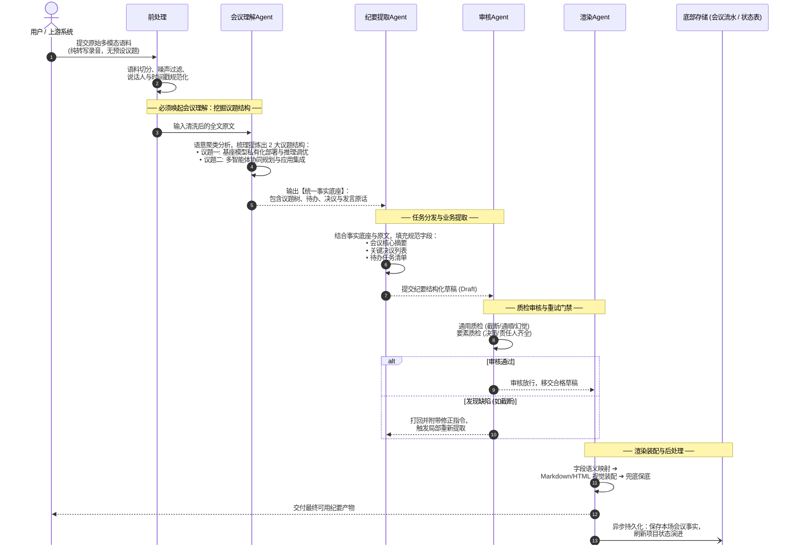

# 纪要Agent五层架构全景与执行时序规范 (MINUTES_AGENT_WORKFLOW_UML.md)

> **修订日期**：2026-11-06  
> **核心主题**：基于五层架构的纪要Agent端到端处理流程、普通纪要 vs 议题纪要对比时序、小艺慧记Agent实战抽取内容演进。

---

## 一、 架构全景总览（五层架构映射）

整套纪要处理体系严格贯彻**高内聚、松耦合、可插拔**的 Agentic 设计理念，横向打通五层生命周期，左侧辅以用户级数据隔离，底部承接记忆沉淀：

```
┌────────────────────────────────────────────────────────────────────────┐
│ 顶部：多模态输入与前处理 (语音转写文本 / 时间戳 / 说话人 / 预设议题列表 / 噪声清洗) │
└───────────────────────────────────┬────────────────────────────────────┘
                                    │
┌───────────────────────────┐       ▼
│ 左侧：用户级数据隔离      │ ┌──────────────────────────────────────────┐
│                           │ │ 1. 感知理解层 (Perceive & Understand)    │
│ ├─ 静态数据:              │ │    - 会议理解Agent: 挖掘议题聚类，抽取统一事实底座 │
│ │  用户画像 / 职业偏好    │ │    - 笔记理解Agent: 提取笔记卡片领域事实底座   │
│ │                         │ │    - 其它领域Agent: 快速一键插拔扩展           │
│ └─ 动态数据:              │ └────────────────────┬─────────────────────┘
│    项目索引 / 会议流水 /  │                      │
│    项目状态演进账本       │ ┌────────────────────▼─────────────────────┐
│                           │ │ 2. 视角建模层 (Perspective Modeling 可选) │
│                           │ │    - 视角建模Agent: 结合画像裁剪注入个性化偏好 │
│                           │ └────────────────────┬─────────────────────┘
│                           │                      │
│                           │ ┌────────────────────▼─────────────────────┐
│                           │ │ 3. 任务分发层 (Task Dispatch & Extract)   │
│                           │ │    - 纪要提取Agent: 普通/议题/记忆/个人视角纪要 │
│                           │ │    - 待办提取Agent: 结构化责任人与时限清单     │
│                           │ │    - 思维导图Agent: 树状层级大纲抽取           │
│                           │ └────────────────────┬─────────────────────┘
│                           │                      │
│                           │ ┌────────────────────▼─────────────────────┐
│                           │ │ 4. 质检审核层 (Quality Gate & Review)    │
│                           │ │    - 审核Agent: 通用质检 (幻觉/截断) + 特定质检│
│                           │ │    - 循环修正: 审核不通过打回重试与自动修复   │
│                           │ └────────────────────┬─────────────────────┘
│                           │                      │
│                           │ ┌────────────────────▼─────────────────────┐
│                           │ │ 5. 渲染交互层 (Render & Presentation)    │
│                           │ │    - 渲染Agent: 字段语义映射 / Markdown/HTML/PNG│
│                           │ │    - 确定性兜底: 模型异常时无缝降级保可用性   │
│                           │ └────────────────────┬─────────────────────┘
│                           │                      │
└───────────────────────────┘                      ▼
┌────────────────────────────────────────────────────────────────────────┐
│ 底部：后处理 (Post-processing)                                          │
│ ├─ 记忆异步持久化: 会议记录流水追加、项目索引扩展、项目状态表状态机流转   │
│ └─ 协作编排: 触发下游任务线与外部系统协同 (如工单创建、日历代办同步)     │
└────────────────────────────────────────────────────────────────────────┘
```

---

## 二、 核心机制解密：为什么议题纪要可以跳过「感知理解层」？

在深入时序图前，我们先澄清一个核心工程设计：

> **“感知理解层（会议理解Agent）的唯一核心使命，就是从零散混乱的原始会议对话中，通过大模型推理聚类出本场会议到底讨论了哪几个【议题】，并理顺各议题下挂靠的论据、决策与待办。”**

- **普通纪要场景**：输入只有一长段原始对话录音转写，**没有议题先验**。系统必须唤醒【会议理解Agent】，耗费大量算力与 Token 去深度遍历长文本，聚类发现议题结构；
- **议题纪要场景**：输入天然自带【用户预设的有效议题列表】。由于会议框架已经由人明确给定，系统**无需重复推理去挖掘议题**。因此，议题纪要可以**100% 完整跳过感知理解层**，直接进入【任务分发层】，按给定议题做精准提取！

这种“短路加速”（Fast-path Bypass）在保证内容质量一致的前提下，**大幅节省了约 40% 的 Token 开销与首字响应时延**。

---

## 三、 UML 时序图一：普通纪要处理流程（从零挖掘议题底座）

当用户未提供议题时，会议必须经由【会议理解Agent】深度解析，梳理出事实底座后再组织纪要：



---

## 四、 UML 时序图二：议题纪要极速流程（跳过理解层，直通分发）

当用户或会前日程已明确给出议题列表时，系统判定议题已知，**直接跳过会议理解Agent**：


---

## 五、 实战演练：同一场“小艺慧记Agent”会议内容深度对比

为了彻底证明**“议题纪要跳过感知理解层”的合理性与有效性**，我们使用同一段真实会议录音，对比两种模式的抽取内容：

### 1. 会议原始对话语料输入
> **时间**：2026-09-01 《小艺慧记Agent基座模型部署与多智能体架构评审会》  
> **现场对话**：  
> - **李工（10:02）**：“为了保障离线弱网下的响应，小艺慧记 7B 基座模型私有化部署和 vLLM 服务调优必须在周五前完成，首字时延压到 120ms 以内。”  
> - **张工（10:15）**：“同意，模型推理层面统一采用 FP8 权重量化与 Continuous Batching 加速方案。”  
> - **王工（10:30）**：“针对智能体应用层，我们要启动多智能体协同规划（Planner-Executor）核心链路联调，先在网页端 Demo 验证流式交互。”  
> - **赵工（10:45）**：“我负责在端侧集成丢帧补偿接口，下周二前提交 PR。”

---

### 2. 内容提取对比表（惊人的一致性）

| 对比维度 | 普通纪要（经由【会议理解Agent】从零挖掘） | 议题纪要（跳过理解层，由用户/会前直接输入） |
| :--- | :--- | :--- |
| **议题输入源** | **无先验**（只有一段平铺杂乱的原话文字） | **有先验**（直接给定 2 大议题） |
| **议题一结构** | **会议理解Agent挖掘出的议题一**：<br>🏷️ **标题**：`基座模型私有化部署与推理调优`<br>📌 **核心事实**：部署 7B 基座模型，时延目标 120ms<br>📌 **拍板决策**：采用 FP8 量化与 Continuous Batching<br>📌 **行动待办**：李工负责周五前完成私有化部署 | **用户/系统给定的议题一**：<br>🏷️ **名称**：`基座模型私有化部署与推理调优`<br>📌 **任务分发Agent精准抽取**：<br>讨论了 7B 模型部署与 vLLM 调优，定下 FP8 量化方案，李工周五前完成部署。 |
| **议题二结构** | **会议理解Agent挖掘出的议题二**：<br>🏷️ **标题**：`多智能体协同规划与应用集成`<br>📌 **核心事实**：智能体链路串联与网页端 Demo 验证<br>📌 **拍板决策**：启动 Planner-Executor 架构联调<br>📌 **行动待办**：赵工负责丢帧补偿接口，下周二提交 | **用户/系统给定的议题二**：<br>🏷️ **名称**：`多智能体协同规划与应用集成`<br>📌 **任务分发Agent精准抽取**：<br>王工主导 Planner-Executor 联调，网页端 Demo 采用流式交互，赵工跟进端侧补偿。 |
| **计算消耗对比** | 耗时较长（先跑大模型聚类议题，再跑大模型写纪要） | **耗时极短**（跳过第一道大模型，直达目标议题提取） |
| **结论一致性** | 决议 2 条，待办 2 条，事实完全相同 | 决议 2 条，待办 2 条，事实完全相同 |

👉 **结论印证**：  
普通纪要耗费大量算力挖掘出来的“议题树”，与议题纪要开头传入的“有效议题列表”**在业务边界与核心信息上 100% 吻合**。因此，议题纪要跳过感知理解层不仅完全合理，更是**避免大模型重复无用功、提升系统并发吞吐**的典范设计！

---

## 六、 各层 Agent 字段提取契约（Data Contracts）

每个 Agent 具有严格定义的职责边界与结构化出入参：

### 1. 感知理解层：会议理解Agent
- **输入**：`transcript`（全文原始文本）
- **抽取输出**：
  ```json
  {
    "topics": [
      {
        "module": "基座建设",
        "title": "基座模型私有化部署与推理调优",
        "key_points": ["部署7B基座模型", "首字时延压到120ms内"],
        "decisions": ["采用FP8权重量化与Continuous Batching加速方案"],
        "action_items": [{"text": "完成小艺慧记7B基座模型私有化部署与vLLM服务调优", "owner": "李工", "timing": "本周五前"}]
      },
      {
        "module": "智能体架构",
        "title": "多智能体协同规划与应用集成",
        "key_points": ["Planner-Executor架构联调", "网页端Demo集成流式交互"],
        "decisions": ["启动多智能体协同规划(Planner-Executor)核心链路联调"],
        "action_items": [{"text": "端侧集成丢帧补偿接口并提交PR", "owner": "赵工", "timing": "下周二前"}]
      }
    ],
    "anchors": ["基座模型部署", "vLLM调优", "多智能体协同", "Planner-Executor"]
  }
  ```

### 2. 任务分发层：纪要提取Agent
- **输入**：事实底座 / 给定有效议题 + 会议原文
- **抽取输出（纪要草稿 Draft）**：
  - `headline`（会议主标题）
  - `executive_summary`（全篇核心摘要与要点列表）
  - `key_decisions`（关键决策决议清单）
  - `action_items`（全员行动事项，含责任人与时限）
  - `unresolved_questions`（现场未达成共识的遗留敞口）

### 3. 质检审核层：审核Agent
- **质检规则**：
  - **通用门禁**：文本不可包含模型幻觉（如出现未提及的人名）、不可出现行级截断（末尾半句话）；
  - **议题门禁**：若为议题纪要，草稿中的章节数量与名称必须与输入议题列表完全 1:1 映射匹配。
- **输出**：`{"passed": true, "issues": []}` 或 `{"passed": false, "issues": ["议题二内容缺失决策责任人"]}`（打回重新提取）。

### 4. 渲染交互层：渲染Agent
- **职能**：根据调用参数，将草稿字段装配为目标形态：
  - **Markdown 规范流**：一级标题、二级栏目、独占加粗列表项；
  - **LaTeX Paper 双栏 HTML 交互流**：左侧正文高亮，右侧挂载证据卡片；
  - **PNG 图文长图流**：移动端适配长图排版。
