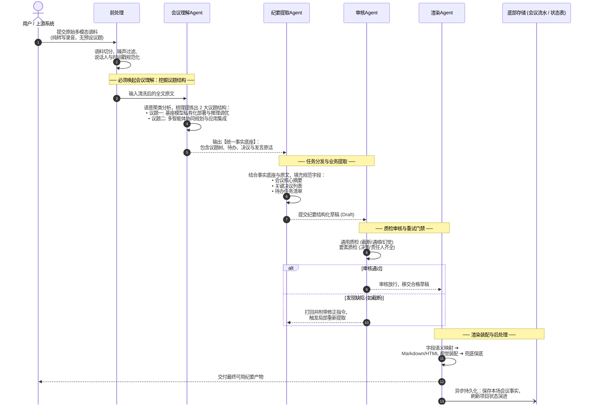
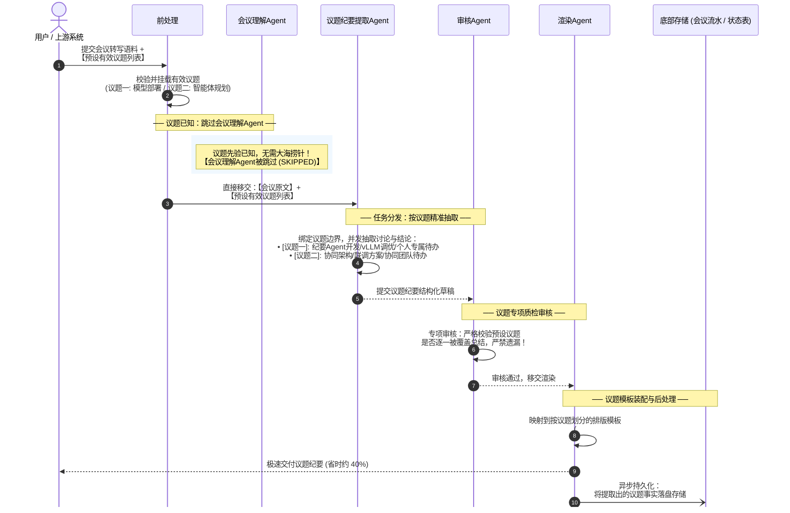
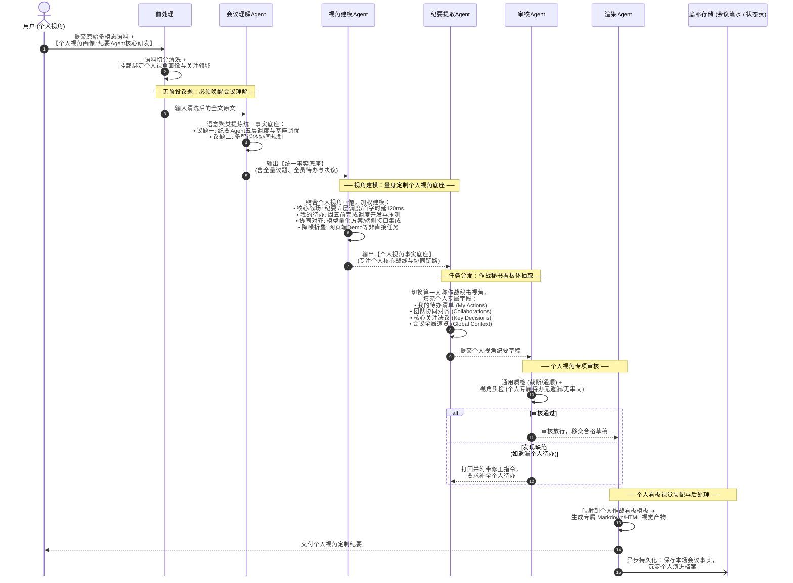

# 纪要Agent五层架构全景与执行时序规范 (MINUTES_AGENT_WORKFLOW_UML.md)

> **修订日期**：2026-11-06  
> **核心主题**：基于五层架构的纪要Agent端到端处理流程、普通纪要 vs 议题纪要对比时序、小艺慧记Agent实战抽取内容演进。

---

## 一、 架构全景总览（五层架构映射）

整套纪要处理体系严格贯彻**高内聚、松耦合、可插拔**的 Agentic 设计理念，横向打通五层生命周期，左侧辅以用户级数据隔离，底部承接记忆沉淀：

```
┌────────────────────────────────────────────────────────────────────────┐
│ 顶部：多模态输入与前处理 (语音转写文本 / 时间戳 / 说话人 / 预设议题列表 / 噪声清洗) │
└───────────────────────────────────┬────────────────────────────────────┘
                                    │
┌───────────────────────────┐       ▼
│ 左侧：用户级数据隔离      │ ┌──────────────────────────────────────────┐
│                           │ │ 1. 感知理解层 (Perceive & Understand)    │
│ ├─ 静态数据:              │ │    - 会议理解Agent: 挖掘议题聚类，抽取统一事实底座 │
│ │  用户画像 / 职业偏好    │ │    - 笔记理解Agent: 提取笔记卡片领域事实底座   │
│ │                         │ │    - 其它领域Agent: 快速一键插拔扩展           │
│ └─ 动态数据:              │ └────────────────────┬─────────────────────┘
│    项目索引 / 会议流水 /  │                      │
│    项目状态演进账本       │ ┌────────────────────▼─────────────────────┐
│                           │ │ 2. 视角建模层 (Perspective Modeling 可选) │
│                           │ │    - 视角建模Agent: 结合画像裁剪注入个性化偏好 │
│                           │ └────────────────────┬─────────────────────┘
│                           │                      │
│                           │ ┌────────────────────▼─────────────────────┐
│                           │ │ 3. 任务分发层 (Task Dispatch & Extract)   │
│                           │ │    - 纪要提取Agent: 普通/议题/记忆/个人视角纪要 │
│                           │ │    - 待办提取Agent: 结构化责任人与时限清单     │
│                           │ │    - 思维导图Agent: 树状层级大纲抽取           │
│                           │ └────────────────────┬─────────────────────┘
│                           │                      │
│                           │ ┌────────────────────▼─────────────────────┐
│                           │ │ 4. 质检审核层 (Quality Gate & Review)    │
│                           │ │    - 审核Agent: 通用质检 (幻觉/截断) + 特定质检│
│                           │ │    - 循环修正: 审核不通过打回重试与自动修复   │
│                           │ └────────────────────┬─────────────────────┘
│                           │                      │
│                           │ ┌────────────────────▼─────────────────────┐
│                           │ │ 5. 渲染交互层 (Render & Presentation)    │
│                           │ │    - 渲染Agent: 字段语义映射 / Markdown/HTML/PNG│
│                           │ │    - 确定性兜底: 模型异常时无缝降级保可用性   │
│                           │ └────────────────────┬─────────────────────┘
│                           │                      │
└───────────────────────────┘                      ▼
┌────────────────────────────────────────────────────────────────────────┐
│ 底部：后处理 (Post-processing)                                          │
│ ├─ 记忆异步持久化: 会议记录流水追加、项目索引扩展、项目状态表状态机流转   │
│ └─ 协作编排: 触发下游任务线与外部系统协同 (如工单创建、日历代办同步)     │
└────────────────────────────────────────────────────────────────────────┘
```

---

## 二、 核心机制解密：为什么议题纪要可以跳过「感知理解层」？

在深入时序图前，我们先澄清一个核心工程设计：

> **“感知理解层（会议理解Agent）的唯一核心使命，就是从零散混乱的原始会议对话中，通过大模型推理聚类出本场会议到底讨论了哪几个【议题】，并理顺各议题下挂靠的论据、决策与待办。”**

- **普通纪要场景**：输入只有一长段原始对话录音转写，**没有议题先验**。系统必须唤醒【会议理解Agent】，耗费大量算力与 Token 去深度遍历长文本，聚类发现议题结构；
- **议题纪要场景**：输入天然自带【用户预设的有效议题列表】。由于会议框架已经由人明确给定，系统**无需重复推理去挖掘议题**。因此，议题纪要可以**100% 完整跳过感知理解层**，直接进入【任务分发层】，按给定议题做精准提取！

这种“短路加速”（Fast-path Bypass）在保证内容质量一致的前提下，**大幅节省了约 40% 的 Token 开销与首字响应时延**。

---

## 三、 UML 时序图一：普通纪要处理流程（从零挖掘议题底座）

当用户未提供议题时，会议必须经由【会议理解Agent】深度解析，梳理出事实底座后再组织纪要：



---

## 四、 UML 时序图二：议题纪要极速流程（跳过理解层，直通分发）

当用户或会前日程已明确给出议题列表时，系统判定议题已知，**直接跳过会议理解Agent**：



---

## 五、 UML 时序图三：个人视角普通纪要处理流程（唤醒视角建模，个性化作战看板）

当用户希望**以个人视角（作战秘书体）**生成纪要，且**未提供预设议题**时，系统将**完整跑通「会议理解 ➔ 视角建模」双阶推理链路**：
1. **唤醒【会议理解Agent】**挖掘出统一全量事实底座；
2. **激活【视角建模Agent】**，结合个人视角画像（角色定位: 纪要Agent核心开发），对底座进行相关性裁剪、注意力加权、个人专属待办与协同人关联；
3. 由【纪要提取Agent】以第一人称作战看板体组织草稿；
4. 经由【审核Agent】对个人专属要素核验后交付。



---

## 六、 实战演练：同一场“小艺慧记Agent”会议内容深度对比（三大模式全景对齐）

为了彻底验证**三大模式（普通客观纪要 vs 议题纪要 vs 个人视角纪要）**在工程与内容层面的差异与一致性，我们以**个人视角用户主导开发小艺慧记纪要Agent**的同一段真实会议录音进行全维度对比：

### 1. 会议原始对话语料输入
> **时间**：2026-09-01 《小艺慧记纪要Agent研发与基座架构评审会》  
> **现场对话**：  
> - **个人视角用户（10:02）**：“为了保障离线弱网下的高效可用，小艺慧记纪要Agent的五层架构核心调度模块研发以及与 7B 基座模型的联调压测必须在周五前完成，首字时延压到 120ms 以内。”  
> - **算法工程师（10:15）**：“同意，模型推理层面统一采用 FP8 权重量化与 Continuous Batching 加速方案，全力支持纪要Agent的高吞吐需求。”  
> - **架构师（10:30）**：“针对智能体应用层，我们要配合启动多智能体协同规划（Planner-Executor）核心链路联调，先在网页端 Demo 验证流式交互。”  
> - **端侧工程师（10:45）**：“我负责在端侧集成丢帧补偿接口，下周二前提交 PR 合并。”

---

### 2. 内容提取对比表（三大模式全景映射）

| 对比维度 | 普通客观纪要（全员中立视角） | 议题纪要（跳过理解层，预设议题直通） | 个人视角纪要（作战秘书看板） |
| :--- | :--- | :--- | :--- |
| **议题输入源** | **无先验**（只有纯文本录音转写） | **有先验**（输入预设 2 大议题） | **无先验**（显式挂载用户画像: 纪要Agent核心开发） |
| **视角建模层** | 默认跳过（全员中立上帝视角） | 默认跳过（按议题客观归纳） | **深度激活**（执行相关性检索与个人视角关注域加权） |
| **议题一：纪要Agent开发与基座部署** | **中立结构化展现**：<br>• 决议: FP8量化加速<br>• 待办: 核心开发人员周五前完成研发部署 | **按预设议题精准归纳**：<br>• 讨论了调度架构与FP8方案<br>• 落地待办: 核心开发人员负责研发 | **【我的核心战场】顶格加粗呈现**：<br>• **我的待办**: 周五前完成五层调度研发与压测(≤120ms)<br>• **协同依赖**: 算法工程师交付FP8量化方案底座 |
| **议题二：多智能体协同联调** | **中立结构化展现**：<br>• 决议: 启动Planner联调<br>• 待办: 端侧工程师周二前提交PR | **按预设议题精准归纳**：<br>• 架构师主导Planner联调<br>• 端侧工程师跟进端侧丢帧补偿 | **【周边协同/全局速览】弱化折叠**：<br>• **协同事项**: 端侧工程师下周二提交丢帧补偿PR<br>• 网页端Demo仅作背景知会，个人视角无直接编码任务 |
| **版面输出形态** | 标准会议公文体（会议摘要/决议/待办） | 分议题结构化体（## 议题一 / ## 议题二） | **个人作战看板体**（我的待办/与我协同/关注决议/风险防范） |
| **计算消耗对比** | 跑 2 次大模型（会议理解 + 纪要抽取） | **仅跑 1 次大模型**（纪要提取直通） | 跑 3 次节点/模型（理解 + 视角建模 + 看板抽取） |

👉 **三大模式演进与协同总结**：  
1. **普通客观纪要**：保底基石，全员中立，适合全员通报与项目存档；
2. **议题纪要**：以先验换效率，跳过理解层，算力开销省约 40%，适合高效闭环评审会；
3. **个人视角纪要**：在统一事实底座之上，引入视角建模层针对个体精准剪裁。纪要将**直击自身代码交付节点与协同依赖项**，大幅提升个人工作流自驱效率！

---

## 七、 各层 Agent 字段提取契约（Data Contracts）

每个 Agent 具有严格定义的职责边界与结构化出入参：

### 1. 感知理解层：会议理解Agent
- **输入**：`transcript`（全文原始文本）
- **抽取输出**：
  ```json
  {
    "topics": [
      {
        "module": "纪要Agent核心建设",
        "title": "纪要Agent五层调度架构与基座模型调优",
        "key_points": ["小艺慧记纪要Agent五层架构研发", "首字时延压到120ms内"],
        "decisions": ["采用FP8权重量化与Continuous Batching加速方案"],
        "action_items": [{"text": "完成小艺慧记纪要Agent五层核心调度研发与vLLM服务联调", "owner": "核心开发人员", "timing": "本周五前"}]
      },
      {
        "module": "智能体协同",
        "title": "多智能体协同规划与应用集成",
        "key_points": ["Planner-Executor架构联调", "网页端Demo集成流式交互"],
        "decisions": ["启动多智能体协同规划(Planner-Executor)核心链路联调"],
        "action_items": [{"text": "端侧集成丢帧补偿接口并提交PR", "owner": "端侧工程师", "timing": "下周二前"}]
      }
    ],
    "anchors": ["纪要Agent架构", "vLLM调优", "多智能体协同", "Planner-Executor"]
  }
  ```

### 2. 视角建模层：视角建模Agent（可选）
- **输入**：统一事实底座 + 个人视角画像 (`role="纪要Agent核心开发"`, `focus_areas=["五层调度", "时延压测", "跨场记忆"]`) + 会议原文
- **抽取输出（个人视角事实底座）**：
  ```json
  {
    "focus_points": [
      "小艺慧记纪要Agent五层架构调度研发",
      "vLLM推理首字时延压至120ms以内"
    ],
    "possible_actions": [
      {
        "text": "完成小艺慧记纪要Agent核心调度开发与部署压测",
        "owner": "个人视角用户",
        "timing": "本周五前",
        "confidence": "high"
      }
    ],
    "collaborations": [
      {"peer": "算法工程师", "topic": "获取FP8权重量化与Continuous Batching推理底座支持"},
      {"peer": "端侧工程师", "topic": "评审下周二提交的端侧丢帧补偿接口PR"}
    ],
    "focus_risks": [
      "弱网离线高并发下纪要生成首字响应时延超标风险"
    ],
    "hit_topics": [
      "纪要Agent五层调度架构与基座模型调优"
    ]
  }
  ```

### 3. 任务分发层：纪要提取Agent
- **输入**：事实底座 / 个人视角底座 / 预设有效议题 + 会议原文
- **抽取输出（纪要草稿 Draft）**：
  - **客观模式**：`headline`, `executive_summary`, `key_decisions`, `action_items`, `unresolved_questions`
  - **个人模式**：`my_actions`（个人专属待办置顶）, `collaborations`（协同事项）, `my_focus_decisions`（关注决议）, `global_context`（全局速览）

### 4. 质检审核层：审核Agent
- **质检规则**：
  - **通用门禁**：文本不可包含模型幻觉（如出现未提及的人名）、不可出现行级截断（末尾半句话）；
  - **议题门禁**：若为议题纪要，草稿中的章节数量与名称必须与输入议题列表完全 1:1 映射匹配；
  - **视角门禁**：若为个人视角纪要，复核个人专属待办是否遗漏，协作对象是否真实对齐，杜绝任务张冠李戴。
- **输出**：`{"passed": true, "issues": []}` 或 `{"passed": false, "issues": ["个人专属待办事项缺失截止时间"]}`（打回重新提取）。

### 5. 渲染交互层：渲染Agent
- **职能**：根据调用参数，将草稿字段装配为目标形态：
  - **Markdown 规范流**：一级标题、二级栏目、独占加粗列表项；
  - **LaTeX Paper 双栏 HTML 交互流**：左侧正文高亮，右侧挂载证据卡片；
  - **PNG 图文长图流**：移动端适配长图排版。
