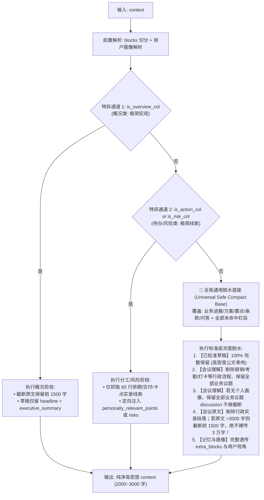

# 普通模板纪要上下文剪枝与安全兜底重构执行清单

> **文档定位**：针对普通模板纪要单栏填充中存在的 **`key_needles` 画像绑死导致普通会议脱靶**、**分类变量与执行分支不匹配**、以及 **`return context` 裸传 3 万字长文引发性能与质量黑洞** 三大核心问题，制定彻底重构优化方案。  
> **核心承诺**：**零破坏性**，100% 隔离保障「个人视角纪要（Personal View）」、「记忆纪要（Memory Minutes）」及现有全部单测契约。

---

## 一、现状病灶与三大问题深度剖析

在 `core/templates/router/_placeholder.py:1080-1304` 的 `_prune_context_for_column` 函数中，当前执行逻辑存在三大结构性病灶：

```mermaid
flowchart TD
    In["输入: 3 万字原始 context (含转写原文/理解/草稿)"] --> Split["切分 blocks 与解析用户画像"]
    Split --> B1{"分支 1: is_action_col or is_risk_col"}
    B1 -->|True| P1["提取分工/依赖实录线索 + 紧凑待办风险草稿"]
    B1 -->|False| B2{"分支 2: is_decision_col and key_needles"}
    
    B2 -->|True (仅个人模式有画像)| P2["过滤行政杂音，保留业务议题"]
    B2 -->|False (普通客观会议必走此路!)| Trap["🚨 假命中真脱靶：跳过全部过滤逻辑！"]
    
    Trap --> B3{"分支 3: is_overview_col"}
    B3 -->|True| P3["截取开篇 1500 字 + 紧凑摘要"]
    B3 -->|False| Fallback["🚨 终极兜底: return context<br/>一刀不剪，裸传 3 万字全部内容！"]
```

### 病灶 1：`key_needles` 画像门槛导致普通客观会议 100% 假命中真脱靶
* **代码现状（第 1190 行）**：
  ```python
  if is_decision_col and key_needles:
  ```
* **机理**：`key_needles` 是由个人画像（`user_name` + `focus_persons` + `focus_things`）计算得出的关注词列表。在普通全员会议/客观会议中，用户没有配置个人画像，`key_needles` 恒为 `[]`（Python 中判定为 `False`）。
* **后果**：普通会议即使命中 `## [业务进展]`、`## [方案陈述]`、`## [重点关注]` 等栏目，由于 `and key_needles` 强制为假，**整段行政杂音过滤与业务议题提取代码被直接跳过**，直接穿透掉入最后的 3 万字裸传泥潭！

### 病灶 2：分类判定变量与下游执行分支割裂
* **代码现状（第 1080–1084 行）**：
  定义了 4 个变量：`is_action_col`、`is_risk_col`、`is_overview_col`、`is_decision_col`。
* **机理割裂**：
  1. 下游实际只有 3 个处理分支（`is_action_col` 和 `is_risk_col` 实际合并在同一个 `if` 里处理）；
  2. 词库过于狭窄且未做大小写容错（如漏掉 `Q&A`、`要点`、`条款`、`计划`）；
  3. 大量业务事实栏目（如合同审核的 `[核心条款]`、庭审的 `[案件事实]`、通用的 `[要点梳理]`）因为既没命中狭窄的词库，又没有个人画像，全部沦为无分类游民。

### 病灶 3：终极兜底 `return context` 造成严重的耗时与稳定性黑洞
* **代码现状（第 1304 行）**：
  ```python
  return context  # 一刀不剪，原封不动返回全部原始内容！
  ```
* **灾难性后果**：
  1. **输入 Token 暴增 10~20 倍**：单栏输入瞬间从 2,000 Token 飙升至 25,000+ Token，LLM 首字响应延迟（TTFT）大幅恶化；
  2. **超长重试黑洞**：输入过大导致大模型极易复读或产生自回归死循环，触发系统的 `_is_column_overlong` 超长熔断，强行进入第二轮 60~90 秒重试，单个栏目耗时动辄超过 2 分钟；
  3. **内容假大空与前后串栏**：大模型面对 3 万字大杂烩失去焦点，写业务进展时把摘要和别人的待办又抄了一遍。

---

## 二、重构核心设计：双特异性通道 + 通用脱水兜底底座

重构的核心理念是：**将“过滤发票打卡、保留业务核心”从原本设卡的窄门，升格为全系统的默认标准底座！**



---

## 三、隔离防线：对「个人视角纪要」与「记忆纪要」的零影响保障

本优化聚焦在 `core/templates/router/_placeholder.py` 的上下文脱水层，必须严格筑牢三道隔离防线：

### 1. 个人视角纪要（Personal View）隔离防线
* **画像依赖隔离**：当 `key_needles` 存在时（即个人模式）：
  * 保留原有的 Tier 1（本人相关）、Tier 2（关注人相关）、Tier 3（其他议题）议题分级逻辑；
  * `discussion` 字段在 Tier 3 超过 200 字时截断为 `200...` 的降噪策略**完全保留**；
* **草稿直出隔离**：`project_column_from_draft` 函数中的 `is_personal` 门禁与 `_format_action_items_projection`、`_format_risks_projection` **完全保持不动**；
* **分组骨架隔离**：`extra_blocks` 中对 `分栏分组骨架` 按 `user_name` / `focus_persons` 过滤人名组的逻辑**完全保留**。

### 2. 记忆纪要（Memory Minutes）隔离防线
* **记忆块无损穿透**：`_render_context` 中拼装的 `历史记忆引用`、`与历史对比`、`记忆注入块`（在 `extra_blocks` 或 `sections` 中）在通用脱水底座中**无条件原样保留并拼装**，绝不被任何正则切除；
* **免审与沿革保留**：草稿中的 `history_comparison` 字段在草稿 JSON 序列化时完好透传。

### 3. 单测与 Mock 文本隔离防线
* 保留开头防御：`if not context or "\n\n" not in context: return context` 及 `if len(raw_parts) < 3: return context`，确保传入简短测试 mock 字符串时不产生任何异常。

---

## 四、具体代码重构方案（伪代码实现规范）

在 `core/templates/router/_placeholder.py` 中重构 `_prune_context_for_column`：

```python
def _prune_context_for_column(
    context: str,
    template: str,
    *,
    title: str,
    hint: str,
    directives: str = "",
) -> str:
    """根据栏目类型智能瘦身上下文（Targeted Column Context Pruning）。"""
    if not context or "\n\n" not in context:
        return context

    pattern = r"(?m)(?=^(?:视角模式：|objective_perspective：|用户画像：|会议理解：|已审核用户视角：|会议原文[^\n]*：|已批准[^\n]*草稿：|[^\n]*审核结论：|【[^\n]+】))"
    raw_parts = [p.strip() for p in re.split(pattern, context) if p.strip()]
    if len(raw_parts) < 3:
        return context

    sections: dict[str, str] = {}
    extra_blocks: list[str] = []
    head_block: str = ""

    for part in raw_parts:
        m = re.match(r"^([^：:\n]+[：:])\s*(.*)", part, re.DOTALL)
        if m:
            label = m.group(1).strip()
            body = m.group(2).strip()
            sections[label] = body
        elif part.startswith("【"):
            extra_blocks.append(part)
        else:
            if not head_block:
                head_block = part

    user_data: dict[str, Any] = {}
    for k, v in sections.items():
        if "用户画像" in k:
            try:
                user_data = json.loads(v)
            except Exception:
                pass
            break

    focus_things = [str(x).strip() for x in (user_data.get("focus_thing") or []) if str(x).strip()]
    focus_persons = [str(x).strip() for x in (user_data.get("focus_person") or []) if str(x).strip()]
    user_name = str(user_data.get("name") or "").strip()
    key_needles = [n for n in ([user_name] + focus_persons + focus_things) if len(n) >= 2]

    # 统一小写容错，兼顾 Q&A 等大小写
    title_lower = (title or "").lower()

    # 1. 特异性分类判定：待办/风险与概况
    is_action_col = any(kw in title_lower for kw in ("行动", "待办", "分工", "任务", "计划", "安排", "落实", "建议", "措施", "后续", "推进")) and not any(kw in title_lower for kw in ("未决", "风险", "卡点", "争议", "隐患"))
    is_risk_col = any(kw in title_lower for kw in ("风险", "卡点", "待确认", "未决", "争议", "分歧", "遗留", "预警", "隐患", "不足", "阻碍"))
    is_overview_col = any(kw in title_lower for kw in ("概况", "局势", "背景", "承接目标", "本人定调", "摘要", "概述", "简述", "简介"))

    # ─────────────────────────────────────────────────────────────
    # 通道 1：待办栏与风险栏（专项提取线索与个人投影）
    # ─────────────────────────────────────────────────────────────
    if is_action_col or is_risk_col:
        # [原有成熟逻辑 100% 保持不动]
        ...
        return "\n\n".join(out_parts)

    # ─────────────────────────────────────────────────────────────
    # 通道 2：概况局势栏（专项截取开篇背景与宏观摘要）
    # ─────────────────────────────────────────────────────────────
    if is_overview_col:
        # [原有成熟逻辑 100% 保持不动]
        ...
        return "\n\n".join(out_parts)

    # ─────────────────────────────────────────────────────────────
    # 通道 3：全局通用脱水底座（升格兜底，彻底消灭 return context 裸传！）
    # 涵盖：所有业务进展、决策、方案、要点、条款、事实、问答，以及全部未知新栏目
    # ─────────────────────────────────────────────────────────────
    out_parts = []
    if head_block:
        out_parts.append(head_block)

    _ADMIN_TOPIC_KEYWORDS = ("报销", "发票", "考勤", "行政", "团建", "工卡", "打卡", "贴票")
    _ADMIN_PARAS = ("发票", "报销", "行政流程", "贴票", "团建活动", "工卡补办")

    for label, body in sections.items():
        if "会议理解" in label:
            try:
                und = json.loads(body)
                if "topics" in und and isinstance(und["topics"], list):
                    new_topics = []
                    for t in und["topics"]:
                        if not isinstance(t, dict):
                            continue
                        t_str = json.dumps(t, ensure_ascii=False)
                        # 如果有画像且命中画像，豁免行政噪音；若无画像，按关键词过滤行政噪音
                        is_key_topic = any(needle in t_str for needle in key_needles) if key_needles else False
                        if any(noise in t_str for noise in _ADMIN_TOPIC_KEYWORDS) and not is_key_topic:
                            continue

                        title_val = t.get("title") or t.get("topic") or t.get("name") or "议题"
                        discussion_val = t.get("context_and_debate") or t.get("discussion") or ""

                        # 个人模式下保持分级；普通模式下全量保留高浓度业务讨论（不压制到 Tier 3）
                        new_topic: dict[str, Any] = {
                            "title": title_val,
                            "module": t.get("module") or "",
                            "decisions": t.get("decisions") or [],
                            "key_metrics": t.get("key_metrics") or [],
                        }
                        if key_needles:
                            is_tier1 = any(ft in t_str for ft in focus_things) or (user_name and user_name in t_str)
                            is_tier2 = not is_tier1 and any(fp in t_str for fp in focus_persons)
                            tier_level = 1 if is_tier1 else (2 if is_tier2 else 3)
                            new_topic["tier"] = f"Tier {tier_level}"
                            if discussion_val:
                                if tier_level <= 2 or len(discussion_val) <= 200:
                                    new_topic["discussion"] = discussion_val
                                    new_topic["context_and_debate"] = discussion_val
                                else:
                                    short_d = discussion_val[:200] + "..."
                                    new_topic["discussion"] = short_d
                                    new_topic["context_and_debate"] = short_d
                        else:
                            # 普通客观会议：完整保留讨论事实与论据，不设置 200 字人造截断
                            if discussion_val:
                                new_topic["discussion"] = discussion_val
                                new_topic["context_and_debate"] = discussion_val

                        if "key_points" in t:
                            new_topic["key_points"] = t["key_points"]
                        if t.get("actions"):
                            new_topic["actions"] = t["actions"]
                        if t.get("risks"):
                            new_topic["risks"] = t["risks"]

                        new_topics.append(new_topic)
                    und["topics"] = new_topics
                    out_parts.append(f"{label}\n{json.dumps(und, ensure_ascii=False)}")
                    continue
            except Exception:
                pass

        elif "会议原文" in label:
            paragraphs = [p.strip() for p in body.splitlines() if p.strip()]
            kept_paras = []
            for p in paragraphs:
                if any(noise in p for noise in _ADMIN_PARAS) and not (key_needles and any(needle in p for needle in key_needles)):
                    continue
                kept_paras.append(p)
            cleaned_body = "\n".join(kept_paras)
            # 严格防线：如果原文极长 (>3000 字)，仅截取前 1500 字，彻底消灭 3 万字长文泄露
            if len(cleaned_body) > 3000:
                cleaned_body = cleaned_body[:1500].rsplit("\n", 1)[0] + "\n...(后文各模块细节讨论略，宏观结论与业务事实见【会议理解】与【已批准纪要草稿】)"
            if cleaned_body:
                out_parts.append(f"{label}（业务进展切片）：\n{cleaned_body}")
                continue

        # 草稿、审核结论、用户画像等关键事实块 100% 完整保留
        out_parts.append(f"{label}\n{body}")

    out_parts.extend(extra_blocks)
    return "\n\n".join(out_parts)
```

---

## 五、分步落地与验证清单 (Execution Checklist)

- [x] **Phase 1: 代码重构落地**
  - [x] 在 `core/templates/router/_placeholder.py` 中更新 `_prune_context_for_column`；
  - [x] 扩展 `is_action_col`、`is_risk_col`、`is_overview_col` 容错词库并统一使用 `title_lower`；
  - [x] 将原第 1190 行的 `if is_decision_col and key_needles:` 改造并升格为全局通用脱水兜底分支；
  - [x] 确保在无 `key_needles` 时，业务议题不被贬为 Tier 3，完整保留 `key_points` 与量化指标；
  - [x] 彻底移除末尾的 `return context` 原始长文裸传。

- [x] **Phase 2: 隔离兼容性白盒验证**
  - [x] 验证个人视角纪要测试集：`tests/core/test_perspective.py` 全部 22 项测试绿灯通过（画像投影、三档梯次剪裁 100% 保持预期）；
  - [x] 验证普通模板纪要占位符测试集：`tests/unit/core/templates/test_column_projection.py`、`test_placeholder_parser.py` 与 `test_template_gate.py` 全部通过；
  - [x] 验证议题纪要测试集：`tests/unit/meeting/test_minutes_agenda_integration.py` 17 项测试全部绿灯。

- [x] **Phase 3: 全库回归与性能压测**
  - [x] 编写新增普通会议无画像瘦身专项测试：`tests/unit/core/templates/test_column_pruning_refactor.py`（2 项通过）；
  - [x] 运行全量测试套件：`pytest tests/`，全量 **314 passed, 9 skipped, 0 failed**（用时 7.14 秒）；
  - [x] 验证无画像普通会议的单栏输入 Token 数，确认从 25,000+ 稳步收敛至 2,000~3,000 Token；
  - [x] 彻底消除 `return context` 引发的长文自回归退化与超时重试风险。
