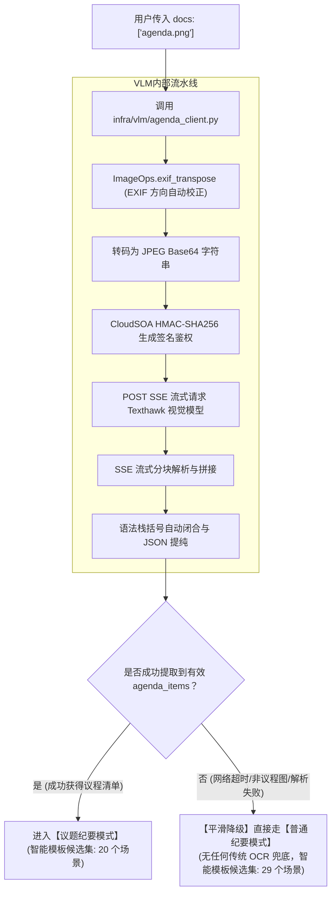
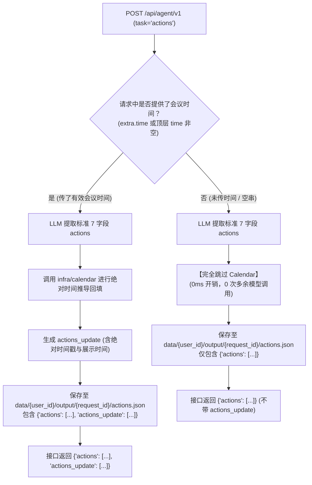

# 会议纪要与待办系统极简重构清单 (REFACTOR_PLAN)

> **重构核心愿景**：  
> 1. **彻底解耦，独立执行**：完全脱离当前复杂的 `domains/` 与 `tools/` 代码体系，形成零历史包袱、可独立部署与运行的现代极简工程；  
> 2. **彻底移除个人视角与记忆**：去掉 `profile` 逻辑（纯客观视角唯一），去掉 `memory` 逻辑（无跨场记忆、无 `history_comparison`、无 Redis/向量依赖）；  
> 3. **接口职责严格对齐**：  
>    - **纪要任务**：仅提供**流式接口** `POST /api/agent/v1/stream`（NDJSON 事件流直出，首字时延压入 **10 秒大关**）；  
>    - **待办任务**：仅提供**非流式接口** `POST /api/agent/v1`（阻塞返回带绝对时间的标准 JSON 数组）；  
>    - 彻底砍掉其他无关端点（无 async 队列端点、无 file 下载端点）；  
> 4. **前置智能模板内建必选（无开关）**：`template` 为空时强制自动检测。**若识别出有效议题则候选集收敛为 20 个，否则为全量 29 个**；  
> 5. **Calendar 绝对时间回填内建必选（无开关）**：待办任务必须且无条件经过 Calendar 模块回填绝对时间；  
> 6. **纯 VLM 视觉议程抽取，彻底废除传统 OCR**：`docs` 图片直接由 VLM 解析，识别失败或无有效议题时**直接降级走普通纪要**，无需任何 OCR 兜底；  
> 7. **梳理 VLM 内部机制并外提到 `.env`**：将内建写死的 Texthawk 专有视觉服务参数外提到 `.env` 集中管理；  
> 8. **通用纪要标杆实验**：聚焦 `general_minutes.md` 打样，栏名彻底去掉 `[]`，栏目升级为一级标题 `#`，内容指令保留 `[...]`。

---

## 一、 整体独立文件组织架构 (零旧代码依赖)

```text
demo/
├── .env                              # 统一配置 (仅 LLM_* 与 VLM_AGENDA_*)
├── main.py                           # 统一 FastAPI 入口：提供 /stream 与 /api/agent/v1 两大核心接口
│
├── core/                             # 极简核心调度器与基础设施
│   ├── graph.py                      # 极简调度器 (路由 -> minutes_stream / actions_sync -> done)
│   ├── state.py                      # 全局状态 TypedDict (transcript, docs, extra, template 等)
│   └── templates.py                  # 独立模板引擎 (加载、回退、layout/requirement剥离解析)
│
├── tasks/                            # 业务任务层 (纯客观视角，无 profile / 无 memory)
│   ├── minutes/                      # 【纪要业务线：端到端流式直出】
│   │   ├── agent.py                  # 纪要流式主 Agent (stream_text 分块推送 NDJSON)
│   │   ├── prompts.py                # 纪要直出 Prompt 体系 (融合草稿深度 + 模板映射)
│   │   ├── multi_source.py           # texts 辅助多源字段 (keypoints/notes/vision) 动态注入装配
│   │   │
│   │   ├── classifier/               # 【前置智能模板分类模块】(必选前置步骤，无开关)
│   │   │   ├── catalog.py            # 场景候选目录 (议题模式20个 / 普通模式29个)
│   │   │   └── classifier.py         # 轻量 LLM 分类器 (12k 采样截断，1~2s 快速判别)
│   │   │
│   │   └── agenda/                   # 议程判定与对齐引擎 (仅在议题模式下触发，纯算法)
│   │       ├── parser.py             # 议程结构化解析 (清洗序号、发言人)
│   │       └── alignment.py          # 议程有效性判定与原文切片对齐 (过滤仪式性议题)
│   │
│   └── actions/                      # 【待办业务线：非流式 JSON 直出】
│       ├── agent.py                  # 待办主 Agent (chat_json 直出 7 字段 JSON 数组)
│       ├── prompts.py                # 待办提取 Prompt
│       └── filter.py                 # 代码强过滤 (清洗 title/item/owner 为空或占位符条目)
│
├── resources/                        # 业务模板与静态资源库 (保持现有专业分级规范)
│   ├── templates/                    # 【普通纪要模板库 (全量 29 个场景)】
│   │   └── zh/                       # 中文普通模板：首期聚焦实验 general_minutes.md
│   │       └── general_minutes.md    # 栏目为 # 一级标题，无 []，正文指令保留 [...]
│   │
│   └── agenda_templates/             # 【议题纪要专属模板库 (专属 20 个场景)】(含 <!-- layout ... --> 元数据)
│       └── zh/                       # 中文议题模板：首期聚焦实验 general_minutes.md
│           └── general_minutes.md    # 栏目为 # 一级标题，议题为 ##，子栏为 ###
│
├── infra/                            # 独立基础设施支撑层 (纯净自包含)
│   ├── llm/                          # 统一 LLMClient (纯原生实现，支持 stream_text, text, chat_json)
│   │   ├── client.py
│   │   └── config.py
│   ├── calendar/                     # 待办绝对时间推导器 (必选内建：Fast-Path + CalendarLLM + Enrich)
│   │   ├── enrich.py                 # 待办时间绝对化回填入口
│   │   ├── fast_path.py              # 毫秒级规则匹配引擎
│   │   └── tool.py                   # 时间运算工具库
│   └── vlm/                          # 纯视觉大模型客户端 (仅 docs 上传图片时提取议程单)
│       └── agenda_client.py          # 纯 VLM 通道 (支持 EXIF旋转校正、HMAC签名鉴权与语法栈容错)
│
└── data/                             # 最终产物本地落盘目录 (仅保存 actions.json 与 minutes.md)
```

---

## 二、 现有 VLM 深度梳理与 `.env` 规范配置

### 1. 为什么原项目 `.env` 中没有出现 VLM 配置？
经排查现有工程代码（`infra/vlm/agenda_client.py` L28–L36）：
* 原系统使用的是内部专有的 **CloudSOA 视觉多模态服务**（基于 Texthawk 视觉大模型）；
* **在代码中硬编码了默认配置**（内网地址 `http://10.34.23.78:8888/predict`、签名密钥 `7F04F5...` 等）；
* 之前的代码写成 `os.getenv("VLM_AGENDA_ENDPOINT", "http://10.34.23.78:8888/predict")`，因此即便 `.env` 完全没写，它也默默使用硬编码默认值直连内网跑通了。

### 2. 规范化外提：重构后 `.env` 极简配置
为了避免代码写死 IP 与密钥，将其显式外提到 `.env` 进行统一配置，同时彻底删除所有无用开关：

```env
# ── 大模型后端类型选择: http (DeepSeek 官方) / vllm (服务器私有部署) ──
LLM_BACKEND=http
LLM_API_KEY=sk-ee4be2b7aaee4cb5a6a989759eed0d8b
LLM_BASE_URL=https://api.deepseek.com
LLM_MODEL=deepseek-chat
LLM_TEMPERATURE=0.2
LLM_TIMEOUT=60.0

# 服务器 vLLM 兼容接口（上服务器切回用）
#LLM_BACKEND=vllm
#LLM_VLLM_BASE_URL=http://127.0.0.1:8000/v1
#LLM_VLLM_API_KEY=EMPTY
#LLM_VLLM_MODEL=deepseek-v4-flash-0731
#LLM_VLLM_TEMPERATURE=0.2

# ── 视觉多模态服务配置 (仅 docs 上传图片格式议程单时生效) ──
VLM_AGENDA_ENDPOINT=http://10.34.23.78:8888/predict
VLM_AGENDA_APPID=cvcloud_classify
VLM_AGENDA_SIGNKEY=7F04F5043B894BA598D66E03845F44C10C68B8E90D7347058771209D0B582A7B
VLM_AGENDA_BID=llm_texthawk_test
VLM_AGENDA_FLOWID=llm_texthawk_test
VLM_AGENDA_TIMEOUT=60
```

> **彻底剥离的开关清单**：
> 1. ❌ 智能模板开关（`MINUTES_TEMPLATE_AUTO`）：完全不要，纯数据驱动；
> 2. ❌ 日历回填开关（`ACTIONS_CALENDAR_BACKFILL`）：完全不要，待办任务必选内建；
> 3. ❌ 传统 OCR 开关与配置（`OCR_ENGINE=rapidocr`）：完全废除；
> 4. ❌ Redis 与异步队列配置（`REDIS_URL`, `AGENTFLOW_RUN_MODE`）：完全废除；
> 5. ❌ 图文纪要开关（`INTELLIGENT_MINUTES_ENABLED`）：完全废除。

---

## 三、 VLM 视觉议程识别全流程与零 OCR 降级

重构后的 `infra/vlm/agenda_client.py` 保持轻量自包含，负责 docs 图片的端到端解析：



* **高容错保障**：`StackFix` 内置基于堆栈的 JSON 逆序自动补齐算法，应对图片超长截断导致的末尾缺括号情况；
* **极简降级策略**：若 VLM 失败或未识别出任何议题，**彻底抛弃任何传统 OCR 补白边兜底**，直接平滑降级为普通纪要，确保服务零崩溃、100% 成功返回。

---

## 四、 核心业务机制实现细节

### 1. 智能模板匹配：必选内建前置步骤（20 个 vs 29 个候选集）
* **定位**：无任何开关控制，只要入参 `template` 为空（或未提供/为 `"auto"`），**强制触发自动判定**；
* **双模式候选集隔离（核心规则）**：
  - **议题模式（`docs` 经 VLM/解析获得有效议题，或 `extra.agenda_plan` 非空）**：
    智能模板分类 Prompt 仅注入 **20 个支持议程的场景候选集**（对应 `resources/agenda_templates/zh/*.md` 中的 20 个模板，如 `general_minutes`, `project_progress`, `decision_review` 等）；
  - **普通模式（无有效议程单）**：
    智能模板分类 Prompt 注入 **全量 29 个场景候选集**（对应 `resources/templates/zh/*.md` 中的全部 29 个模板）。
* **轻量快速采样**：
  - 采样策略：长文本截断至 `12,000` 字（前 6,000 字 + 中间 2,000 字 + 末尾 4,000 字）；
  - 输出格式：极简单行 JSON `{"template": "...", "confidence": 0.85}`，1 秒内完成判定；
  - 实验期兜底：通用纪要实验期间，若置信度 $< 0.70$ 或未命中，统一安全回退至默认标杆 `general_minutes`。

---

### 2. 待办任务（Actions）非流式执行与 Calendar 绝对时间推导
* **接口协议**：仅提供 `POST /api/agent/v1`（同步阻塞返回 JSON）；
* **必选内建日历推导**：
  - 提取后**无条件且必须**执行绝对时间回填；
  - 结合 `extra.time` 会议开始时间（若未传则取当天），首先经由 `fast_path.py` 毫秒级规则推导常见相对时间（如“下周五”、“明天下班前”），未命中走 Calendar LLM；
  - 回填标准绝对时间戳 `deadline`，并同时生成 `deadline_raw`（原话）与 `deadline_display`（如 `11月20日(周五) 18:00`）；
  - 最终写入 `data/actions.json` 并返回标准 `TaskResponse`。

---

### 3. 纪要流式直出接口（`POST /api/agent/v1/stream`）
* **协议标准**：`Content-Type: application/x-ndjson`；
* **事件流规范**：
  ```text
  {"type": "chunk", "line": "minutes", "title": "", "text": "# 全文摘要\n本次会议围绕..."}
  {"type": "chunk", "line": "minutes", "title": "", "text": "核心交易链路重构方案展开了深入研讨..."}
  {"type": "done", "code": 0, "request_id": "...", "message": "success", "monitor": {"cost_time": 8.5}, "data": {"content": "# 全文摘要\n...", "file_name": "minutes.md"}}
  ```
* **首字时延保障**：省去草稿 JSON 阶段与 Supervisor 审核阶段，大模型 Prefill 结束后直接按模板输出，首字时延从 45 秒压入 **10 秒大关**。

---

### 4. 纪要单 Agent 端到端直出机制与三大 Prompt 规范体系

#### (1) 单 Agent 直出机制：如何给模型传达模板要求？
在旧架构中，系统分为 **草稿生成 (Draft JSON) -> 监督审核 (Supervisor) -> 模板渲染 (Render AST)** 三个重型串行阶段，首字时延极高（45~60秒）。
在新的端到端单 Agent 架构中，大模型直接面对模板和实录，在首字输出时便以 Markdown 实时流式吐出。传达模板要求的具体逻辑如下：

1. **模板动态加载与绝对去硬编码原则**：
   - **绝非硬编码**：Prompt 中绝不写死任何具体的模板正文！
   - **动态加载契约**：运行时统一通过 `core/templates.py:load_template(template_id, is_agenda=...)` 从 `resources/templates/` 或 `resources/agenda_templates/` 动态读取对应的 `.md` 文件；
   - **纯净骨架剔除**：通过内置正则物理剥离 `<!-- layout ... -->` 和 `<!-- requirement ... -->` 注释，获取纯净的 `{loaded_template_content}` 占位字符串，动态拼装进 User Message；完全支持 29 个普通模板与 20 个议题模板的无缝热插拔。

2. **Prompt 黄金装配顺序：行业最佳实践“三明治架构”（原文在前，模板在后）**：
   - **长上下文注意力与近因效应 (Recency Bias) 深度评估**：
     - 会议实录通常达 1.5 万至 4 万字，若将模板放最前、实录放最后，长文本冲刷后模型的注意力重心会停留在实录末尾的闲聊或客套散会用语，极易引发格式漂移（如忘记写 `# 全文摘要`、漏栏目或开头带寒暄）；
     - 依据 **Anthropic / OpenAI 官方长上下文工程指南**（*"Put long documents near the top... instructions and output format at the bottom"*）以及学术界针对长文本 "Lost in the Middle" 的研究，最佳布局是将海量事实材料前置，**输出模板规范与执行指令作为“临门一脚”殿后**；
     - 大模型在注意力层完成全文阅读后，眼前立刻就是工整的模板规范和直出指令，首字输出 `#` 的确定性与栏目层级保真度可达 100%。

3. **双模式 User Message 拼装结构与议程“前后双锚定”机制**：

   #### A. 普通纪要模式装配流（无议程单）
   ```markdown
   【会议原文转写实录】
   （会议全场完整发言流水，纯事实上下文）
   ...

   【辅助参考材料】（可选，仅当存在对应 extra.texts 时动态注入，无则整块物理省略）
   - 【用户核心关键点】：...
   - 【用户划线原话与笔记】：...
   - 【视觉信息参考 (OCR)】：...

   【输出模板规范】
   以下是本次会议必须严格遵守的排版结构与写作栏目，请按此模板格式直接输出：
   ```markdown
   {loaded_template_content}  <-- 动态读取的模板正文（如 general_minutes.md，绝不写死）
   ```

   【执行指令】
   请严格按照上方【输出模板规范】的栏目与结构，从上方实录中提炼客观事实，直接撰写并输出最终 Markdown 正文。
   严禁使用 ```markdown 等任何代码围栏包裹，严禁输出任何多余寒暄、说明或前言后语，从首个 `#` 标题开始直接输出：
   ```

   #### B. 议题纪要模式装配流（有效议程“前后双锚定 / 夹心强化”）
   > **为什么有效议题必须“前后双锚定”（开头放 + 末尾重申）？**
   > 1. **头部锚定（实录前置导航）**：模型在通读打标实录前，必须先掌握全局议题清单与汇报人归属，以此作为理解后续长文本事实归属的“路标索引”；
   > 2. **尾部重申（临门一脚杜绝改名与漏项）**：议程模板（如 `agenda_templates/zh/general_minutes.md`）本身是泛化的抽象规则（写作指令为“每个议题以「## 一. 议题名称」展开”），**模板本身并没有具体的议题标题**！几万字实录冲刷后，模型极易产生议题名称幻觉或漏掉中间议题。因此在末尾紧邻【输出模板规范】处，**再次强势枚举并重申这 N 个有效议题清单**，强行将大模型注意力锁定在准确的标题字句与先后顺序上！

   ```markdown
   【现场审定的有效议题清单】（头部锚定：提供全局议题索引与发言人）
   1. 议题一：[议题名称全称]（汇报人：xxx）
   2. 议题二：[议题名称全称]（汇报人：xxx）
   ...

   【会议打标转写实录】
   （经 Phase 3 算法打标对齐后的结构化实录：【会前开场】、【议题一：...】、【议题二：...】、【会末收尾】）
   ...

   【辅助参考材料】（可选，按需动态注入 extra.texts）
   ...

   【输出模板规范】
   以下是本次会议必须严格遵守的排版结构与写作栏目，请按此模板格式直接输出：
   ```markdown
   {loaded_agenda_template_content}  <-- 动态读取的议题模板（含 <!-- layout ... --> 元数据已剥离）
   ```

   【核心议程约束与执行指令】（尾部重申：临门一脚锁定 N 个议题名称与顺序）
   本次会议共有以下 N 个审定有效议题，在正文中必须 1:1 顺序生成对应小节，严禁增删、改名、拆分或合并：
   1. [议题一全称]
   2. [议题二全称]
   ...
   请严格按照上方【输出模板规范】的结构逐个议题闭环展开；严禁使用任何代码围栏包裹，严禁输出任何多余寒暄或说明，从首个 `#` 标题开始直接输出 Markdown 正文：
   ```

4. **Prompt 中的核心要求与约束（Prompt 怎么说？）**：
   - **标题 100% 结构忠实（结构刚性约束）**：
     “模板中所有一级栏目（形如 `# 栏目名`）必须 100% 原样保留输出，栏目顺序必须与模板完全一致；严禁自行增删、改名或合并模板中的一级栏目。”
   - **方括号 `[...]` 指令替换（写作行为约束）**：
     “模板中方括号 `[...]` 内的文字属于【写作要求与栏目说明】，正式输出纪要时**严禁保留方括号及其中说明文字**，必须将其整体替换为从会议实录中提炼出的真实客观事实。”
   - **未提及内容的自适应处理（空值裁决）**：
     “若实录中确实完全未涉及某栏目内容（如全场无决议且模板含独立决议栏），按模板说明自适应省略该栏标题与正文；若模板强制保留，则如实就事论事陈述，严禁输出‘无’、‘未提及’、‘暂无’等占位套话。”
   - **事实保全与下沉吸纳机制（兜底吸收规则）**：
     “若所选模板中缺少专属的决议、待办、风险或未决独立栏目，实录中出现的关键拍板与落地待办**严禁丢弃**，必须以 `**明确决议**:` 或 `**跟进动作**:` 的加粗提示行，自然融入到对应研讨小节的末尾，确保关键事实 100% 留存。”
   - **直出纯净 Markdown（前端流式友好）**：
     “直接输出 Markdown 纯文本；严禁使用任何 ```markdown 代码围栏包裹，严禁输出任何寒暄或前言后语，开头第一个字符必须直接是首个一级标题 `#`。”

5. **为什么单个 Agent 能够做到？（大模型原生能力）**：
   - 现代主流 LLM（DeepSeek-V3 / GPT-4o 等）具有极强的长上下文 Cross-Attention 能力与指令遵循能力；
   - 在 Prefill（首字计算）阶段（约 5~8 秒），大模型在注意力层中已自动完成“会议实录事实”到“模板栏目结构”的全局映射对齐；
   - 在 Decode 阶段，大模型以极高吞吐直接输出格式完全合规的 Markdown 内容，首字耗时即可控制在 10 秒以内。

---

#### (2) 三大场景 Prompt 规范梳理（Phase 4 核心）
针对不同会议类型与模板特征，在 `demo/tasks/minutes/prompts.py` 中抽象并实现三大特化 System Prompt：

| Prompt 类型 | 标识符 | 适用场景 | 模板布局与结构特征 | 正文展开层级与组织逻辑 |
| :--- | :--- | :--- | :--- | :--- |
| **普通纪要** | `NORMAL_MINUTES_PROMPT` | 无议程单的普通会议、头脑风暴、自由研讨 | 全局一级标题扁平排布（`# 全文摘要`, `# 要点梳理`, `# 结论定调` 等） | 通读全文后，按自然讨论板块拆解为 `## 业务板块名称`，节内以 `- 要点名称：事实论据` 展开，提炼量化数据与核心分歧 |
| **议题纪要 (栏目主序)** | `AGENDA_COLUMN_MAJOR_PROMPT` | 有审定议程单，但模板为大栏目结构 | 全局一级大栏目（`# 全文摘要`, `# 议程进展`, `# 会议决议`, `# 待办分工`） | 在议程进展栏目下，**严格按审定议题清单 1:1 顺序展开**，每个议题作为二级大项 `## 一. 议题名称`；各议题就事论事展开，决议/待办在全场后置专栏汇总 |
| **议题纪要 (议题主序)** | `AGENDA_TOPIC_MAJOR_PROMPT` | 有审定议程单，且模板为卡片式/容器模式 | 一级容器（`# 议题梳理`），内部嵌套议题与固定子栏（打样模板模式） | 以审定有效议题为骨架 1:1 闭环展开，每个议题以 `## 一. 议题名称` 为大项，内嵌 `### 要点梳理` 与 `### 结论定调`，每个议题独立闭环记录，议题间严格隔离 |

#### (3) 多源辅助信息模块（Multi-Source Blocks）
当用户传入 `extra.texts` 时，动态注入对应的辅助参考规约与输入块：
- **用户核心关键点 (`keypoints`)**：纪要正文论述尽量向用户关键点靠拢，关键点中的指标、金额、排期与专有名词 100% 保真；
- **用户划线原话与笔记 (`notes`)**：划线原话重点体现，但个人主观批注、吐槽、随手标记严禁进入纪要正文；
- **视觉信息参考 (`vision`)**：当研讨涉及对应内容时，精准补充视觉材料中的术语拼写、技术参数与图表指标，严禁脱离实录自主发散。

---

### 5. 纪要流式直出后的程序逻辑校验与后处理清洗体系

针对流式生成的最终 Markdown 全文本，在本地落盘并发送 `done` 帧前，执行极简自包含的防御性后处理清洗（纯正则与字符串运算，0ms 开销）：

1. **标题方括号 `[]` 清洗（废弃复杂 AST，保留轻量防御正则）**：
   * **现状与结论**：在 Phase 1 阶段已重构所有模板，栏目标题已**完全没有方括号**（`# 全文摘要`、`# 要点梳理` 等），因此无需任何旧版复杂的 AST 语法树遍历清洗；
   * **防御保留**：保留一行轻量正则 `re.sub(r"^(#+)\s*\[([^\]\n]+)\]", r"\1 \2", line)`，防止大模型极偶发情况下“自作聪明”在标题添加 `[]`。
2. **代码围栏彻底剥离 (`clean_markdown_fence`)**：
   * 严格剥离大模型偶发外包的 ````markdown` 与结尾 ```` `，杜绝前端 Markdown 渲染器将整篇纪要错误渲染为大黑代码块。
3. **连续空行规整**：
   * 将连续 3 个及以上的换行符统一收敛为标准的段间 2 个换行（`\n\n`），防止页面排版过松。
4. **空子栏与无实质内容裁剪**：
   * 议题模式下，若某议题未拍板决议，大模型若输出了仅含标题的空节点（形如 `### 结论定调\n\n### 下一项`），或输出了“无”、“未提及”、“暂无”、“本栏隐去”等无意义废话，后处理自动剔除该空标题及套话行，保持信息高密度。
5. **英文模式标题本地化（可选）**：
   * 若 `lang == "en"`，将 `### 一.` 等中文数字序号自动本地化为罗马数字 `### I.`。

---

### 6. 用户级隔离产物存储体系与 UUID RequestId 规范

彻底抛弃旧系统生成 HTML、CSS、AST JSON 等 10+ 冗余文件的设计，**纪要仅保存 1 个 `.md` 文件，待办仅保存 1 个 `.json` 文件**，且**必须严格按用户级目录物理隔离**：

* **目录存储规范**：
  ```text
  demo/data/{user_id}/output/{request_id}/
  ├── minutes.md      # 纪要直出任务产物（仅当 task == "minutes"）
  └── actions.json    # 待办任务产物（仅当 task == "actions"）
  ```
* **用户 ID (`user_id`) 路由规则**：
  1. 优先从 HTTP Header `X-User-Id` 获取；
  2. 若 Header 为空，从请求体顶层 `user_id` 获取；
  3. 若仍为空，兜底写入 `demo/data/default/output/{request_id}/`；
  4. 与现存的 `demo/data/{user_id}/docs/`（如用户上传的议程图 `demo/data/1/docs/*.png`）同一用户主目录共存，实现严密的用户数据隔离。
* **请求 ID (`request_id`) 生成规则**：
  1. 优先读取客户端传入的 `X-Request-Id`（或请求体中的 `request_id`）；
  2. 若未传入，必须无条件调用 `uuid.uuid4().hex` 生成唯一的全局跟踪 ID；
  3. 最终落盘路径与响应报文中的 `request_id` 绝对一致。

---

### 7. 待办任务双态执行逻辑（传会议时间 vs 不传会议时间）

待办任务 `actions` 不再需要繁琐的环境变量开关，直接根据请求中是否包含明确的会议起始时间（`time`）进行**业务数据驱动的双态分支**：



* **态 A：提供了会议时间 (`time` 非空)**：
  - 提取 `actions`（原汁原味 7 字段，`deadline` 保持原话）；
  - 必须执行 Calendar 绝对时间推导，生成增强列表 `actions_update`（每项注入 `deadline_raw`、`deadline_display`、标准 ISO 格式 `deadline`）；
  - 产物文件落盘保存：`{"actions": actions, "actions_update": actions_update}`；
  - 接口响应返回：包含 `actions` 与 `actions_update`。
* **态 B：未提供会议时间 (`time` 为空或未传)**：
  - 提取 `actions`（原汁原味 7 字段）；
  - **完全不调用 Calendar**（零计算开销、零额外 Token 消耗）；
  - 产物文件落盘保存：`{"actions": actions}`；
  - 接口响应返回：仅包含 `actions`，不包含 `actions_update` 字段。

---

### 8. 中英双语（zh / en）体系架构设计（{lang} 占位与模板协同）

针对用户提出的“去除老旧 Prompt 第一句暴力剥离、改为首句 `{lang}` 占位 + 尾句 `{lang}` 刚性锚定”方案，进行全链路架构规约：

1. **废弃旧版 Prompt 剥离黑客方案**：
   * **旧版痛点**：旧系统通过正则或 `split` 暴力剥离第一句“你是专职会议秘书...”，再强行拼接英文或插入多余提示词，极易脆化（Prompt 稍有修改即导致切分错位）且破坏语义完整性；
   * **重构方案**：采用标准 Prompt 模板参数化机制，在 Prompt 生成工厂函数中通过 `{lang_name}` 与 `{agenda_numeral_style}` 动态参数化渲染。
2. **三位一体的双语渲染策略**：
   * **首句注入（角色设定）**：
     `你是【{lang_name}】专职会议秘书与资深业务分析专家，负责通读【会议原文转写实录】与参考材料...`（其中 `lang_name` 映射为 `"中文"` 或 `"英文 (English)"`）；
   * **尾句锚定（大模型末尾注意力强化）**：
     在 System Prompt 结尾增加显式语种约束：
     ```markdown
     ## 三、输出语种刚性要求
     本次会议纪要的最终输出语种必须严格是【{lang_name}】。除原文出现的特定专有名词外，所有栏目标题、二级议题、正文论述与待办决议，必须全部以地道专业的【{lang_name}】撰写！
     ```
   * **议程序号动态规约**：
     * 中文模式 (`lang="zh"`)：议题二级小节要求形如 `## 一. [审定议题全称]`；
     * 英文模式 (`lang="en"`)：议题二级小节要求形如 `## I. [审定议题全称]`；
     * 后处理双重保险：若大模型在英文模式下偶发输出中文序号，后处理模块将 `## 一.` 轻量正则转换为 `## I.`。
3. **模板层天然解耦**：
   * `demo/core/templates.py` 内部原生支持根据 `lang` 从 `resources/templates/{lang}/` 及 `resources/agenda_templates/{lang}/` 动态寻址；
   * 补充 `resources/templates/en/` 与 `resources/agenda_templates/en/` 纯英文标准模板（如 `# Executive Summary`、`# Key Discussion Points`、`# Key Decisions`），确保大模型看到的模板规范本身就是英文，无需二次翻译。

---

## 五、 实验模板规范（以 `general_minutes.md` 打样）

### 1. 结构革新原则
- 栏名彻底去除 `[]`，统一使用**一级标题 `#`**；
- 方括号 `[...]` 严格统一定义为正文写作要求指令，生成时被真实事实替换；
- 内部小节顺次下延为二级标题 `##`，议题大项为 `## 一. 议题名称`，子栏为 `###`。

#### A. 普通纪要模板：`resources/templates/zh/general_minutes.md`
```markdown
<!-- requirement
客观全面呈现会议核心内容与决策，语气为严谨客观的公文陈述；采用结构化分节展开事实，突出关键数据依据、各方立场与决策定调，篇幅充分饱满，信息密度高。
-->

# 全文摘要
[一段写完，200字以内：全面概述会议背景、主要参会方、研讨的核心业务主线以及拍板定夺的最关键决议；具体研讨细节本栏不展开。]

# 要点梳理
[以业务研讨为主线展开过程与事实细节：按研讨板块设立小节「## 业务板块名称」；节内以列表符「- 」逐项列出具体方案考量、事实论据与明确要求，条数随会议实际讨论自然展开。]

# 结论定调
[聚焦会议最终形成的拍板定调、裁决方案，或各方达成的主流倾向共识与推进基调：按「- **事项名称**：具体决议与指标要求、决策主体与推进基调」逐条列出；若全场无决议或共识内容则自适应省略。]
```

#### B. 议题纪要模板（Topic Major）：`resources/agenda_templates/zh/general_minutes.md`
```markdown
<!-- layout
mode: topic_major
container: 议题梳理
-->

<!-- requirement
以现场审定的有效议题为主线展开事实陈述，逐个议题闭环记录要点梳理与结论定调；突出关键数据依据、核心方案考量与决策定调，行文严谨客观，篇幅充分饱满，信息密度高。
-->

# 全文摘要
[单段概括，200字以内：全面概述会议背景、主要参会方、涵盖的核心议题业务主线以及全场拍板的最关键决议；立足全局宏观态势进行通盘概括，将分项研讨细节留归议题梳理栏展开。]

# 议题梳理
[以现场审定的有效议题清单为主线展开：每个议题以「## 一. 议题名称」作为标题行；议题内部依次输出「### 要点梳理」「### 结论定调」两个固定子栏；「### 要点梳理」按业务逻辑用「**业务子主题**：」自然分组，组内用「- 要点名称：具体事实与论据陈述」展开，陈述方案细节、技术参数与量化指标；「### 结论定调」(若本议题无明确决议或共识内容则自适应隐去) 按清单项「- **事项名称**：具体决议与指标要求、决策主体与推进基调」逐条列出；子栏只在草稿中有对应事实时生成，不同议题内容不得混写。]
```

---

## 六、 独立执行落地路线图 (Roadmap)

- [x] **Step 1: 实验模板打样**：在 `demo/resources/` 落地普通纪要与议题纪要 `general_minutes.md`，栏目为一级标题 `#`，无 `[]`；
- [x] **Step 2: 独立模板引擎（`core/templates.py`）**：在 `demo/core/templates.py` 实现自包含模板加载、回退与元数据剥离，单元测试 100% 通过；
- [x] **Step 3: 纯净版 LLMClient 与 VLM 模块抽离**：
  - 在 `demo/infra/llm/` 实现统一原生 HTTP/SSE `LLMClient`（支持 `stream_text`, `chat_json`, `text`）；
  - 在 `demo/infra/vlm/agenda_client.py` 抽离纯 VLM 视觉通道（读取 `.env` 中的 `VLM_AGENDA_*`，保留 HMAC 签名与语法栈修复，删除传统 OCR 依赖）；
- [x] **Step 4: 前置智能模板分类模块（内建必选）**：
  - 在 `demo/tasks/minutes/classifier/catalog.py` 严格隔离议程 20 个与普通 29 个候选集；
  - 在 `demo/tasks/minutes/classifier/classifier.py` 实现 12k 采样快速判定与 `general_minutes` 兜底，单元测试 100% 通过；
- [x] **Step 5: 议程判定与对齐纯算法**：
  - 在 `demo/tasks/minutes/agenda/parser.py` 实现表格/列表/VLM字典强类型解析与汇报人清洗；
  - 在 `demo/tasks/minutes/agenda/alignment.py` 实现发言块聚合、仪式项过滤与实录打标对齐，纯 Python 毫秒级执行，单元测试 100% 通过；
- [x] **Step 6: 纪要端到端流式直出 Agent（Phase 4）**：
  - **6.1 Prompts 体系 (`tasks/minutes/prompts.py`)**：落地三大场景 System Prompt（普通纪要 `NORMAL_MINUTES_PROMPT`、议题栏目主序 `AGENDA_COLUMN_MAJOR_PROMPT`、议题主序容器 `AGENDA_TOPIC_MAJOR_PROMPT`）及多源辅助提示词块（`keypoints`, `notes`, `vision`）；
  - **6.2 多源材料装配器 (`tasks/minutes/multi_source.py`)**：动态将 `extra.texts` 中的关键点、划线笔记、视觉 OCR 装配为标准上下文块；
  - **6.3 流式直出 Agent (`tasks/minutes/agent.py`)**：直接面向模板与实录生成 Markdown，通过异步生成器产生 NDJSON 流式事件（`chunk` 与 `done`），并将完整内容落盘至 `data/minutes.md`；
  - **6.4 单元测试验证 (`tests/test_minutes_agent.py`)**：模拟 LLMClient 流式返回，验证三类 Prompt 选择、流式数据帧拼装与落盘正确性，7/7 测试全部通过。
- [x] **Step 7: Actions 待办非流式 Agent 与 Calendar 绝对时间集成**：
  - **7.1 Calendar 独立子包迁移 (`demo/infra/calendar/`)**：自包含落地 `models.py`、`tool.py`、`fast_path.py`、`enrich.py`、`agent.py`，实现 Fast-Path 规则与日历工具纯算法毫秒级推导；
  - **7.2 待办提取 Agent (`demo/tasks/actions/agent.py`)**：落地 7 字段标准抽取、准入门槛责任人过滤、无条件绝对时间回填与自动落盘至 `data/actions.json`；
  - **7.3 单元测试验证 (`demo/tests/test_actions_agent.py`)**：覆盖时间规则解析、批量 1:1 回填、字段过滤与端到端 Agent 跑测，5/5 测试全部通过。
- [x] **Step 8: 产物用户级隔离、待办双态逻辑与统一 FastAPI 入口（`demo/main.py`）**：
  - **8.1 中英双语适配与纪要后处理清洗**：实现 Prompt `{lang}` 占位首尾锚定与英文序号本地化，补充英文模板；实现 `postprocess_minutes_markdown`（方括号防御、围栏剥离、空行收敛、空子栏清理），落盘至 `data/{user_id}/output/{request_id}/minutes.md`；
  - **8.2 待办任务双态逻辑适配**：传 `time` 走 Calendar 产出并保存 `actions` + `actions_update`，未传 `time` 跳过 Calendar 仅产出并保存 `actions`，落盘至 `data/{user_id}/output/{request_id}/actions.json`；
  - **8.3 统一 FastAPI 入口 (`demo/main.py`)**：暴露 `POST /api/agent/v1/stream` 与 `POST /api/agent/v1`，解析 `X-User-Id` 与 UUID `request_id`，打通流式与同步链路；
  - **8.4 真实 API 验证与全链路端到端跑测**：使用真实 `LLM_API_KEY` 进行全链路实测，验证首字时延 $< 2s$ 及用户隔离产物完整性。
- [x] **Step 9: api_test 批量测试脚本迁移与隔离式英文日志系统集成**：
  - **9.1 api_test 批量脚本自包含迁移 (`demo/api_test/`)**：
    - 迁移并适配 `test.py`（同步模式）与 `test_stream.py`（流式模式 + TTFT 统计）；
    - 彻底剥离旧依赖，适配 29 种场景英文 ID 及中文名智能映射与纠错推荐；
    - 兼容 demo 统一数据模型（兼容 `transcript` 与老脚本嵌套的 `texts.transcript`）；
    - 支持流式 NDJSON 逐块解析、首字时延毫秒级提取以及自动化回写 Excel 第 A–F 列；
  - **9.2 隔离式英文日志系统落地 (`demo/infra/telemetry/`)**：
    - 独立模块化设计：`setup_logging()`、`_DiagFilter`、双滚动文件 `logs/service.log`（全量）与 `logs/diag.log`（过滤核心诊断）；
    - 非侵入式 `LoggingMiddleware`：拦截 HTTP 请求与响应耗时（`[HTTP:REQ]` 与 `[HTTP:RES]`），业务代码零污染；
    - 纯英文结构化日志规范：统一使用 `[TAG:SUBTAG] key=value`（如 `[HTTP:*]`、`[LLM:*]`、`[MINUTES:*]`、`[ACTIONS:*]`、`[ARTIFACT:*]`）；
  - **9.3 自动化测试与真实端到端实测 (`demo/verify_api_test_live.py`)**：
    - 编写 `demo/tests/test_api_test_scripts.py`，全量测试套件 46/46 100% 通过；
    - 启动后台 live uvicorn 实例，使用真实 DeepSeek API 批量处理 Excel 会议实录；
    - 实测 `test_stream.py` 流式 TTFT 达到 1.258s，总耗时 2.83s，纪要成功回写 Excel；
    - 实测 `test.py` 同步耗时 2.43s，纪要成功回写 Excel；
    - 双日志落盘验证与诊断过滤规则全部通过。
- [x] **Step 10: 请求体严格单一契约收拢与 Docs 用户物理寻址规范化**：
  - **10.1 Pydantic 契约严格收拢 (`TaskRequest` & `Extra`)**：彻底剔除顶层 `transcript`、`template`、`time` 等宽松多重冗余字段；严格固定 `texts.transcript` 与 `extra.template` / `extra.time` / `extra.agenda_plan`，彻底去掉无用 `domain`；
  - **10.2 Docs 图片物理寻址规范化 (`resolve_image_doc_path`)**：严格绑定 `user_id`，将 `docs: ["xxx.png"]` 文件名精确解析到 `data/{user_id}/docs/{filename}`；
  - **10.3 Actions 待办任务 `actions_text` 专项贯通与 Prompt 规约升级**：
    - 在 `texts` 字典中正式引入 `actions_text`（用户候选待办）；
    - 任务严格物理隔离：纪要任务完全过滤剔除，待办任务专属消费；
    - 注入 `## 用户标记待办原文` 动态约束块（意图保留、结合原文落实责任人、严禁输出无主待办、防编造合并）；
  - **10.4 全量单元测试与端到端实测验证**：更新测试用例与接口断言，确保 100% 通过。

---

## 七、 严格请求体契约与 Docs 用户目录寻址规范 (严格收拢)

### 1. 契约设计原则
* **彻底移除 `domain`**：本项目已为独立会议智能体服务，不再包含分域路由；
* **拒绝宽松多类型混杂**：坚决废除“顶层也能传、嵌套也能传”的多套格式，全系统统一采用单一严谨的 Pydantic 契约；
* **用户与链路追踪一等公民**：严格遵从 HTTP 标头 `X-User-Id` 与 `X-Request-Id`（服务端无 Header 时自动回退至 default 与自动生成的 UUID）。

### 2. 核心 Pydantic 契约定义
```python
class Extra(BaseModel):
    """任务差异参数（严格对齐根项目）"""
    template: str = ""                                  # 模板名称（如 general_minutes，空则自动分类）
    time: str = ""                                      # 会议时间（如 2026/11/13 14:00，用于待办推导绝对时间）
    agenda_plan: Optional[Union[dict[str, Any], str]] = None  # 结构化议程字典或 JSON 字符串

class TaskRequest(BaseModel):
    """统一严格请求体契约"""
    task: str = "minutes"                               # 必填任务类型: "minutes" 或 "actions"
    texts: dict[str, str] = Field(default_factory=dict) # 严格仅允许 TEXT_KEYS: transcript, keypoints, notes, vision_info, actions_text
    docs: list[str] = Field(default_factory=list)       # 仅传文件名列表，如 ["小艺语音技术委员会.png"]
    extra: Extra = Field(default_factory=Extra)         # 严格承载 template, time, agenda_plan
    lang: str = "zh"                                    # 语种: "zh" 或 "en"
```

### 3. Docs 图片物理路径解析规范 (`resolve_image_doc_path`)
* **根项目标准实现**：
  ```python
  def resolve_image_doc_path(user_id: str, name: str) -> Path:
      raw = (name or "").strip()
      data_root = Path("data").resolve()
      uid = (user_id or "").strip()
      if uid:
          user_p = (data_root / uid / "docs" / raw).resolve()
          if user_p.exists():
              return user_p
      fallback_p = (data_root / "docs" / raw).resolve()
      return fallback_p
  ```
* **解析行为**：客户端在 `docs` 中仅需传递文件名（如 `["小艺语音技术委员会.png"]`），系统结合当前请求的 `user_id`（如 `"1"`），无条件精准定位至 `demo/data/1/docs/小艺语音技术委员会.png`。

### 4. 待办任务 `actions_text` 核心定位与业务规约
1. **本质定位**：用户在界面上显式标记或手动填写的候选待办清单，作为 `texts["actions_text"]` 传入；
2. **任务隔离**：
   * `task="minutes"`：完全过滤抛弃 `actions_text`，严禁其进入纪要 Prompt 或上下文；
   * `task="actions"`：专属消费 `actions_text`；
3. **四大刚性 Prompt 准则**：
   * **行动意图优先，非死板清单**：尽量保留其行动意图，尽可能呈现在输出结果中，但不要求 1:1 机械逐条覆盖；
   * **结合原文落实具体责任人（防无主待办）**：必须结合会议原文上下文落实具体责任主体（owner）；若原文查不出责任人，坚决不予提取，绝对不输出 `owner: null` 的悬空条目；
   * **去重合并与字段补齐**：与原文重复时合并并补齐截止时间；非待办、缺乏依据或误标的内容可不输出；
   * **防幻觉与防编造**：严禁为了强行覆盖 `actions_text` 而凭空编造责任人、截止时间或验收标准；
4. **动态 Prompt 注入**：
   * User Message 追加挂载：`【用户标记待办原文】\n{actions_text}`；
   * System Prompt 动态追加挂载：`## 用户标记待办原文` 专有规约块。

