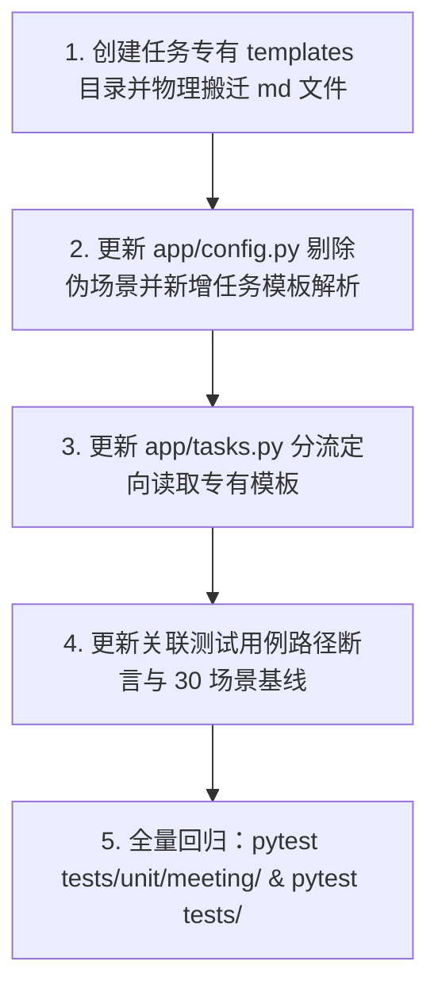

# 模板库纯化与任务专有模板下沉重构行动清单

> **目标**：将混入 `resources/templates/` 的任务专有模板（`personal_minutes.md`、`consensus_decision.md`）安全剥离并下沉至各自对应的任务模块中；使 `resources/templates/` 严格回归为纯正的 **8 场景 30 类标准场景模板库**，全链路功能与单测保持 100% 兼容。

---

## 一、现状诊断与核心矛盾

### 1. 架构定位错位
* **`resources/templates/` 的标准定位**：系统对外暴露的通用业务场景模板库（覆盖会议、学习、访谈、面试、医疗、法律、发布、日常 8 大场景）。
* **混入的非场景模板**：
  * **`personal_minutes.md`**：本质是 `minutes`（会议纪要）任务在线选择“个人视角（`profile=user`）”时的**任务内部看板基线模板**，不是一种通用会议场景。
  * **`consensus_decision.md`**：本质是 `consensus_decision`（共识决策）独立任务线的**专用报表结构模板**（含共识度速览表格、得失权衡等内部专用栏目），混在通用场景库中破坏了模板库的纯粹性。

### 2. 数量与配置核对
* 当前 `resources/templates/` 实际存在 **32 个模板**；
* `app/config.py` 注释声明为“8 场景 30 类”，但内部 `TEMPLATE_SCENARIO` 却违和地将上述两个专有模板强行挂在 `meeting_minutes` 场景下凑成 32 项；
* **剥离这两个模板后，`resources/templates/` 正好保留原始标准的 30 个场景模板**。

---

## 二、模板物理落盘方案

### 1. 资产变迁映射表
| 原文件路径 | 迁移后目标路径 | 归属任务/模块 | 模板职责定义 |
| :--- | :--- | :--- | :--- |
| `resources/templates/personal_minutes.md` | `domains/meeting/tasks/minutes/templates/personal_minutes.md` | `domains/meeting/tasks/minutes/` | 个人视角纪要专用看板模板（个人动作省主语、本人/协同看板化） |
| `resources/templates/consensus_decision.md` | `domains/meeting/tasks/consensus_decision/templates/consensus_decision.md` | `domains/meeting/tasks/consensus_decision/` | 共识决策任务专有交付报表模板（决策总览表、得失权衡展开） |

> **注：关于个人视角模板是“独立 `.md` 文件”还是“直接集成到 Python 文件”的选型决策**：
> - **推荐方案（独立 `.md` 存入任务 `templates/` 目录）**：
>   1. 保持 Markdown 原生可读性，产品与业务方无需触碰 Python 代码即可维护模板占位说明与提示词；
>   2. 与 `domains/meeting/tasks/consensus_decision/` 及系统现有的 `core/templates/router` 占位符解析引擎保持完全一致的文件读取协议；
>   3. 物理上彻底内聚于各自的 `tasks/<task_name>/templates/` 目录下，外界不可见，实现任务级自治。

---

## 三、代码与调用链路改造清单

### 1. 注册表纯化与任务模板独立解析（`app/config.py`）
- [ ] **移除场景伪映射**：
  从 `TEMPLATE_SCENARIO` 字典中删除：
  ```python
  "personal_minutes": "meeting_minutes",
  "consensus_decision": "meeting_minutes",
  ```
  使注册表严格对齐 8 场景 30 类。
- [ ] **新增任务专有模板解析函数**：
  提供安全、规范的任务模板格式读取接口（跳过 30 类场景注册表，直接读取任务专属目录）：
  * `resolve_personal_minutes_template_format() -> str`：
    从 `domains/meeting/tasks/minutes/templates/personal_minutes.md` 读取并封装 requirement；
  * `resolve_consensus_decision_template_format() -> str`：
    从 `domains/meeting/tasks/consensus_decision/templates/consensus_decision.md` 读取并封装 requirement；
- [ ] **兼容兜底保全**：
  `resolve_template_format(value)` 若收到 `"personal_minutes"` 或 `"consensus_decision"` 时，平滑分流至上述任务专有解析函数，避免外部历史调用抛出 400。

### 2. 任务装配默认模板分流（`app/tasks.py`）
- [ ] **重构 `_template_file()` 的加载路由**：
  * **共识决策线（`domain == "meeting"` 且 `line == "consensus_decision"`）**：
    若未传自定义 `extra.template`（或传了默认 `"consensus_decision"`），直接定向加载 `resolve_consensus_decision_template_format()`，不查场景注册表；
  * **会议纪要线个人视角（`domain == "meeting"` 且 `line == "minutes"` 且 `is_personal`）**：
    若未传自定义 `extra.template`（或传了 `"general_minutes"` 等默认值），直接定向加载 `resolve_personal_minutes_template_format()`；
  * **通用场景模板**：其余情况继续走 30 类场景模板的 `resolve_template_format()`。

### 3. 运行引擎与后处理保持零破坏（`core/`）
- [ ] **`core/runtime/kinds.py`**：
  `s in {"general_minutes", "personal_minutes", "通用纪要", "个人视角纪要"}` 仍用于判定快速确定性装配（零 LLM 调用），逻辑纯纯基于字符串判定，**完全保持不变**；
- [ ] **`core/templates/router/_placeholder.py`**：
  个人视角栏目省略判定 `"personal_minutes.md" in template` 仅对模板文本特征做嗅探，**完全保持不变**。

---

## 四、测试用例与质量基线适配清单

### 1. 单元测试路径与断言更新
- [ ] **`tests/meeting/test_consensus_decision.py`**：
  * 将第 34 行、第 299 行写死的原路径 `PROJECT_ROOT / "resources" / "templates" / "consensus_decision.md"` 更新为 `PROJECT_ROOT / "domains" / "meeting" / "tasks" / "consensus_decision" / "templates" / "consensus_decision.md"`；
  * 验证默认自动解析 `_template_file("meeting", "consensus_decision", "")` 依然准确命中；
- [ ] **`tests/unit/core/templates/test_section_pruner.py`**：
  * 将第 1461–1466 行针对 `consensus_decision.md` 混入模板目录的特殊排除逻辑还原：
    因 `resources/templates/` 下已无表格模板，30 个场景模板 100% 纯净覆盖首栏单段正则，断言更新为 `len(matched) == len(templates) == 30`；
- [ ] **`tests/unit/core/templates/_common.py`**：
  * 从 `SCALAR_BASELINE_BY_DIR["template"]` 基线表中移除 `"personal_minutes": 4`，基准项纯正回归为 30 项；
- [ ] **`tests/core/test_perspective.py`**：
  * 验证个人视角模板的加载与打标路由测试全部通过。

---

## 五、分步落地与回滚保障



### 回滚预案
所有改动不改动数据模型与接口对外输入输出契约。若遇任何异常，只需将两个 `.md` 文件移回 `resources/templates/` 并恢复 `TEMPLATE_SCENARIO` 即可秒级复原。
