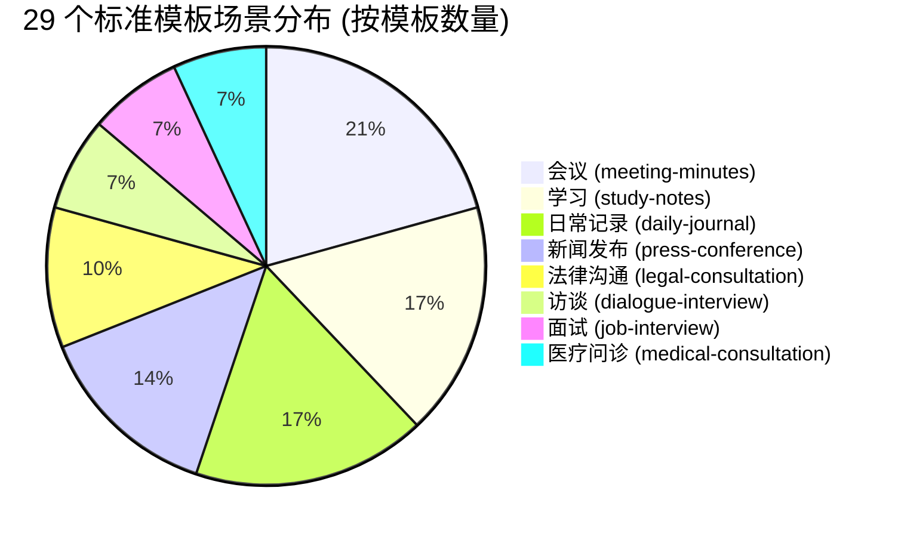

# 29 个标准模板场景、所属分类及栏目结构全景统计规范

> **文档定位**：本规范全面盘点了系统 8 大业务领域共 29 个原始标准模板，建立“中文模板名 — 英文文件名 — 所属场景 — 包含栏目列表”的完整映射字典，并系统标注每个场景在“按议题输出（Agenda-Driven）”模式下的承接栏目与结构设计。

---

## 一、29 个标准模板场景与栏目结构全景总览

> 注：表格中带有 **`🎯`** 标识的栏目，代表经业务论证天然契合**“按议题输出（树状层级直出）”**的核心承接栏目。

| 序号 | 中文模板名 (`template/`) | 英文模板原文件名 (`resources/templates/`) | 所属场景分类 | 栏数 | 具体包含栏目（按文档出现顺序排列） |
| :---: | :--- | :--- | :--- | :---: | :--- |
| **01** | **团队例会.md** | `team_meeting.md` | 会议 (meeting-minutes) | 4 | `例会概况`、`工作进展`、`落实安排`、`未决风险` |
| **02** | **项目进度会.md** | `project_progress.md` | 会议 (meeting-minutes) | 4 | `项目概况`、**`🎯 进度追踪`**、`风险预警`、`后续计划` |
| **03** | **决策评审会.md** | `decision_review.md` | 会议 (meeting-minutes) | 4 | `评审议题概况`、**`🎯 方案陈述`**、`最终决议`、`遗留问题` |
| **04** | **工作研讨会.md** | `workshop_session.md` | 会议 (meeting-minutes) | 4 | `研讨概述`、`核心观点`、**`🎯 研讨方案`**、`未决后续` |
| **05** | **总结复盘会.md** | `retrospective_session.md` | 会议 (meeting-minutes) | 5 | `复盘概况`、`关键成果`、`亮点事项`、`不足事项`、`改进计划` |
| **06** | **沟通交流会.md** | `exchange_forum.md` | 会议 (meeting-minutes) | 4 | `沟通背景`、**`🎯 核心信息`**、`各方诉求`、`沟通结果` |
| **07** | **课堂记录.md** | `class_transcript.md` | 学习 (study-notes) | 4 | `课程概况`、`核心知识点`、`问答记录`、`课后任务` |
| **08** | **专题讲座.md** | `special_lecture.md` | 学习 (study-notes) | 4 | `讲座概况`、`核心观点`、`金句总结`、`Q&A 环节` |
| **09** | **小组讨论.md** | `group_seminar.md` | 学习 (study-notes) | 4 | `讨论议题`、**`🎯 发言要点`**、`共识与分歧`、`未决问题` |
| **10** | **知识笔记.md** | `knowledge_memo.md` | 学习 (study-notes) | 3 | `知识概述`、`核心概念`、`核心结论` |
| **11** | **辩论会.md** | `debate_forum.md` | 学习 (study-notes) | 4 | `辩论概况`、`各方立场`、**`🎯 核心争议`**、`结辩裁决` |
| **12** | **调研访谈.md** | `research_dialogue.md` | 访谈 (dialogue-interview) | 4 | `访谈概况`、`核心反馈`、`核心洞察`、`改进建议` |
| **13** | **采访记录.md** | `interview_transcript.md` | 访谈 (dialogue-interview) | 3 | `访谈概述`、`访谈详细记录`、`金句总结` |
| **14** | **面试报告.md** | `hiring_report.md` | 面试 (job-interview) | 3 | `候选人概况`、`面试问答`、`能力评估` |
| **15** | **面试复盘.md** | `interview_debrief.md` | 面试 (job-interview) | 4 | `面试概况`、`个人表现复盘`、`面试官反馈`、`改进计划` |
| **16** | **就医咨询.md** | `clinical_advisory.md` | 医疗问诊 (medical-consultation) | 5 | `就诊概况`、`病史信息`、`诊断结果`、`治疗方案`、`预警信号` |
| **17** | **心理咨询.md** | `psychological_session.md` | 医疗问诊 (medical-consultation) | 3 | `咨询概况`、`咨询详情`、`咨询小结` |
| **18** | **法律咨询.md** | `legal_advisory.md` | 法律沟通 (legal-consultation) | 4 | `咨询概况`、`案件事实`、`法律分析`、`行动建议` |
| **19** | **庭审记录.md** | `court_transcript.md` | 法律沟通 (legal-consultation) | 4 | `庭审概况`、`诉辩意见`、**`🎯 举证质证`**、`庭审结果` |
| **20** | **合同审核.md** | `contract_vetting.md` | 法律沟通 (legal-consultation) | 4 | `合同概况`、**`🎯 核心条款梳理`**、`风险识别`、`审核结论` |
| **21** | **新闻发布.md** | `media_briefing.md` | 新闻发布 (press-conference) | 4 | `发布会概况`、`核心信息`、`官方表态`、`Q&A环节` |
| **22** | **产品发布.md** | `product_launch.md` | 新闻发布 (press-conference) | 4 | `产品概况`、`市场定位`、`核心卖点`、`发售信息` |
| **23** | **政府报告.md** | `government_bulletin.md` | 新闻发布 (press-conference) | 3 | `报告概况`、`核心政策`、`重点工作` |
| **24** | **媒体问答.md** | `media_qa_session.md` | 新闻发布 (press-conference) | 4 | `问答概况`、`核心提问与回应`、`媒体关注焦点`、`信息澄清与表态` |
| **25** | **通用纪要.md** | `general_minutes.md` | 日常记录 (daily-journal) | 3 | `全文摘要`、**`🎯 要点梳理`** *(已落地标杆)*、`结论与决定` |
| **26** | **个人备忘.md** | `personal_memo.md` | 日常记录 (daily-journal) | 4 | `备忘概况`、`待办事项与提醒`、`灵感与想法`、`情绪与自我反思` |
| **27** | **对话记录.md** | `conversation_transcript.md` | 日常记录 (daily-journal) | 4 | `对话概况`、`交流内容`、`共识与分歧`、`延伸话题` |
| **28** | **参观游览.md** | `site_visit_tour.md` | 日常记录 (daily-journal) | 4 | `参观概况`、`核心看点`、`互动体验`、`心得收获` |
| **29** | **家校沟通.md** | `home_school_liaison.md` | 日常记录 (daily-journal) | 4 | `沟通概况`、`沟通内容`、`话题探讨`、`共识与配合` |

---

## 二、按 8 大业务场景分类深度剖析

---

### 1. 会议场景 (meeting-minutes) —— 共 6 个模板

本场景多为企业、政企及跨团队正式协同会议，天然具备议题化、决议化的基因。

#### (1) 团队例会 (`team_meeting.md`) —— 4 栏
* `## [例会概况]`：单段概括，交代例会时间、参会范围、核心进展大盘与重要共识；
* `## [工作进展]`：按责任人或业务板块列表展开，记述已完成事项、进行中事项及指标参数；
* `## [落实安排]`：以动宾短语交代落实任务、协同对象与交付时限；
* `## [未决风险]`：列出跨部门依赖阻碍与交付卡点。

#### (2) 项目进度会 (`project_progress.md`) —— 4 栏
* `## [项目概况]`：单段概述项目里程碑进展与整体交付态势；
* **`## [进度追踪]`** `🎯`：**【建议议题承接栏】**。跨子战线周会时，按 `### 一. [子系统/模块名称]` 作为议题展开交付细节与进度；
* `## [风险预警]`：系统瓶颈、资源缺失与进度延期风险；
* `## [后续计划]`：下阶段里程碑排期与核心验收标准。

#### (3) 决策评审会 (`decision_review.md`) —— 4 栏
* `## [评审议题概况]`：单段概述本次待评审的核心技术/业务事项与参评专家范围；
* **`## [方案陈述]`** `🎯`：**【极度推荐议题承接栏】**。每个待审提案独立立项为 `### 一. [评审议题名称]`，四级子主题展开设计考量与实测指标；
* `## [最终决议]`：逐项对应列出评委会拍板定调（通过/附带条件通过/驳回）；
* `## [遗留问题]`：遗留卡点与会后需补充论证的事项。

#### (4) 工作研讨会 (`workshop_session.md`) —— 4 栏
* `## [研讨概述]`：单段交代专项研讨背景、目标与探讨主线；
* `## [核心观点]`：提炼研讨形成的指导原则与战略方向；
* **`## [研讨方案]`** `🎯`：**【极度推荐议题承接栏】**。按攻坚议题展开 `### 一. [专题方案名称]`，子主题阐述技术选型与落地路径；
* `## [未决后续]`：待论证方案与后续拉通排期。

#### (5) 总结复盘会 (`retrospective_session.md`) —— 5 栏
* `## [复盘概况]`：单段概述复盘项目背景、周期与最终整体表现；
* `## [关键成果]`：量化列出交付成果与核心业务指标达成情况；
* `## [亮点事项]`：成功经验、方法论沉淀与突破点；
* `## [不足事项]`：过程踩坑、技术缺陷与协同卡点深度复盘；
* `## [改进计划]`：针对缺陷制定的长效改进举措与责任团队。

#### (6) 沟通交流会 (`exchange_forum.md`) —— 4 栏
* `## [沟通背景]`：单段概述沟通各方诉求与拉通目标；
* **`## [核心信息]`** `🎯`：**【建议议题承接栏】**。按对齐事项设立 `### 一. [协同对接议题]`，呈现双方事实输入；
* `## [各方诉求]`：各团队利益诉求、资源缺口与预期目标；
* `## [沟通结果]`：现场达成的一致结论与后续跟进人。

---

### 2. 学习场景 (study-notes) —— 共 5 个模板

#### (1) 课堂记录 (`class_transcript.md`) —— 4 栏
* `## [课程概况]`：课程主题、主讲教师与教学目标；
* `## [核心知识点]`：按教学大纲展开核心理论框架、定理推导与公式考点；
* `## [问答记录]`：课堂师生互动提问与解答；
* `## [课后任务]`：课后作业、思考题与阅读拓展。

#### (2) 专题讲座 (`special_lecture.md`) —— 4 栏
* `## [讲座概况]`：主讲专家背景、讲座宏观背景与行业主旨；
* `## [核心观点]`：专家核心理论主张、行业洞察与前沿趋势研判；
* `## [金句总结]`：高价值提炼语句与启示录；
* `## [Q&A 环节]`：现场参会人提问与专家答复。

#### (3) 小组讨论 (`group_seminar.md`) —— 4 栏
* `## [讨论议题]`：小组研讨命题背景；
* **`## [发言要点]`** `🎯`：**【极度推荐议题承接栏】**。按讨论命题展开 `### 一. [命题名称]`，子主题陈述学员观点与实证案例；
* `## [共识与分歧]`：组内形成的一致见解与存疑争议点；
* `## [未决问题]`：待指导老师进一步答疑的悬而未决事项。

#### (4) 知识笔记 (`knowledge_memo.md`) —— 3 栏
* `## [知识概述]`：知识体系或技术名词的宏观定义与适用领域；
* `## [核心概念]`：核心原理解构、关键特性与横向技术对比；
* `## [核心结论]`：最佳实践推荐与总结要点。

#### (5) 辩论会 (`debate_forum.md`) —— 4 栏
* `## [辩论概况]`：辩题背景、正反双方阵营与立论基准；
* `## [各方立场]`：正反双方核心立论框架与价值主张；
* **`## [核心争议]`** `🎯`：**【建议议题承接栏】**。按分论点设立 `### 一. [争议交锋焦点]` 记述攻防论据；
* `## [结辩裁决]`：结辩陈词与评委最终裁决结果。

---

### 3. 访谈场景 (dialogue-interview) —— 共 2 个模板

#### (1) 调研访谈 (`research_dialogue.md`) —— 4 栏
* `## [访谈概况]`：访谈对象画像、调研主题与业务背景；
* `## [核心反馈]`：受访人对产品/业务的具体体验痛点与诉求陈述；
* `## [核心洞察]`：调研团队提炼的深层用户需求与行为动因；
* `## [改进建议]`：针对受访反馈提出的产品/服务迭代方向。

#### (2) 采访记录 (`interview_transcript.md`) —— 3 栏
* `## [访谈概述]`：采访背景、被采访人身份与采访主线；
* `## [访谈详细记录]`：以结构化对话或核心主题展开问答要点；
* `## [金句总结]`：受访人精彩语录与思想观点精粹。

---

### 4. 面试场景 (job-interview) —— 共 2 个模板

#### (1) 面试报告 (`hiring_report.md`) —— 3 栏
* `## [候选人概况]`：应聘岗位、教育履历、过往代表作与核心背景；
* `## [面试问答]`：技术考核题解答、业务项目深度问答与真实表现；
* `## [能力评估]`：专业硬技能、软素质、职级对标及面试官录用建议。

#### (2) 面试复盘 (`interview_debrief.md`) —— 4 栏
* `## [面试概况]`：应聘岗位与流程概貌；
* `## [个人表现复盘]`：候选人自评回答表现、技术失误点与亮点；
* `## [面试官反馈]`：面试官重点关注维度与现场即时追问要点；
* `## [改进计划]`：针对薄弱环节的知识巩固与后续面试策略。

---

### 5. 医疗问诊 (medical-consultation) —— 共 2 个模板

#### (1) 就医咨询 (`clinical_advisory.md`) —— 5 栏
* `## [就诊概况]`：就诊科室、主诉症状与发病周期；
* `## [病史信息]`：既往病史、过敏史、家族史与检查报告数据；
* `## [诊断结果]`：临床诊断意见与疑似病因分析；
* `## [治疗方案]`：用药指导、处方剂量、复查时限与医嘱要求；
* `## [预警信号]`：需紧急就医的危险体征与日常禁忌事项。

#### (2) 心理咨询 (`psychological_session.md`) —— 3 栏
* `## [咨询概况]`：咨询主诉、求助动机与情绪基准状态；
* `## [咨询详情]`：来访者认知叙事、核心心理卡点与咨询师共情干预；
* `## [咨询小结]`：心理解析定性、课后作业与下期咨询目标。

---

### 6. 法律沟通 (legal-consultation) —— 共 3 个模板

#### (1) 法律咨询 (`legal_advisory.md`) —— 4 栏
* `## [咨询概况]`：咨询当事人身份、纠纷领域与咨询主旨；
* `## [案件事实]`：客观梳理案件发生经过、证据物证与法律关系；
* `## [法律分析]`：适用法条引用、司法判例倾向与胜诉风险评估；
* `## [行动建议]`：律师给出的诉讼策略、和解方案与证据补强指引。

#### (2) 庭审记录 (`court_transcript.md`) —— 4 栏
* `## [庭审概况]`：案号、案由、原被告及代理律师、合议庭组成；
* `## [诉辩意见]`：原告诉讼请求及事实理由、被告答辩意见；
* **`## [举证质证]`** `🎯`：**【建议议题承接栏】**。针对审定争议焦点展开证据三性（真实/合法/关联）质辩；
* `## [庭审结果]`：法庭辩论总结、当事人最后陈述及调解/宣判安排。

#### (3) 合同审核 (`contract_vetting.md`) —— 4 栏
* `## [合同概况]`：合同名称、签约主体、标的金额及履约期限；
* **`## [核心条款梳理]`** `🎯`：**【极度推荐议题承接栏】**。按条款议题设立 `### 一. [争议条款名称]` 逐项记录修改论证；
* `## [风险识别]`：违约金倒挂、知识产权流失、管辖权不利等重大风控点；
* `## [审核结论]`：法务总体定性意见（签字放行/修改重审/否决）。

---

### 7. 新闻发布 (press-conference) —— 共 4 个模板

#### (1) 新闻发布 (`media_briefing.md`) —— 4 栏
* `## [发布会概况]`：发布会主题、主办单位、主讲人及发布背景；
* `## [核心信息]`：通报的核心事实、战略规划、重大政策或业务里程碑；
* `## [官方表态]`：权威定调、政府/企业指导原则与立场重申；
* `## [Q&A环节]`：现场媒体记者提问与发言人答复。

#### (2) 产品发布 (`product_launch.md`) —— 4 栏
* `## [产品概况]`：产品名称、型号规格与首发亮相态势；
* `## [市场定位]`：目标受众画像、竞品对比优势与市场细分定位；
* `## [核心卖点]`：硬件性能参数、技术黑科技突破与颠覆性功能；
* `## [发售信息]`：官方指导售价、预售权益、首批开售时间与渠道。

#### (3) 政府报告 (`government_bulletin.md`) —— 3 栏
* `## [报告概况]`：报告主题、发布机关与宏观发展态势；
* `## [核心政策]`：新出台法规条例、补贴标准与扶持准入条件；
* `## [重点工作]`：下阶段重点工程推进部署、民生保障与考核指标。

#### (4) 媒体问答 (`media_qa_session.md`) —— 4 栏
* `## [问答概况]`：问答背景、参会媒体机构范围与关注倾向；
* `## [核心提问与回应]`：按问答对逐条提炼热点提问与官方回答；
* `## [媒体关注焦点]`：舆情关注点聚合与敏感话题倾向；
* `## [信息澄清与表态]`：辟谣澄清事项与底线表态。

---

### 8. 日常记录 (daily-journal) —— 共 5 个模板

#### (1) 通用纪要 (`general_minutes.md`) —— 3 栏 *(系统现有议题标杆)*
* `## [全文摘要]`：单段概览，宏观概述会议背景与最核心拍板决议；
* **`## [要点梳理]`** `🎯`：**【议题标杆承接栏】**。按审定议题直出 `### 一.`、`#### 1.` 与 `- `；
* `## [结论与决定]`：使用列表项逐条陈述全场最终定调决议与指标要求。

#### (2) 个人备忘 (`personal_memo.md`) —— 4 栏
* `## [备忘概况]`：备忘日期、核心主题背景及整体内容概貌；
* `## [待办事项与提醒]`：按优先级列出待办任务、截止时限与关键提醒；
* `## [灵感与想法]`：突发灵感、创新构想与延伸思考点；
* `## [情绪与自我反思]`：工作状态感受、复盘反思及后续调整意向。

#### (3) 对话记录 (`conversation_transcript.md`) —— 4 栏
* `## [对话概况]`：对话人关系、交流场景与总体基调；
* `## [交流内容]`：梳理对话核心事实、讨论细节与信息交换；
* `## [共识与分歧]`：双方达成的一致意见与各自保留观点；
* `## [延伸话题]`：对话衍生出但未深入讨论的偶发话题。

#### (4) 参观游览 (`site_visit_tour.md`) —— 4 栏
* `## [参观概况]`：参观地点、参访团队、时间与行程目的；
* `## [核心看点]`：参访场馆/产线的主要亮点设施与展出技术；
* `## [互动体验]`：现场操作演示、互动问答与现场讲解；
* `## [心得收获]`：参观团队的启示感悟与可借鉴经验。

#### (5) 家校沟通 (`home_school_liaison.md`) —— 4 栏
* `## [沟通概况]`：学生姓名、沟通参与人（教师/家长）与学情背景；
* `## [沟通内容]`：在校课堂表现、作业完成度与同伴交往现状；
* `## [话题探讨]`：针对偏科、习惯培养或心理状态的深入交流；
* `## [共识与配合]`：家校协同方案、家庭辅导要求与后续反馈机制。

---

## 三、统计洞察与落地指引

### 1. 栏目数量规律统计
* **4 栏模板（绝大多数）**：共 **20 个**（占比 69%），结构高度标准化（`概况` + `核心主体1` + `核心主体2` + `结论/收尾`）；
* **3 栏模板（高度凝练）**：共 **7 个**（占比 24%），如通用纪要、知识笔记、面试报告等；
* **5 栏模板（重型专业）**：共 **2 个**（占比 7%），仅为 `总结复盘会` 和 `就医咨询`。

### 2. 首栏总述公文规范（100% 具备）
所有 29 个模板的首栏均为总述概括栏位（如 `xx概况`、`全文摘要`、`报告概况`），在系统底层已实现**单段公文契约控制**（严禁换行、约 200–350 字）。

### 3. 按议题输出的最佳栏目统一规律
当扩展某个场景支持议程增强时，承接议题的栏目均具备**“方案论述最深、多方交锋最密集、事实细节最丰富”**的特征：
* 评审场景 ➔ 对应 **`方案陈述`** 栏；
* 研讨场景 ➔ 对应 **`研讨方案`** 或 **`发言要点`** 栏；
* 合同/法律场景 ➔ 对应 **`核心条款梳理`** 或 **`举证质证`** 栏；
* 进度场景 ➔ 对应 **`进度追踪`** 栏。
