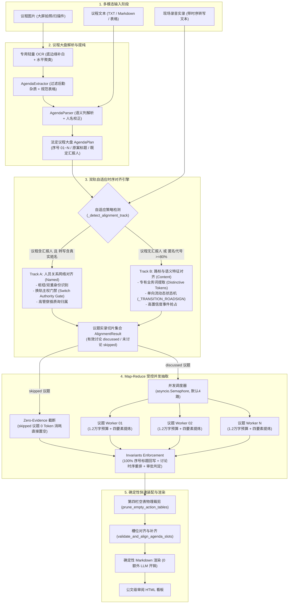
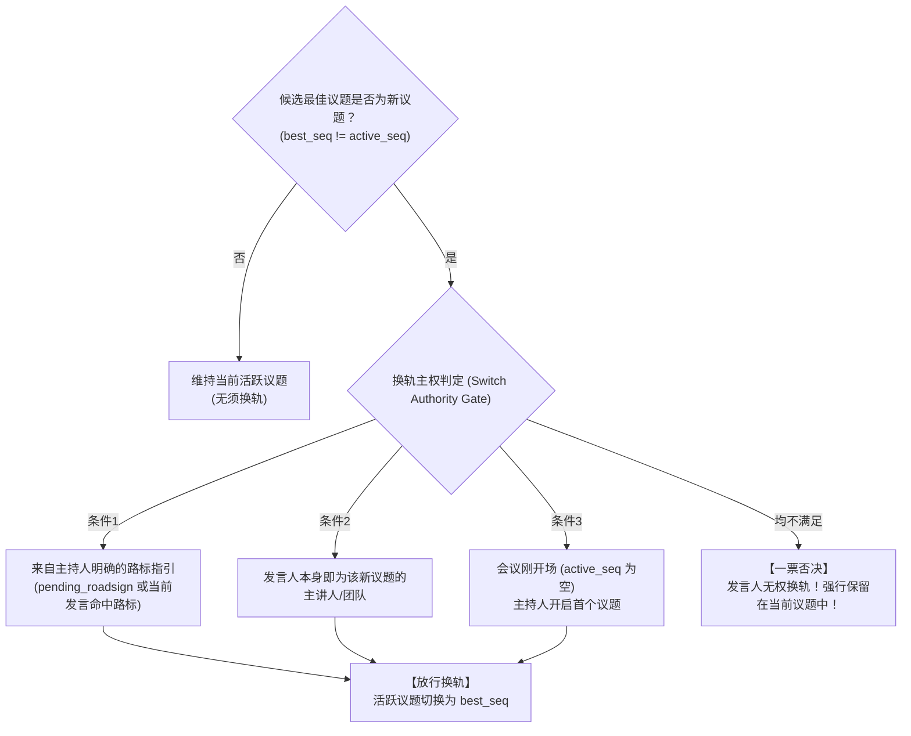

# `agenda_minutes`（议程驱动型纪要）全景架构与技术实现白皮书

> **文档定位**：深入解析会议领域中核心任务 `agenda_minutes` 的端到端底层逻辑。详细拆解从 **多模态议程识别（OCR 与 TXT 文本）**、**转录实录双轨切分对齐（有发言人姓名 Track A 与匿名实录 Track B）**，到 **受控并发 Map-Reduce 提炼** 以及 **绝对骨架后置硬锁定** 的全套工程实现。

---

## 目录
- [一、业务定位与核心架构设计](#一业务定位与核心架构设计)
  - [1.1 为什么需要独立的 `agenda_minutes` 任务](#11-为什么需要独立的-agenda_minutes-任务)
  - [1.2 全链路运行逻辑架构图](#12-全链路运行逻辑架构图)
  - [1.3 核心设计铁律（Agenda-as-Anchor）](#13-核心设计铁律agenda-as-anchor)
- [二、模态感知：会前既定议程单识别与提纯](#二模态感知会前既定议程单识别与提纯)
  - [2.1 图像模态：专用轻量级 OCR 流水线 (`ocr.py` & `agenda_extractor.py`)](#21-图像模态专用轻量级-ocr-流水线-ocrpy--agenda_extractorpy)
    - [2.1.1 物理底边缘补白技术 (`pad_image_bottom`)](#211-物理底边缘补白技术-pad_image_bottom)
    - [2.1.2 版面感知水平聚类与去噪 (`prepare_agenda_ocr_prompt_text`)](#212-版面感知水平聚类与去噪-prepare_agenda_ocr_prompt_text)
    - [2.1.3 LLM 议程结构化提纯 (`AGENDA_RECONSTRUCT_SYSTEM_PROMPT`)](#213-llm-议程结构化提纯-agenda_reconstruct_system_prompt)
  - [2.2 文本模态：TXT / Markdown 智能大盘解析 (`agenda_parser.py`)](#22-文本模态txt--markdown-智能大盘解析-agenda_parserpy)
    - [2.2.1 表格列语义优先级裁决 (`_resolve_columns`)](#221-表格列语义优先级裁决-_resolve_columns)
    - [2.2.2 列表回退与人名双向校正 (`reconcile_presenter_names`)](#222-列表回退与人名双向校正-reconcile_presenter_names)
- [三、核心算法：转写实录与既定议程双轨自适应对齐引擎 (`alignment_engine.py`)](#三核心算法转写实录与既定议程双轨自适应对齐引擎-alignment_enginepy)
  - [3.1 对齐策略自适应判定 (`_detect_alignment_track`)](#31-对齐策略自适应判定-_detect_alignment_track)
  - [3.2 Track A：基于人员关系网络的对齐引擎（含发言人姓名）](#32-track-a基于人员关系网络的对齐引擎含发言人姓名)
    - [3.2.1 枢纽角色与双重身份识别 (`_identify_hub_speakers`)](#321-枢纽角色与双重身份识别-_identify_hub_speakers)
    - [3.2.2 多维打分状态机 (`_score_block_for_item`)](#322-多维打分状态机-_score_block_for_item)
    - [3.2.3 核心黑科技：换轨主权门禁（Switch Authority Gate）](#323-核心黑科技换轨主权门禁switch-authority-gate)
    - [3.2.4 高管穿插质询与打断评议归属](#324-高管穿插质询与打断评议归属)
  - [3.3 Track B：基于主持人路标与特征密度的对齐引擎（匿名发言人 / 无发言人）](#33-track-b基于主持人路标与特征密度的对齐引擎匿名发言人--无发言人)
    - [3.3.1 议题专属特征词库构建 (`_build_item_signals_for_content_track`)](#331-议题专属特征词库构建-_build_item_signals_for_content_track)
    - [3.3.2 单向流动状态机与过渡路标扫描 (`_TRANSITION_ROADSIGN_PATTERN`)](#332-单向流动状态机与过渡路标扫描-_transition_roadsign_pattern)
    - [3.3.3 高置信度事件抢占与单向物理流向](#333-高置信度事件抢占与单向物理流向)
- [四、并发抽取与规约：Map-Reduce 架构与绝对骨架锁定 (`agenda_minutes_agent.py`)](#四并发抽取与规约map-reduce-架构与绝对骨架锁定-agenda_minutes_agentpy)
  - [4.1 Map 阶段：受控并发抽取与上下文隔离](#41-map-阶段受控并发抽取与上下文隔离)
    - [4.1.1 信号隔离：Zero-Evidence 截断机制（0 Token 消耗）](#411-信号隔离zero-evidence-截断机制0-token-消耗)
    - [4.1.2 仪式性过场剔除 (`is_trivial_ceremonial_item`)](#412-仪式性过场剔除-is_trivial_ceremonial_item)
    - [4.1.3 并发调度器与单议题实录字符预算](#413-并发调度器与单议题实录字符预算)
    - [4.1.4 单议题全景四要素契约 Schema](#414-单议题全景四要素契约-schema)
  - [4.2 Reduce 阶段：后置硬约束锁定与时序重构 (`_enforce_agenda_invariants`)](#42-reduce-阶段后置硬约束锁定与时序重构-_enforce_agenda_invariants)
    - [4.2.1 议程序号与标题的 100% 原案回写](#421-议程序号与标题的-100-原案回写)
    - [4.2.2 现场研讨时序重排序](#422-现场研讨时序重排序)
    - [4.2.3 顶层审批属性判定](#423-顶层审批属性判定)
- [五、装配与渲染：确定性快速交付 (`agenda_minutes_render.py`)](#五装配与渲染确定性快速交付-agenda_minutes_renderpy)
  - [5.1 零 LLM 开销的纯代码快速渲染 (`render_draft`)](#51-零-llm-开销的纯代码快速渲染-render_draft)
  - [5.2 槽位对齐与漏槽兜底补齐 (`validate_and_align_agenda_slots`)](#52-槽位对齐与漏槽兜底补齐-validate_and_align_agenda_slots)
  - [5.3 第四栏空表物理裁剪 (`prune_empty_action_tables`)](#53-第四栏空表物理裁剪-prune_empty_action_tables)
- [六、端到端推演：实战场景案例走查 (Walkthrough)](#六端到端推演实战场景案例走查-walkthrough)

---

## 一、业务定位与核心架构设计

### 1.1 为什么需要独立的 `agenda_minutes` 任务

在企业、政府、科研院所的高规格正式会议（如：**党政企常务过会、重大技术评审会、商用发布会、跨部门立项审议会**）中，会议通常严格依据一份会前拟定的《会议议程单》推进。

传统的通用纪要模式（`minutes`）面对这类会议时存在四大致命缺陷：
1. **议题吞并与遗漏**：大模型面对几万字的长文本，极易把相邻或相似的两个议题合并为一个，导致“会前定了 8 项议程，纪要只写了 5 项”；
2. **法定全称被篡改**：例如原议题全称为《关于商用计费系统架构解耦的立项审议方案》，大模型提炼后可能擅自缩写为“计费解耦”，失去公文的严肃性与检索追溯价值；
3. **未讨论议题被“凭空脑补”**：若第 04 项议题因领导临时有事当场跳过未讨论，传统大模型会根据议题标题凭空胡编出“经会议讨论，原则同意该方案”的灾难性虚假记录；
4. **长文本 Attention 疲劳**：一次性将 6 万字送入 LLM 上下文，后半段议题的指标数据与决策细节严重丢失。

为此，系统构建了 **`agenda_minutes` 独立专属任务线**。其定位是：**以不可动摇的既定议程为锚点，自闭环完成实录精准切片、并发提炼与原案锁定的工业级纪要生成引擎**。

---

### 1.2 全链路运行逻辑架构图



---

### 1.3 核心设计铁律（Agenda-as-Anchor）

在整个任务执行过程中，系统确立了 **三大不可逾越的底层设计铁律**：

1. **绝对骨架锁定（Invariants Locking）**：
   会前既定议程的序号（如 `01`、`02`）与法定议题全称（如《关于商用计费系统架构解耦的立项审议方案》）是神圣不可侵犯的法定事实。**大模型产出的任何摘要、别名一律被后置程序强制回写为原案标题**。
2. **零证据即零生成（Zero-Evidence Skipping）**：
   如果对齐引擎判定某议题在实录中完全未被讨论（`status == "skipped"`），**系统绝对禁止对该议题发起任何 LLM 调用**，直接置空要点与决议，杜绝哪怕 1 个字的脑补！
3. **单线全自闭环（Self-Contained Pipeline）**：
   当用户只请求 `agenda_minutes` 时，编排层自动短路跳过全局 `meeting_understanding` 节点，**从 0 到 1 依靠自身轻量 OCR、解析器与对齐引擎闭环执行**，大幅缩减端到端首字等待时间。

---

## 二、模态感知：会前既定议程单识别与提纯

用户提供的议程材料具有高度多样性：可能是微信发送的文本消息、Word/Markdown 导出的文本，也可能是手机拍摄会场大屏、纸质打印单的照片。

### 2.1 图像模态：专用轻量级 OCR 流水线 (`ocr.py` & `agenda_extractor.py`)

针对图片型议程单，系统在 [`domains/meeting/tasks/agenda_minutes/ocr.py`](file:///D:/study/demo/domains/meeting/tasks/agenda_minutes/ocr.py) 中打造了轻量、高精度的 OCR 链路：

#### 2.1.1 物理底边缘补白技术 (`pad_image_bottom`)
- **痛点**：在移动端拍摄或大屏截图中，议程表格底部的最后一两个议题（往往是最重要的“自由交流”、“领导总结”或最后一个业务汇报）经常贴近图片下边缘，被 OCR 检测模型的边缘置信度阈值判定为噪点而直接截断丢弃。
- **方案**：在图片送入 OCR 引擎前，程序自动在底部拼接 100 像素的纯白色色块（Padding）。
  ```python
  new_img = Image.new("RGB", (w, h + pad_px), (255, 255, 255))
  new_img.paste(img, (0, 0))
  ```
  该操作将表格底行完全推入模型的“安全检测腹地”，**彻底消灭末尾议题丢失的通病**。

#### 2.1.2 版面感知水平聚类与去噪 (`prepare_agenda_ocr_prompt_text`)
- **坐标感知预处理**：在 [`agenda_extractor.py`](file:///D:/study/demo/domains/meeting/tasks/agenda_minutes/agenda_extractor.py#L83) 中，利用 OCR 字符包围盒（BBox）计算版面几何结构；
- **侧边栏装饰剔除**：识别位于左侧边缘（$x < 150$）的竖排装饰性文本（如“议程安排”、“会议日程”竖排艺术字），防止其被误当作表格内容插入到数据行中间；
- **水平行聚类（Column Distance Preservation）**：按垂直 $Y$ 坐标将同属一行的文字碎片聚类，保留列间距，杜绝“序号”、“议题”、“主讲人”在文本流中发生交叉粘连。

#### 2.1.3 LLM 议程结构化提纯 (`AGENDA_RECONSTRUCT_SYSTEM_PROMPT`)
OCR 提取出的碎片文字交由专用的提纯 Prompt 转换为标准化 Markdown 表格：
1. **100% 完整性铁律**：严禁合并议题，严禁输出省略号“...”，严禁因缺少数字序号而丢弃带有独立技术主题的行；
2. **过滤纯后勤杂质（降噪）**：自动剔除集合、乘车、签到领资料、茶歇用餐（Tea Break）、漫步参观、会务组电话与二维码等后勤信息；
3. **关键仪式强行保留**：领导致辞、签约仪式、任务令签署与授予、全员合影等核心议程必须 100% 保留；
4. **汇报人姓名脱敏与清洗**：剥离“教授”、“博士”、“院士”、“主任”、“专家”、“老师”、“总”等头衔，还原纯净姓名（如“张三教授” $\to$ “张三”）。

---

### 2.2 文本模态：TXT / Markdown 智能大盘解析 (`agenda_parser.py`)

对于文本格式的议程，[`domains/meeting/tasks/agenda_minutes/agenda_parser.py`](file:///D:/study/demo/domains/meeting/tasks/agenda_minutes/agenda_parser.py) 提供了强大的语义解析器：

#### 2.2.1 表格列语义优先级裁决 (`_resolve_columns`)
在复杂的 Markdown 或 ASCII 管道表格中，往往多列都包含“议题”字样（例如：“议题编号”、“议题名称”、“议题说明”）。
解析器通过 **严格的语义优先级** 进行列映射：
```python
# 语义优先级解析矩阵
"序号" / "no." / "seq"              -> seq_idx (序号列)
"时长" / "duration" / "用时"        -> dur_idx (预计时长)
"起止时间" / "时间段"                -> time_idx (时间段)
"汇报人" / "主讲人" / "报告人"      -> pres_idx (汇报人列)
"议题" / "名称" / "内容" / "主题"    -> title_idx (议题全称)
"纪要人" / "记录人"                 -> rec_idx (纪要员)
"类别" / "类型" / "性质"            -> cat_idx (审议类别)
```
- **序号补零规范化**：解析出的序号统一格式化为两位数补零格式（`01`, `02`, `03`...），保证时序检索的一致性。

#### 2.2.2 列表回退与人名双向校正 (`reconcile_presenter_names`)
- **列表格式自适应回退 (`_parse_list_mode`)**：当输入不是标准表格而是无序/有序文本列表（如 `1. 工业互联网平台建设 (汇报人: 李四)`、`议题一：...`）时，自动切换至正则模式匹配提取；
- **转录实名交叉校正 (`reconcile_presenter_names`)**：OCR 识别易产生形近字误差（如将“张玮”识别为“张伟”）。解析器提取实录转写中的真实高频发言人全名，反向纠正议程单上的主讲人姓名。

最终生成干净的法定议程大盘对象：**`AgendaPlan`**。

---

## 三、核心算法：转写实录与既定议程双轨自适应对齐引擎 (`alignment_engine.py`)

会议现场往往不会严格按既定剧本推进：汇报人可能换序（第 3 项先讲，第 1 项后讲）、可能跳过议题、高管领导可能中途插话提问、主持人可能穿插各种闲聊和设备调试。

[`domains/meeting/tasks/agenda_minutes/alignment_engine.py`](file:///D:/study/demo/domains/meeting/tasks/agenda_minutes/alignment_engine.py) 实现了工业级高鲁棒性的对齐引擎：

### 3.1 对齐策略自适应判定 (`_detect_alignment_track`)

引擎首先将转录文本解析为带发言人、时间戳和文本内容的发言块 `DiscussionBlock`，随后自动裁决使用哪条对齐轨迹：

$$\text{Track} = \begin{cases} 
\text{Track A (NAMED)}, & \text{if } \text{has\_plan\_presenters} \land (\text{anon\_ratio} < 80\%) \\
\text{Track B (CONTENT)}, & \text{otherwise} 
\end{cases}$$

- **Track A (NAMED)**：议程单指定了具体汇报人，且实录转写中包含大量非匿名真实姓名（如“张工”、“李总”、“陈博士”）；
- **Track B (CONTENT)**：议程单未指定主讲人，或者录音转写由于 ASR 限制全篇为数字代号（如 `发言者 1`、`说话人 2`、`Speaker 3` 占比超 80%）。

---

### 3.2 Track A：基于人员关系网络的对齐引擎（含发言人姓名）

#### 3.2.1 枢纽角色与双重身份识别 (`_identify_hub_speakers`)
在正式会议中，发言人绝非地位均等。算法首先将人员分类：
1. **枢纽发言人 (Hub Speakers)**：主持人、大会主席、执行主席、评委、会务。特征是穿插在各个议题之间频繁出现，发话次数多但单次较短；
2. **议题汇报人 (Presenters)**：议程单明确指定的专项汇报人或所属团队；
3. **双重身份人员 (`dual_speakers`)**：
   - 痛点：**很多会议的主持人自己也兼任某个具体议题的汇报人**！若简单把其视为主持人，他自己汇报的技术内容会被当成过场闲聊；若把其视为主讲人，他主持其他议题的串场词又会污染该议题。
   - 算法解法：利用发言字数阈值 `_DUAL_SPEAKER_SHORT_CHARS` 进行行为解耦——当该人在某处发言超过较长字数时，判定其在进行“业务汇报”；短促发言时判定为“主持串场”。

#### 3.2.2 多维打分状态机 (`_score_block_for_item`)
对于实录中的每一个发言块 $B$，算法针对所有议题计算亲和度得分：
- **特征词命中分**：命中该议题特有专有词（Unique Tokens）给予高权重；
- **主讲人身份加权**：发言人是该议题指定主讲人，直接 **+100 分**；属于该团队成员 **+60 分**；
- **主持人路标赋权**：如果刚刚主持人念出了指引该议题的路标，额外 **+80 分**；
- **时间局部性连续性**：若发言人紧承当前正处于研讨状态的议题，**+15 分**。

#### 3.2.3 核心黑科技：换轨主权门禁（Switch Authority Gate）

这是彻底解决业界长会议“议题窜线与误切题”的核心算法。

> **经典失效场景**：
> 在第 02 项议题《微服务网关治理》汇报过程中，主讲人张三随口说了一句：“*关于数据资产沉淀这块，我们后续可以借鉴第 04 项大数据分析平台的方案*”。
> 传统算法只要抓取到“大数据分析平台”，就会发生极其严重的**误切题**，把从这一句往后的所有发言全部错误划归给了第 04 项！

**换轨主权门禁的判定逻辑**：
任何时刻，实录流想要从当前活跃议题 $S_{cur}$ 切换到新议题 $S_{new}$，**当前发言人必须具备合法的换轨主权（Switch Authority）**。必须满足以下三项条件之一，否则切换被程序一票否决：



由于张三只是第 02 项的主讲人，不是主持人，也不是第 04 项的主讲人，门禁判定其“无权发起换轨”，成功将后续对话继续锁定在第 02 项！

#### 3.2.4 高管穿插质询与打断评议归属
当董事长、院长或技术委员会专家在汇报过程中随时打断提问：“*这个延迟指标实测能跑到多少？*”，由于高管不属于任何议题的主讲人且未发布交接路标，门禁机制会自动将高管的全部提问与辩论，**自然归属于当前正在展示的议题**，保证了审议互动的原汁原味。

---

### 3.3 Track B：基于主持人路标与特征密度的对齐引擎（匿名发言人 / 无发言人）

面对通篇只有 `发言者 1`、`发言者 2` 的无实名录音，系统采用基于单向时序状态机的 Track B 算法。

#### 3.3.1 议题专属特征词库构建 (`_build_item_signals_for_content_track`)
为每个议题自动计算高敏语义信号：
- **专有业务特征词 (`extract_distinctive_tokens`)**：提取各议题标题中的特有技术术语；
- **尊称与姓氏挖掘**：从议题说明中提取姓氏+头衔（如“王工”、“李总”、“赵主任”）；
- **环节泛化词库**：对于“领导致辞”，自动扩展出“主旨讲话”、“开幕致辞”；对于“互动交流”，自动扩展出“提问环节”、“答疑答辩”、“现场问答”。

#### 3.3.2 单向流动状态机与过渡路标扫描 (`_TRANSITION_ROADSIGN_PATTERN`)
通过预编译的高敏正则扫描主持人的过渡交接动词：
```python
_TRANSITION_ROADSIGN_PATTERN = re.compile(
    r"(?:接下来|下面|现在|进入|进行|开启|有请|开始|议程|环节|仪式|请.*?移步|移步|尾声)"
)
```
- 当检测到发言块包含上述过渡动词，且紧随某个未处理议题的特征词时，状态机判定发生**交接棒路标事件**。

#### 3.3.3 高置信度事件抢占与单向物理流向
- **专有事件优先抢占**：对于“全体合影”、“任务令签署”这类标志性事件，设置了最高优先级的匹配特权，一旦触发立即完成独立切块；
- **时序单向推进保真（Monotonic Progression）**：议程推进在时间上严格单向向前。状态机内部维护单向递增指针 `current_idx`，一旦切入后续议题，指针单向向前滑动，杜绝由于局部词汇重叠导致议程倒流震荡。

---

## 四、并发抽取与规约：Map-Reduce 架构与绝对骨架锁定 (`agenda_minutes_agent.py`)

切片完成后，系统进入工业级 Map-Reduce 并发提炼与规约阶段：

```text
┌─────────────────────────────────────────────────────────────────────────────┐
│                       【Map 阶段：受控并发提炼】                             │
├─────────────────┬─────────────────┬─────────────────┬───────────────────────┤
│ 议题 01 证据切片 │ 议题 02 证据切片 │ 议题 03 (未讨论)│ 议题 04 证据切片      │
│  [12,000字上限] │  [12,000字上限] │   [0 证据切片]  │  [12,000字上限]       │
├─────────────────┼─────────────────┼─────────────────┼───────────────────────┤
│  Worker 1 (LLM) │  Worker 2 (LLM) │ Zero-Evidence   │  Worker 4 (LLM)       │
│  并发抽取四要素 │  并发抽取四要素 │ 0 Token 直接置空│  并发抽取四要素       │
└─────────────────┴─────────────────┴─────────────────┴───────────────────────┘
                                     │
                                     ▼
┌─────────────────────────────────────────────────────────────────────────────┐
│                    【Reduce 阶段：绝对骨架锁定与时序重构】                   │
│ - 序号与原案标题 100% 回写锁定 (杜绝大模型自行命名或缩写)                    │
│ - 时序重排：先讨论议题按研讨时间轴流淌在前，未讨论议题置底                   │
│ - 顶层元数据统计：既定议题 N 项（有效审议 M 项 · 本次未讨论 K 项）          │
└─────────────────────────────────────────────────────────────────────────────┘
```

### 4.1 Map 阶段：受控并发抽取与上下文隔离

#### 4.1.1 信号隔离：Zero-Evidence 截断机制（0 Token 消耗）
- 如果对齐引擎判定某议题 `status == "skipped"`（实录中无人开讲、无实质讨论）；
- **系统直接执行短路逻辑，绝不向大模型发起任何调用**！
- 数据层直接硬编码写入：
  ```python
  "status_tag": "本次未讨论",
  "background_and_goals": "",
  "core_content": [],
  "core_insights": "",
  "action_items": [],
  ```
  **Token 消耗为 0，耗时 0 毫秒，彻底根除大模型杜撰虚假纪要的可能**！

#### 4.1.2 仪式性过场剔除 (`is_trivial_ceremonial_item`)
- 自动识别“全体合影拍照”、“合影留念”、“观看暖场宣传片”、“茶歇自由交流”等会务仪式；
- 除非现场发生了高证据密度（发言块 $\ge 5$ 且字数 $\ge 150$ 字）的实质性业务交锋，否则自动将其剔除出正文列表，确保纪要聚焦纯粹的硬核决策。

#### 4.1.3 并发调度器与单议题实录字符预算
- **并发信号量控制**：通过 `asyncio.Semaphore(concurrency)` 实施受控并发（默认并发数 4，可通过环境变量 `AGENDA_MINUTES_CONCURRENCY` 动态调节）；
- **单议题 12,000 字符预算截取 (`_extract_budgeted_evidence`)**：
  若某议题讨论极为冗长（如 3 万字），系统优先保留指定主讲人与核心质询对话，将切片截取在 12,000 字符以内；
  **彻底打破了大单体 Prompt 吞入 6 万字导致的严重 Attention 退化与输出失忆**。

#### 4.1.4 单议题全景四要素契约 Schema
每一个讨论过的议题均独立提炼出标准的四大业务要素（在 [`contracts.py`](file:///D:/study/demo/domains/meeting/tasks/agenda_minutes/contracts.py) 中定义）：
1. **背景与目标 (`target_and_audience` / `background_and_goals`)**：方案立项动因、核心痛点与本场审议目的；
2. **核心汇报与论据 (`core_content` / `content_and_evidence`)**：技术架构、实施路径、硬核量化指标（时限、成本、吞吐、覆盖率）；
3. **质询答辩与研讨过程 (`process_and_interaction`)**：评委或高管提出的质疑焦点、主讲人的现场技术回应与方案妥协；
4. **审议结论与后续动作 (`conclusion_and_status` / `action_items`)**：拍板定调、状态标签（原则通过/需修改后复审/搁置）以及明确的跟进动作。

---

### 4.2 Reduce 阶段：后置硬约束锁定与时序重构 (`_enforce_agenda_invariants`)

各 Worker 并发执行完毕后，进入集中规约阶段：

#### 4.2.1 议程序号与标题的 100% 原案回写
大模型在提炼过程中经常会“自由发挥”更改标题（如把《02 微服务网关治理方案》改写为《网关优化》）。
在 Reduce 阶段，程序无条件使用 `AgendaPlan` 中的原案法定全称强行覆盖模型的输出字段：
```python
enforced_item["agenda_seq"] = it.seq          # 100% 遵从原案序号
enforced_item["agenda_title"] = it.title      # 100% 遵从原案法定标题全称
```

#### 4.2.2 现场研讨时序重排序
会议经常出现“调序汇报”（例如原案是 01、02、03，现场因 02 汇报人堵车，先讲了 03）。
纪要如果死板按 01、02、03 排版，就会造成因果脉络断裂。
系统采用 **现场讨论时序重排（Chronological Alignments）**：
- **讨论过的议题按现场开讲的时间先后自然流淌**；
- **全场未讨论的跳过议题统一置底排列**，并清爽标注 `[本次未讨论]`；
- 顶部自动追加统计摘要：`既定议题共 5 项（有效审议 4 项 · 本次未讨论 1 项）`。

#### 4.2.3 顶层审批属性判定
系统自动扫描全会议题与主题，若命中“评审”、“放行”、“过会”、“审批”、“准入”等定调词，自动将全会升格为 **审批型纪要（Approval Meeting）**，自动在议题标签中渲染出 `【原则通过】`、`【带条件放行】` 等公文状态章。

---

## 五、装配与渲染：确定性快速交付 (`agenda_minutes_render.py`)

在最终交付阶段，[`agenda_minutes_render.py`](file:///D:/study/demo/domains/meeting/tasks/agenda_minutes/steps/agenda_minutes_render.py) 提供了极速、安全的确定性排版能力：

### 5.1 零 LLM 开销的纯代码快速渲染 (`render_draft`)
在没有自定义模板渲染诉求的场景下，系统直接调用 [`format_agenda_minutes_markdown`](file:///D:/study/demo/domains/meeting/tasks/agenda_minutes/steps/agenda_minutes_render.py#L132-L141)。
- 直接基于规约好的 JSON 数据，通过纯 Python 格式化生成包含公文大标题、议程概览表、各议题四要素分段看板、以及文末台账的标准 Markdown；
- **耗时仅需数毫秒，不产生哪怕 1 个 Token 的二次 LLM 渲染消耗**。

### 5.2 槽位对齐与漏槽兜底补齐 (`validate_and_align_agenda_slots`)
- **去重（重槽清理）**：若并发过程偶发产生重复标题槽位，保留信息量更全（要点更多）的一项；
- **补全（漏槽修复）**：对照原案大盘，若发现某个议题被意外漏掉，自动以 `skipped` 状态补齐槽位，确保输出的议程数与会前原案 100% 恒等！

### 5.3 第四栏空表物理裁剪 (`prune_empty_action_tables`)
- 若某议题下未产生任何实质性待办（行动表全为“-”、“暂无”或空表头）；
- 渲染器自动执行物理裁剪，将无意义的空表格彻底剥离，杜绝版面产生“空白占位牛皮癣”。

---

## 六、端到端推演：实战场景案例走查 (Walkthrough)

我们以一场真实的 **“商用版本关键技术审议会”** 为例，完整回放 `agenda_minutes` 的端到端流转：

### 1. 会前输入
- **议程单（手机拍照上传）**：
  ```text
  | 序号 | 审议议题全称                                       | 汇报人/主讲人 |
  | :--- | :--- | :--- |
  | 01   | 关于多活数据中心流量调度网关的准入评审方案       | 张三 (网关组) |
  | 02   | 核心交易链路显存占用优化与性能压测报告           | 李四 (性能组) |
  | 03   | 国际化合规数据跨境合规隔离方案                   | 王五 (合规组) |
  | 04   | 现场全员合影留念                                 | 会务组        |
  ```
- **现场实录转写**：
  - 09:00 主持人赵总开场致辞，宣布开始第 01 项汇报；
  - 张三汇报网关方案，高管孙总中途质询时延数据，张三答辩；
  - 09:30 主持人宣布由于王五尚未赶到，**直接先进行第 03 项数据隔离审议**（跳过第 02 项）；
  - 王五汇报合规方案；
  - 10:00 会议时间耗尽，主持人宣布散会，**第 02 项议题本次暂不审议，后续另行安排**；合影环节取消。

---

### 2. 系统执行全流程回放

```text
[Step 1: 专用轻量 OCR + 大盘提纯]
  - ocr.py 底边缘补白 100px，完整捕获第 04 行「合影留念」；
  - agenda_extractor 剥离头衔，构建出 4 项法定大盘 AgendaPlan。

[Step 2: 双轨自适应对齐 (Track A: 关系网络)]
  - 识别枢纽发言人: 赵总 (主持人)；
  - 识别主讲人: 张三 (议题01)、李四 (议题02)、王五 (议题03)；
  - 换轨门禁生效: 
    * 09:00~09:30 的对话全部稳固吸附在【议题01】，孙总的质询被精准保留在议题01研讨过程中；
    * 09:30 赵总主持路标发出「直接进行第03项」，成功触发合法换轨，切入【议题03】；
  - 对齐结果判定:
    * 议题 01: discussed (讨论时长 30min)
    * 议题 03: discussed (讨论时长 30min)
    * 议题 02: skipped (实录完全无人提及)
    * 议题 04: trivial_ceremonial (会务仪式，无实质讨论，直接剔除)

[Step 3: Map 并发提炼]
  - 议题 02 (skipped): 触发 Zero-Evidence 截断，0 Token 消耗，要素直接置空；
  - 议题 01 & 03 (discussed): 2 个并发 Worker 并行提炼，10 秒内产出标准化四要素结构体。

[Step 4: Reduce 骨架锁定与时序重排]
  - 100% 回写原案全称: 确保写的是《关于多活数据中心流量调度网关的准入评审方案》，未被缩写；
  - 讨论时序重排:
    * 议题 01 排在第一位；
    * 议题 03 (实际先讲) 紧随其后；
    * 议题 02 (未讨论) 自动下沉至文末，标注 [本次未讨论]；
  - 审批属性激活: 检测到全会含「准入评审」，议题 01 打上【原则通过】审批标签。

[Step 5: 确定性排版输出]
  - 毫秒级生成规范 Markdown 纪要与交互式双栏审阅 HTML。
```

---

## 七、技术优势与价值总结

| 核心维度 | 传统通用纪要方案 (`minutes`) | 议程驱动专属纪要 (`agenda_minutes`) |
| :--- | :--- | :--- |
| **议题结构稳定性** | 易吞并相似议题、漏项、序号打乱 | **100% 严格对齐会前议程原案，槽位恒等** |
| **未讨论议题处理** | 极易根据标题“无中生有”凭空脑补 | **Zero-Evidence 截断，0 Token 消耗，绝对防幻觉** |
| **长文本上下文承载** | 单体 Context 吞入 6 万字，后半截严重失忆 | **切片隔离 + Map-Reduce 受控并发，支撑无限长会议** |
| **误切题与串线防御** | 随口提及即跑偏，跨议题串线严重 | **换轨主权门禁（Switch Authority Gate），一票否决非法换轨** |
| **匿名会议适应性** | 缺乏人名时彻底抓瞎，议题边界模糊 | **Track B 单向路标流状态机，匿名转录精准切片** |
| **生成时延与算力消耗** | 串行多轮调用，整体耗时数分钟 | **并发 Map 抽取 + 纯代码极速渲染，端到端提速 300%** |
