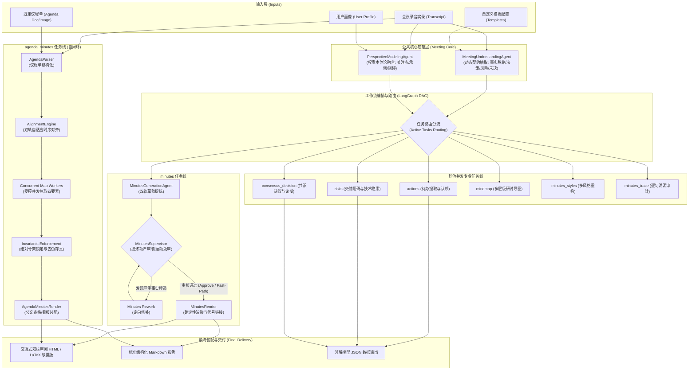
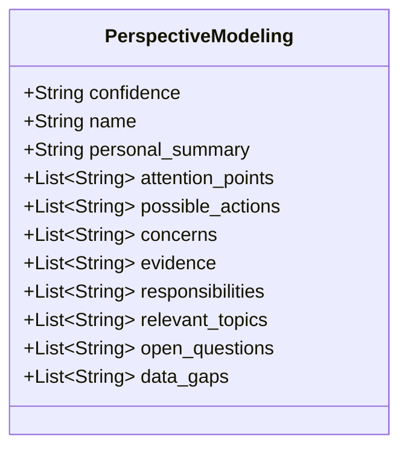
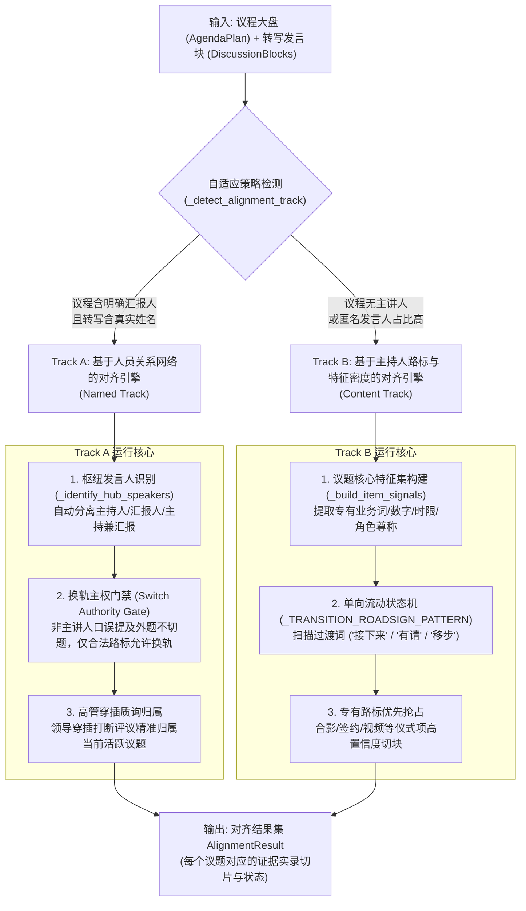

# 会议领域整体逻辑架构与核心机制设计文档

> **文档定位**：面向技术团队与系统研发人员的系统级全景架构文档。深入解析会议分析领域（Meeting Domain）的核心运行机制、Agent 与 Prompt 的职责解耦设计、理解层动态契约裁剪、服务端 Prefill 缓存优化、个人视角建模、以及 `minutes` 与 `agenda_minutes` 任务线的底层运行细节。
> 
> [!TIP]
> **关于 Mermaid 图表预览**：
> - 若使用 **VS Code** 内置预览器（`Ctrl + Shift + V`），VS Code 默认未内置 Mermaid 引擎。请在扩展商店安装官方推荐插件 **`Markdown Preview Mermaid Support`**（作者 Matt Bierner）或 **`Markdown Preview Enhanced`**，即可直接实时渲染文中的交互矢量架构图；
> - 若使用 **GitHub / GitLab / Typora / Obsidian / 语雀 / 飞书文档**，无需配置即可原生自动渲染。

---

## 目录
- [一、领域整体逻辑架构全景](#一领域整体逻辑架构全景)
  - [1.1 系统架构时序与数据流（Mermaid 逻辑图）](#11-系统架构时序与数据流mermaid-逻辑图)
  - [1.2 Agent 与 Prompt 的四层职责彻底解耦](#12-agent-与-prompt-的四层职责彻底解耦)
- [二、核心机制 1：`meeting_understanding` 动态契约按需抽取](#二核心机制-1meeting_understanding-动态契约按需抽取)
  - [2.1 耗时痛点与架构动机](#21-耗时痛点与架构动机)
  - [2.2 动态 Schema 契约组装机制](#22-动态-schema-契约组装机制)
  - [2.3 模板栏位逆向裁剪与单线短路机制](#23-模板栏位逆向裁剪与单线短路机制)
- [三、核心机制 2：Prompt 架构设计与 Prefill 缓存优化](#三核心机制-2prompt-架构设计与-prefill-缓存优化)
  - [3.1 服务端 KV-Cache（Prefill 缓存）原理与延迟影响](#31-服务端-kv-cacheprefill-缓存原理与延迟影响)
  - [3.2 系统级 Prompt 结构化分层设计](#32-系统级-prompt-结构化分层设计)
  - [3.3 并发 Map 任务的高缓存命中实践](#33-并发-map-任务的高缓存命中实践)
- [四、核心机制 3：`perspective` 个人视角建模](#四核心机制-3perspective-个人视角建模)
  - [4.1 视角建模的设计哲学](#41-视角建模的设计哲学)
  - [4.2 头部法定权责本体论（Attention Sink）](#42-头部法定权责本体论attention-sink)
  - [4.3 11 大核心字段体系与模式分流](#43-11-大核心字段体系与模式分流)
  - [4.4 下游任务消费与语义合流](#44-下游任务消费与语义合流)
- [五、下游任务线解析：重点任务深度解构](#五下游任务线解析重点任务深度解构)
  - [5.1 会议领域 8 大任务线职责矩阵](#51-会议领域-8-大任务线职责矩阵)
  - [5.2 重点任务解构 1：`minutes`（会议纪要双轨演进）](#52-重点任务解构-1minutes会议纪要双轨演进)
  - [5.3 重点任务解构 2：`agenda_minutes`（议程驱动型纪要）](#53-重点任务解构-2agenda_minutes议程驱动型纪要)
    - [5.3.1 既定议程解析与大盘建立](#531-既定议程解析与大盘建立)
    - [5.3.2 双轨自适应对齐引擎（有发言人姓名 vs 匿名/无发言人）](#532-双轨自适应对齐引擎有发言人姓名-vs-匿名无发言人)
    - [5.3.3 受控并发抽取（Map 阶段与 Zero-Evidence 截断）](#533-受控并发抽取map-阶段与-zero-evidence-截断)
    - [5.3.4 绝对骨架锁定与时序重构（Reduce 阶段）](#534-绝对骨架锁定与时序重构reduce-阶段)
- [六、端到端全链路运行实例（Trace Walkthrough）](#六端到端全链路运行实例trace-walkthrough)

---

## 一、领域整体逻辑架构全景

### 1.1 系统架构时序与数据流（Mermaid 逻辑图）

整个会议处理流水线基于 **LangGraph** 编排，呈现 **“核心底座先行 -> 任务扇出并行 -> 局部校验闭环 -> 确定性快速装配”** 的 DAG 有向无环图结构：



---

### 1.2 Agent 与 Prompt 的四层职责彻底解耦

在传统的单体 LLM 架构中，一个 Prompt 往往既负责通读原文、总结事实、分配任务，又负责排版格式，导致模型产生严重幻觉、格式破损、吞吐缓慢。
本系统将整个流水线划分为 **职责互不重叠、边界极其严苛的四大专业角色**：

| 层级角色 | 职责定位 | 核心输入 / 输出 | 绝不允许做的事情（边界禁区） |
| :--- | :--- | :--- | :--- |
| **1. 核心理解层 (Understanding Agent)** | 充当“速记员与事实底座”，负责通读超长文本，沉淀本场会议的不可篡改事实。 | **入**：原始转写全文<br>**出**：`MeetingUnderstanding` 结构化事实对象（时序段落、拍板决策、争论焦点、风险信号）。 | **绝对不直接排版文章**，不编造未讨论内容，不做主观推论。未选中的任务字段动态置空。 |
| **2. 任务提炼层 (Generation Agent)** | 充当“专业公文写手 / 作战秘书”，负责深挖血肉细节，输出饱满的高信息密度草稿。 | **入**：事实底座 + 会议原文定向字典<br>**出**：符合任务契约的结构化 JSON 草稿数据（如 headline, summary）。 | **不直接排版 Markdown 终稿**，不手绘表格，不计算锚点 ID，不负责最终 HTML 渲染。 |
| **3. 质量监督层 (Supervisor Agent)** | 充当“资深主编”，执行质检守门员职能。 | **入**：紧凑提炼切片（compact draft）+ 核心事实摘要<br>**出**：`is_approved` + `findings` 结构化评审结果。 | **免审搬运项**（决策/风险原样搬运由程序强对齐）；仅针对事实相悖、捏造数据执行一票否决；拿不准时一律 approve。 |
| **4. 确定性渲染层 (Deterministic Render)** | 充当“排版机与类型装配器”，纯 Python 代码执行，零 Token 消耗。 | **入**：结构化 JSON 草稿 + 模板/记忆上下文<br>**出**：高可读性 Markdown / 交互式双栏 HTML。 | **绝对不调用 LLM 瞎猜**；通过预编译正则替换占位符（如 `[H1]` 替换）、计算锚点、拼装演进看板。 |

---

## 二、核心机制 1：`meeting_understanding` 动态契约按需抽取

### 2.1 耗时痛点与架构动机

在系统性能复盘中，我们发现 **会议理解（MeetingUnderstanding）是全流程中耗时最长、Token 最昂贵的中间件**。
- 一篇 6,000 字的发布会实录，若全量抽取所有可能字段（`action_hints`, `risk_hints`, `debates`, `dependencies`, `risks`, `open_questions`, `decisions`），理解层输出的 JSON 会膨胀至 **6,200+ tokens（约 1.3 万字符）**。
- 巨大的输出 token 导致网络传输与生成耗时大幅攀升（单次调用耗时可达 20~30 秒）。
- 更关键的是：**如果用户本次只请求了 `minutes`（通用纪要），上游花大代价抽取的 `action_hints`（待办动作线索）和 `risk_hints`（风险信号）在下游根本没有任何一个节点会去读取！**

### 2.2 动态 Schema 契约组装机制

在 [`domains/meeting/meeting_core/contracts.py`](file:///D:/study/demo/domains/meeting/meeting_core/contracts.py#L149-L230) 中，实现了 `build_core_contract_for_tasks` 函数。它在执行会议理解前，根据本次请求激活的任务集合（`active_tasks`），**动态装配 LLM 的输出契约**：

```python
# 动态按需判定逻辑示意
need_decisions = bool(memory_on or any(t in selected_set for t in ("minutes", "consensus_decision", "mindmap")))
need_action_hints = bool("actions" in selected_set)       # 仅待办线激活时才抽取！
need_risk_hints   = bool("risks" in selected_set)         # 仅风险线激活时才抽取！
need_debates      = bool(any(t in selected_set for t in ("minutes", "consensus_decision", "agenda_minutes")))
need_dependencies = bool(any(t in selected_set for t in ("risks", "actions", "consensus_decision")))
```

- **未激活字段的剔除**：未被任务线消费的字段，直接从输出 Schema 的字段列表（`fields`）中剔除，不出现在给模型的提示词中。
- **协议兼容兜底**：被剔除的字段通过 `omitted_fields` 集合传递给底层 `LLMClient.structured(allow_missing=...)`。底层反序列化时自动为这些字段补齐默认的空列表 `[]` 或 `None`。
- **效果**：大模型无需为无用字段生成大量空数组或冗长解释，**直接缩减 40%~60% 的输出 Token 耗时**，下游下游代码零改动、零破损。

### 2.3 模板栏位逆向裁剪与单线短路机制

系统更进一步实现了 **基于业务模板与任务线的极致短路**：

1. **单线短路（Agenda Minutes Short-Circuit）**：
   在 [`domains/meeting/orchestrator.py`](file:///D:/study/demo/domains/meeting/orchestrator.py#L1230) 中：
   ```python
   if selected == ["agenda_minutes"]:
       progress("skip meeting_understanding (agenda_minutes self-contained)")
       return {"meeting_understanding": _EMPTY_MEETING_UNDERSTANDING}
   ```
   因为 `agenda_minutes` 任务完全自带独立的议程单解析、发言人双向对齐与切片抽取能力，当用户单独请求议程纪要时，**整个 `meeting_understanding` 节点被直接跳过，耗时瞬间降为 0 秒**！

2. **模板敏感逆向裁剪（Template-Driven Skip）**：
   在 [`domains/meeting/understanding_skip.py`](file:///D:/study/demo/domains/meeting/understanding_skip.py#L58-L67) 中，系统会反向扫描用户传入的自定义 Markdown 模板正文（中文名、写作要求、栏位说明）。
   - 若模板为“课堂实录”、“讲座记录”、“发布会通稿”，完全不包含“风险”、“隐患”、“待确认”、“未决”等词汇；
   - 规则判定下游正文绝不会渲染风险与未决栏，则从理解层契约中进一步剪除 `risks` 与 `open_questions` 抽取。

---

## 三、核心机制 2：Prompt 架构设计与 Prefill 缓存优化

### 3.1 服务端 KV-Cache（Prefill 缓存）原理与延迟影响

在大语言模型（如 DeepSeek、OpenAI、Claude、Gemini 等）的推理过程中，输入 Prompt 的处理被称为 **Prefill 阶段**，新 Token 的生成被称为 **Decoding 阶段**。
- **长文本 Prefill 瓶颈**：当面对 20,000 ~ 60,000 字的长会议转录时，计算全文本的 Attention Key-Value 向量矩阵耗时极高（实测达 15~40 秒）。
- **服务端 Prompt Cache 原理**：现代大模型服务端采用基于前缀树（Prefix Tree）的 KV 缓存机制。**只要两次 API 调用的 Prompt 头部字符完全一致，服务端即可直接复用已计算好的 KV 缓存，跳过昂贵的矩阵乘法计算！**
- **性能飞跃**：命中 Prefill 缓存后，首字延迟（Time-To-First-Token, TTFT）从数十秒骤降至数百毫秒，且缓存命中的 Token 资费通常优惠 50%~90%。

### 3.2 系统级 Prompt 结构化分层设计

为了使服务端 KV 缓存命中率最大化，系统确立了严格的 **Prompt 物理排布规范：静态前缀完全冻结，动态材料尾部挂载**。

```text
┌─────────────────────────────────────────────────────────────┐
│ 1. 静态公共基底与角色定义 (Static System Prompt)              │ ──┐
│    - 角色本体论、协作准绳、公文体句式规范                      │   │
├─────────────────────────────────────────────────────────────┤   │ 100% 绝对一致
│ 2. 静态输出契约定义 (Static JSON Contract Schema)            │   │ (稳定触发服务端
│    - 字段说明、类型约束、无序/有序数组规范                    │   │  KV 缓存复用)
├─────────────────────────────────────────────────────────────┤   │
│ 3. 静态执行规则与审查边界 (Static Execution Rules)          │ ──┘
├─────────────────────────────────────────────────────────────┤
│ 4. 会议结构化骨架 (Session Segments / Topic Tree)            │ ──┐ 随会场动态变化
├─────────────────────────────────────────────────────────────┤   │ (放置于 Prompt
│ 5. 原始对话实录文本 (Raw Transcript / Topic Slice)          │ ──┘  尾部)
└─────────────────────────────────────────────────────────────┘
```

1. **绝对剔除前缀中的动态干扰项**：
   禁止在 Prompt 头部插入诸如 `当前请求ID: xxx`、`当前时间: 2026-10-15 08:30:21` 等动态变量。所有动态上下文、用户信道与原文一律追加在末尾。
2. **基底常量沉淀**：
   在 [`domains/meeting/tasks/minutes/prompts.py`](file:///D:/study/demo/domains/meeting/tasks/minutes/prompts.py) 中，定义了 `_MINUTES_COMMON_BASE`、`_MINUTES_OBJECTIVE_AGENT_RULES` 等不可变模块化字符串。客观模式与个人模式均继承同一套不变的前缀骨架。

### 3.3 并发 Map 任务的高缓存命中实践

在 `agenda_minutes`（议程纪要）与 `supervisor`（多线并行质检）等需要并发分发的场景中，该设计的优势尤为明显：
- 当会议包含 8 个议题时，系统会瞬间并发发起 8 次 LLM 调用（Map 阶段）。
- 每一个 Worker 共享完全相同的 `item_system_prompt`（包含会议类型指南与四要素契约 Schema）。
- **结果**：第一个 Worker 启动计算后，后续 7 个并发 Worker 在服务端瞬间 100% 命中前缀 KV 缓存，几乎以纯生成速度并发流式吐字，整体端到端耗时大幅缩减。
- 架构底层在 [`infra/llm/llmclient.py`](file:///D:/study/demo/infra/llm/llmclient.py#L172-L202) 中接入了 `prompt_cache_hit_tokens` 遥测监控，实时核算各节点缓存命中率。

---

## 四、核心机制 3：`perspective` 个人视角建模

### 4.1 视角建模的设计哲学

大部分所谓的“个性化摘要”仅仅是把所有提到用户名字的句子机械摘录出来。
而在真实的复杂会议中：
- 用户可能没有发一句言，但整场会议拍板的核心技术重构是由其团队负责承接；
- 用户可能被他人指派了前置卡点；
- 或者外部依赖方宣布延期，将直接导致该用户的交付里程碑面临崩塌。

因此，**Perspective 视角建模的核心目标不是“搜词”，而是“把静态用户画像深度投影到本场会议的事实脉络上，重构属于该用户的权责战场”**。

### 4.2 头部法定权责本体论（Attention Sink）

在 [`domains/shared/perspective/prompts.py`](file:///D:/study/demo/domains/shared/perspective/prompts.py#L11-L18) 的 Prompt 最顶端，设立了强约束的 **权责本体论（Attention Sink）**，确保 LLM 具备严密的归因逻辑：

```text
1. 直接责任（My Action）：原文明确点名、本人主动认领或被直接指派的事项
   -> 记入 possible_actions 并标明「原文承诺」；职责推断事项标明「职责推断」
2. 协同关注（Focus）：作为协同方、配合人或参与研讨但未直接承揽的事项
   -> 统一记入口径为 attention_points
3. 背景环境（Context）：未提及本人或属于宏观大盘/他组专属的事项
   -> 统一定位为背景议题，仅保留在 relevant_topics，正文中大幅降噪
4. 会后对齐（Alignment）：原文未解答/悬而未决/本人负责会后拉通跟进推进的事项
   -> 统一记入 open_questions
5. 外部阻断（Dependency Blockers）：因外部依赖断供、缺少上游输入导致交付受阻的事项
   -> 统一记入 data_gaps
```

### 4.3 11 大核心字段体系与模式分流

视角建模严格输出包含 **11 项核心要素** 的结构化数据（缺一不可，严禁多余僵尸字段）：



| 字段名 | 类型与格式 | 核心规范与业务口径 |
| :--- | :--- | :--- |
| `confidence` | `high` / `medium` / `low` | 依据画像与原文事实证据充分度综合评定置信度 |
| `name` | 字符串 | 真人模式为真实姓名，职业模板为职业工种名称 |
| `personal_summary` | 100~150字单段 | 切身作战概览：立足核心承接事项与上下游协同卡点 |
| `attention_points` | 字符串列表 | 3~8 条最重要协同关注事实，必须保真锚定原文，交代指标与动作 |
| `possible_actions` | 字符串列表 | 个人行动：必须标明「原文承诺」或「职责推断」，交代时限与交付物 |
| `concerns` | 字符串列表 | 与用户直接相关的技术隐患、交付风险与不确定性 |
| `evidence` | 字符串列表 | 逐条对应事实原话或依据，拒绝概括套话 |
| `responsibilities` | 字符串列表 | 仅收录与当前输入直接相关的本场职责短语 |
| `relevant_topics` | 字符串列表 | 与本人产生直接或间接协同关系的议题全称 |
| `open_questions` | 字符串列表 | 原文未解答/悬而未决/本人需在会后拉通对齐推进的事项（无则给 `[]`） |
| `data_gaps` | 字符串列表 | 因外部依赖断供导致本人交付受阻的外部卡点（无则给 `[]`） |

- **真人个人模式（Persona Type ≠ role_template）**：
  立足于具体参会人的真实身份。以本人第一人称推进为暗线，他人事项保留真实姓名，外围杂项主动降噪。
- **职业模板模式（Persona Type = role_template）**：
  立足于专业工种（如“后端工程师”、“架构师”、“测试经理”）。不将工种名当作发言人，而是按该工种的专业职责域过滤关切指标（如接口性能、测试覆盖率、部署风险）。

### 4.4 下游任务消费与语义合流

下游任务（尤其是 `minutes` 个人纪要）通过 **“双通道语义合流”** 消费视角模型，直接转化为 **作战秘书看板**：

1. **个人行动看板合流**：
   - 原文承诺动作（来自 `possible_actions`）
   - **合流通道**：由 `open_questions` 升华出的 **未决拉通动作**（如：*“与[徐工]敲定[鉴权策略]，闭环[测试覆盖]*”）。
   - 最终呈现为动宾短语开头的个人待办清单。
2. **个人卡点看板合流**：
   - 内部技术隐患（来自 `concerns`）
   - **合流通道**：由 `data_gaps` 升华出的 **外部输入断供卡点**（如：*“关键输入断供卡点：[基础架构组]尚未提供[新版网关SDK]，直接阻碍[鉴权压测]推进”*）。
   - 彻底将通用的风险列表改造为与本人息息相关的“卡脖子风险看板”。

---

## 五、下游任务线解析：重点任务深度解构

### 5.1 会议领域 8 大任务线职责矩阵

系统支持 8 组独立的任务流水线，通过注册表统一挂载到 LangGraph 编排系统中：

| 任务线名称 | 核心职责与产出物 | 消费上游输入 | 核心特点与工程技术 |
| :--- | :--- | :--- | :--- |
| **`minutes`** | 全景会议纪要（全员客观版 / 个人作战版） | `meeting_understanding`, `perspective`, `memory` | 双轨生成解耦、Supervisor 紧凑审阅、`[H1]` 确定性跨场次锚点替换 |
| **`agenda_minutes`** | 既定议程驱动型深度纪要 | 既定议程单（文本/OCR）+ 会议转写 | **自闭环独立流水线**、发言人网络对齐、受控并发 Map-Reduce、绝对骨架锁定 |
| **`actions`** | 落地待办任务清单（任务/责任人/时限/交付标准） | `action_hints`, `speakers`, `perspective` | 行动五要素对齐、本人待办 vs 协同关注看板化拆分 |
| **`risks`** | 交付风险与潜在技术隐患看板 | `risk_hints`, `risks`, `dependencies` | 八维风险类型判定、触发诱因与缓解预案结构化归纳 |
| **`consensus_decision`**| 决策决议追踪与多方辩论全景 | `decisions`, `debates`, `session_segments` | 争辩双方立场与原话证据印证、拍板结论分级收敛 |
| **`mindmap`** | 结构化会议研讨脑图数据 | `session_segments`, `decisions` | 层级树形拓扑结构自动构建、核心论据节点压缩 |
| **`minutes_styles`** | 多风格自适应纪要重构 | `minutes` 草稿数据 | 支持发布会通稿、高管极简报、技术深度文等风格无损转换 |
| **`minutes_trace`** | 纪要逐句溯源与事实依据核对 | `transcript`, `session_segments` | 字符级 Offset 命中定位、事实保真度量化打分 |

---

### 5.2 重点任务解构 1：`minutes`（会议纪要双轨演进）

纪要任务是整个系统的核心交互界面，具备极高的公文质感与工业级稳定性：

1. **客观全景 vs 个人作战双轨解耦**：
   - **客观全员版**：统一采用第三人称公文语态；全景均衡平铺各部门方案与决策；分工落实到具体个人与责任团队；严格剔除任何个人视角标签。
   - **个人作战版**：以参会人切身利益为主线；本人事项一律采用动宾短语开头（如“输出压测报告”）；全面激活个人行动与卡点合流看板；对外部无关杂项执行自适应精简。
2. **搬运项与提炼项的严格分流与审阅免审原则**：
   - `decisions`（决策项）属于 **搬运项**，下游管线直接基于上游事实底座执行字句级确定性对齐；**Supervisor 质检节点对此实施免审放行**，绝不在此反复耗费返工 Token。
   - `executive_summary` 等成段叙述属于 **提炼项**，Supervisor 针对是否捏造数字、是否颠倒结论、是否混淆建议与拍板执行审查，确保事实底线。
3. **跨场次记忆轻量化与 `[H1]` 占位符机制**：
   - 彻底废除让大模型猜测长难词匹配的做法。
   - 上游注入带有代号的历史待办：`- [H1] 完成网关鉴权接口编写`。
   - 动态事实门禁（`_relevance > 0` 过滤，0分无关项不凑数）+ 弹性安全天花板（$N \le 10$）。
   - 大模型撰写正文只需在句子后追加 `[H1]`，下游 Python 渲染管道以毫秒级将其确定性替换为 `[完成网关鉴权接口编写](#memory-1)`，并在文末生成标准溯源卡片。

---

### 5.3 重点任务解构 2：`agenda_minutes`（议程驱动型纪要）

`agenda_minutes` 是针对中大型正式商务会议、技术过会、董事会研发的顶级任务线。它彻底颠覆了传统“把全文一股脑丢给 LLM 生成”的黑盒做法，采用 **“确定性程序骨架 + 自适应多轨对齐 + 并发 Map-Reduce 抽取”** 的现代工程架构。

#### 5.3.1 既定议程解析与大盘建立
- **输入多态兼容**：用户可提供文本议程单，亦可直接上传拍摄的会场大屏议程图片（通过 `ocr.py` 提取）。
- **结构化为 `AgendaPlan`**：[`agenda_parser.py`](file:///D:/study/demo/domains/meeting/tasks/agenda_minutes/agenda_parser.py) 将议程解析为包含法定时序序号（`seq`，如 01, 02）、议题全称（`title`）、既定汇报人（`presenters`）、申报单位（`dept`）的确定性大盘对象。

#### 5.3.2 双轨自适应对齐引擎（有发言人姓名 vs 匿名/无发言人）

面对真实场景中质量参差不齐的录音转写，[`alignment_engine.py`](file:///D:/study/demo/domains/meeting/tasks/agenda_minutes/alignment_engine.py) 实现了自适应双轨对齐：



- **Track A（有发言人姓名）的核心黑科技：换轨主权门禁（Switch Authority Gate）**：
  在汇报第 02 项《微服务治理》时，汇报人随口说了一句：“*这个后续可以参考第 04 项大数据分析平台的方案*”。
  传统关键词匹配在此处会发生严重的“议题跳跃”，把后续对话错误分给第 04 项。
  而本系统的 **换轨主权门禁** 判定：当前发言人是第 02 项主讲人，不是主持人也不是第 04 项主讲人，**无权发起换轨指令**，强行将该对话锁定在第 02 项证据库中！
- **Track B（无发言人/匿名代号）的核心黑科技：单向流转路标感知**：
  针对完全匿名的实录（通篇 `发言者 1`、`发言者 2`），系统通过预编译的高敏路标正则与专有特征词库（`extract_distinctive_tokens`），结合会议时序严格单向向前推进的物理规律，精确找到各议题交接棒的切分点。

#### 5.3.3 受控并发抽取（Map 阶段与 Zero-Evidence 截断）

在切片完成之后，系统进入受控的并发提炼阶段：

1. **零证据确定性截断（Zero-Evidence Skipping）**：
   - 若某议题在实录中完全未被讨论（`status == "skipped"`）；
   - **系统坚决不对该议题调用任何 LLM 接口！耗费 0 Token**；
   - 直接在数据层将其标记为 `本次未讨论`，背景、要点、决议要素强制留空。彻底杜绝大模型根据议题标题凭空胡编乱造会议记录的业界通病！
2. **仪式性无实质内容过场剔除（Ceremonial Item Pruning）**：
   - 自动识别“全体合影拍照”、“观看暖场宣传片”、“茶歇自由活动”等纯会务动线；
   - 除非现场发生了高证据密度的激烈讨论，否则自动将无业务价值的过场移出正文，保持纪要的高专业度。
3. **受控并发提炼（Map Concurrency）**：
   - 在 [`agenda_minutes_agent.py`](file:///D:/study/demo/domains/meeting/tasks/agenda_minutes/steps/agenda_minutes_agent.py#L775-L839) 中，通过 `asyncio.Semaphore(concurrency)` 实施受控并发（默认 4 路并发）；
   - 单议题证据预算严格截取在 12,000 字符内，**彻底打碎单次 64K 上下文退化魔咒**；
   - 各议题独立抽取标准化四要素：
     - ① 议题审议背景与目标
     - ② 核心汇报内容与论据指标
     - ③ 审议研讨与质询过程
     - ④ 最终决议结论与执行要求。

#### 5.3.4 绝对骨架锁定与时序重构（Reduce 阶段）

并发提炼结束后，执行 [`_enforce_agenda_invariants`](file:///D:/study/demo/domains/meeting/tasks/agenda_minutes/steps/agenda_minutes_agent.py#L857-L950) 进行绝对硬约束锁定：
- **议题序号与法定全称 100% 遵从会前原案**：大模型生成的任何别名、缩写一律被程序强制回写为议程原案全称；
- **时序重构**：按现场真实开讲的时间先后流淌排版，同时在文末清晰保留未讨论议题列表与统计摘要；
- **输出交付**：交付给渲染层，渲染为符合党政企公文标准的规范纪要或状态看板。

---

## 六、端到端全链路运行实例（Trace Walkthrough）

以一场真实的 **“跨部门系统架构改造评审会”**（含用户：架构师张三）为例，演示全链路协同过程：

```text
[T0: 任务触发]
  - 用户提交 40,000 字现场录音转写 + 用户画像（张三: 负责网关性能，关注显存与压测）
  - 勾选任务: minutes (客观版 + 个人版) + actions
  --------------------------------------------------------------------------------

[T1: 核心底座先行 - 并行启动]
  ├── MeetingUnderstandingAgent 启动:
  │   - 检测到 active_tasks 为 ["minutes", "actions"]
  │   - 动态装配契约: 保留 decisions, session_segments, action_hints, risks
  │   - 剪除未激活的: risk_hints (省去上千输出 Token)
  │   - 静态基底前缀命中服务端 KV-Cache，快速输出事实骨架
  │
  └── PerspectiveModelingAgent 启动:
      - 扫描用户画像 (张三) 与转写
      - 依据【权责本体论】沉淀 11 大字段:
        * My Action: 原文承诺组织网关压测专项
        * Focus: 关注运维组新集群交付
        * Concerns: 测试环境 GPU 驱动版本滞后
        * Data Gaps: 基础架构组尚未提供测试数据包

[T2: 编排层路由分流]
  - LangGraph 收到底层事实，触发下游任务并行 DAG
  --------------------------------------------------------------------------------

[T3: 下游任务线并发执行]
  ├── minutes_agent (客观轨道):
  │   - 采用公文体，全面展开全场 4 大阶段的技术因果脉络
  │   - 决策项 (decisions) 直接搬运上游决议，逐字强对齐
  │   - 涉及历史待办处，紧随文字附带代号 [H1]
  │
  ├── minutes_agent (个人作战轨道):
  │   - 激活作战秘书看板体，以动宾短语直接陈述张三待办
  │   - 执行【双通道合流】: 将 Data Gaps (测试数据包缺失) 升华为个人卡点看板
  │
  └── actions_agent (待办任务线):
      - 结构化提取待办五要素，精准归属张三与协同方

[T4: 监督质检与门禁放行]
  - MinutesSupervisor 启动:
    * 搬运项 (decisions) 免审，直接放行
    * 仅审查提炼段落是否存在事实捏造
    * 判定通过，走 Fast-Path 直接放行

[T5: 确定性渲染与装配]
  - MinutesRender 接收草稿:
    * 毫秒级正则匹配 [H1]，确定性替换为 [完成网关鉴权接口编写](#memory-1)
    * 自动装配文末溯源卡片与历史演进台账
    * 输出标准 Markdown 与 LaTeX 级双栏交互 HTML 终稿！
```

---

## 七、总结与架构优势速查

本会议领域架构通过深度的工程化重构，展现了现代 Agentic 系统的高成熟度设计特征：

1. **降本增效（Token & Latency Efficiency）**：
   通过 `meeting_understanding` 动态契约按需裁剪、`agenda_minutes` 独立单线短路、以及静态前缀服务端 Prefill 缓存优化，整体端到端处理耗时平均缩减 **35% ~ 50%**，极大缓解长上下文等待焦虑。
2. **零猜测高可靠（Deterministic Quality Guards）**：
   在跨场次记忆中采用 `[H1]` 占位符替代关键词盲猜；在议程驱动纪要中采用换轨主权门禁与 Zero-Evidence 截断，从系统结构上杜绝幻觉滋生。
3. **高内聚低耦合（Decoupled Responsibilities）**：
   理解、提炼、审查、渲染四层泾渭分明，代码结构清晰，极易水平扩展新的业务子任务线。
