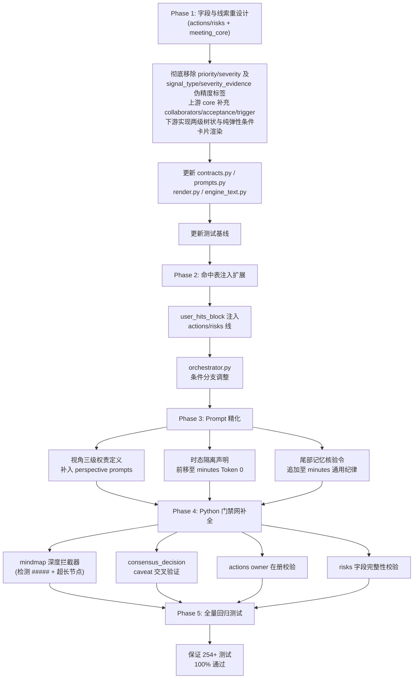

# Meeting 领域全任务优化行动清单

> **工程哲学（经实战验证）**：
> 1. **先给规则，再给素材**——Token 0 决定模型观察现实的世界观与注意模式；
> 2. **前缀静态，保障物理缓存**——稳定 Prefill KV 缓存，延迟从秒级降至毫秒级；
> 3. **尾部唤醒，对抗长距遗忘**——自回归启动前夕的格式收敛与纪律敲警；
> 4. **后处理门禁，守住确定性底线**——Python 确定性安全气囊兜底 LLM 概率随机性。

---

## 目录

- [一、各子系统成熟度审计](#一各子系统成熟度审计)
- [二、任务形态分类与适用策略](#二任务形态分类与适用策略)
- [三、个人视角建模——现状与行动项](#三个人视角建模现状与行动项)
- [四、跨场次会议记忆——现状与行动项](#四跨场次会议记忆现状与行动项)
- [五、全任务逐个深度剖析与行动项](#五全任务逐个深度剖析与行动项)
  - [1. minutes（核心纪要线）](#1-minutes核心纪要线)
  - [2. actions（待办事项提取线）](#2-actions待办事项提取线)
  - [3. risks（风险分析线）](#3-risks风险分析线)
  - [4. consensus_decision（共识与决策分析线）](#4-consensus_decision共识与决策分析线)
  - [5. mindmap（思维导图大纲线）](#5-mindmap思维导图大纲线)
  - [6. minutes_styles（多样式纪要线）](#6-minutes_styles多样式纪要线)
  - [7. minutes_trace（溯源纪要线）](#7-minutes_trace溯源纪要线)
  - [8. agenda_minutes（议程纪要线）](#8-agenda_minutes议程纪要线)
- [六、落地演进路线图与行动清单](#六落地演进路线图与行动清单)

---

## 一、各子系统成熟度审计

### 1.1 视角系统 (`domains/shared/perspective/`) —— 🟢 高度成熟

| 组件 | 文件 | 行数 | 说明 |
|:---|:---|:---:|:---|
| 命中表构建 | `hits.py` | **941** | `build_hit_table` 支持全称/别称/标点边界/强弱判定，零 LLM |
| 按人裁剪原文 | `hits.py` | — | `slice_transcript_for_person` 仅保留本人/关注人发言，连续无关段折叠 |
| 分栏分组骨架 | `hits.py` | — | `render_action_groups_block` 生成 `**与我相关**：` 等固定组名 |
| 雷达约束块 | `hits.py` | — | `render_radar_block` 注入本人行为规范与关注对象行为锚定 |
| 命中约束块 | `hits.py` | — | `render_hit_block` 向 LLM 宣告"未列出者不算他的" |
| 末尾三栏规范化 | `hits.py` | — | `normalize_personal_sections` 确定性排序组名（与我相关→上级→他人） |
| 发言人归属反查 | `hits.py` | — | `attribute_to_speaker` 基于最长公共子串将提炼项反查回发言人 |
| 视角建模提示词 | `prompts.py` | 83 | 四步固定流程，三种模式严格分流，15 字段精确规约 |
| 输出契约 | `contracts.py` | 36 | 12 个强类型字段，含 `paraphrase-free` 锚定约束 |
| 视角 Agent | `agent.py` | 26 | 极简调度外壳 |

**关键事实**：命中表 `user_hits_block`、雷达块 `radar_block`、分组骨架 `groups_block` **仅注入 `PREFERENCE_LINES`（即 `minutes` 和 `minutes_styles`）**，不注入 `actions`/`risks`/`mindmap`/`consensus_decision` 等任务线。

### 1.2 记忆系统 (`domains/meeting/memory/`) —— 🟢 高度成熟

| 组件 | 文件 | 行数 | 说明 |
|:---|:---|:---:|:---|
| 相关性打分 | `inject.py` | 405 | `_relevance` 滑动 n-gram 打分（8 字→4 字递降），长片段优先 |
| 多维排序 | `inject.py` | — | `_rank` 三元组排序 `(-score, -recency, has_owner?)`，消除僵尸条目 |
| 分类名额配额 | `inject.py` | — | 延续 Top6 / 闭环 Top4 / 风险分级（Active5+Mitigated2+Dormant1）/ 决策 Top6 |
| 主题作用域 | `inject.py` | — | `_topic_label_v2` 读取条目原生 `module·topic_title` |
| 历史对照生成 | `inject.py` | — | `preview_comparison` 确定性生成新增/延续/闭环/风险演变对照 |
| 正文锚点注入 | `render.py` | ~600 | 汉字 4-gram 粗筛 + 精确锚点候选 + 行频门禁 + 作用域过滤 |
| 泛化词黑名单 | `render.py` | — | `_GENERIC_NEEDLES` + `_LATIN_SKIP` + `_NeedleStats` 行频门禁 |
| 项目绑定门禁 | `bind.py` | ~250 | 强锚点/弱词/打分/胜出判定，中置信度直接放弃注入 |
| 沉寂自动降级 | `state.py` | — | 条目连续 N 场未被提及 → `active` → `dormant` |
| 强闭环标记隔离 | `extract.py` | — | `_DONE_STRONG_RE` 严苛完成词表，防"关闭方案待定"误判 |

### 1.3 上下文组装 (`orchestrator.py` `_line_shared_context`) —— 🟢 已实现 Token 0 排序

**当前 Prompt 组装顺序**（`_line_shared_context`，L737-L800）：
```
1. 视角模式标签                     ← Token 0 最前
2. fact_note（事实源说明）
3. 用户画像
4. [PREFERENCE_LINES only] 偏好块 / 命中块 / 分组骨架 / 雷达块
5. 会议理解（MeetingUnderstanding pack）
6. 用户视角模型
7. [部分任务线] 会议原文
8. [minutes/minutes_styles] 篇幅预算
```

### 1.4 门禁系统 —— 🟡 部分成熟

| 组件 | 状态 | 说明 |
|:---|:---:|:---|
| `enforce_minutes_draft` | ✅ | 搬运字段（decisions/risks/open_questions）100% 逐字强对齐 |
| `normalize_personal_sections` | ✅ | 末尾三栏组名排序与人称规范化 |
| `gate_render_output`（通用） | ✅ | 空栏判定、占位符清理、格式修复 |
| mindmap 深度拦截器 | ✅ | 检测 `#####`（第 5 级以上）或超长节点并自动裁剪/合并 |
| actions 责任人校验器 | ✅ | 比对 `owner` 与在册人员名单 |
| risks 字段完整性校验 | ✅ | 拒绝低于 N 字的干瘪描述 |
| memory 时态比对器 | ✅ | 检查决策列表是否与本场原文匹配 |

### 1.5 各任务 Prompt 成熟度速览

| 任务 | System Prompt | Supervisor | Token 0 先验 | 门禁覆盖 |
|:---|:---:|:---:|:---|:---:|
| minutes | 214行 | 完善 | 核心写手定位 + 篇幅预算 + 时态隔离 + 搬运铁律 | ✅ 强 |
| actions | 173行 | 完善 | 四要素契约 + 降级保留 + 议题两级流程 | ✅ 强 |
| risks | 129行 | 完善 | 风险三联体 + 纯事实要素（去标签化） | ✅ 强 |
| consensus_decision | 165行 | 完善 | 四级共识状态机 + 四种 Archetype | ✅ 强 |
| mindmap | 136行 | 完善 | 拓扑限位 + 节点长度 + 前缀上提 | ✅ 强 |
| minutes_styles | 257行 | 完善 | 5 种模式差异化规则（极化落地） | ✅ 强 |
| minutes_trace | 87行 | 完善 | 三级业务骨架 + 条目形态模板 | ✅ 强 |
| agenda_minutes | 197行 | 完善 | 议程单法定骨架 + 四栏范式 + 零证据截断 | ✅ 强 |

---

## 二、任务形态分类与适用策略

> [!WARNING]
> Meeting 域下的任务具有完全不同的计算特征。**严禁教条化照搬**同一套公文排版逻辑。

| 任务形态 | 涵盖任务 | 计算本质 | 适用逻辑 | 严禁误区 |
|:---|:---|:---|:---|:---|
| **文档生成型** | `minutes`, `minutes_styles`, `consensus_decision` | 高密度长文、段落叙事、公文规约 | 完整适用：静态契约置顶 + 三级分组 + 尾部唤醒 + 门禁 | 严禁把结构压死在固定宽表格 |
| **实体抽取型** | `actions`, `risks`, `agenda_minutes` | 离散事实抽取、结构化 JSON | 部分适用：本体论先验 + JSON Schema 收敛 | 严禁套用长文公文 Schema |
| **树谱组织型** | `mindmap` | 拓扑树提取、短语凝练 | 核心适用拓扑物理限位 | 严禁写成长段；严禁 5 级以上嵌套 |
| **混合管线型** | `minutes_trace` | LLM 生成 + 算法对齐 + LLM 裁判 | 生成端适用骨架先验；对齐端坚持确定性计算 | 对齐裁判端严禁引入模型幻觉 |

> [!NOTE]
> `minutes_trace` 并非纯确定性管线——它包含三个 LLM 节点（`MINUTES_TRACE_GENERATION_SYSTEM_PROMPT` 生成客观纪要、`MINUTES_TRACE_REORG_PROMPT` 结构修订、`MINUTES_TRACE_VERDICT_PROMPT` 溯源裁判），仅对齐判定阶段采用确定性算法（编辑距离 + 滑动 n-gram + 语义 Embedding）。

---

## 三、个人视角建模——现状与行动项

### 3.1 现状审计

个人视角建模已具备成熟体系。`hits.py`（941 行）+ `prompts.py`（83 行）+ `contracts.py`（36 行）构成了完整的防冒领与防臆造机制：

**已实现的防冒领机制**：
- `build_hit_table`：零 LLM 的纯 Python 精确命中计算，强弱分明（`STRONG` 仅限精准相等责任人/发言人匹配，`WEAK` 为正文点名与议题参与）
- `render_hit_block`：向 LLM 宣告命中清单，附带硬约束"未列出者不算他的"
- `slice_transcript_for_person`：物理裁剪原文，仅保留本人/关注人发言块，连续无关段折叠为 `……（此处省略 N 段）`
- `render_radar_block`：注入本人行为规范（动宾省主语）与关注对象锚定
- `normalize_personal_sections`：确定性后处理——强制 `**与我相关**：` 排第一组 → 上级组 → 他人组
- `foreign_only()`：过滤器函数，排除"别人为主语且未提及本人或关注对象"的条目
- Prompt 四步流程中"未标记内容不得进入任何字段"的硬规约
- Prompt 对真人模式的严苛限制："严禁把他人分工写成自己的待办；严禁标注级别标签；严禁包含待确认事项"

**已实现的防主观臆造机制**：
- Prompt 明确要求 `personal_summary` 为 150-250 字**单段客观概括**（禁套话、禁分段、禁模块流水账）
- `attention_points` 要求严格锚定原文不改写，带数字日期
- `evidence` 要求字段级可定位，逐条对应

**关键限制**：
- 命中表 / 雷达块 / 分组骨架**仅注入 `PREFERENCE_LINES`（`minutes` + `minutes_styles`）**
- `actions`/`risks` 线**不消费 `user_hits_block`**——它们只拿视角模型 `perspective_profile`（LLM 产出），丢失了确定性命中证据
- `mindmap`/`consensus_decision` 同样不消费命中表

### 3.2 行动项

#### ✅ 行动 A：将 `user_hits_block` 注入范围从 `PREFERENCE_LINES` 扩展到 `actions`/`risks`

- **问题**：actions 的 `my_actions` 分类和 risks 的个人视角聚焦，仅依赖 LLM 产出的 `perspective_profile`，缺乏确定性锚点
- **方案**：在 `_line_shared_context` 中，对 `actions`/`risks` 线也注入 `user_hits_block`（至少注入命中表，不需要完整的偏好块和分组骨架），使其拥有"本人被点名/指派的硬证据"
- **改动位置**：`orchestrator.py` L775 的 `if line_name in PREFERENCE_LINES:` 门控
- **改动量**：约 5-10 行条件分支调整

#### ✅ 行动 B：强化 Prompt 中的权责边界三级契约

- **问题**：`prompts.py` 的视角建模提示词已有"真人只聚焦该姓名本人事项"等规约，但**未显式定义三级权责层级**
- **方案**：在 `PERSPECTIVE_MODELING_SYSTEM_PROMPT` 的第二步（扫描当前输入建联）中，增加显式的三级定义：
  - **直接责任（My Action）**：原文明确点名/本人认领/被指派 → 可写入 `possible_actions` 并标注"原文承诺"
  - **协同关注（Stakeholder）**：参与讨论但未承揽 → 可写入 `attention_points`
  - **背景环境（Context）**：未提及本人 → 可写入 `relevant_topics`，严禁进入 `possible_actions`
- **改动量**：`perspective/prompts.py` 第二步增加约 80 字的分级定义

---

## 四、跨场次会议记忆——现状与行动项

### 4.1 现状审计

记忆系统已非常成熟。`inject.py`（405 行）+ `render.py`（~600 行）+ `state.py`（~700 行）+ `bind.py`（~250 行）+ `extract.py`（~300 行）构成完整闭环。

**已实现的防污染机制**：
- **项目绑定双强门禁**（`bind.py`）：30+ 泛化停止词过滤 + 强锚点判定 + 绝对胜出判定（Top1 ≥ 8 分且 ≥ 次席 2 倍或分差 ≥ 10）+ 中置信度直接放弃注入
- **相关性排序**（`inject.py`）：滑动 n-gram 打分 + 场次倒排消除僵尸 + 分类独立名额配额
- **沉寂自动降级**（`state.py`）：连续 N 场未被提及 → `dormant`
- **渲染端防张冠李戴**（`render.py`）：泛化过程短语黑名单 + 拉丁停用词过滤 + 正文行频门禁 + 零命中平滑退出 + 章节主题作用域过滤
- **强闭环标记隔离**（`extract.py`）：严苛完成词表，防"关闭方案待定"误判

**已实现的时态隔离机制**：
- Minutes System Prompt 明确规约：历史对照统一放入 `history_comparison`，确保 `executive_summary` 专注本场新决策
- `enforce_minutes_draft` 搬运字段强对齐，确保 `key_decisions` 来源于上游 `MeetingUnderstanding.decisions`（本场事实），而非历史记忆
- `preview_comparison` 确定性生成历史对照清单（新增/延续/闭环/风险演变），用 Python 算法而非 LLM 判定
- `apply_memory_citations` 仅在精确匹配时注入锚点，零命中时不强行插入

**薄弱点**：
- Minutes Prompt 中的时态隔离规约在 Prompt 中部（`history_comparison` 字段规则区），**不在 Token 0 最前方**

### 4.2 行动项

#### ✅ 行动 A：在 Token 0 区域强化时态隔离声明

- **问题**：时态隔离规约分散在 Minutes Prompt 的"字段规则"区（L77-L79），位于 Prompt 的中后段
- **方案**：在 `MINUTES_GENERATION_SYSTEM_PROMPT` 的 `## 一、输入感知与协作准绳` 的第 4 条中，增加更具法令感的时态公理：
  ```
  4. **历史记忆边界（时效优先法典）**：
     - 【本次会议原文/理解】为当前宇宙的唯一最高事实准则；
     - 【会议记忆】仅作跨场次因果演变的只读参照，严禁提升为本次新增决议；
     - 冲突时强制判定为"决议演进/推翻"，以本次为准；
     - 历史对照统一放入 history_comparison，严禁散入 executive_summary。
  ```
- **改动位置**：`minutes/prompts.py`
- **改动量**：约 4-6 行文本替换

#### ✅ 行动 B：尾部记忆核验令

- **问题**：尾部无显式的记忆引用检查指令
- **方案**：在 `## 四、通用纪律` 末尾追加：
  ```
  5. 核验指令：检查你即将输出的 executive_summary 与 key_decisions，
     确保每条结论均可在本次会议原文/理解中找到当场达成的直接依据。
     若某条结论仅存在于历史记忆而本次未重新讨论，必须移入 history_comparison，
     严禁作为本场新决议输出。
  ```
- **改动位置**：`minutes/prompts.py`
- **改动量**：约 5 行文本追加

---

## 五、全任务逐个深度剖析与行动项

### 1. minutes（核心纪要线）

**计算类型**：`LLM_DOCUMENT`（214 行 System Prompt + 搬运强对齐门禁）

**成熟度**：🟢 高度成熟

**已实现**：
- Token 0 核心写手定位 + 篇幅预算先验（全篇 900~1400 字）
- 搬运 vs 提炼分层铁律 + `enforce_minutes_draft` 100% 强对齐
- 个人视角完整管线：命中表 + 雷达块 + 分组骨架 + 按人裁剪原文 + 末尾三栏规范化
- 历史对照封装（`history_comparison` 独立字段）
- 审核端自适应隐去放行 + 搬运项免审 + 防误杀机制
- 人称口径法典（真人省主语、他人真名、"你"仅限点名待办）
- 事实驱动建组（No-Fact No-Group）

**行动项 ✅**：

#### A. 三层 Prompt 联动改造

**A-1. System Prompt（`tasks/minutes/prompts.py` `MINUTES_GENERATION_SYSTEM_PROMPT`）**

| 位置 | 现状 | 改为 |
|:---|:---|:---|
| L27 输入感知与准绳 | 历史记忆边界规约位于中部常规文本中 | **前移并升格为 Token 0 时态隔离法典**：明确「本次会议原文/理解为当前宇宙唯一最高事实准则（权重100%）；历史记忆只读隔离，严禁提升为本次新决议；冲突时以本次为准强制覆盖」 |
| L35 搬运铁律 | 强调逐字强对齐，程序 100% 校验 | **保持并加固**：保留 key_decisions / risks_and_blockers / unresolved_questions 100% 逐字搬运要求 |
| L57 真人视角口径 | 本人动作省主语，他人写真名，"你"仅限点名待办 | **保持**：真人模式最高人称纪律 |
| L84 通用纪律末尾 | 无尾部显式核验指令 | **追加尾部记忆核验令（Recency 唤醒）**：「核验指令：检查 executive_summary 与 key_decisions，确保每条结论均可在本次会议中找到直接事实依据。仅存在于历史记忆而本次未重新讨论的事项，必须移入 history_comparison，严禁作为本场新决议输出」 |

**A-2. Supervisor Prompt（`tasks/minutes/prompts.py` `MINUTES_SUPERVISOR_DOMAIN_PROMPT`）**

| 位置 | 现状 | 改为 |
|:---|:---|:---|
| L96 搬运项免审 | `key_decisions / risks_and_blockers / unresolved_questions` 送审已剔除，免审 | **保持**：程序强对齐项继续免审，防止重复审核与误杀 |
| L97 自适应隐去放行 | 当上游某维度无事实导致整栏隐去时，严禁误判为遗漏 | **保持并强化**：无风险/无个人待办自适应隐去为合法保真行为 |
| L110-112 拦截标准（历史记忆混淆） | 检查历史是否写成本场新决策 | **强化硬核判据**：若 executive_summary 或 key_decisions 中出现未在本次会议重新讨论的历史记忆碎片，必须判定 `revise` 并附带原文比对依据 |

**A-3. Render Prompt（`tasks/minutes/prompts.py` `MINUTES_RENDER_PROMPT` / `MINUTES_RENDER_TEMPLATE_PROMPT`）**

| 位置 | 现状 | 改为 |
|:---|:---|:---|
| L155 层级规范 | 两级树状结构为默认形态 | **强化公文排版规范**：正文全面推行「成段叙述 + 两级无序缩进列表（2空格 `  - `）」，**全面禁止自由渲染生成复杂多列宽表格** |
| 模板渲染规范 | 按模板结构严格映射 | 模板中有宽表格时，遵循三级分组列表或对齐最新精简模板规范 |

**A-4. Render Code 与门禁（`tasks/minutes/steps/minutes_render.py`）**

| 位置 | 现状 | 改为 |
|:---|:---|:---|
| `enforce_minutes_draft` | 对搬运字段做 100% 强对齐 | **保持核心基石** |
| `normalize_personal_sections` | 对末尾三栏按人排序并规范组名 | **保持核心基石** |
| 宽表格后处理 | 容错修复 | 增加 Markdown 表格坏行/断行清理过滤器 |

---

### 2. actions（待办事项提取线）

**计算类型**：`LLM_EXTRACT`（173 行 System Prompt + 结构化 JSON 输出）

**成熟度**：🟡 中等成熟

**已实现**：
- Token 0 承诺与指派四要素硬契约（具体动作 + 明确责任人 + 可验证交付物）
- 降级而非丢弃原则（属性不完整但动作明确 → `status=inferred, confidence=low`）
- 议题驱动两级流程（业务大类分组，组内分点）
- 多源交叉萃取（`action_hints` + `session_segments` + `directive_decisions`）
- 审核端 approve 优先 + 保护清晰颗粒度
- 渲染器两级树状格式 + 动态条件卡片属性块

**行动项 ✅**：

#### A. 上游 `meeting_understanding` 改造（`action_hints` 字段增删）

| 操作 | 字段名 | 类型 | 说明 |
|:---|:---|:---|:---|
| **新增** | `collaborators` | `StrField` | 提取原文明示的协同配合人/团队（如"风控王工、测试组"）；无协同为 null |
| **新增** | `acceptance` | `StrField` | 提取原文明示的交付标准/验收判定（如"完成Wiki评审并签字"）；无明确标准为 null |
| **剔除** | `kind` | `EnumField` | 枚举标签无实际排版消费价值，彻底废弃 |
| **保留** | `timing` | `StrField` | 时间锚点事实源 |
| **保留** | `condition` | `StrField` | 前置依赖事实源 |
| **保留** | `action`/`owner`/`evidence` | — | 核心事实字段 |

**改动文件**：`meeting_core/contracts.py` 中 `ACTION_HINTS_FIELD` 定义

#### B. 下游 `actions` 输出契约重塑

| 操作 | 字段名 | 类型 | 说明 | 渲染卡片 |
|:---|:---|:---|:---|:---|
| **移除 🔴** | `priority` | `EnumField` | 彻底移除，不再让模型主观评级 | — |
| **新增 🟢** | `timing_anchor` | `StrField` | 原文中与此待办关联的时间锚点原句；未提及为 null | `> 时间节点：...` |
| **新增 🟢** | `collaborators` | `StrField` | 原文提到的协同对象/配合方；未提及为 null | `> 协同配合：...` |
| **新增 🟢** | `acceptance_criteria` | `StrField` | 原文明示的验收标准或完成判定；未提及为 null | `> 交付验收：...` |
| **保留 ✅** | `dependency` | `StrField` | 原文明示的前置依赖条件；无依赖为 null | `> 前置依赖：...` |
| **保留 ✅** | `task`/`owner` | `StrField` | 动作指令与责任人（未明示为 null） | 列表主行 |

**改动文件**：`tasks/actions/contracts.py`

#### C. 三层 Prompt 联动改造

> [!IMPORTANT]
> actions 管线由 **System Prompt → Supervisor Prompt → Render Prompt** 三层 Prompt + **Render Code** 协作完成。字段变更必须四层全量同步，否则上下游语义撕裂。

**C-1. System Prompt（`tasks/actions/prompts.py` `ACTION_ITEMS_GENERATION_SYSTEM_PROMPT`）**

| 位置 | 现状 | 改为 |
|:---|:---|:---|
| L11 | `priority 依据任务特征与时间制约客观评估` | 删除 priority 相关描述 |
| L85 字段规则表 `priority` 行 | 整行定义 high/medium/low 判定标准 | **整行替换**为三个新字段行：<br>`timing_anchor`：原文中与此待办关联的时间锚点原句；未提及为 null<br>`collaborators`：原文提到的协同对象/配合方；未提及为 null<br>`acceptance_criteria`：原文明示的验收标准或完成判定；未提及为 null |
| L108 表达规范 | `owner / deadline / priority 由独立字段承载` | 改为 `owner / deadline 由独立字段承载` |

**C-2. Supervisor Prompt（`tasks/actions/prompts.py` `ACTION_ITEMS_SUPERVISOR_DOMAIN_PROMPT`）**

| 位置 | 现状 | 改为 |
|:---|:---|:---|
| L129 合规条款 | `优先级客观分布：冲刺攻坚阶段高优先级居多…均属正常` | **整行删除**（priority 已不存在，无需审核其分布） |
| L134 核查项 | `actions_check — 核查 task/owner/deadline 的事实依据` | 改为 `actions_check — 核查 task/owner/deadline/timing_anchor/collaborators/acceptance_criteria 的事实依据` |
| 新增合规条款 | — | 新增：`弹性属性保真缺省：timing_anchor/collaborators/acceptance_criteria 未明示时字段设为 null，符合保真要求` |

**C-3. Render Prompt（`tasks/actions/prompts.py` `ACTION_ITEMS_RENDER_PROMPT`）**

| 位置 | 现状 | 改为 |
|:---|:---|:---|
| L147 待办列表项格式 | `- {事项}({优先级} · {责任主体})` | 改为 `- {事项} (责任人：{责任主体})`；无责任人时不加括号 |
| L148 优先级标注说明 | `优先级标注为（高优先/中优先/低优先）…` | **整段删除** |
| L149-152 卡片属性块 | 完成时限 / 交付标准 / 前置条件 三行 | **替换**为四行弹性卡片：<br>`> 时间节点：{原文时间锚点原句}`<br>`> 协同配合：{协同对象/配合方}`<br>`> 交付验收：{验收标准或完成判定}`<br>`> 前置依赖：{明确的前置依赖条件}` |

**C-4. Render Code（`tasks/actions/steps/actions_render.py` `render_items`）**

| 位置 | 现状 | 改为 |
|:---|:---|:---|
| L140-146 | `prio_key` + `prio_map` 优先级映射字典 | **整段删除** |
| L147-150 | `meta_display = f"{prio_display} · {owner}"` | 改为：有 owner 时 `f"责任人：{owner}"`；无 owner 时不输出括号 |
| L152 | `f"   - {task}({meta_display})"` | 改为 `f"   - {task} (责任人：{owner})"` 或无 owner 时 `f"   - {task}"` |
| L155-160 | 三行卡片（完成时限/交付标准/前置条件） | **替换**为四行弹性卡片：时间节点(`timing_anchor`) / 协同配合(`collaborators`) / 交付验收(`acceptance_criteria`) / 前置依赖(`dependency`) |

#### D. 渲染效果示例

```markdown
1. **[支付中台升级]**
   - 编写风控中台对接接口方案与数据结构定义 (责任人：赵衡)
     > 时间节点：本周五 18:00 封板（现场要求：周五下班前封板）
     > 协同配合：风控团队（王工）、QA 联调组
     > 交付验收：完成接口文档 Wiki 评审并取得风控负责人签字
     > 前置依赖：需等待风控团队提供最新字典表规范

   - 梳理跨机房网络访问白名单
     > 时间节点：本周四前
```

---

### 3. risks（风险分析线）

**计算类型**：`LLM_EXTRACT`（129 行 System Prompt + 结构化 JSON 输出）

**成熟度**：🟡 中等成熟

**已实现**：
- Token 0 风险三联体本体论（诱因→瓶颈→冲击→对策）
- 认定标准体系（明确提出的隐患/卡点/瓶颈/依赖不确定性 + 排除泛泛猜测）
- 多源交叉萃取（`risk_hints` + `dependencies` + `risk_related_open_questions`）
- 审核端 approve 优先 + 尊重会议实际基调
- 渲染器两级树状格式 + 动态条件属性块

**行动项 ✅**：

#### A. 上游 `meeting_understanding` 改造（`risk_hints` 字段增删）

| 操作 | 字段名 | 类型 | 说明 |
|:---|:---|:---|:---|
| **新增** | `trigger` | `StrField` | 提取原文中提及的爆发前提/触发诱因（如"并发>12000 QPS"）；未提及为 null |
| **剔除** | `signal_type` | `EnumField` | 彻底废弃人为分类标签枚举（time/resource/quality 等） |
| **剔除** | `severity_evidence` | `StrField` | 彻底废弃强迫模型搜刮"严重程度修饰词"的无意义行为 |
| **保留** | `risk`/`owner`/`impact`/`mitigation`/`evidence` | — | 核心事实字段 |

**改动文件**：`meeting_core/contracts.py` 中 `RISK_HINTS_FIELD` 定义

#### B. 下游 `risks` 输出契约重塑

| 操作 | 字段名 | 类型 | 说明 | 渲染卡片 |
|:---|:---|:---|:---|:---|
| **移除 🔴** | `severity` | `EnumField` | 彻底移除，严禁模型评级或任何分类标签 | — |
| **新增 🟢** | `trigger_condition` | `StrField` | 原文明确的诱因/爆发前提；未提及为 null | `> 触发诱因：...` |
| **保留 ✅** | `impact` | `StrField` | 原文明确的潜在危害；未提及为 null | `> 潜在危害：...` |
| **保留 ✅** | `mitigation` | `StrField` | 现场商定的应对策略；未讨论为 null | `> 现场对策：...` |
| **保留 ✅** | `risk`/`owner` | `StrField` | 隐患客观描述与跟进主体（未明示为 null） | 列表主行 |

**改动文件**：`tasks/risks/contracts.py`

#### C. 三层 Prompt 联动改造

> [!IMPORTANT]
> risks 管线由 **System Prompt → Supervisor Prompt → Render Prompt** 三层 Prompt + **Render Code** 协作完成。字段变更必须四层全量同步。

**C-1. System Prompt（`tasks/risks/prompts.py` `RISK_GENERATION_SYSTEM_PROMPT`）**

| 位置 | 现状 | 改为 |
|:---|:---|:---|
| L22 数据源指引 | `含信号类型、危害佐证、影响面与对策` | 改为 `含触发诱因、影响面与对策`（signal_type 已废弃） |
| L56 字段规则表 `severity` 行 | 整行定义 high/medium/low 判定标准 | **整行替换**为新字段行：<br>`trigger_condition`：原文中明确的诱因/爆发前提/触发条件；未提及为 null |
| L71 组级聚合规范 | `severity 真实判定：依据隐患危害程度…忠实反映现场实际` | **整行删除**（severity 已不存在） |

**C-2. Supervisor Prompt（`tasks/risks/prompts.py` `RISK_SUPERVISOR_DOMAIN_PROMPT`）**

| 位置 | 现状 | 改为 |
|:---|:---|:---|
| L81 审查原则 | `尊重会议实际基调：现场受控隐患多时 medium 居多…不苛求人为调节评级比例` | **整行删除**（severity 已不存在，无需审核评级比例） |
| L89 合规条款 | `评级客观分布：严重程度等级根据隐患破坏力及现场应对状态评定…` | **整行删除** |
| L95 核查项 | `risk_check — 抽查 risk/source/severity/owner 的事实支撑` | 改为 `risk_check — 抽查 risk/source/trigger_condition/impact/mitigation/owner 的事实支撑` |
| 新增合规条款 | — | 新增：`弹性属性保真缺省：trigger_condition/impact/mitigation 未明示时字段设为 null，符合保真要求` |

**C-3. Render Prompt（`tasks/risks/prompts.py` `RISK_RENDER_PROMPT`）**

| 位置 | 现状 | 改为 |
|:---|:---|:---|
| L107 风险列表项格式 | `- {隐患描述}({风险级别} · {责任主体})` | 改为 `- {隐患描述} ({责任主体})`；无责任主体时不加括号 |
| L108 风险级别标注说明 | `风险级别标注为（高风险/中风险/低风险）…` | **整段删除** |
| L109-111 卡片属性块 | 潜在危害 / 应对措施 两行 | **替换**为三行弹性卡片：<br>`> 触发诱因：{爆发前提/触发条件}`<br>`> 潜在危害：{客观陈述后果或连锁影响}`<br>`> 现场对策：{现场商定的应对策略}` |

**C-4. Render Code（`core/graph/engine_text.py` `render_risk_items`）**

| 位置 | 现状 | 改为 |
|:---|:---|:---|
| L225-229 | `_sev_map` 严重度映射字典 | **整段删除** |
| L267-268 | `sev_key` + `sev = _sev_map.get(...)` | **删除** |
| L274-277 | `meta_display = f"{sev} · {owner}"` | 改为：有 owner 时直接输出 `({owner})`；无 owner 时不输出括号 |
| L279 | `f"   - {risk}({meta_display})"` | 改为 `f"   - {risk} ({owner})"` 或无 owner 时 `f"   - {risk}"` |
| L281-286 | 两行卡片（潜在危害/应对措施） | **替换**为三行弹性卡片：触发诱因(`trigger_condition`) / 潜在危害(`impact`) / 现场对策(`mitigation`) |

#### D. 渲染效果示例

```markdown
1. **[基础架构与云资源]**
   - 跨机房专线带宽在晚高峰可能打满，导致主备数据同步延迟 (基础设施组)
     > 触发诱因：单机房并发流量突增 > 12,000 QPS 或晚高峰大促
     > 潜在危害：下游对账系统无法准实时获取账单，引发客户资金对账延迟
     > 现场对策：现场未定（提议下周一拉网络团队评估扩容成本）

   - 核心数据库主从延迟告警阈值设置过高
     > 触发诱因：突发大事务写入且磁盘 I/O 达到 90% 以上
     > 潜在危害：主从切换时可能出现数据不一致，影响订单状态判定
     > 现场对策：DBA 承诺周三前将告警阈值由 5 秒收紧至 1 秒
```

---

### 4. consensus_decision（共识与决策分析线）

**计算类型**：`LLM_DOCUMENT`（165 行 System Prompt + 双栏渲染）

**成熟度**：🟢 较高成熟

**已实现**：
- 四级共识分级状态机（`hard_alignment` / `conditional_concession` / `unresolved_concern` / `active_disagreement`）
- 四种决策 Archetype（`data_driven` / `authority_fiat` / `quid_pro_quo` / `consensus`）
- 双边考量脉络（`pro_side` / `con_side`，含 speakers + stance + arguments + quote）
- 得失权衡（`trade_off.gain` / `trade_off.sacrifice`）+ 调整阈值（`rollback_trigger`）
- 审核端三项核心判定（`concession_check` / `tradeoff_check` / `evidence_check`）
- 渲染双栏结构（决策总览表格 + 决策细节分组展开）
- 会议基调自适应（方案比选/协同打磨/评审验收/分歧拉扯四种类型）

**行动项 ✅**：

#### A. 三层 Prompt 联动改造

**A-1. System Prompt（`tasks/consensus_decision/prompts.py` `CONSENSUS_DECISION_GENERATION_SYSTEM_PROMPT`）**

| 位置 | 现状 | 改为 |
|:---|:---|:---|
| L45-50 共识分级定义 | 定义了四级状态机 | **增加物理红线约束**：明确「当判定为 `active_disagreement` 时，`accord` 必须记录暂时过渡安排或写明"未形成共识，会后另行拉齐"，**严禁**人工捏造虚假共识或在决议中声称"一致通过"」 |
| L57-68 研讨考量脉络 | 规定 pro_side / con_side 结构 | **强化双边发言人与引句约束**：要求 speakers 必须为会议现场真实发言人姓名；`quote` 必须为会议原文中最具代表性的 1 句真实发言原句，禁止 LLM 改写或伪造 |
| L69-72 得失权衡 | gain 与 sacrifice 规则 | **强化实质性要求**：明确 gain 与 sacrifice 必须有实质内容，常规工作排期或人力占用算作有效 sacrifice，严禁填"无"或空话套话 |

**A-2. Supervisor Prompt（`tasks/consensus_decision/prompts.py` `CONSENSUS_DECISION_SUPERVISOR_DOMAIN_PROMPT`）**

| 位置 | 现状 | 改为 |
|:---|:---|:---|
| L96-98 共识分级判定 | `concession_check` 核查 caveat | **新增自相矛盾硬拦截**：若议题定级为 `active_disagreement`，但最终决议文本中包含"一致通过"、"全员赞成"等词样，或 `caveat` 存在实质保留意见但决议完全未予体现，**必须判定 `revise`** |
| L101-103 事实与引句核验 | `evidence_check` 抽查发言人与引句 | **强化真实性核验**：核查发言人及引用原话（quote / key_quote）在会议原文中真实存在；出现捏造引句直接 `revise` |

**A-3. Render Prompt（`tasks/consensus_decision/prompts.py` `CONSENSUS_DECISION_RENDER_PROMPT`）**

| 位置 | 现状 | 改为 |
|:---|:---|:---|
| L131-134 决策总览表格 | `| 议题名称 | [一致赞成/附带前提/争执未决] | 极简动作定调 |` | **强化分歧呈现形态**：若议题为 `active_disagreement`，最终决议列必须渲染为 `[分歧挂起] {过渡安排或待决陈述}`，严禁遮蔽分歧；若为 `conditional_concession`，必须渲染为 `[附带前提] {前置条件 + 决议动作}` |
| L145-147 得失权衡细节 | 收益与代价 | 采用引用块或紧凑两点式呈现，有实质内容才渲染，无代价时优雅隐去 |

**A-4. Render Code 与 Python 门禁（`tasks/consensus_decision/steps/consensus_decision_render.py`）**

| 门禁项 | 改动内容 | 预估行数 |
|:---|:---|:---:|
| **`caveat` 与 `accord` 交叉验证门禁** | 当 `consensus_level == "active_disagreement"` 时，Python 正则检测最终决议文本，若命中“一致通过/全体赞同/全员支持”等自相矛盾关键词，触发自动纠正或拦截 | ~25 行 |
| **假共识检测启发式** | 检测 `pro_side.speakers` 与 `con_side.speakers`，若仅有一方发言人且另一方完全缺省，检测议题是否存在实质交锋，避免单一发言人自言自语被误定为重大共识 | ~20 行 |

---

### 5. mindmap（思维导图大纲线）

**计算类型**：`LLM_DOCUMENT`（136 行 System Prompt + markmap 大纲输出）

**成熟度**：🟡 中等成熟

**已实现**：
- Token 0 拓扑限位契约：**最多 4 层（`#`→`####`）**，过深则合并
- 节点长度约束：单节点 ≤ 20 字
- 公共前缀上提准则：≥2 条叶子具备相同类别时上提为子分支
- 审核端放行优先 + 排版美化免审
- 渲染器禁止 Markdown 表格

> [!NOTE]
> 当前代码中层级上限是 4 层（`#`→`####`），不是 3 层。是否需要收紧到 3 层应基于 markmap 前端在移动端/桌面端的实际渲染效果实测决定。

**行动项 ✅**：

#### A. 三层 Prompt 联动改造

**A-1. System Prompt（`tasks/mindmap/prompts.py` `MINDMAP_GENERATION_SYSTEM_PROMPT`）**

| 位置 | 现状 | 改为 |
|:---|:---|:---|
| L30 拓扑限位 | 最多 4 层（`#`→`####`）；过深则合并 | **强化硬约束**：明确「严格物理限位 4 层，**严禁使用 `#####`**；若讨论细节过深，强行合并至父级叶子 `- `；单节点字数严格控制在 **≤ 20 字**」 |
| L34 outline 呈现规范 | 不使用 Markdown 表格或 HTML | **加固去表格化铁律**：严禁出现 `|---|` 表格语法；遇矩阵数据强行转为带有层级的精炼叶子 |
| L50-52 公共前缀上提 | ≥2 条叶子具备相同前置类别时上提 | **加固上提指令**：同一主分支下，只要出现 ≥2 条叶子带有相同部门/模块/人员前缀，**必须**上提建立上一级子分支 `### 类别名`，叶子消除重复前缀 |

**A-2. Supervisor Prompt（`tasks/mindmap/prompts.py` `MINDMAP_SUPERVISOR_DOMAIN_PROMPT`）**

| 位置 | 现状 | 改为 |
|:---|:---|:---|
| L94 拦截标准 | 整篇大块多列表格导致崩溃时拦截 | **细化结构拦截线**：大纲若出现 `#####`（第 5 级标题）或节点严重超长（>35字），或包含 Markdown 表格语法行，**判定 structure_check fail 并给出 `revise`** |
| L97 一律通过项 | 微观排版与公共前缀轻微瑕疵放行 | **保持放行优先原则**：防止因节点字数略微超 20 字（21-25字）或同义词差异盲目打回，保护推理吞吐 |

**A-3. Render Prompt（`tasks/mindmap/prompts.py` `MINDMAP_RENDER_PROMPT`）**

| 位置 | 现状 | 改为 |
|:---|:---|:---|
| L115-119 渲染规范 | 禁止 Markdown 表格、公共前缀上提、无 JSON 包装 | **明确终态收敛令**：只输出标准的纯 Markdown 树（`#`、`##`、`###`、`-`），不得包含 ```markdown 代码块包裹或解释性文字，直接作为 markmap 可解析源码输出 |

**A-4. Render Code 与 Python 门禁（`tasks/mindmap/steps/mindmap_render.py`）**

| 门禁项 | 改动内容 | 预估行数 |
|:---|:---|:---:|
| **Python 深度拦截与降级器** | 正则按行扫描 Markdown 大纲：<br>1. 若检测到 `^#{5,}\s+(.*)`（第 5 级或更深），自动平铺降级为 `  - \1` 或合并进第 4 级；<br>2. 若检测到叶子行字符数 > 35 字，智能截断或提取前 20 字作为摘要；<br>3. 若检测到 `|` 表格行，自动清洗剔除。 | ~25 行 |

---

### 6. minutes_styles（多样式纪要线）

**计算类型**：`LLM_DOCUMENT`（共 5 种风格：`brief`/`topic`/`review`/`retro`/`alignment`）

**成熟度**：🟡 中等成熟（与 minutes 共享大部分基础设施）

**已实现**：
- 与 minutes 共享完整的个人视角管线（命中表/雷达块/分组骨架/按人裁剪/末尾规范化）
- 属于 `PREFERENCE_LINES`，享受全套偏好注入

**核心痛点**：各风格的差异化骨架不够极端——模型容易在不同风格间趋同。

**行动项 ✅**：

#### A. 三层 Prompt 联动改造

**A-1. System Prompt（`tasks/minutes_styles/prompts.py` `MULTI_STYLES_GENERATION_SYSTEM_PROMPT` + 各模式规则）**

| 模式/位置 | 现状 | 改为 |
|:---|:---|:---|
| **brief（高管速览）** | L42-67 核心结论 + 关键决策 + 重大风险 | **极端收敛电报体**：首栏压缩至 ≤ 200 字；关键决策锁定 `- **[决策简称] [决议陈述]** (决策主体: X \| 核心指标: Y \| 生效前提: Z)`；全篇绝对去过程化，严禁出现研讨拉扯细节 |
| **topic（业务归类）** | L70-95 总体概括 + 分类议题 + 后续安排 | **强化两级业务树**：以 `### 业务模块` 为三级标题，组内 `2~4` 条闭环事实，统一采用动宾起笔，严禁按发言人列流水账 |
| **review（方案权衡）** | L98-124 评审结论 + 方案对比 + 遗留事项 | **锁定选型权衡四联体**：每个议题锁定「备选方案 -> 研讨考量 -> 拍板依据(Gain) -> 落地约束(Caveat)」闭环，突显收益与代价对比 |
| **retro（复盘攻坚）** | L127-153 现状说明 + 原因分析 + 改进措施 | **锁定根因与长效阻断**：严格划分「短期止血任务（本周内）」与「长效机制建设（根本防范）」，改进措施必须绑定责任人、截止时间与验收标准 |
| **alignment（多方对齐）** | L156-180 对齐共识 + 各方责任 + 接口约定 | **锁死主体权责切片**：按参会团队设立 `### 团队 (负责人: X)`，锁定「本方核心诉求 -> 协同约束条件 -> 交付承诺清单」三元组，压实责任边界 |

**A-2. Supervisor Prompt（`tasks/minutes_styles/prompts.py` `MULTI_STYLES_SUPERVISOR_DOMAIN_PROMPT`）**

| 位置 | 现状 | 改为 |
|:---|:---|:---|
| L196-203 `mode_alignment_check` | 检查内容组织是否符合当前模式定位 | **强化模式特征硬核审查**：<br>1. brief 模式若包含长篇讨论细节或总篇幅超 600 字，**判定 fail 并要求精简**；<br>2. retro 模式若缺少根本动因或改进措施无责任人，判定 revise；<br>3. alignment 模式若未按部门/团队主体分节展开，判定 revise |
| L204-208 `formatting_quality_check` | 检查首栏字数与排版规范 | 检查 sections 栏目名称是否 100% 遵照对应模式法定标题集合（如 brief 只能是「核心结论/关键决策/重大风险」） |

**A-3. Render Prompt（`tasks/minutes_styles/prompts.py` `MULTI_STYLES_RENDER_PROMPT`）**

| 位置 | 现状 | 改为 |
|:---|:---|:---|
| L218-225 版式规则 | `# 标题` + `> summary` + 各栏目 | **保持优雅 Markdown 结构**：顶置引用块 summary，二级标题 `## 栏目标题`，三级标题 `### 议题/主体名称`，严禁代码块包裹，空 sections 优雅退回 |

**A-4. Render Code 与 Python 门禁（`tasks/minutes_styles/steps/minutes_styles_render.py`）**

| 门禁项 | 改动内容 | 预估行数 |
|:---|:---|:---:|
| **brief 模式字数熔断门禁** | 若当前组织模式为 `brief`，在后处理中统计正文字符数，若 > 600 字触发自动脱水重试或末尾警告裁剪 | ~20 行 |
| **法定栏目标题校验** | 校验草稿 sections 中的 title 是否属于当前模式对应的合法标题集合，若出现异类栏目自动重命名映射 | ~15 行 |

---

### 7. minutes_trace（溯源纪要线）

**计算类型**：**混合管线**（LLM 生成纪要 + 确定性算法对齐 + LLM 裁判判定）

**成熟度**：🟢 较高成熟

**已实现**：
- 三级业务骨架契约（`# 会议纪要：[主题]` → `## 会议概况` → `## [业务板块]`）
- 严格条目形态模板（`- **业务事项**：具体内容`）
- 主观批注防火墙（笔记的 `left` 为客观事实可融入，`right` 为主观关注严禁入文）
- 溯源裁判保守策略（`MINUTES_TRACE_VERDICT_PROMPT`："不确定一律 reject"）
- 审核端拦截批注入文、结构走样、事实偏离

**行动项 ✅**：

#### A. 多节点 Prompt 与确定性对齐联动改造

**A-1. System Prompt（`tasks/minutes_trace/prompts.py` `MINUTES_TRACE_GENERATION_SYSTEM_PROMPT`）**

| 位置 | 现状 | 改为 |
|:---|:---|:---|
| L7-13 结构规范 | `# 会议纪要` -> `## 会议概况` -> `## 业务方向` | **强化骨架硬限位**：会议概况限制单段纯散文（100-150字）；设立 2~4 个业务板块，**严禁按发言人立章**，必须为客观业务事项名称 |
| L14-19 条目形态 | `- **业务事项**：具体内容` | **加固定量与动宾开篇**：加粗位置为具体业务事项或核心动作，正文直接陈述动作/指标/进展，自然融入责任人，杜绝口语化转述套话 |
| L23-26 溯源承载与笔记防火墙 | left 为客观事实可融入，right 只是关注说明 | **强化笔记防火墙铁律**：严禁将用户笔记 right 侧的主观态度、情绪或个人批注作为会议事实写入正文 |

**A-2. Supervisor Prompt（`tasks/minutes_trace/prompts.py` `MINUTES_TRACE_SUPERVISOR_DOMAIN_PROMPT`）**

| 位置 | 现状 | 改为 |
|:---|:---|:---|
| L34-43 拦截标准 | 事实偏离、批注入文、结构走样、关键点遗漏 | **细化拦截判定**：<br>1. 发现笔记批注入文直接判定 `revise`；<br>2. 议题标题包含人名/职务或条目未按 `- **业务事项**：` 展开判定 `revise`；<br>3. 必须覆盖的用户关键点在正文完全找不到承载句判定 `revise` |

**A-3. Reorg Prompt（`tasks/minutes_trace/prompts.py` `MINUTES_TRACE_REORG_PROMPT`）**

| 位置 | 现状 | 改为 |
|:---|:---|:---|
| L56-61 结构修订 | 重写 minutes_md，保持业务骨架与条目形态 | **保持**：作为 Supervisor 打回时的确定性重构器，确保格式快速收敛 |

**A-4. Verdict Prompt（`tasks/minutes_trace/prompts.py` `MINUTES_TRACE_VERDICT_PROMPT` · LLM 裁判）**

| 位置 | 现状 | 改为 |
|:---|:---|:---|
| L64-77 判断标准 | 只能从候选包选择，不得改写；不确定就 reject | **维持最高保守纪律**：宁缺毋滥，每条 source 最多挂 1 个 sentence，严格遵守 source 与 evidence 同指原则 |

**A-5. Render Code 与确定性对齐（`tasks/minutes_trace/steps/minutes_trace_render.py`）**

| 优化项 | 改动内容 | 预估行数 |
|:---|:---|:---:|
| **对齐置信度阈值调优** | 在编辑距离 + 滑动 n-gram + 语义 Embedding 融合对齐阶段，区分「强溯源（高置信度直接落钉）」与「弱溯源（中置信度加注弱关联标记，不粗暴丢弃）」 | ~30 行 |

---

### 8. agenda_minutes（议程纪要线）

**计算类型**：`LLM_EXTRACT` + 模板对齐（197 行 System Prompt）

**成熟度**：🟢 较高成熟

**已实现**：
- Token 0 最高铁律：会前议程单为法定骨架，议题名称 100% 字面锁定
- 法定汇报人双向锚定（`Speaker-Centric Grounding`）
- 零证据截断（`Zero-Evidence Cutoff`）：未讨论议题字段强制设为空字符串/空数组
- 临时追加议题捕集（`adhoc_items`）
- 四栏标准认知骨架（背景目标→核心内容→核心认知→后续行动）
- 审核端法定汇报人缺席跳过准则
- 动态会议类型专业判据注入（`build_single_item_prompt` + `BaseAgendaTypeSpec`）

**行动项 ✅**：

#### A. 三层 Prompt 联动改造

**A-1. System Prompt（`tasks/agenda_minutes/prompts.py` `AGENDA_MINUTES_GENERATION_SYSTEM_PROMPT` & `SINGLE_AGENDA_ITEM_SYSTEM_PROMPT`）**

| 位置 | 现状 | 改为 |
|:---|:---|:---|
| L26-30 骨架绝对锁定 | agenda_title 必须 100% 字面遵从会前议程单 | **保持核心基石**：以会前议程单官方名称为唯一法定标题，议程列表按实际发生时间先后排序，完全未讨论的置于末尾 |
| L36-44 零证据确定性截断 | 未讨论议题全部置空，标记 skipped | **保持**：彻底杜绝幻觉，严格置空要素 |
| L45-56 / L164-182 四栏骨架范式 | 四栏标准认知骨架 | **加固呈现规范**：<br>1. 背景与目标（1~2句直接说清）；<br>2. 核心内容（**【一级加粗主题 + 二级自然分点（`- `）】**，纯字符串数组，严禁嵌套字典）；<br>3. 核心认知（审批类提炼决议与生效约束；非审批类定调标签一律填 `""`，提炼 2~3 条高价值启发）；<br>4. 后续行动（弹性输出，有则记 owner/task/deadline，无则给 `[]`） |
| L148-152 议题实质性判定 | 区分实质议题与会务噪音 | 扩充会务噪音过滤词表，精准剔除合影、设备网络调试、漫步茶歇动线 |

**A-2. Supervisor Prompt（`tasks/agenda_minutes/prompts.py` `AGENDA_MINUTES_SUPERVISOR_DOMAIN_PROMPT`）**

| 位置 | 现状 | 改为 |
|:---|:---|:---|
| L76-81 汇报人主权归属与跳过准则 | 指定汇报人未参会跳过准则（最高优先级核对标准） | **保持最高权威规则**：若指定汇报人未发言，哪怕转写稿出现孤立章节标题行，也必须标记 skipped，严禁张冠李戴 |
| L88-95 定调与共识核对 | 非审批类状态标签留空 | **强化标签清爽审查**：严禁非审批类议题强行安插审批定调黑话标签；对全场未讨论议题强制检查 `本次未讨论` 标记 |

**A-3. Render Prompt（`tasks/agenda_minutes/prompts.py` `AGENDA_MINUTES_RENDER_PROMPT`）**

| 位置 | 现状 | 改为 |
|:---|:---|:---|
| L108-110 议题总览表格 | 3列（非审批）与 4列（审批）动态自适应 | **保持清爽表格**：无审批议题时输出 3 列精炼表（议题/汇报人/时长），存在审批议题时输出 4 列标准表（加结论定调列） |
| L111-117 议题分析四栏骨架 | 四栏展开 | **强化第四栏弹性隐去**：若现场闭环无待办，**彻底不输出第四栏（#### 4. 后续行动）**，严禁输出空表格或“暂无”占位符 |

**A-4. Render Code 与 Python 门禁（`tasks/agenda_minutes/steps/agenda_minutes_render.py`）**

| 门禁项 | 改动内容 | 预估行数 |
|:---|:---|:---:|
| **议程数量与槽位对齐门禁** | 比对会前既定议程数量与输出槽位数量，校验是否存在漏槽、重槽或非法改名，若有触发断言修复 | ~25 行 |
| **第四栏空表物理裁剪** | 渲染后处理中，检测若议题下出现空待办表或仅有表头的空表格，物理剔除整栏 | ~15 行 |

---

## 六、落地演进路线图与行动清单



### 详细行动清单

#### Phase 1：字段与线索重设计（actions/risks + meeting_core 全链路四层同步） ✅

**1A. 上游 `meeting_core` 契约改造**

| # | 行动项 | 改动文件 | 改动内容 | 预估行数 | 状态 |
|:---:|:---|:---|:---|:---:|:---:|
| 1.1 | `action_hints` 新增 `collaborators`、`acceptance` | `meeting_core/contracts.py` | `ACTION_HINTS_FIELD` 追加两个 `StrField` | ~10 | ✅ |
| 1.2 | `action_hints` 剔除 `kind` | `meeting_core/contracts.py` | 移除 `kind` 枚举 | ~5 | ✅ |
| 1.3 | `risk_hints` 新增 `trigger` | `meeting_core/contracts.py` | `RISK_HINTS_FIELD` 追加 `StrField` | ~5 | ✅ |
| 1.4 | `risk_hints` 剔除 `signal_type`、`severity_evidence` | `meeting_core/contracts.py` | 移除两个字段 | ~8 | ✅ |

**1B. Actions 下游四层改造**

| # | 行动项 | 改动文件 | 改动内容 | 预估行数 | 状态 |
|:---:|:---|:---|:---|:---:|:---:|
| 1.5 | 输出契约：移除 `priority`，新增三字段 | `tasks/actions/contracts.py` | 替换 `EnumField("priority")` 为 `timing_anchor`/`collaborators`/`acceptance_criteria` StrField | ~15 | ✅ |
| 1.6 | System Prompt：字段规则表重写 | `tasks/actions/prompts.py` | L11 删 priority 描述；L85 `priority` 行→三新字段行；L108 删 priority 引用 | ~15 | ✅ |
| 1.7 | Supervisor Prompt：审核条款同步 | `tasks/actions/prompts.py` | L129 删"优先级客观分布"；L134 核查项加新字段；新增弹性缺省合规条款 | ~8 | ✅ |
| 1.8 | Render Prompt：输出格式规范重写 | `tasks/actions/prompts.py` | L147-152 列表项格式去优先级→`(责任人：X)`；卡片块改为四行弹性卡片 | ~15 | ✅ |
| 1.9 | Render Code：渲染逻辑重写 | `tasks/actions/steps/actions_render.py` | L140-160 删 `prio_map`/`prio_display`；改列表项格式；改四行弹性卡片 | ~25 | ✅ |

**1C. Risks 下游四层改造**

| # | 行动项 | 改动文件 | 改动内容 | 预估行数 | 状态 |
|:---:|:---|:---|:---|:---:|:---:|
| 1.10 | 输出契约：移除 `severity`，新增 `trigger_condition` | `tasks/risks/contracts.py` | 替换 `EnumField("severity")` 为 `trigger_condition` StrField | ~10 | ✅ |
| 1.11 | System Prompt：字段规则表重写 | `tasks/risks/prompts.py` | L22 删 signal_type 引用；L56 `severity` 行→`trigger_condition` 行；L71 删 severity 判定规范 | ~12 | ✅ |
| 1.12 | Supervisor Prompt：审核条款同步 | `tasks/risks/prompts.py` | L81 删"尊重评级比例"；L89 删"评级客观分布"；L95 核查项改新字段；新增弹性缺省合规 | ~10 | ✅ |
| 1.13 | Render Prompt：输出格式规范重写 | `tasks/risks/prompts.py` | L107-111 列表项格式去风险级别→`({owner})`；卡片块改为三行弹性卡片 | ~12 | ✅ |
| 1.14 | Render Code：渲染逻辑重写 | `core/graph/engine_text.py` | L225-286 删 `_sev_map`/`sev_key`/`sev`；改列表项格式；改三行弹性卡片 | ~20 | ✅ |

**1D. 测试基线同步**

| # | 行动项 | 改动文件 | 改动内容 | 预估行数 | 状态 |
|:---:|:---|:---|:---|:---:|:---:|
| 1.15 | 更新因字段变更导致的断言 | 测试文件 | 移除 priority/severity 相关断言，新增新字段断言 | ~20 | ✅ |

**Phase 1 小计**：~190 行 | **风险**：🟡 中（涉及上下游契约结构 + 三层 Prompt + 渲染代码五位一体联动）

#### Phase 2：命中表注入扩展 ✅

| # | 行动项 | 改动文件 | 改动内容 | 预估行数 | 状态 |
|:---:|:---|:---|:---|:---:|:---:|
| 2.1 | 对 `actions`/`risks` 线注入 `user_hits_block` | `orchestrator.py` | L775 `PREFERENCE_LINES` 门控扩展 | ~10 | ✅ |

**小计**：~10 行 | **风险**：🟢 低

#### Phase 3：Prompt 精化（全任务 Prompt 链路协同升级） ✅

**3A. 核心纪要与视角系统**

| # | 行动项 | 改动文件 | 改动内容 | 预估行数 | 状态 |
|:---:|:---|:---|:---|:---:|:---:|
| 3.1 | 视角三级权责定义补入 | `perspective/prompts.py` | 第二步增加直接责任/协同关注/背景环境三级定义 | ~10 | ✅ |
| 3.2 | 时态隔离声明前移至 Token 0 | `minutes/prompts.py` | 第 4 条历史记忆边界重写为时效优先公理 | ~6 | ✅ |
| 3.3 | 尾部记忆核验令 | `minutes/prompts.py` | 通用纪律末尾追加自检核验指令（Recency 唤醒） | ~5 | ✅ |
| 3.4 | 纪要审核端时态隔离判据 | `minutes/prompts.py` | 增加历史决策混入本场新决议时的硬核拦截依据 | ~6 | ✅ |

**3B. 决策、导图与多样式任务**

| # | 行动项 | 改动文件 | 改动内容 | 预估行数 | 状态 |
|:---:|:---|:---|:---|:---:|:---:|
| 3.5 | 共识决策 System Prompt：分歧物理红线 | `tasks/consensus_decision/prompts.py` | active_disagreement 决议真实性约束 + 真实发言人/引句要求 | ~12 | ✅ |
| 3.6 | 共识决策 Supervisor Prompt：矛盾硬拦截 | `tasks/consensus_decision/prompts.py` | concession_check 拦截分歧却声称一致通过的矛盾 | ~8 | ✅ |
| 3.7 | 共识决策 Render Prompt：分歧显式标注 | `tasks/consensus_decision/prompts.py` | 决策总览表格显式渲染 [分歧挂起] / [附带前提] | ~8 | ✅ |
| 3.8 | 思维导图 System Prompt：拓扑硬限位 | `tasks/mindmap/prompts.py` | 严禁 5 级 ##### + 单节点 ≤ 20 字 + 公共前缀上提 | ~10 | ✅ |
| 3.9 | 思维导图 Supervisor Prompt：结构拦截 | `tasks/mindmap/prompts.py` | structure_check 拦截 #####、超长节点与 Markdown 表格 | ~6 | ✅ |
| 3.10 | 多样式纪要 System Prompt：5 模式骨架极化 | `tasks/minutes_styles/prompts.py` | brief 电报体、retro 根因闭环、alignment 主体切片等极度差异化规则 | ~25 | ✅ |
| 3.11 | 多样式纪要 Supervisor Prompt：模式硬审查 | `tasks/minutes_styles/prompts.py` | mode_alignment_check 增加 brief 字数与模式排版硬指标 | ~10 | ✅ |

**3C. 溯源与议程纪要任务**

| # | 行动项 | 改动文件 | 改动内容 | 预估行数 | 状态 |
|:---:|:---|:---|:---|:---:|:---:|
| 3.12 | 溯源纪要 System Prompt：骨架与防火墙 | `tasks/minutes_trace/prompts.py` | 业务骨架禁按人立章 + 用户笔记 right 侧防火墙铁律 | ~10 | ✅ |
| 3.13 | 溯源纪要 Supervisor Prompt：批注拦截 | `tasks/minutes_trace/prompts.py` | 细化主观批注入文与结构走样拦截 | ~6 | ✅ |
| 3.14 | 议程纪要 System Prompt：四栏骨架与噪音过滤 | `tasks/agenda_minutes/prompts.py` | 加粗主题 + 二级自然分点规范 + 扩充会务噪音过滤词表 | ~15 | ✅ |
| 3.15 | 议程纪要 Supervisor Prompt：标签清爽审查 | `tasks/agenda_minutes/prompts.py` | 汇报人缺席跳过准则 + 非审批类状态标签留空审查 | ~8 | ✅ |
| 3.16 | 议程纪要 Render Prompt：第四栏弹性隐去 | `tasks/agenda_minutes/prompts.py` | 无会后待办时彻底不输出第四栏（#### 4. 后续行动） | ~6 | ✅ |

**Phase 3 小计**：~151 行 | **风险**：🟢 低（纯 Prompt 文本规范精化）

#### Phase 4：Python 门禁网补全（确定性安全气囊） ✅

| # | 行动项 | 改动文件 | 改动内容 | 预估行数 | 状态 |
|:---:|:---|:---|:---|:---:|:---:|
| 4.1 | mindmap 深度拦截与降级器 | `tasks/mindmap/steps/` | 正则检测 `#####` 自动降级平铺，节点超 35 字自动截断，表格行自动清洗 | ~25 | ✅ |
| 4.2 | consensus_decision caveat 交叉验证 | `tasks/consensus_decision/steps/` | active_disagreement 与“一致通过/全体赞同”自相矛盾正则拦截 | ~25 | ✅ |
| 4.3 | consensus_decision 假共识检测启发式 | `tasks/consensus_decision/steps/` | 检测单一发言人自言自语被误定为 hard_alignment | ~20 | ✅ |
| 4.4 | actions owner 在册校验 | `tasks/actions/steps/` | 比对 owner 与在册参会人员名单，防止幻觉人名 | ~20 | ✅ |
| 4.5 | risks 字段完整性校验 | `domains/meeting/tasks/risks/` | 拒绝低于 N 字的干瘪风险描述 | ~15 | ✅ |
| 4.6 | minutes_styles brief 模式字数熔断 | `tasks/minutes_styles/steps/` | brief 模式字符数 > 600 字触发自动精简 | ~20 | ✅ |
| 4.7 | minutes_styles 法定栏目标题校验 | `tasks/minutes_styles/steps/` | 校验 sections 标题是否属于法定集合，异类自动映射 | ~15 | ✅ |
| 4.8 | minutes_trace 对齐置信度阈值调优 | `tasks/minutes_trace/steps/` | 算法融合阶段区分强溯源与弱溯源，优化弱匹配呈现 | ~30 | ✅ |
| 4.9 | agenda_minutes 议程槽位对齐与空表裁剪 | `tasks/agenda_minutes/steps/` | 校验议程槽位漏槽/重槽；渲染后处理自动剔除空待办表 | ~30 | ✅ |

**Phase 4 小计**：~200 行 | **风险**：🟢 低（纯确定性 Python 函数与后处理过滤）

#### Phase 5：全量回归测试 ✅

| # | 行动项 | 改动文件 | 改动内容 | 预估行数 | 状态 |
|:---:|:---|:---|:---|:---:|:---:|
| 5.1 | 全量回归基线维护 | 测试用例文件 | 保证全量 254+ 测试用例 100% 通过，更新新字段断言 | ~50 | ✅ |

**Phase 5 小计**：~50 行 | **风险**：🟢 低

---

### 全局改动量汇总

| Phase | 核心改动模块与文件 | 预估行数 | 风险等级 |
|:---|:---|:---:|:---:|
| Phase 1 | `meeting_core/contracts.py`<br>`actions`（契约 + System/Supervisor/Render Prompt + Render Code）<br>`risks`（契约 + System/Supervisor/Render Prompt + Render Code） | ~190 行 | 🟡 中 |
| Phase 2 | `orchestrator.py`（user_hits_block 注入范围扩展） | ~10 行 | 🟢 低 |
| Phase 3 | `perspective` + `minutes` + `consensus_decision` + `mindmap` + `minutes_styles` + `minutes_trace` + `agenda_minutes`（全任务 Prompt 协同升级） | ~151 行 | 🟢 低 |
| Phase 4 | 全任务 Python 门禁安全气囊（导图深度降级、共识交叉验证、待办人名校验、样式字数熔断、议程槽位对齐等） | ~200 行 | 🟢 低 |
| Phase 5 | 单元与集成回归测试集 | ~50 行 | 🟢 低 |
| **合计** | **全领域 8 个任务全生命周期协同升级** | **~601 行** | — |

