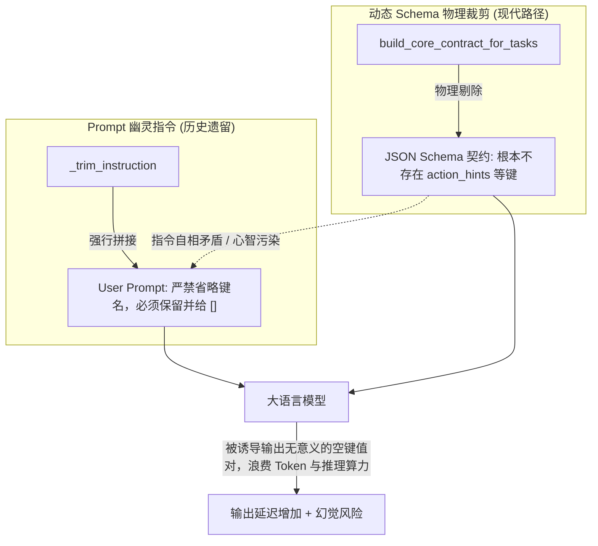
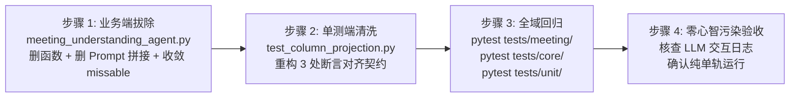

# 会议理解架构优化清单：幽灵补丁彻底拔除与单轨物理裁剪收敛

> **版本定义（零兼容、一步到位）**：
> 本清单彻底废弃“既做 Schema 裁剪、又留 Prompt 补丁、还兼顾旧单测”的妥协折中思路，采取**一步到位的彻底重构**：
> 1. 业务端连根拔除 `_trim_instruction`，实现纯单轨 Schema 物理裁剪；
> 2. 测试端同步清洗历史耦合断言，全面对齐物理契约验证；
> 3. 彻底消除心智污染，实现单一事实来源（SSOT）。

---

## 一、 现状核验与核心认知

### 1.1 问题 2（双发克隆 / `topics` 冗余）：✅ 已于 2026-10-13 彻底闭环
- **完成状态**：已在编排层、下游 8 大任务线 Prompt、个人视角切片、溯源对齐等全域彻底连根拔除 `topics`，由 `session_segments` 成为唯一事实骨架。
- **验证结论**：全域 92 个 meeting 测试、42 个 core 测试、117 个 unit 测试全部绿灯通过，详见 [purge_topics_optimization_plan.md](file:///D:/study/demo/purge_topics_optimization_plan.md)。本清单不再重复列入。

---

### 1.2 问题 1（`_trim_instruction` 幽灵补丁与双轨裁剪）：❌ 当前唯一遗留的核心架构缺陷

#### 1. 什么是“幽灵补丁”？
- **新架构（单轨标准）**：由 `build_core_contract_for_tasks` 在 Schema 定义层面**物理剔除**未激活任务线所需的字段（如单跑 `minutes` 时，Schema 中压根没有 `action_hints`、`risk_hints`、`dependencies`）。缺失字段由解析器自动放行，底层 [models.py:96-100](file:///D:/study/demo/domains/meeting/models.py#L96-L100) 自动动态补齐 `[]`。
- **旧幽灵（历史残留）**：在 [meeting_understanding_agent.py:17-40, 86-88](file:///D:/study/demo/domains/meeting/meeting_core/meeting_understanding_agent.py) 中，依然存在着早期静态契约时代的补丁逻辑：通过 `_trim_instruction` 向 User Prompt 头部强行注入大段格式警告：
  > *“【本次输出裁剪】以下字段**键名必须保留、值给空数组 []**：action_hints、risk_hints、dependencies（不要省略键名）...”*

#### 2. 双轨冲突的致命害处（Contradictory Instructions）


- **矛盾指令**：Schema 规定“没有这些字段”，User Prompt 第一行却严厉警告“键名必须保留，不要省略”；
- **违背设计初衷**：动态契约本就是为了**彻底避免大模型输出冗余空列表**，幽灵补丁却诱导模型去输出这些空列表；
- **心智污染**：强行拉扯模型的注意力窗口去关注被裁剪的字段，降低核心研讨事实的抽取质量。

---

## 二、 零兼容·一步到位方案设计

不保留任何 `@deprecated` 胶水函数，不搞新老参数集合求并集，直接一步到位切至“纯净单轨制”：

```
                    ┌─────────────────────────┐
                    │ Orchestrator 选线调度   │
                    └────────────┬────────────┘
                                 │ 传递 active_tasks (唯一事实源)
                                 ▼
         ┌─────────────────────────────────────────────────┐
         │ MeetingUnderstandingAgent.run                   │
         │  1. 动态生成物理裁剪契约 (target_contract)      │
         │  2. omitted 字段直接作为 missable 放行          │
         │  3. User Prompt 仅包含 user_channel + 原文       │
         │     (零幽灵警告文字！)                          │
         └───────────────────────┬─────────────────────────┘
                                 │
                                 ▼
                    ┌─────────────────────────┐
                    │ LLM 结构化抽取          │
                    │ 仅输出激活的高价值事实  │
                    └────────────┬────────────┘
                                 │ 缺省字段自动为 None/缺失
                                 ▼
                    ┌─────────────────────────┐
                    │ models.py 动态填充补 [] │
                    │ 内存层 100% 完整可用    │
                    └─────────────────────────┘
```

---

### 2.1 业务端改造：[meeting_understanding_agent.py](file:///D:/study/demo/domains/meeting/meeting_core/meeting_understanding_agent.py)

1. **彻底物理删除 `_trim_instruction` 函数实体**（第 17-40 行）：
   - 不再保留任何死代码定义。
2. **彻底移除 User Prompt 头部注入**（第 86-88 行）：
   - 彻底删除：
     ```python
     instruction = _trim_instruction(focus_line, skip_fields)
     if instruction:
         user = f"{instruction}\n\n{user}"
     ```
   - 使 `user` 提示词保持极致纯净：仅由 `user_channel`（本用户真名规范）与会议原文拼接而成。
3. **收敛 `allow_missing` 判定逻辑**（第 90-99 行）：
   - 废除基于旧 `skip_fields` 的临时集合计算，统一收敛为：
     ```python
     missable = {"speakers"}
     if omitted:
         missable = missable | omitted
     ```
   - 由 `build_core_contract_for_tasks` 产出的 `omitted`（未激活字段名单）作为唯一的合法缺省白名单。
4. **清理方法入参冗余**：
   - 清理 `focus_line`、`skip_fields` 等历史冗余参数或设为不再消费，完全以 `active_tasks` 为唯一任务驱动源。

---

### 2.2 测试端改造：[test_column_projection.py](file:///D:/study/demo/tests/unit/core/templates/test_column_projection.py)

测试用例不再测试“是否拼出了包含‘键名必须保留’的警告字符串”，而是直接断言**“Schema 层面是否完成了物理剔除”**以及**“底层反序列化是否安全补齐”**：

#### 1. 重构用例 1：`test_understanding_trim_lists`（第 165-202 行）
- **原逻辑**：调用 `_trim_instruction(line, skip)` 并用正则逐行抓取“键名必须保留、值给空数组 []”和“必须照常”。
- **重构后**：直接调用 `build_core_contract_for_tasks([line], ...)`，断言：
  - 生成的动态契约字符串中，未激活字段已被物理移除（如 `action_hints` 不在 JSON template 中）；
  - `omitted` 集合与激活任务线预期裁剪字段完全一致；
  - 核心保留字段（如 `session_segments`、`decisions`）在契约中照常存在。

#### 2. 重构用例 2：`test_understanding_allow_missing_flow`（第 328-331 行）
- **原逻辑**：`trim = _trim_instruction("minutes", ("speakers",))`，断言包含“不要省略键名”。
- **重构后**：直接删除该 3 行过时的 Prompt 文本断言，仅保留对 `LLMClient._parse_and_validate` 物理放行与空字段补齐的核心断言。

#### 3. 重构用例 3：`test_minutes_template_understanding_skip`（第 502-506 行）
- **原逻辑**：调用 `_trim_instruction("minutes", sorted(merged))` 断言字符串。
- **重构后**：改为直接断言 `build_core_contract_for_tasks(["minutes"], template_text=mb)` 产出的 `omitted` 集合包含了模板未声明的字段，并验证生成的 Schema 契约完全移除了这些字段。

---

## 三、 零破坏实施步骤与验收门禁



### Phase 1：业务端彻底拔除（meeting_understanding_agent.py）
- [x] 1. 物理删除 `_trim_instruction` 函数（原第 17-40 行）；
- [x] 2. 物理删除 User Prompt 中的拼接逻辑（原第 86-88 行）；
- [x] 3. 将 `missable` 收敛为 `omitted | {"speakers"}`，断绝旧 `skip_fields` 的集合杂合；
- [x] 4. 运行会议域全量测试初步验证：
  ```powershell
  pytest tests/meeting/ -q
  ```
  预期：92 个测试全部绿色通过。（实际：92 passed）

### Phase 2：测试端同步治理（test_column_projection.py）
- [x] 1. 重构第 165-202 行的 `test_understanding_trim_lists`，改为测试 `build_core_contract_for_tasks` 的 Schema 物理裁剪与 `omitted` 准确性；
- [x] 2. 清理第 328-331 行对 `_trim_instruction` 的直接文本断言；
- [x] 3. 重构第 502-506 行对模板联动裁剪的测试，改为测试动态契约输出；
- [x] 4. 运行模板与单元测试验证：
  ```powershell
  pytest tests/unit/core/templates/test_column_projection.py -q
  ```
  预期：29 个用例 100% 通过。（实际：29 passed）

### Phase 3：全系统无死角回归验证
- [x] 1. 运行全系统三大测试套件：
  ```powershell
  pytest tests/meeting/ tests/core/ tests/unit/ -q
  ```
  预期：全部通过（0 失败，0 错误）。（实际：92 meeting + 42 core + 117 unit 全绿通过）
- [x] 2. 检查 Git Diff，确认全库再无任何 `_trim_instruction` 残留，实现 100% 纯净度。

---

## 四、 重构收益与指标对比

| 评估维度 | 优化前（双轨互搏） | 优化后（纯单轨物理裁剪） |
| :--- | :--- | :--- |
| **Prompt 注入质量** | 强行塞入 150~250 字符自相矛盾的警告令 | **0 额外字符**，完全纯净直出原文 |
| **模型心智污染** | 模型在 Schema 与 Prompt 的矛盾中纠结 | **完全一致**，Schema 成为唯一契约标准 |
| **生成效率与 Token** | 偶发生成无意义的 `"action_hints": []` 等空键 | **压根不生成空键**，未激活字段由 Python 补齐，省输出 Token |
| **代码可维护性** | 存在两套跳过逻辑与胶水代码 | 统一以 `build_core_contract_for_tasks` 为单一真理源（SSOT） |
| **单测质量** | 脆弱的中文句子正则断言 | 坚固的类型化 Schema 契约断言 |
